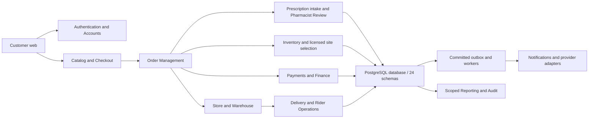

# Module boundaries and command ownership

**Architecture: Proposed modular monolith, retaining the selected Next.js/NestJS/PostgreSQL/Redis/BullMQ/private S3 stack.** The directory reorganization does not create independent deployable microservices. Boundary assignments remain subject to D-001/D-024; database objects are validated independently from product approval.

## Business domains and surfaces

| Stable module | Canonical blueprint | Accountable role proposed | Boundary |
| --- | --- | --- | --- |
| Authentication_Access | [Authentication](../03-Modules/Authentication_Access/README.md) | Security / Identity | Domain command/policy boundary; exact table rights per operation |
| Customer_Accounts | [Customer Accounts](../03-Modules/Customer_Accounts/README.md) | Customer platform | Domain command/policy boundary; exact table rights per operation |
| Product_Catalog | [Product Catalog](../03-Modules/Product_Catalog/README.md) | Catalog / Merchandising | Domain command/policy boundary; exact table rights per operation |
| Cart_Checkout | [Cart Checkout](../03-Modules/Cart_Checkout/README.md) | Commerce / Checkout | Domain command/policy boundary; exact table rights per operation |
| Prescription_Upload | [Prescription Management](../03-Modules/Prescription_Upload/README.md) | Prescription intake | Domain command/policy boundary; exact table rights per operation |
| Pharmacist_Review | [Pharmacist Review](../03-Modules/Pharmacist_Review/README.md) | Pharmacy clinical lead | Domain command/policy boundary; exact table rights per operation |
| Customer_Orders | [Customer Orders](../03-Modules/Customer_Orders/README.md) | Customer commerce surface | Client/projection facade; delegates authoritative writes |
| Order_Operations | [Order Management](../03-Modules/Order_Operations/README.md) | Order operations | Domain command/policy boundary; exact table rights per operation |
| Inventory | [Inventory](../03-Modules/Inventory/README.md) | Inventory control | Domain command/policy boundary; exact table rights per operation |
| Store_Operations | [Store Operations](../03-Modules/Store_Operations/README.md) | Store fulfillment | Domain command/policy boundary; exact table rights per operation |
| Warehouse | [Warehouse](../03-Modules/Warehouse/README.md) | Warehouse / Procurement | Domain command/policy boundary; exact table rights per operation |
| Finance_Payments | [Payments](../03-Modules/Finance_Payments/README.md) | Finance / Payments | Domain command/policy boundary; exact table rights per operation |
| Delivery_Operations | [Delivery](../03-Modules/Delivery_Operations/README.md) | Delivery operations | Domain command/policy boundary; exact table rights per operation |
| Rider_App | [Rider Operations](../03-Modules/Rider_App/README.md) | Rider operations / mobile client | Client/projection facade; delegates authoritative writes |
| Notifications | [Notifications](../03-Modules/Notifications/README.md) | Communications / Platform | Domain command/policy boundary; exact table rights per operation |
| Admin_CMS | [Admin](../03-Modules/Admin_CMS/README.md) | Administration / Operations | Domain command/policy boundary; exact table rights per operation |
| Reporting | [Reporting](../03-Modules/Reporting/README.md) | Reporting / Finance analytics | Domain command/policy boundary; exact table rights per operation |
| Audit | [Audit](../03-Modules/Audit/README.md) | Security / Audit platform | Domain command/policy boundary; exact table rights per operation |

## Database ownership and transactions

[Ownership-and-Scope.json](../04-Database/Ownership-and-Scope.json) assigns every one of the 268 tables a proposed domain owner, shared infrastructure owner or explicit future-owner decision. Domain write owners enforce invariants; HTTP surface ownership and SQL access alone do not grant writes. Customer Orders delegates to Order Management, Delivery and Payments; Rider Operations is an assigned-task client. Authentication owns OTP execution even though the historical customer OTP contracts stay on the Customer Accounts surface.

Within one process/database, orchestration calls the responsible module command with the existing transaction context when atomicity is required. Do not independently commit Inventory, clinical or money rows inside another owner's transaction. Stable command DTOs and return results are internal contracts; an internal HTTP route does not imply a microservice. No module obtains unrestricted shared ORM writes.

Orders, stock, clinical approval, payment evidence and delivery remain separate facts. A coordinator composes progress; it cannot mark another domain's fact true. Aggregate changes, versions, audit and outbox commit together. External side effects use outbox/inbox, idempotency and reconciliation. Payment timeouts remain uncertain; neither retries nor compensation fabricate money or stock.

## Shared platform and future domains

Private file sessions/scan/grants, idempotency, audit/outbox/inbox, jobs and provider adapters are engineering capabilities within the modular application/worker deployment. They do not grant clinical access or overwrite domain truth. Only three RLS policies are currently installed; service authorization must protect every other resource as well.

Appointment, diagnostics, insurance, membership, support, risk and marketplace objects are retained. Their existence does not approve launch APIs or a new service. D-027 requires Product and the applicable domain lead to assign ownership and phase before implementation. [Capability scope](../01-Project/Capability-Scope.md) distinguishes inherited requirements and proposals.

## Cross-module contract evidence

[Fourteen workflows](../06-Workflows/README.md) specify orchestration and recovery. [API matrix](../05-APIs/API-Database-Feature-Matrix.md) covers every route and exact table dependencies; [feature delivery trace](../09-References/Feature-Delivery-Traceability.md) connects all 110 requirements to workflows, designed tests and stable tasks. Detailed auth, allowed transitions, idempotency and recovery remain endpoint-specific. Documentation completeness, approval and implementation are independent states.

## Shared Identity and scoped workspace boundary

Authentication_Access is the sole proposed credential/session/grant command owner. Customer, Staff/Admin, Pharmacist and Rider panels consume one identity and verified workspace projection; Customer Accounts owns onboarding/profile/consent and Admin delegates Identity administration. [Unified design](../03-Modules/Authentication_Access/Unified-Identity-Architecture.md) defines stronger-workspace proof, assignment scope, live revocation and the distinction between scoped offboarding and globally authorized identity suspension. PostgreSQL runtime capabilities remain separate from business roles.
