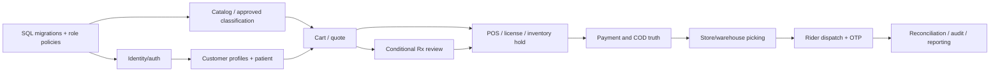

# Module dependencies

## Planning dependency graph

The graph represents prerequisite domain evidence, not a mandatory serial sprint schedule. Catalog and identity tasks can run in parallel after SQL conventions. Private Rx storage and payment adapter setup can proceed in parallel while business rules are being signed off, but cannot be enabled before the corresponding safety/owner gates are approved.

Basic warehouse transfers are needed in the current operational flow but Phase 1 vs Phase 2 ownership remains D-002. Hosted PG15, integration credentials and production content are external dependencies and can block release despite completed coding. See Roadmap.
