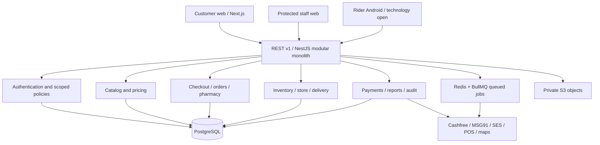

# System architecture (HLD)

[Business journey](../00-Business-Guide/Pharmville-Complete-Business-Flow.md) · [command/data ownership](../07-Engineering/State-and-Recovery-Contracts.md) · [module designs](../03-Modules/README.md)

## Master High-Level Design (HLD)

**Proposed technology direction (D-001/D-014):** multi-repository, modular-monolith NestJS API, Next.js/React/TypeScript web clients, PostgreSQL, Redis/BullMQ, S3, AWS Mumbai, Docker, Nginx and GitHub Actions. These are proposed design choices, not evidence a production app exists. The Python/SQLAlchemy repository is a parallel schema verification/deployment companion; its Alembic migrations must not run.

The database remains source of truth for money, stock, clinical decisions and state history. Redis is a cache/worker mechanism, not a durable clinical or financial ledger. Integration calls must be signed or independently authorized and reconciled. No service should receive unconstrained SQL access because all modules share a database.

**Failure-domain choice:** begin with a modular monolith to simplify transactions and releases. Split services only after measured operational or team-domain pressure. Public API routes must enforce actor, patient and location scope; PostgreSQL additionally enforces FKs, checks, triggers, and restricted capability roles. Outbox events are proposed for post-commit notifications and eventual delivery.

**Critical architecture risks:** stale POS stock, unapproved production pharmacy licenses, webhook ambiguity, money/stock concurrency, unapproved retention and incomplete external provider contracts. Related Module dependencies, Cross-module order flow, Database, and Decisions.

## Customer, staff, rider and database platform boundaries

Customer Web is mobile-first Next.js and displays browse/search, dependent patient selection, Rx upload and a safe order timeline. Staff Web is a separate protected role- and location-scoped surface for product admin, pharmacist workbench, stock, store/warehouse, rider assignment, finance, reports and audit. Riders use an Android workflow in later Phase 1 decisions, but the mobile framework/distribution rules remain open. Native customer apps are future-phase scope.

All clients call REST v1 through a controlled API ingress. Session refresh and OTP login are centralized. A client supplies public UUIDs as resource locators, but backend services derive current user, location and patient scope independently. Business rules are server-side; a hidden UI control is not authorization.

Database deploys independently from NestJS and Next.js using versioned SQL runners in the database repository. Python/SQLAlchemy model tooling validates database parity and is not permission to introduce a second migration authority. Staff operational and financial actions require auditable immutable business events and separate capability grants.

**Delivery units:** independent repositories are a proposed preference; agree API version, shared schema migration ownership and coordinated release contracts to avoid drift. See Environments, API and Source conflicts.

## System components and responsibility boundaries

| Component | Owns | Should not do |
| --- | --- | --- |
| Customer web | Client-side navigation, forms, order status projections | Infer pharmacy eligibility or payment success |
| Staff/admin web | Scopes and queues by staff role, approvals, CMS | Call internal SQL functions or bypass clinic/payment rules |
| Rider app | Task/shift interaction, GPS and delivery evidence | Decide that money is settled or P dispensing approved |
| NestJS domain modules | All validated business commands and transactional orchestration | Use one giant controller or share unrestricted ORM models |
| PostgreSQL | Authoritative relations, transaction guards, history and scoped privileges | Replace required external provider evidence |
| Redis/BullMQ | Ephemeral cache, queued safe retries and timed jobs | Be source of account balance, stock or clinical truth |
| S3 | Private Rx/media/export objects, short-lived scoped access | Serve unreviewed document URLs publicly |
| Adapter processes | Cashfree, MSG91/SES/FCM, Maps/OSRM, POS, GPS | Trust unsigned callbacks or make blind money retries |

**Cross-cutting services:** authentication, permission policies, audit records, configuration/controlled masters, telemetry, notification templates and versioned events. Source HLDs are proposals. The modules each have an actual design folder under LLD.

## Module dependencies and interaction matrix

A domain schema can be referenced by multiple modules. The table below denotes **potential read/collaboration**, not blanket permission to write another module's tables. Clinical, money, stock and identity own separate evidence; order orchestration consumes their approved results.

| Active module | Potential collaborator modules (shared schemas) | Core business gate |
| --- | --- | --- |
| Customer_Accounts | Admin_CMS, Authentication_Access, Cart_Checkout, Pharmacist_Review, Prescription_Upload, Rider_App | An address is not serviceable merely because its PIN is syntactically valid; family profiles must be access controlled |
| Product_Catalog | Cart_Checkout, Inventory | Unknown or unsafe class blocks ordering; price and stock are separate sources of truth |
| Cart_Checkout | Customer_Accounts, Customer_Orders, Finance_Payments, Inventory, Order_Operations, Pharmacist_Review, Prescription_Upload, Product_Catalog | Never charge an unapproved revision; distinct idempotency key per intent |
| Prescription_Upload | Admin_CMS, Audit, Authentication_Access, Cart_Checkout, Customer_Accounts, Notifications, Pharmacist_Review, Reporting | M/O never requires Rx; unsafe or inaccessible file cannot be used as evidence |
| Customer_Orders | Cart_Checkout, Delivery_Operations, Finance_Payments, Order_Operations, Pharmacist_Review, Reporting, Rider_App, Store_Operations | Customer status is projection of clinical/payment/inventory/delivery facts |
| Admin_CMS | Audit, Authentication_Access, Customer_Accounts, Delivery_Operations, Notifications, Order_Operations, Prescription_Upload, Reporting | No self-granting privileges; content publish and configuration changes audited |
| Order_Operations | Admin_CMS, Authentication_Access, Cart_Checkout, Customer_Orders, Delivery_Operations, Finance_Payments, Inventory, Pharmacist_Review | Never split one order across sites without explicit approved design |
| Store_Operations | Cart_Checkout, Customer_Orders, Delivery_Operations, Inventory, Order_Operations, Warehouse | Recheck P decisions, license, active inventory observation, exact reservation before packing |
| Inventory | Cart_Checkout, Order_Operations, Product_Catalog, Store_Operations, Warehouse | Never derive orderable stock from stale or unknown upstream observations |
| Warehouse | Cart_Checkout, Customer_Orders, Delivery_Operations, Inventory, Order_Operations, Store_Operations | Phase 1 minimum and advanced Phase 2 split disputed; license and scope apply |
| Pharmacist_Review | Audit, Cart_Checkout, Customer_Accounts, Customer_Orders, Finance_Payments, Order_Operations, Prescription_Upload, Reporting | Only currently approved P lines for accepted order revision may be dispatched |
| Delivery_Operations | Admin_CMS, Authentication_Access, Customer_Orders, Order_Operations, Rider_App, Store_Operations, Warehouse | Proof of delivery and cash collection are different business facts |
| Rider_App | Admin_CMS, Authentication_Access, Customer_Accounts, Customer_Orders, Delivery_Operations, Notifications | Access limited to assigned deliveries; protect location traces and OTP |
| Finance_Payments | Cart_Checkout, Customer_Orders, Order_Operations, Pharmacist_Review, Reporting | Unknown provider result remains pending; refunds and credits are idempotent |
| Reporting | Admin_CMS, Audit, Authentication_Access, Cart_Checkout, Customer_Orders, Finance_Payments, Notifications, Order_Operations | Reports cannot bypass protected clinical/finance or location permissions |
| Audit | Admin_CMS, Authentication_Access, Notifications, Pharmacist_Review, Prescription_Upload, Reporting | No application role may silently modify historical audit facts |
| Authentication_Access | Admin_CMS, Audit, Customer_Accounts, Delivery_Operations, Notifications, Order_Operations, Prescription_Upload, Reporting | Never trust client-provided actor IDs; runtime DB users are least privilege |
| Notifications | Admin_CMS, Audit, Authentication_Access, Prescription_Upload, Reporting, Rider_App | Never include Rx/image/diagnosis in notification body; retry safely |

Use synchronous in-process service APIs for transactional reads and validated commands. Where eventual processing is acceptable, persist a local outbox event in the same transaction and handle it idempotently. A new microservice is not justified by a domain folder alone. The manual next-step dependency ordering is in Implementation_Order.

## Security trust boundaries

Trust boundaries exist between public customer browser, protected staff web, rider Android app, backend API, DB capability roles, private S3, payment/OTP services and workers. Each request is untrusted until session, per-object scope, version and business policy are checked by a backend service.

The database final report records four NOLOGIN capability roles and RLS on selected order and stock tables, plus a `PUBLIC EXECUTE` default-denial change in V0029. These tests are **not** authorization coverage for every table; unsupported polymorphic access stays denied. Never use migration-owner DB credentials in an API runtime and never accept browser-supplied SQL or `actor_user_id` as trusted context.

Encryption of RDS/S3/ElastiCache with KMS, Secrets Manager, TLS, staff MFA, access limits, scan/authorization of Rx uploads and report download re-checks are part of the selected/recommended design but require deployed evidence. Healthcare permissions and retention rules need specialist review before launch.

See Threat Model, Auth flows and Audit.

## PostgreSQL architecture and identity strategy

**Supplied database source:** the user-selected `healthcare_db/postgresql/migrations/` history is the documentation baseline; historical Alembic execution is frozen. Its recorded local PostgreSQL 18 evidence describes 24 schemas, 266 tables, 4,438 columns, 1,461 FKs, 1,204 indexes, 56 functions, 879 triggers and 3 RLS policies. PostgreSQL 15 hosted validation and production authorization remain unproven.

**Primary keys:** `identity.users.id` is UUID; 257 older entity tables use BIGINT `internal_id` as their primary key with original immutable UNIQUE public UUID `id`; eight newer tables use BIGINT `id` identity PK. Key crosswalks and paired numeric FKs preserve existing public contracts. Internal numeric IDs are join keys, not access tokens; service authorization always checks actor, owner, scope and state.

**Deployment rule:** write new forward-only SQL versions, rehearse on an isolated copy, run the repo's verified `status/migrate/verify` runner with explicitly approved database URL, compare schema/ORM/catalog and release only after approvals. Never stamp, reset or run Alembic side by side. Schema migration and application rollout must use compatibility-aware expand/backfill/contract transitions.

Full existing table/field/constraint inventories are generated under Database design from the supplied catalog. [Migration evidence](../04-Database/Migrations.md) records the source verification and historical acceptance report. The source reference is resolved for documentation; target deployment and production approval remain separate checks.

## Growth without premature distributed systems

The proposed architecture is a modular monolith, so maintain cohesive domain ownership before deciding to split services. Scale stateless NestJS/Next.js containers, isolate queue workers from interactive traffic, and use PostgreSQL query plans and resource limits before adding caches. Do not add a distributed bus or Kubernetes simply because many domains exist.

Primary scaling risks: hot inventory lot rows during last-unit holds, checkout peak concurrency, large order/history/report scans, POS reconciliation lag, rider GPS write volume, and Rx/private-file access throughput. Use measured scoped indexes and representative workloads. The database repo records a synthetic 19-query benchmark and 50,000-row key experiment, but neither proves production capacity or a business SLA.

Redis may cache published catalogue summaries or rate limits, never authoritative payment/stock/Rx approval. Add asynchronous jobs for provider callbacks, notifications and large reports with durability/replay controls. Keep partitioning, pooling, replicas and service extraction as evidence-based future choices. Track latency, connection pool saturation, inventory conflicts, webhook delay and queue backlog. See Performance testing.

## Reliability and disaster recovery design

Prioritize *correctness under partial failure* over optimistic progress. A customer closing the browser cannot duplicate an order; a Cashfree timeout cannot become “payment succeeded”; a stale Techsmith stock feed cannot authorize another reservation; a rider GPS outage cannot mark parcel delivered; a rejected P line cannot pass packing gates.

Use idempotency on commands, reconciliation for external provider uncertainty, database transaction/row-version guards for competing writers, and outbox publication for committed effects. Bounded retries and escalation queues should distinguish transient provider failure from irrecoverable authorization/clinical denial. Do not retry a financial write blindly after network timeout.

The checklist proposes daily backups with 30-day retention, enabled PITR, target RPO 15–30 min and RTO 1–2 h. These values are owner decisions in documentation, not measured achievements. Verify an actual restore including migration ledger, runtime ACLs/RLS, encryption and object-store file access; do not announce availability targets met without evidence.

See Incidents and Reconciliation.
