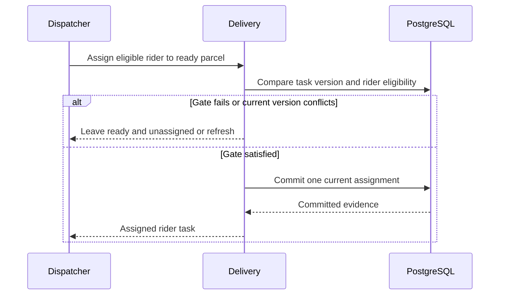
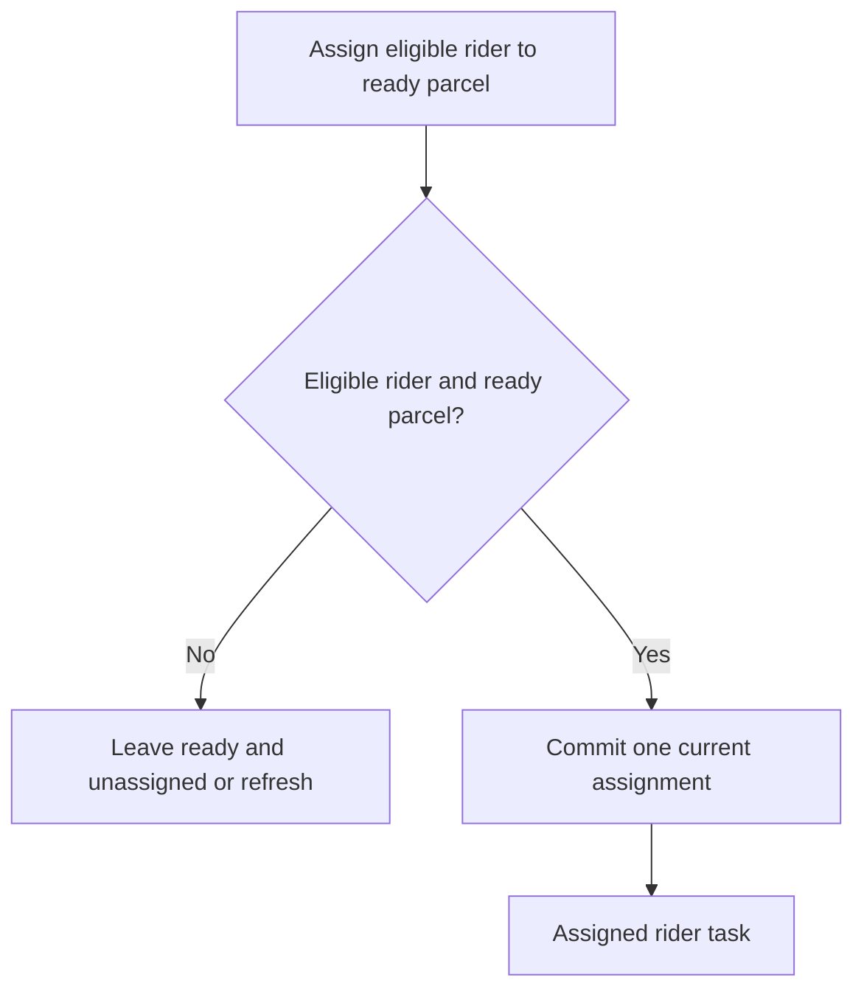

# Delivery Operations LLD

<!-- ERD-NAV-START -->

## Database relationships

[`logistics` ERD](../../04-Database/ER-Diagrams/12-logistics.md) · [`organization` ERD](../../04-Database/ER-Diagrams/16-organization.md) · [FK catalog](../../04-Database/ER-Diagrams/Relationship-Catalog.md)

These diagrams show recorded PostgreSQL constraints, not approved module write ownership or authorization. See [migration evidence](../../04-Database/Migrations.md) for the supplied source and deployment verification limits.

<!-- ERD-NAV-END -->

[Business flow](../../00-Business-Guide/Delivery-and-Rider-App.md) · [feature register](../../09-References/Coverage-and-Traceability.md) · [ownership and recovery](../../07-Engineering/State-and-Recovery-Contracts.md)

## Delivery planning, route and proof — implementation acceptance

**Proposed conditions for engineering handoff; never imply QA passed.**

## Draft features
- **DLV-01 / REQ-074:** Live map of riders (available, on delivery, offline) and orders ready for pickup (Must (draft)).
- **DLV-02 / REQ-075:** Suggest the nearest available rider; staff confirm or choose another (Must (draft)).
- **DLV-03 / REQ-076:** Failed-delivery queue: reattempt, reschedule or return to store (Must (draft)).
- **DLV-04 / REQ-077:** COD handover: cash collected vs deposited per rider per day (Must (draft)).
- **DLV-05 / REQ-078:** Rider management: onboard, assign location, shifts (Must (draft)).

## Required release checks
- Authorised happy path persists exactly the intended state.
- Invalid, cross-account and cross-location requests leave authoritative rows unchanged.
- Concurrent duplicate requests do not create duplicate money, stock or order effects.
- File, prescription and patient data are not exposed to unauthorised roles.
- Recoverable provider failure exposes a pending/retryable state; never claims success.
- Audit/trace data contains public references, not credentials or sensitive document contents.

Module test scenarios

## Delivery Management — HTTP API responsibilities

All routes below are **Proposed REST v1 contracts**. The database repository does not implement them. Public UUIDs identify resources; staff scope and patient/order ownership are checked at each handler, not inferred from URL paths.

- API-064 GET /v1/staff/delivery/tasks — Track scoped delivery queue
- API-065 POST /v1/staff/delivery/tasks/{task_id}/assign — Assign authorized rider
- API-066 POST /v1/staff/delivery/tasks/{task_id}/resolution — Resolve failed attempt
- API-067 GET /v1/staff/delivery/cod-handover — Review COD by rider
- API-068 POST /v1/staff/delivery/riders — Onboard rider with shift/location

## Cross-cutting request contract

Writes require validated body, stable intent key, expected current version when appropriate, auditable actor identity and an explicit outcome. Reads use safe pagination and permission-filtered fields. `401` indicates no valid session; `403/404` denied scope; `409` conflict; `422` business validation; `503` unknown upstream outcome. Read [api conventions](../../05-APIs/README.md) before implementing the endpoint.

**Business gate:** A rider assignment must be scope-checked, reschedulable on failure and linked to parcel evidence. COD handover requires separate daily reconciliation, regardless of delivery-completed status. For actual response fields, see the linked illustrative contract and approve a typed OpenAPI schema before implementation.

## Delivery Management — business logic and invariants

**Rule origin:** the documented draft requirements and database migration guards. Distinguish a **confirmed database guard** from a **proposed API orchestration** and **open numeric policy**.

## Core procedure

1. Authenticate the actor and resolve server-owned tenant/location/patient permission.
2. Re-read the relevant product, order, document, stock or ledger state from the owning tables.
3. Reject incomplete or stale input; validate the latest accepted revision and current classification where relevant.
4. Apply the module invariant: **A rider assignment must be scope-checked, reschedulable on failure and linked to parcel evidence. COD handover requires separate daily reconciliation, regardless of delivery-completed status.**
5. In a transaction, persist the minimal authoritative rows, version and audit outcome; publish notifications after commit.
6. Return a scoped read model; expose only approved information to the caller.

## Features implemented by this rule set

`DLV-01`, `DLV-02`, `DLV-03`, `DLV-04`, `DLV-05` (see full requirement descriptions).

## Pseudocode — command boundary

```text
context := verify_session_and_resource_scope(request)
current := load_owned_aggregate_for_update(context, resource_id)
assert expected_version_matches(current)
assert domain_policy_allows_action(current, request)
result := transition_atomically(current, validated_request)
write_audit_and_outbox_in_same_transaction(result)
return filter_for_actor(result, context)
```

Unknown business thresholds (expiry freshness, COD cap, review deadlines, refund limits) must be policy data agreed by business owners, never hard-coded assumptions. On conflict, expose an actionable `409` and reload state. On an external provider timeout, keep the result pending rather than guessing success.

## Delivery Management — internal components

**Status:** Proposed NestJS modular-monolith design informed by the decided stack in the master decisions checklist. This is not code already implemented in the SQLAlchemy repository.

| Component | Responsibility | Failure boundary |
| --- | --- | --- |
| HTTP controller / DTO validator | Accept typed requests for delivery management, reject malformed payloads | `400/422`, no database change |
| Use-case service | Execute: Assign rider; manage failed attempts; reconcile COD handoff | Explicit domain errors, no invented outcomes |
| Policy/authorization service | Enforce user role, object ownership, business eligibility | `403/404` and audit denied attempt |
| Domain repository | Execute scoped PostgreSQL reads/writes within a transaction | Retry only on safe concurrency errors |
| Outbox / integration adapter | Publish committed changes toward other modules or third parties | Durable retry and dead-letter review if adopted |

### Boundaries

A rider assignment must be scope-checked, reschedulable on failure and linked to parcel evidence. COD handover requires separate daily reconciliation, regardless of delivery-completed status. Public controllers must not call database workflow functions with arbitrary SQL and must not accept a caller-supplied `actor_user_id`. Network IO belongs outside long-lived locks. Modules should depend on domain interfaces, not on each other's ORM entities. Consult Dependencies and [architecture overview](../../02-Architecture/System-HLD.md).

## Delivery Management — existing database usage

**Confirmed database:** 24 PostgreSQL schemas; SQL migration authority the checked-in SQL migration history. The tables below exist, but **a schema-domain association does not automatically mean this module owns every row or has write rights**. The database repository is not an HTTP service.

- `logistics.delivery_assignments` — columns · contracts
- `logistics.delivery_attempts` — columns · contracts
- `logistics.delivery_failure_reasons` — columns · contracts
- `logistics.delivery_location_updates` — columns · contracts
- `logistics.delivery_otp_challenges` — columns · contracts
- `logistics.delivery_routes` — columns · contracts
- `logistics.delivery_slots` — columns · contracts
- `logistics.rider_shifts` — columns · contracts

## Ownership, transactions and change control

Proposed owning service: `Delivery_Operations`. Main read concerns: rider assignment, live fleet, delivery exceptions and cod handover. Writes must be restricted by the actual foreign keys, CHECKs, unique contracts, crosswalks, policy and trigger guards. Use one transaction per domain state transition, use an outbox for reliable cross-module publication, and make any external retry idempotent.

**Safety:** A rider assignment must be scope-checked, reschedulable on failure and linked to parcel evidence. COD handover requires separate daily reconciliation, regardless of delivery-completed status.

Internal ID strategy: `identity.users.id` is UUID; most other tables have BIGINT internal PK with original immutable UUID alias. Never cast UUID to BIGINT or expose DB internal IDs as authorization tokens. All schema changes require new forward-only SQL migration under the source repo and a fresh PG15/PG18 parity test. Related [migration strategy](../../04-Database/Migrations.md).

## Delivery Management — dependencies and ownership

**Underlying schemas:** `logistics`, `fulfillment`, `organization`. These schemas are shared data domains; shared reads are not automatic write rights. Candidate collaborator modules are inferred from overlapping schema use:

- Admin_CMS
- Authentication_Access
- Customer_Orders
- Order_Operations
- Rider_App
- Store_Operations
- Warehouse

## Communication rules

Use the owning service interface for business changes rather than making uncontrolled cross-module writes. In the chosen modular-monolith style, synchronous application calls can remain in-process. BullMQ/Redis jobs serve slow notifications and integrations after commit; they should not become the source of order, payment, stock or clinical truth. Build independent adapters for Cashfree, POS/Techsmith, MSG91 and driver APIs; failures must remain visible.

**Data-access contract:** A rider assignment must be scope-checked, reschedulable on failure and linked to parcel evidence. COD handover requires separate daily reconciliation, regardless of delivery-completed status.. Related: [module dependencies](../../02-Architecture/Module-Dependencies.md) and [database usage](../../04-Database/Module-Mapping.md).

## Delivery Management — domain objects and DTO boundaries

**Proposed objects, not new database tables.** A domain object is a service-level business concept; a DTO is a validated data transfer object (API input/output). Do not confuse them with the Python SQLAlchemy models used for schema verification.

| Proposed object | Source of truth / evidence | Rules |
| --- | --- | --- |
| `Delivery_OperationsCommand` | Authenticated HTTP request and expected version | Includes actor context, idempotency key and validated business input |
| `Delivery_OperationsAggregate` | Domain rows listed in Database Usage | Represents the current authoritative business facts |
| `Delivery_OperationsPolicy` | Approved master/role records and product rules | A rider assignment must be scope-checked, reschedulable on failure and linked to parcel evidence. COD handover requires separate daily reconciliation, regardless of delivery-completed status. |
| `Delivery_OperationsReadModel` | Role-filtered current state | Removes protected fields and translates internal statuses |
| `Delivery_OperationsEvent` | Committed state transition and audit ID | Events carry references and versions, not clinical documents |

**Existing representative tables:** `logistics.delivery_assignments`, `logistics.delivery_attempts`, `logistics.delivery_failure_reasons`, `logistics.delivery_location_updates`, `logistics.delivery_otp_challenges`, `logistics.delivery_routes`, `logistics.delivery_slots`, `logistics.rider_shifts`. Internal BIGINT primary keys are never used as authorization credentials, and original UUID public references must remain stable. Any DTO field not directly supported by a confirmed column must be labelled proposed until the API team approves the mapping. See [database usage](../../04-Database/Module-Mapping.md).

## Delivery Management — failure handling

**Primary rule:** A rider assignment must be scope-checked, reschedulable on failure and linked to parcel evidence. COD handover requires separate daily reconciliation, regardless of delivery-completed status.

- **Missing or invalid input:** respond with a field-specific problem code; do not leak sensitive data and do not write partial state.
- **Unauthorized object or location:** return `403` or privacy-safe `404`; record the attempted privileged action.
- **Duplicate submission:** return the persisted result when key + payload match; reject key reuse with different payload.
- **Stale/concurrent change:** database version/FK/CHECK guard must resolve a single winner; caller reloads latest projection.
- **Partial external failure:** leave the aggregate pending, never mark payment/stock/delivery success by assumption. Retry verified idempotent adapter calls; otherwise reconcile manually.
- **Safety or compliance policy unknown:** fail closed. Route staff to an exception queue and customer to a non-misleading status.

Use structured problem codes, request ID, retryability category and operator runbook reference. Sensitive Rx, financial tokens, OTPs and location traces must not be placed into logs. See [error responses](../../05-APIs/README.md#standard-problem-response-behavior) and [incident triage](../../07-Engineering/Release-and-Incident-Handling.md).

## Delivery planning, route and proof — proposed interfaces and DTOs

**Business context:** Order handoff to courier requires authorised assignment; failed attempts retain reason and evidence.

**Controller contract:** validate identity and scope before accepting a command; never expose internal BIGINT IDs. Typed inputs should carry allowed public identifiers, operation-specific fields, expected record version and a unique idempotency key on mutations.

**Use-case interface:** `execute(trustedContext, validatedRequest) -> acceptedResult | domainError`. This is pseudocode for a boundary, **not generated application code**.

**Repository interface:** require a database transaction handle, parameterised SQL/ORM queries, and a stored accepted transition. Return public UUIDs or approved opaque references only.

**Error DTO proposal:** `{"error":{"code":"STATE_CONFLICT","message":"Refresh the record and try again","request_id":"..."}}`. Do not expose SQL errors, provider secrets or prescription contents.

**Existing table candidates:** `logistics.shipments`, `logistics.delivery_assignments`, `logistics.delivery_attempts`, `logistics.delivery_slots`, `logistics.ndr_cases`.

**Per-operation request and response examples:** API contract index. No generic DTO in this document overrides module-specific validation.

## Delivery planning, route and proof — internal architecture

**Status: Proposed application design.** The database repo does not contain a NestJS HTTP implementation.

## Business behavior
Order handoff to courier requires authorised assignment; failed attempts retain reason and evidence.

## Components
| Component | Responsibility | Data affected | Failure outcome |
| --- | --- | --- | --- |
| `Delivery_OperationsController` (proposed) | Validate DTO and request context | Public API request only | 400/401/403 without partial mutation |
| `Delivery_OperationsUseCase` (proposed) | Enforce module business invariant | logistics.shipments, logistics.delivery_assignments, logistics.delivery_attempts | Domain status, do not guess provider truth |
| `Delivery_OperationsRepository` (proposed) | Scoped SQL transaction and concurrency guard | Exact migrated tables | Roll back on conflict or constraint error |
| `Delivery_OperationsIntegrationAdapter` (only when needed) | Map external IO and reconcile delivery | Outbox/inbox or verified provider record | Retries outside DB lock |

## Transaction and retry sequence

1. read packed shipment and destination consent.
2. choose serviceable delivery method.
3. assign authorised rider/carrier.
4. record handoff, attempts and proof state.
5. reconcile failed/non-delivery reasons.

## Existing tables (candidate responsibilities)
- logistics.shipments — candidate entity; verify the exact operation and field set in the implementation review.
- logistics.delivery_assignments — candidate entity; verify the exact operation and field set in the implementation review.
- logistics.delivery_attempts — candidate entity; verify the exact operation and field set in the implementation review.
- logistics.delivery_slots — candidate entity; verify the exact operation and field set in the implementation review.
- logistics.ndr_cases — candidate entity; verify the exact operation and field set in the implementation review.

## Related
HLD · States · Permissions

## Delivery planning, route and proof — observability

**Proposed runtime design:** Structured logs record correlation ID, module, operation, outcome code and elapsed time. Replace identifiers with approved pseudonymous references. No raw OTP, prescription text, secrets, payment credentials, addresses or GPS coordinates in logs.

**Candidate counters:** `delivery_operations_command_total{outcome}`, `delivery_operations_denied_total{reason}`, and `delivery_operations_provider_pending_total` when an external provider is involved. Names are proposed and require monitoring owner review.

**Actionable alerts:** persistent command rejection spikes, outbox backlog, stale integrations or reconciliation mismatches; thresholds are open questions, not fabricated service-level objectives.

Monitoring design

## Delivery Management — permission model

**Actors:** Delivery/Ops Manager. **Proposed service scope:** `staff_delivery`. Roles are application concepts; existing PostgreSQL NOLOGIN capability roles form a separate lower-level authorization layer.

| Operation class | Required entitlement | Enforcement |
| --- | --- | --- |
| Read own/scoped data | Authenticated identity + object or location ownership | Controller + service + database guard where provided |
| Create / edit | Explicit module action grant, approved master and domain status | Policy decision before transaction |
| Override / refund / pharmacist action | Specialized staff permission and documented approval reason | Distinct privilege, immutable audit evidence |
| Export / sensitive view | Purpose-limited role, retention and access logging | Recheck at download/stream time |

**Core constraint:** A rider assignment must be scope-checked, reschedulable on failure and linked to parcel evidence. COD handover requires separate daily reconciliation, regardless of delivery-completed status. A customer cannot infer another customer's resource existence. Do not connect app runtime through migration-owner credentials. Consult [roles and permissions](../../07-Engineering/Security.md).

## Delivery Management — functional requirements

**Source:** the documented draft requirements. **Status:** Draft requirements, not proof of final business acceptance. 🔴/🟡/🟢 priorities have been normalized as Must/Should/Could without changing their meaning.

| Feature | Priority in v0.1 | Statement | Dependency |
| --- | --- | --- | --- |
| `DLV-01` | Must (draft) | Live map of riders (available, on delivery, offline) and orders ready for pickup | Not stated |
| `DLV-02` | Must (draft) | Suggest the nearest available rider; staff confirm or choose another | Q19, rider availability rules |
| `DLV-03` | Must (draft) | Failed-delivery queue: reattempt, reschedule or return to store | Q27 |
| `DLV-04` | Must (draft) | COD handover: cash collected vs deposited per rider per day | COD workflow (Q12) |
| `DLV-05` | Must (draft) | Rider management: onboard, assign location, shifts | Rider list |

## Interactions and acceptance basis

The user performs: Assign rider; manage failed attempts; reconcile COD handoff. Server-side enforcement must preserve this invariant: **A rider assignment must be scope-checked, reschedulable on failure and linked to parcel evidence. COD handover requires separate daily reconciliation, regardless of delivery-completed status.**

A feature becomes implementation-ready only after its inputs (especially any dependency listed above), permissions, workflow outcome, API body and database transaction are resolved. Confirm business thresholds before coding: a field existing in SQL is not proof that its value was approved.

See requirement coverage and test IDs.

## Delivery planning, route and proof — request sequence

**Proposed design**, not a diagram of deployed services. Business-specific steps appear in Internal Architecture.



## Delivery Management — service design

**Proposed NestJS module:** `Delivery_OperationsModule` with a controller, application service, authorization policy, repository and adapters. The supplied database code is a schema/validation library; no running HTTP controller was found in Archive 2.

## Candidate service methods

- `API-064: track_scoped_delivery_queue(actor_context, validated_command, expected_version) -> Result`
- `API-065: assign_authorized_rider(actor_context, validated_command, expected_version) -> Result`
- `API-066: resolve_failed_attempt(actor_context, validated_command, expected_version) -> Result`
- `API-067: review_cod_by_rider(actor_context, validated_command, expected_version) -> Result`
- `API-068: onboard_rider_with_shift/location(actor_context, validated_command, expected_version) -> Result`

## Transaction and integration contract

For each mutation: authenticate actor, validate inputs, read affected rows with a lock/version check, verify policy, update the minimum relevant rows and immutable audit/outbox in one transaction. A remote gateway, storage or GPS call should be performed outside the locked transaction and reconciled on callback/timeout. Use PostgreSQL to reject invalid writes even if application validation is bypassed.

**Module invariant:** A rider assignment must be scope-checked, reschedulable on failure and linked to parcel evidence. COD handover requires separate daily reconciliation, regardless of delivery-completed status.

**Timeouts/retries:** configure per provider, use exponential backoff with caps for safe reads and idempotent messages; never blindly repeat charge/refund/cash state changes. A dead-letter queue is an optional BullMQ operating pattern because BullMQ/Redis are selected in the checklist, but exact job topology needs signoff. **Telemetry:** actor pseudonym, request ID, action, state transition latency, retries and failure category; redact protected clinical and payment contents. See [database usage](../../04-Database/Module-Mapping.md) and Monitoring.

## Delivery Management — state and transition policy

**Status:** State boundaries are derived from the unified order journey and existing SQL CHECK/trigger contracts; the following is a service design, not a claim that a single enum exists.



**Module-specific invariant:** A rider assignment must be scope-checked, reschedulable on failure and linked to parcel evidence. COD handover requires separate daily reconciliation, regardless of delivery-completed status.

Each transition must record the prior state, target state, reason where required, actor, accepted version and timestamp. A second command on the same state must either replay the prior idempotent result or fail with `409`. A failed external callback cannot roll an accepted state backward; reconcile with authoritative provider evidence. When an order changes, keep clinical, payment, inventory, fulfillment and delivery statuses separate, then derive one safe user-visible projection.

This flow shows command gates, not an entity enum. Legal entity transitions and recovery are specified in [state contracts](../../07-Engineering/State-and-Recovery-Contracts.md); the table catalog supplies actual stored values.

## Delivery Management — verification and acceptance

**Candidate test IDs** derived one-to-one from the v0.1 feature IDs. They are test-design work items, not claims that the tests have been implemented. Database-level tests reported in the source do not replace HTTP and browser tests.

| Stable test ID | Behavior | Expected result |
| --- | --- | --- |
| `TC-DLV-01-OK` | Live map of riders (available, on delivery, offline) and orders ready for pickup | Dispatch map distinguishes available/on-task/offline riders and ready parcels |
| `TC-DLV-01-DENY` | Rider telemetry stops | Last update/offline indicated; no fictitious live location; Dispatcher contacts rider and reviews assignment |
| `TC-DLV-02-OK` | Suggest the nearest available rider; staff confirm or choose another | Staff confirms one eligible rider assignment |
| `TC-DLV-02-DENY` | Two dispatchers assign the same ready task | Single current assignment; stale write conflicts; Dispatcher refreshes and communicates accepted task |
| `TC-DLV-03-OK` | Failed-delivery queue: reattempt, reschedule or return to store | Failure resolution records permitted reattempt/reschedule/return |
| `TC-DLV-03-DENY` | Resolution is submitted after reassignment | Stale resolution denied; parcel remains with current accountable task; Dispatch checks current assignment and reason |
| `TC-DLV-04-OK` | COD handover: cash collected vs deposited per rider per day | Cash view compares recorded collection and handover per rider/period |
| `TC-DLV-04-DENY` | Handover is less than collection | Unresolved cash difference remains, no forced clear; Finance/Operations investigates evidence with rider |
| `TC-DLV-05-OK` | Rider management: onboard, assign location, shifts | Onboarding and shifts bind rider to permitted location |
| `TC-DLV-05-DENY` | Off-duty or deactivated rider is assigned | Assignment refused without rewriting rider eligibility; Manager corrects approved shift/access |

## Cross-module contract tests

- Verify authenticated customer/staff/location ownership using actual restricted runtime roles.
- Verify concurrency and duplicate idempotency behavior against an isolated PostgreSQL database with authoritative migrations.
- Verify safe retry when callbacks or files arrive late or malformed.
- Verify audit and notification records are based on committed state and contain no confidential payloads.
- Verify this invariant: **A rider assignment must be scope-checked, reschedulable on failure and linked to parcel evidence. COD handover requires separate daily reconciliation, regardless of delivery-completed status.**

Coverage state: **Designed, not executed for the proposed application**. Link individual results to the associated test ID and requirement before go-live. Read [test strategy](../../07-Engineering/Testing.md).

## Delivery Management — validation checkpoints

| Boundary | Required validation | Rejection outcome |
| --- | --- | --- |
| Input | Required fields, type, size, allowed format and business master codes | `400/422`; no write |
| Actor | Session validity, role, location, customer/patient/parcel ownership | `401/403/404`; audit |
| Version | Accepted order revision or row version matches, if state-changing | `409`; fetch current state |
| Domain | A rider assignment must be scope-checked, reschedulable on failure and linked to parcel evidence. COD handover requires separate daily reconciliation, regardless of delivery-completed status. | Explicit blocked/pending/error status |
| Database | FK, PK, UNIQUE, CHECK, trigger and RLS outcome | Safe conflict/business error; rollback |
| Integration | Authenticated provider/callback, idempotency key and settled evidence | Keep pending; reconciliation task |

**Requirements:** `DLV-01`, `DLV-02`, `DLV-03`, `DLV-04`, `DLV-05`. Never trust browser-supplied patient, clinical decision, backend actor context, price or available quantity. Refer to Testing for negative tests.

## Delivery Management — operational workflows

**Entry points:** Assign rider; manage failed attempts; reconcile COD handoff. **User group:** Delivery/Ops Manager. The following source-defined order journey stages identify primary ownership; supporting modules also participate without necessarily owning the stage.

- S23 — Assign the rider and hand over the parcel
- S26 — Finish delivery and provide documents
- S27 — Handle a failed delivery

## Shared processing rules

The requested action is first validated against user scope, current state and approved business master data. Read required evidence from real migrated tables; change only data this module owns; publish a safe event or notify the next module after commit.

**Alternative paths:** missing required input keeps the process actionable; a stale or duplicate request is deduplicated; another actor's update returns a version conflict; external unavailability produces a pending/blocked state. Prescriptions, inventory, payments and logistics never independently set the whole order to delivered.

**Module-specific rule:** A rider assignment must be scope-checked, reschedulable on failure and linked to parcel evidence. COD handover requires separate daily reconciliation, regardless of delivery-completed status.

See [state transitions](../../07-Engineering/State-and-Recovery-Contracts.md) and [unified order](../../00-Business-Guide/Pharmville-Complete-Business-Flow.md).
