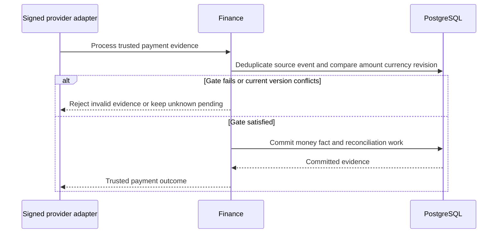
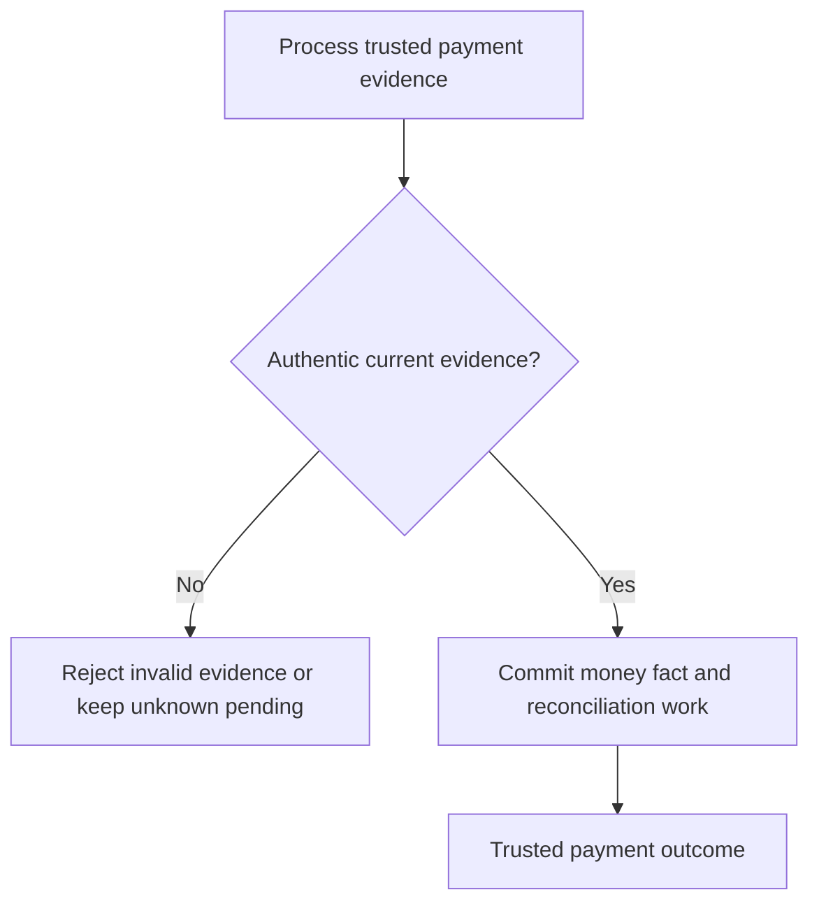

# Finance Payments LLD

[Business flow](../../00-Business-Guide/Finance-and-Reconciliation.md) · [feature register](../../09-References/Coverage-and-Traceability.md) · [ownership and recovery](../../07-Engineering/State-and-Recovery-Contracts.md)

## Payment truth, refunds and invoice evidence — implementation acceptance

**Proposed conditions for engineering handoff; never imply QA passed.**

## Draft features
- **FIN-01 / REQ-086:** Payment records from Cashfree webhooks and COD collections (Must (draft)).
- **FIN-02 / REQ-087:** GST invoice per order, from the right GSTIN (Must (draft)).
- **FIN-03 / REQ-088:** Automatic refunds; manual refunds need approval above a set amount (Must (draft)).
- **FIN-04 / REQ-089:** COD refunds by bank transfer or UPI (Should (draft)).
- **FIN-05 / REQ-090:** Daily reconciliation: Cashfree settlements vs orders (Must (draft)).
- **FIN-06 / REQ-091:** COD reconciliation: collected vs deposited (Must (draft)).
- **FIN-07 / REQ-092:** Credit notes for refunds and returns (Should (draft)).

## Required release checks
- Authorised happy path persists exactly the intended state.
- Invalid, cross-account and cross-location requests leave authoritative rows unchanged.
- Concurrent duplicate requests do not create duplicate money, stock or order effects.
- File, prescription and patient data are not exposed to unauthorised roles.
- Recoverable provider failure exposes a pending/retryable state; never claims success.
- Audit/trace data contains public references, not credentials or sensitive document contents.

Module test scenarios

## Payments, Invoices & Refunds — HTTP API responsibilities

All routes below are **Proposed REST v1 contracts**. The database repository does not implement them. Public UUIDs identify resources; staff scope and patient/order ownership are checked at each handler, not inferred from URL paths.

- API-075 POST /v1/payments/intents — Open charge for approved order
- API-076 POST /v1/webhooks/cashfree — Verify signed authoritative callback
- API-077 GET /v1/admin/finance/payments — Review gateway and COD facts
- API-078 POST /v1/admin/finance/refunds — Create idempotent refund request
- API-079 GET /v1/admin/finance/settlements — Compare settlement ledger
- API-080 POST /v1/admin/finance/cod-reconciliation — Reconcile COD deposits
- API-081 GET /v1/admin/finance/invoices/{order_id} — Get scoped GST invoice

## Cross-cutting request contract

Writes require validated body, stable intent key, expected current version when appropriate, auditable actor identity and an explicit outcome. Reads use safe pagination and permission-filtered fields. `401` indicates no valid session; `403/404` denied scope; `409` conflict; `422` business validation; `503` unknown upstream outcome. Read [api conventions](../../05-APIs/README.md) before implementing the endpoint.

**Business gate:** Only authoritative signed payment/cash evidence can satisfy dispatch gates. Persist provider event deduplication, money ledger/reversal, refund amounts and finance approval thresholds; unknown charge stays pending. For actual response fields, see the linked illustrative contract and approve a typed OpenAPI schema before implementation.

## Payments, Invoices & Refunds — business logic and invariants

**Rule origin:** the documented draft requirements and database migration guards. Distinguish a **confirmed database guard** from a **proposed API orchestration** and **open numeric policy**.

## Core procedure

1. Authenticate the actor and resolve server-owned tenant/location/patient permission.
2. Re-read the relevant product, order, document, stock or ledger state from the owning tables.
3. Reject incomplete or stale input; validate the latest accepted revision and current classification where relevant.
4. Apply the module invariant: **Only authoritative signed payment/cash evidence can satisfy dispatch gates. Persist provider event deduplication, money ledger/reversal, refund amounts and finance approval thresholds; unknown charge stays pending.**
5. In a transaction, persist the minimal authoritative rows, version and audit outcome; publish notifications after commit.
6. Return a scoped read model; expose only approved information to the caller.

## Features implemented by this rule set

`FIN-01`, `FIN-02`, `FIN-03`, `FIN-04`, `FIN-05`, `FIN-06`, `FIN-07` (see full requirement descriptions).

## Pseudocode — command boundary

```text
context := verify_session_and_resource_scope(request)
current := load_owned_aggregate_for_update(context, resource_id)
assert expected_version_matches(current)
assert domain_policy_allows_action(current, request)
result := transition_atomically(current, validated_request)
write_audit_and_outbox_in_same_transaction(result)
return filter_for_actor(result, context)
```

Unknown business thresholds (expiry freshness, COD cap, review deadlines, refund limits) must be policy data agreed by business owners, never hard-coded assumptions. On conflict, expose an actionable `409` and reload state. On an external provider timeout, keep the result pending rather than guessing success.

## Payments, Invoices & Refunds — internal components

**Status:** Proposed NestJS modular-monolith design informed by the decided stack in the master decisions checklist. This is not code already implemented in the SQLAlchemy repository.

| Component | Responsibility | Failure boundary |
| --- | --- | --- |
| HTTP controller / DTO validator | Accept typed requests for payments, invoices & refunds, reject malformed payloads | `400/422`, no database change |
| Use-case service | Execute: Initiate payment; verify webhook; refund; reconcile settlement | Explicit domain errors, no invented outcomes |
| Policy/authorization service | Enforce user role, object ownership, business eligibility | `403/404` and audit denied attempt |
| Domain repository | Execute scoped PostgreSQL reads/writes within a transaction | Retry only on safe concurrency errors |
| Outbox / integration adapter | Publish committed changes toward other modules or third parties | Durable retry and dead-letter review if adopted |

### Boundaries

Only authoritative signed payment/cash evidence can satisfy dispatch gates. Persist provider event deduplication, money ledger/reversal, refund amounts and finance approval thresholds; unknown charge stays pending. Public controllers must not call database workflow functions with arbitrary SQL and must not accept a caller-supplied `actor_user_id`. Network IO belongs outside long-lived locks. Modules should depend on domain interfaces, not on each other's ORM entities. Consult Dependencies and [architecture overview](../../02-Architecture/System-HLD.md).

## Payments, Invoices & Refunds — existing database usage

**Confirmed database:** 24 PostgreSQL schemas; SQL migration authority the checked-in SQL migration history. The tables below exist, but **a schema-domain association does not automatically mean this module owns every row or has write rights**. The database repository is not an HTTP service.

- `commerce.orders` — columns · contracts
- `finance.accounts` — columns · contracts
- `finance.credit_notes` — columns · contracts
- `finance.invoice_items` — columns · contracts
- `finance.invoices` — columns · contracts
- `finance.journal_entries` — columns · contracts
- `finance.journal_lines` — columns · contracts
- `finance.settlement_items` — columns · contracts
- `finance.settlement_runs` — columns · contracts
- `payment.chargebacks` — columns · contracts
- `payment.cod_collections` — columns · contracts
- `payment.customer_payment_methods` — columns · contracts

## Ownership, transactions and change control

Proposed owning service: `Finance_Payments`. Main read concerns: cashfree, payment truth, invoice, refund, settlement and cod accounting. Writes must be restricted by the actual foreign keys, CHECKs, unique contracts, crosswalks, policy and trigger guards. Use one transaction per domain state transition, use an outbox for reliable cross-module publication, and make any external retry idempotent.

**Safety:** Only authoritative signed payment/cash evidence can satisfy dispatch gates. Persist provider event deduplication, money ledger/reversal, refund amounts and finance approval thresholds; unknown charge stays pending.

Internal ID strategy: `identity.users.id` is UUID; most other tables have BIGINT internal PK with original immutable UUID alias. Never cast UUID to BIGINT or expose DB internal IDs as authorization tokens. All schema changes require new forward-only SQL migration under the source repo and a fresh PG15/PG18 parity test. Related [migration strategy](../../04-Database/Migrations.md).

## Payments, Invoices & Refunds — dependencies and ownership

**Underlying schemas:** `payment`, `finance`, `commerce`. These schemas are shared data domains; shared reads are not automatic write rights. Candidate collaborator modules are inferred from overlapping schema use:

- Cart_Checkout
- Customer_Orders
- Order_Operations
- Pharmacist_Review
- Reporting

## Communication rules

Use the owning service interface for business changes rather than making uncontrolled cross-module writes. In the chosen modular-monolith style, synchronous application calls can remain in-process. BullMQ/Redis jobs serve slow notifications and integrations after commit; they should not become the source of order, payment, stock or clinical truth. Build independent adapters for Cashfree, POS/Techsmith, MSG91 and driver APIs; failures must remain visible.

**Data-access contract:** Only authoritative signed payment/cash evidence can satisfy dispatch gates. Persist provider event deduplication, money ledger/reversal, refund amounts and finance approval thresholds; unknown charge stays pending.. Related: [module dependencies](../../02-Architecture/Module-Dependencies.md) and [database usage](../../04-Database/Module-Mapping.md).

## Payments, Invoices & Refunds — domain objects and DTO boundaries

**Proposed objects, not new database tables.** A domain object is a service-level business concept; a DTO is a validated data transfer object (API input/output). Do not confuse them with the Python SQLAlchemy models used for schema verification.

| Proposed object | Source of truth / evidence | Rules |
| --- | --- | --- |
| `Finance_PaymentsCommand` | Authenticated HTTP request and expected version | Includes actor context, idempotency key and validated business input |
| `Finance_PaymentsAggregate` | Domain rows listed in Database Usage | Represents the current authoritative business facts |
| `Finance_PaymentsPolicy` | Approved master/role records and product rules | Only authoritative signed payment/cash evidence can satisfy dispatch gates. Persist provider event deduplication, money ledger/reversal, refund amounts and finance approval thresholds; unknown charge stays pending. |
| `Finance_PaymentsReadModel` | Role-filtered current state | Removes protected fields and translates internal statuses |
| `Finance_PaymentsEvent` | Committed state transition and audit ID | Events carry references and versions, not clinical documents |

**Existing representative tables:** `commerce.orders`, `finance.accounts`, `finance.credit_notes`, `finance.invoice_items`, `finance.invoices`, `finance.journal_entries`, `finance.journal_lines`, `finance.settlement_items`. Internal BIGINT primary keys are never used as authorization credentials, and original UUID public references must remain stable. Any DTO field not directly supported by a confirmed column must be labelled proposed until the API team approves the mapping. See [database usage](../../04-Database/Module-Mapping.md).

## Payments, Invoices & Refunds — failure handling

**Primary rule:** Only authoritative signed payment/cash evidence can satisfy dispatch gates. Persist provider event deduplication, money ledger/reversal, refund amounts and finance approval thresholds; unknown charge stays pending.

- **Missing or invalid input:** respond with a field-specific problem code; do not leak sensitive data and do not write partial state.
- **Unauthorized object or location:** return `403` or privacy-safe `404`; record the attempted privileged action.
- **Duplicate submission:** return the persisted result when key + payload match; reject key reuse with different payload.
- **Stale/concurrent change:** database version/FK/CHECK guard must resolve a single winner; caller reloads latest projection.
- **Partial external failure:** leave the aggregate pending, never mark payment/stock/delivery success by assumption. Retry verified idempotent adapter calls; otherwise reconcile manually.
- **Safety or compliance policy unknown:** fail closed. Route staff to an exception queue and customer to a non-misleading status.

Use structured problem codes, request ID, retryability category and operator runbook reference. Sensitive Rx, financial tokens, OTPs and location traces must not be placed into logs. See [error responses](../../05-APIs/README.md#standard-problem-response-behavior) and [incident triage](../../07-Engineering/Release-and-Incident-Handling.md).

## Payment truth, refunds and invoice evidence — proposed interfaces and DTOs

**Business context:** Unknown provider outcomes stay pending; external callbacks cannot double-apply money.

**Controller contract:** validate identity and scope before accepting a command; never expose internal BIGINT IDs. Typed inputs should carry allowed public identifiers, operation-specific fields, expected record version and a unique idempotency key on mutations.

**Use-case interface:** `execute(trustedContext, validatedRequest) -> acceptedResult | domainError`. This is pseudocode for a boundary, **not generated application code**.

**Repository interface:** require a database transaction handle, parameterised SQL/ORM queries, and a stored accepted transition. Return public UUIDs or approved opaque references only.

**Error DTO proposal:** `{"error":{"code":"STATE_CONFLICT","message":"Refresh the record and try again","request_id":"..."}}`. Do not expose SQL errors, provider secrets or prescription contents.

**Existing table candidates:** `payment.payment_intents`, `payment.payment_attempts`, `payment.payment_webhooks`, `payment.refunds`, `finance.invoices`.

**Per-operation request and response examples:** API contract index. No generic DTO in this document overrides module-specific validation.

## Payment truth, refunds and invoice evidence — internal architecture

**Status: Proposed application design.** The database repo does not contain a NestJS HTTP implementation.

## Business behavior
Unknown provider outcomes stay pending; external callbacks cannot double-apply money.

## Components
| Component | Responsibility | Data affected | Failure outcome |
| --- | --- | --- | --- |
| `Finance_PaymentsController` (proposed) | Validate DTO and request context | Public API request only | 400/401/403 without partial mutation |
| `Finance_PaymentsUseCase` (proposed) | Enforce module business invariant | payment.payment_intents, payment.payment_attempts, payment.payment_webhooks | Domain status, do not guess provider truth |
| `Finance_PaymentsRepository` (proposed) | Scoped SQL transaction and concurrency guard | Exact migrated tables | Roll back on conflict or constraint error |
| `Finance_PaymentsIntegrationAdapter` (only when needed) | Map external IO and reconcile delivery | Outbox/inbox or verified provider record | Retries outside DB lock |

## Transaction and retry sequence

1. create payment intent for accepted order revision.
2. call approved provider with idempotency.
3. validate signed callback or fetch provider truth.
4. post money ledger exactly once.
5. issue invoice/refund or keep unresolved status for reconciliation.

## Existing tables (candidate responsibilities)
- payment.payment_intents — candidate entity; verify the exact operation and field set in the implementation review.
- payment.payment_attempts — candidate entity; verify the exact operation and field set in the implementation review.
- payment.payment_webhooks — candidate entity; verify the exact operation and field set in the implementation review.
- payment.refunds — candidate entity; verify the exact operation and field set in the implementation review.
- finance.invoices — candidate entity; verify the exact operation and field set in the implementation review.

## Related
HLD · States · Permissions

## Payment truth, refunds and invoice evidence — observability

**Proposed runtime design:** Structured logs record correlation ID, module, operation, outcome code and elapsed time. Replace identifiers with approved pseudonymous references. No raw OTP, prescription text, secrets, payment credentials, addresses or GPS coordinates in logs.

**Candidate counters:** `finance_payments_command_total{outcome}`, `finance_payments_denied_total{reason}`, and `finance_payments_provider_pending_total` when an external provider is involved. Names are proposed and require monitoring owner review.

**Actionable alerts:** persistent command rejection spikes, outbox backlog, stale integrations or reconciliation mismatches; thresholds are open questions, not fabricated service-level objectives.

Monitoring design

## Payments, Invoices & Refunds — permission model

**Actors:** Finance Manager, Finance Executive. **Proposed service scope:** `staff_finance`. Roles are application concepts; existing PostgreSQL NOLOGIN capability roles form a separate lower-level authorization layer.

| Operation class | Required entitlement | Enforcement |
| --- | --- | --- |
| Read own/scoped data | Authenticated identity + object or location ownership | Controller + service + database guard where provided |
| Create / edit | Explicit module action grant, approved master and domain status | Policy decision before transaction |
| Override / refund / pharmacist action | Specialized staff permission and documented approval reason | Distinct privilege, immutable audit evidence |
| Export / sensitive view | Purpose-limited role, retention and access logging | Recheck at download/stream time |

**Core constraint:** Only authoritative signed payment/cash evidence can satisfy dispatch gates. Persist provider event deduplication, money ledger/reversal, refund amounts and finance approval thresholds; unknown charge stays pending. A customer cannot infer another customer's resource existence. Do not connect app runtime through migration-owner credentials. Consult [roles and permissions](../../07-Engineering/Security.md).

## Payments, Invoices & Refunds — functional requirements

**Source:** the documented draft requirements. **Status:** Draft requirements, not proof of final business acceptance. 🔴/🟡/🟢 priorities have been normalized as Must/Should/Could without changing their meaning.

| Feature | Priority in v0.1 | Statement | Dependency |
| --- | --- | --- | --- |
| `FIN-01` | Must (draft) | Payment records from Cashfree webhooks and COD collections | Not stated |
| `FIN-02` | Must (draft) | GST invoice per order, from the right GSTIN | Invoice format, GSTIN decision |
| `FIN-03` | Must (draft) | Automatic refunds; manual refunds need approval above a set amount | Refund rules |
| `FIN-04` | Should (draft) | COD refunds by bank transfer or UPI | Refund method |
| `FIN-05` | Must (draft) | Daily reconciliation: Cashfree settlements vs orders | Settlement cycle |
| `FIN-06` | Must (draft) | COD reconciliation: collected vs deposited | Q12 |
| `FIN-07` | Should (draft) | Credit notes for refunds and returns | Finance + CA |

## Interactions and acceptance basis

The user performs: Initiate payment; verify webhook; refund; reconcile settlement. Server-side enforcement must preserve this invariant: **Only authoritative signed payment/cash evidence can satisfy dispatch gates. Persist provider event deduplication, money ledger/reversal, refund amounts and finance approval thresholds; unknown charge stays pending.**

A feature becomes implementation-ready only after its inputs (especially any dependency listed above), permissions, workflow outcome, API body and database transaction are resolved. Confirm business thresholds before coding: a field existing in SQL is not proof that its value was approved.

See requirement coverage and test IDs.

## Payment truth, refunds and invoice evidence — request sequence

**Proposed design**, not a diagram of deployed services. Business-specific steps appear in Internal Architecture.



**Concurrency rule:** Hold locks for minimal local SQL work only; repeated calls use the same idempotency key or expected-version check. Provider timeouts leave state pending and require authoritative reconciliation.

## Payments, Invoices & Refunds — service design

**Proposed NestJS module:** `Finance_PaymentsModule` with a controller, application service, authorization policy, repository and adapters. The supplied database code is a schema/validation library; no running HTTP controller was found in Archive 2.

## Candidate service methods

- `API-075: open_charge_for_approved_order(actor_context, validated_command, expected_version) -> Result`
- `API-076: verify_signed_authoritative_callback(actor_context, validated_command, expected_version) -> Result`
- `API-077: review_gateway_and_cod_facts(actor_context, validated_command, expected_version) -> Result`
- `API-078: create_idempotent_refund_request(actor_context, validated_command, expected_version) -> Result`
- `API-079: compare_settlement_ledger(actor_context, validated_command, expected_version) -> Result`
- `API-080: reconcile_cod_deposits(actor_context, validated_command, expected_version) -> Result`
- `API-081: get_scoped_gst_invoice(actor_context, validated_command, expected_version) -> Result`

## Transaction and integration contract

For each mutation: authenticate actor, validate inputs, read affected rows with a lock/version check, verify policy, update the minimum relevant rows and immutable audit/outbox in one transaction. A remote gateway, storage or GPS call should be performed outside the locked transaction and reconciled on callback/timeout. Use PostgreSQL to reject invalid writes even if application validation is bypassed.

**Module invariant:** Only authoritative signed payment/cash evidence can satisfy dispatch gates. Persist provider event deduplication, money ledger/reversal, refund amounts and finance approval thresholds; unknown charge stays pending.

**Timeouts/retries:** configure per provider, use exponential backoff with caps for safe reads and idempotent messages; never blindly repeat charge/refund/cash state changes. A dead-letter queue is an optional BullMQ operating pattern because BullMQ/Redis are selected in the checklist, but exact job topology needs signoff. **Telemetry:** actor pseudonym, request ID, action, state transition latency, retries and failure category; redact protected clinical and payment contents. See [database usage](../../04-Database/Module-Mapping.md) and Monitoring.

## Payments, Invoices & Refunds — state and transition policy

**Status:** State boundaries are derived from the unified order journey and existing SQL CHECK/trigger contracts; the following is a service design, not a claim that a single enum exists.



**Module-specific invariant:** Only authoritative signed payment/cash evidence can satisfy dispatch gates. Persist provider event deduplication, money ledger/reversal, refund amounts and finance approval thresholds; unknown charge stays pending.

Each transition must record the prior state, target state, reason where required, actor, accepted version and timestamp. A second command on the same state must either replay the prior idempotent result or fail with `409`. A failed external callback cannot roll an accepted state backward; reconcile with authoritative provider evidence. When an order changes, keep clinical, payment, inventory, fulfillment and delivery statuses separate, then derive one safe user-visible projection.

This flow shows command gates, not an entity enum. Legal entity transitions and recovery are specified in [state contracts](../../07-Engineering/State-and-Recovery-Contracts.md); the table catalog supplies actual stored values.

## Payments, Invoices & Refunds — verification and acceptance

**Candidate test IDs** derived one-to-one from the v0.1 feature IDs. They are test-design work items, not claims that the tests have been implemented. Database-level tests reported in the source do not replace HTTP and browser tests.

| Stable test ID | Behavior | Expected result |
| --- | --- | --- |
| `TC-FIN-01-OK` | Payment records from Cashfree webhooks and COD collections | Trusted provider/COD facts yield one authoritative money record |
| `TC-FIN-01-DENY` | Unsigned, repeated or out-of-order webhook arrives | Unsigned rejected; replay has no second effect; older failure cannot undo success; Finance reconciles trusted provider evidence |
| `TC-FIN-02-OK` | GST invoice per order, from the right GSTIN | Invoice uses correct seller/site GSTIN and accepted amounts |
| `TC-FIN-02-DENY` | GSTIN/tax setup is missing | Invoice pending/blocked; no invented tax document or recharge; Finance/CA corrects approved tax setup |
| `TC-FIN-03-OK` | Automatic refunds; manual refunds need approval above a set amount | Approved refund obeys remaining refundable value and instruction identity |
| `TC-FIN-03-DENY` | Duplicate refund races with another refund | Cumulative payout cannot exceed permitted paid value; one instruction per intent; Finance reloads refunded totals and reconciles unknown provider result |
| `TC-FIN-04-OK` | COD refunds by bank transfer or UPI | COD refund uses an approved verified bank/UPI destination |
| `TC-FIN-04-DENY` | Unverified replacement destination is supplied | No money sent; refund awaits verified details; Finance obtains approved proof securely |
| `TC-FIN-05-OK` | Daily reconciliation: Cashfree settlements vs orders | Settlement comparison retains matched and unmatched evidence |
| `TC-FIN-05-DENY` | Provider amount/currency/reference differs from order | Unresolved reconciliation item, no fabricated settlement; Finance investigates provider/bank and posts approved correction |
| `TC-FIN-06-OK` | COD reconciliation: collected vs deposited | COD collected/deposited totals retain both actual amounts |
| `TC-FIN-06-DENY` | Rider deposit is short | Cash exception remains open; delivery not rewritten; Finance/Operations investigates shortage |
| `TC-FIN-07-OK` | Credit notes for refunds and returns | Approved credit note links eligible refund/return/invoice once |
| `TC-FIN-07-DENY` | Same credit note intent repeats | No duplicate credit or journal effect; original invoice retained; Finance checks existing credit reference and policy |

## Cross-module contract tests

- Verify authenticated customer/staff/location ownership using actual restricted runtime roles.
- Verify concurrency and duplicate idempotency behavior against an isolated PostgreSQL database with authoritative migrations.
- Verify safe retry when callbacks or files arrive late or malformed.
- Verify audit and notification records are based on committed state and contain no confidential payloads.
- Verify this invariant: **Only authoritative signed payment/cash evidence can satisfy dispatch gates. Persist provider event deduplication, money ledger/reversal, refund amounts and finance approval thresholds; unknown charge stays pending.**

Coverage state: **Designed, not executed for the proposed application**. Link individual results to the associated test ID and requirement before go-live. Read [test strategy](../../07-Engineering/Testing.md).

## Payments, Invoices & Refunds — validation checkpoints

| Boundary | Required validation | Rejection outcome |
| --- | --- | --- |
| Input | Required fields, type, size, allowed format and business master codes | `400/422`; no write |
| Actor | Session validity, role, location, customer/patient/parcel ownership | `401/403/404`; audit |
| Version | Accepted order revision or row version matches, if state-changing | `409`; fetch current state |
| Domain | Only authoritative signed payment/cash evidence can satisfy dispatch gates. Persist provider event deduplication, money ledger/reversal, refund amounts and finance approval thresholds; unknown charge stays pending. | Explicit blocked/pending/error status |
| Database | FK, PK, UNIQUE, CHECK, trigger and RLS outcome | Safe conflict/business error; rollback |
| Integration | Authenticated provider/callback, idempotency key and settled evidence | Keep pending; reconciliation task |

**Requirements:** `FIN-01`, `FIN-02`, `FIN-03`, `FIN-04`, `FIN-05`, `FIN-06`, `FIN-07`. Never trust browser-supplied patient, clinical decision, backend actor context, price or available quantity. Refer to Testing for negative tests.

## Payments, Invoices & Refunds — operational workflows

**Entry points:** Initiate payment; verify webhook; refund; reconcile settlement. **User group:** Finance Manager, Finance Executive. The following source-defined order journey stages identify primary ownership; supporting modules also participate without necessarily owning the stage.

- S14 — Pay online
- S15 — Check a payment with an uncertain result
- S16 — Recognise paid or COD order
- S31 — Return the correct money once

## Shared processing rules

The requested action is first validated against user scope, current state and approved business master data. Read required evidence from real migrated tables; change only data this module owns; publish a safe event or notify the next module after commit.

**Alternative paths:** missing required input keeps the process actionable; a stale or duplicate request is deduplicated; another actor's update returns a version conflict; external unavailability produces a pending/blocked state. Prescriptions, inventory, payments and logistics never independently set the whole order to delivered.

**Module-specific rule:** Only authoritative signed payment/cash evidence can satisfy dispatch gates. Persist provider event deduplication, money ledger/reversal, refund amounts and finance approval thresholds; unknown charge stays pending.

See [state transitions](../../07-Engineering/State-and-Recovery-Contracts.md) and [unified order](../../00-Business-Guide/Pharmville-Complete-Business-Flow.md).

## Critical recovery scenarios

**Designed; NOT RUN.** Run against approved policy fixtures and actual restricted database roles. Inspect customer/staff result, state/history, stock and money effects together.

| Test | Input / interruption | Expected result and record assertions |
| --- | --- | --- |
| `TC-FIN-03-01` | Concurrent distinct refunds each request the same remaining refundable amount | Serialize against authoritative paid/refunded evidence: cumulative accepted payout cannot exceed eligible paid value. A pending unknown instruction cannot be duplicated to consume the same balance again. |
| `TC-FIN-05-01` | Provider settlement evidence for the period is missing | Run/period remains pending or exception, never matched/closed. Finance retains missing-evidence references and resumes comparison after authentic evidence arrives; no automatic balancing journal. |
