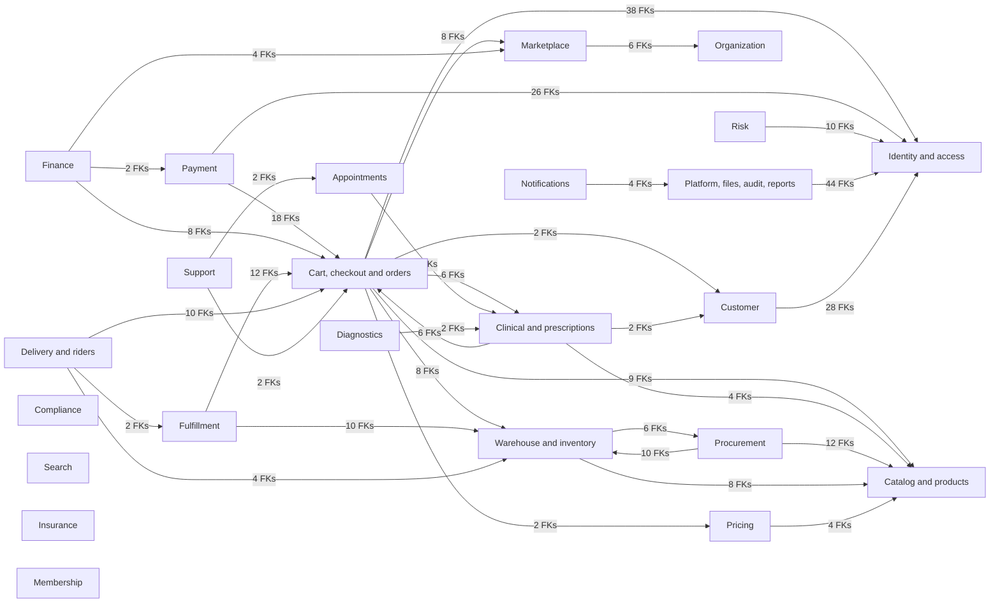

# System data map

## What this map shows

Pharmville's checked-out database snapshot contains **24 schemas, 266 tables, 4,438 columns, and 1,461 declared foreign keys**. The map below shows representative business-domain dependencies backed by one or more declared foreign keys. Arrows point from the schema that owns the referencing (child) column to the schema containing its referenced (parent) key; they do not grant access or establish service write ownership. The [cross-domain reference register](15-Cross-Domain-Relationships.md) lists every observed cross-schema pair.

## Main domain map

The diagram focuses on cross-domain connections used to orient readers. Identity references are repeated across many tables; their exact constraints are cataloged in the detailed schema diagrams and relationship index. Appointment, diagnostics, insurance, membership, risk, search, support, notification, compliance, and platform are included because their schemas exist in the checked-out source even where their launch scope is not approved.

## Database domains

| Schema | Tables | Recorded area | Detailed ER diagrams |
|---|---:|---|---|
| `appointment` | 9 | Appointments and scheduling | [appointment](01-appointment.md) |
| `catalog` | 19 | Products, medicines, and classification | [catalog](02-catalog.md) |
| `clinical` | 17 | Prescriptions and pharmacist decisions | [clinical](03-clinical.md) |
| `commerce` | 17 | Carts, checkout, orders, and returns | [commerce](04-commerce.md) |
| `compliance` | 8 | Regulatory records and retention actions | [compliance](05-compliance.md) |
| `customer` | 8 | Customer profiles and addresses | [customer](06-customer.md) |
| `diagnostics` | 13 | Tests and laboratory services | [diagnostics](07-diagnostics.md) |
| `finance` | 8 | Invoices, ledgers, and settlements | [finance](08-finance.md) |
| `fulfillment` | 10 | Picking, packing, and shipment preparation | [fulfillment](09-fulfillment.md) |
| `identity` | 14 | Accounts, sessions, and permissions | [identity](10-identity.md) |
| `insurance` | 8 | Policies and claims | [insurance](11-insurance.md) |
| `logistics` | 15 | Riders, shipments, and delivery | [logistics](12-logistics.md) |
| `marketplace` | 7 | Sellers and listings | [marketplace](13-marketplace.md) |
| `membership` | 6 | Benefits and loyalty | [membership](14-membership.md) |
| `notification` | 10 | Templates, messages, and delivery attempts | [notification](15-notification.md) |
| `organization` | 6 | Operating companies, sites, and licenses | [organization](16-organization.md) |
| `payment` | 13 | Payment attempts, confirmation, and refunds | [payment](17-payment.md) |
| `platform` | 21 | Configuration, files, audit, events, and reports | [platform](18-platform.md) |
| `pricing` | 8 | Prices, taxes, and promotions | [pricing](19-pricing.md) |
| `procurement` | 13 | Suppliers, purchase orders, and receiving | [procurement](20-procurement.md) |
| `risk` | 5 | Risk rules, cases, and signals | [risk](21-risk.md) |
| `search` | 5 | Search indexes and query signals | [search](22-search.md) |
| `support` | 8 | Customer support cases | [support](23-support.md) |
| `warehouse` | 18 | Stock balances, lots, and transfers | [warehouse](24-warehouse.md) |

## Evidence boundary

This documentation is generated from [the canonical standalone SQL](../../pharmville-database/pharmville_schema.sql) and its derived [validated catalog](../Schema-Catalog.json). A private PostgreSQL 18.6 replay through V0030 and a separate empty schema installation produced zero differences across 23 catalog dimensions. [Evidence](../../09-References/Database-Evidence.json) records file checksums and archive provenance. No production database was inspected.
