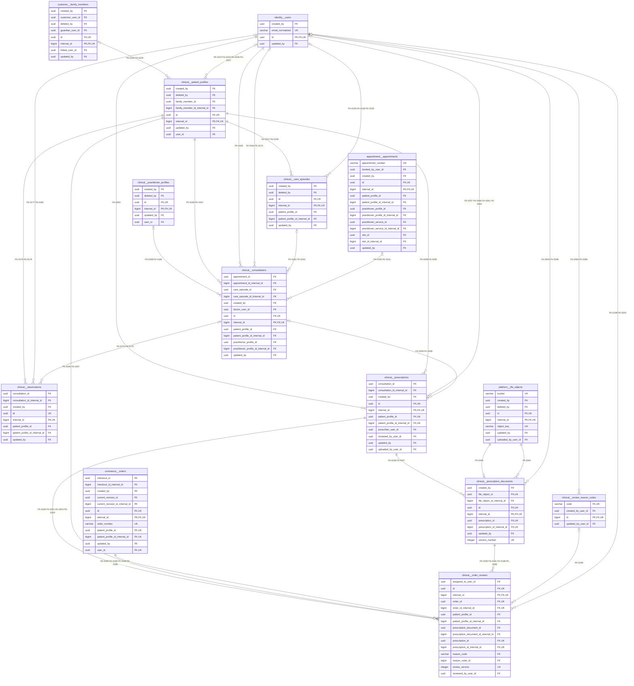
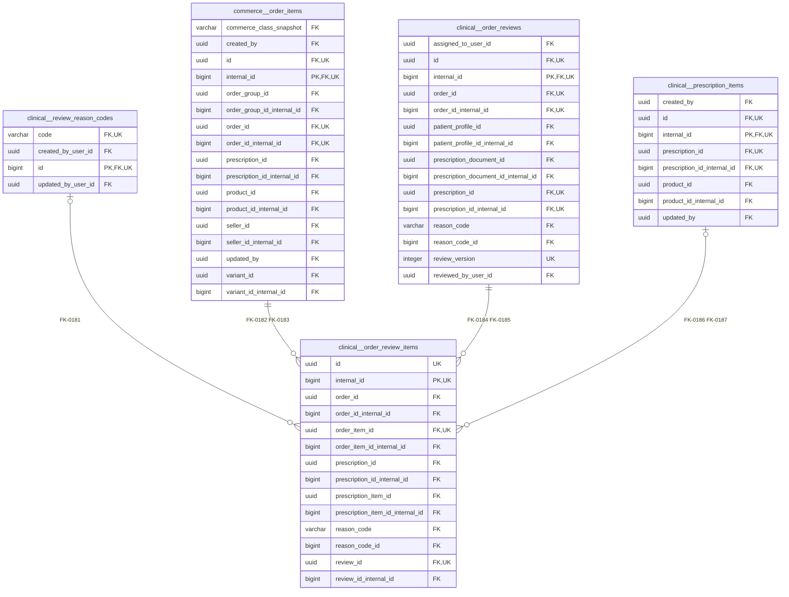

```mermaid
erDiagram
    catalog__products {
        uuid brand_id FK
        bigint brand_id_internal_id FK
        uuid category_id FK
        bigint category_id_internal_id FK
        varchar commerce_class FK
        uuid commerce_class_approved_by_user_id FK
        uuid created_by FK
        uuid deleted_by FK
        uuid dosage_form_id FK
        bigint dosage_form_id_internal_id FK
        uuid id FK, UK
        bigint internal_id PK, FK, UK
        uuid manufacturer_id FK
        bigint manufacturer_id_internal_id FK
        uuid updated_by FK
    }
    clinical__consultations {
        uuid appointment_id FK
        bigint appointment_id_internal_id FK
        uuid care_episode_id FK
        bigint care_episode_id_internal_id FK
        uuid created_by FK
        uuid doctor_user_id FK
        uuid id FK, UK
        bigint internal_id PK, FK, UK
        uuid patient_profile_id FK
        bigint patient_profile_id_internal_id FK
        uuid practitioner_profile_id FK
        bigint practitioner_profile_id_internal_id FK
        uuid updated_by FK
    }
    clinical__diagnoses {
        uuid consultation_id FK
        bigint consultation_id_internal_id FK
        uuid created_by FK
        uuid id UK
        bigint internal_id PK, UK
        uuid updated_by FK
    }
    clinical__patient_allergies {
        uuid created_by FK
        uuid deleted_by FK
        uuid id UK
        bigint internal_id PK, UK
        uuid patient_profile_id FK
        bigint patient_profile_id_internal_id FK
        uuid updated_by FK
    }
    clinical__patient_conditions {
        uuid created_by FK
        uuid deleted_by FK
        uuid id UK
        bigint internal_id PK, UK
        uuid patient_profile_id FK
        bigint patient_profile_id_internal_id FK
        uuid updated_by FK
    }
    clinical__patient_medications {
        uuid created_by FK
        uuid deleted_by FK
        uuid id UK
        bigint internal_id PK, UK
        uuid patient_profile_id FK
        bigint patient_profile_id_internal_id FK
        uuid product_id FK
        bigint product_id_internal_id FK
        uuid updated_by FK
    }
    clinical__patient_profiles {
        uuid created_by FK
        uuid deleted_by FK
        uuid family_member_id FK
        bigint family_member_id_internal_id FK
        uuid id FK, UK
        bigint internal_id PK, FK, UK
        uuid updated_by FK
        uuid user_id FK
    }
    clinical__practitioner_organizations {
        uuid created_by FK
        uuid id UK
        bigint internal_id PK, UK
        uuid location_id FK, UK
        bigint location_id_internal_id FK
        uuid organization_id FK, UK
        bigint organization_id_internal_id FK
        uuid practitioner_profile_id FK, UK
        bigint practitioner_profile_id_internal_id FK
        uuid updated_by FK
    }
    clinical__practitioner_profiles {
        uuid created_by FK
        uuid deleted_by FK
        uuid id FK, UK
        bigint internal_id PK, FK, UK
        uuid updated_by FK
        uuid user_id FK
    }
    clinical__prescription_access_logs {
        uuid actor_user_id FK
        uuid id UK
        bigint internal_id PK, UK
        uuid prescription_id FK
        bigint prescription_id_internal_id FK
    }
    clinical__prescription_items {
        uuid created_by FK
        uuid id FK, UK
        bigint internal_id PK, FK, UK
        uuid prescription_id FK, UK
        bigint prescription_id_internal_id FK, UK
        uuid product_id FK
        bigint product_id_internal_id FK
        uuid updated_by FK
    }
    clinical__prescriptions {
        uuid consultation_id FK
        bigint consultation_id_internal_id FK
        uuid created_by FK
        uuid id FK, UK
        bigint internal_id PK, FK, UK
        uuid patient_profile_id FK, UK
        bigint patient_profile_id_internal_id FK, UK
        uuid prescriber_user_id FK
        uuid reviewed_by_user_id FK
        uuid updated_by FK
        uuid uploaded_by_user_id FK
    }
    identity__users {
        uuid created_by FK
        varchar email_normalized UK
        uuid id PK, FK, UK
        uuid updated_by FK
    }
    organization__locations {
        varchar code UK
        uuid created_by FK
        uuid deleted_by FK
        uuid id FK, UK
        bigint internal_id PK, FK, UK
        uuid organization_id FK, UK
        bigint organization_id_internal_id FK
        uuid updated_by FK
    }
    organization__organizations {
        uuid created_by FK
        uuid deleted_by FK
        uuid id FK, UK
        bigint internal_id PK, FK, UK
        uuid updated_by FK
    }
    identity__users o|--o{ clinical__practitioner_organizations : "FK-0228 FK-0235"
    organization__locations o|--o{ clinical__practitioner_organizations : "FK-0229 FK-0230"
    organization__organizations ||--o{ clinical__practitioner_organizations : "FK-0231 FK-0232"
    clinical__practitioner_profiles ||--o{ clinical__practitioner_organizations : "FK-0233 FK-0234"
    identity__users o|--o{ clinical__practitioner_profiles : "FK-0236 FK-0237 FK-0238"
    identity__users ||--o{ clinical__practitioner_profiles : "FK-0239"
    identity__users o|--o{ clinical__patient_allergies : "FK-0205 FK-0206 FK-0209"
    clinical__patient_profiles ||--o{ clinical__patient_allergies : "FK-0207 FK-0208"
    identity__users o|--o{ clinical__patient_conditions : "FK-0210 FK-0211 FK-0214"
    clinical__patient_profiles ||--o{ clinical__patient_conditions : "FK-0212 FK-0213"
    identity__users o|--o{ clinical__patient_medications : "FK-0215 FK-0216 FK-0221"
    clinical__patient_profiles ||--o{ clinical__patient_medications : "FK-0217 FK-0218"
    catalog__products o|--o{ clinical__patient_medications : "FK-0219 FK-0220"
    identity__users o|--o{ clinical__prescription_items : "FK-0249 FK-0254"
    clinical__prescriptions ||--o{ clinical__prescription_items : "FK-0250 FK-0251"
    catalog__products o|--o{ clinical__prescription_items : "FK-0252 FK-0253"
    identity__users o|--o{ clinical__prescription_access_logs : "FK-0240"
    clinical__prescriptions ||--o{ clinical__prescription_access_logs : "FK-0241 FK-0242"
    clinical__consultations ||--o{ clinical__diagnoses : "FK-0171 FK-0172"
    identity__users o|--o{ clinical__diagnoses : "FK-0173 FK-0174"
```

# Clinical ER diagrams

## What this part of the database stores

The `clinical` schema stores prescriptions and pharmacist decisions. The names and structural relationships below come from the checked-out database catalog snapshot; business-purpose summaries marked inferred are not product-owner approval.

## Main tables

| Table | Recorded purpose | Table definition |
|---|---|---|
| [`care_episodes`](../Tables/clinical/care_episodes.md) | Holds care episodes records within the clinical domain (prescriptions and pharmacist decisions). Its precise write owner and lifecycle must be accepted during module implementation. (inferred meaning) | [Table contract](../Tables/clinical/care_episodes.md) |
| [`consultations`](../Tables/clinical/consultations.md) | Holds consultations records within the clinical domain (prescriptions and pharmacist decisions). Its precise write owner and lifecycle must be accepted during module implementation. (inferred meaning) | [Table contract](../Tables/clinical/consultations.md) |
| [`diagnoses`](../Tables/clinical/diagnoses.md) | Holds diagnoses records within the clinical domain (prescriptions and pharmacist decisions). Its precise write owner and lifecycle must be accepted during module implementation. (inferred meaning) | [Table contract](../Tables/clinical/diagnoses.md) |
| [`observations`](../Tables/clinical/observations.md) | Holds observations records within the clinical domain (prescriptions and pharmacist decisions). Its precise write owner and lifecycle must be accepted during module implementation. (inferred meaning) | [Table contract](../Tables/clinical/observations.md) |
| [`order_review_items`](../Tables/clinical/order_review_items.md) | Holds order review items records within the clinical domain (prescriptions and pharmacist decisions). Its precise write owner and lifecycle must be accepted during module implementation. (inferred meaning) | [Table contract](../Tables/clinical/order_review_items.md) |
| [`order_reviews`](../Tables/clinical/order_reviews.md) | Holds order reviews records within the clinical domain (prescriptions and pharmacist decisions). Its precise write owner and lifecycle must be accepted during module implementation. (inferred meaning) | [Table contract](../Tables/clinical/order_reviews.md) |
| [`patient_allergies`](../Tables/clinical/patient_allergies.md) | Holds patient allergies records within the clinical domain (prescriptions and pharmacist decisions). Its precise write owner and lifecycle must be accepted during module implementation. (inferred meaning) | [Table contract](../Tables/clinical/patient_allergies.md) |
| [`patient_conditions`](../Tables/clinical/patient_conditions.md) | Holds patient conditions records within the clinical domain (prescriptions and pharmacist decisions). Its precise write owner and lifecycle must be accepted during module implementation. (inferred meaning) | [Table contract](../Tables/clinical/patient_conditions.md) |
| [`patient_medications`](../Tables/clinical/patient_medications.md) | Holds patient medications records within the clinical domain (prescriptions and pharmacist decisions). Its precise write owner and lifecycle must be accepted during module implementation. (inferred meaning) | [Table contract](../Tables/clinical/patient_medications.md) |
| [`patient_profiles`](../Tables/clinical/patient_profiles.md) | Holds patient profiles records within the clinical domain (prescriptions and pharmacist decisions). Its precise write owner and lifecycle must be accepted during module implementation. (inferred meaning) | [Table contract](../Tables/clinical/patient_profiles.md) |
| [`practitioner_organizations`](../Tables/clinical/practitioner_organizations.md) | Holds practitioner organizations records within the clinical domain (prescriptions and pharmacist decisions). Its precise write owner and lifecycle must be accepted during module implementation. (inferred meaning) | [Table contract](../Tables/clinical/practitioner_organizations.md) |
| [`practitioner_profiles`](../Tables/clinical/practitioner_profiles.md) | Holds practitioner profiles records within the clinical domain (prescriptions and pharmacist decisions). Its precise write owner and lifecycle must be accepted during module implementation. (inferred meaning) | [Table contract](../Tables/clinical/practitioner_profiles.md) |
| [`prescription_access_logs`](../Tables/clinical/prescription_access_logs.md) | Holds prescription access logs records within the clinical domain (prescriptions and pharmacist decisions). Its precise write owner and lifecycle must be accepted during module implementation. (inferred meaning) | [Table contract](../Tables/clinical/prescription_access_logs.md) |
| [`prescription_documents`](../Tables/clinical/prescription_documents.md) | Holds prescription documents records within the clinical domain (prescriptions and pharmacist decisions). Its precise write owner and lifecycle must be accepted during module implementation. (inferred meaning) | [Table contract](../Tables/clinical/prescription_documents.md) |
| [`prescription_items`](../Tables/clinical/prescription_items.md) | Holds prescription items records within the clinical domain (prescriptions and pharmacist decisions). Its precise write owner and lifecycle must be accepted during module implementation. (inferred meaning) | [Table contract](../Tables/clinical/prescription_items.md) |
| [`prescriptions`](../Tables/clinical/prescriptions.md) | Holds prescriptions records within the clinical domain (prescriptions and pharmacist decisions). Its precise write owner and lifecycle must be accepted during module implementation. (inferred meaning) | [Table contract](../Tables/clinical/prescriptions.md) |
| [`review_reason_codes`](../Tables/clinical/review_reason_codes.md) | Holds review reason codes records within the clinical domain (prescriptions and pharmacist decisions). Its precise write owner and lifecycle must be accepted during module implementation. (inferred meaning) | [Table contract](../Tables/clinical/review_reason_codes.md) |

## ER diagrams

These diagrams show declared PostgreSQL foreign keys from focused source tables. Entity fields include primary keys, unique keys, and FK columns; exact data types remain in the linked table contracts. `PK`, `FK`, and `UK` mark key roles. Relationship cardinality comes from FK nullability and unique constraints/indexes in the recorded catalog.

### Diagram 01 — order_reviews, prescriptions, observations, prescription_documents, review_reason_codes, patient_profiles, care_episodes, consultations

This focused view contains every declared FK owned by the listed focus tables. Referenced tables outside that set appear as context. Parallel FK constraints are distinguished by their stable IDs; search those IDs in the [relationship catalog](Relationship-Catalog/clinical.md) for exact columns and actions.

**Entity name mapping**

| Mermaid name | PostgreSQL table |
|---|---|
| `appointment__appointments` | [`appointment.appointments`](../Tables/appointment/appointments.md) |
| `clinical__care_episodes` | [`clinical.care_episodes`](../Tables/clinical/care_episodes.md) |
| `clinical__consultations` | [`clinical.consultations`](../Tables/clinical/consultations.md) |
| `clinical__observations` | [`clinical.observations`](../Tables/clinical/observations.md) |
| `clinical__order_reviews` | [`clinical.order_reviews`](../Tables/clinical/order_reviews.md) |
| `clinical__patient_profiles` | [`clinical.patient_profiles`](../Tables/clinical/patient_profiles.md) |
| `clinical__practitioner_profiles` | [`clinical.practitioner_profiles`](../Tables/clinical/practitioner_profiles.md) |
| `clinical__prescription_documents` | [`clinical.prescription_documents`](../Tables/clinical/prescription_documents.md) |
| `clinical__prescriptions` | [`clinical.prescriptions`](../Tables/clinical/prescriptions.md) |
| `clinical__review_reason_codes` | [`clinical.review_reason_codes`](../Tables/clinical/review_reason_codes.md) |
| `commerce__orders` | [`commerce.orders`](../Tables/commerce/orders.md) |
| `customer__family_members` | [`customer.family_members`](../Tables/customer/family_members.md) |
| `identity__users` | [`identity.users`](../Tables/identity/users.md) |
| `platform__file_objects` | [`platform.file_objects`](../Tables/platform/file_objects.md) |

Coverage: 8 focus tables, 14 entities, 62 FK constraints (62 unique IDs).

### Diagram 02 — practitioner_organizations, practitioner_profiles, patient_allergies, patient_conditions, patient_medications, prescription_items, prescription_access_logs, diagnoses

This focused view contains every declared FK owned by the listed focus tables. Referenced tables outside that set appear as context. Parallel FK constraints are distinguished by their stable IDs; search those IDs in the [relationship catalog](Relationship-Catalog/clinical.md) for exact columns and actions.

**Entity name mapping**

| Mermaid name | PostgreSQL table |
|---|---|
| `catalog__products` | [`catalog.products`](../Tables/catalog/products.md) |
| `clinical__consultations` | [`clinical.consultations`](../Tables/clinical/consultations.md) |
| `clinical__diagnoses` | [`clinical.diagnoses`](../Tables/clinical/diagnoses.md) |
| `clinical__patient_allergies` | [`clinical.patient_allergies`](../Tables/clinical/patient_allergies.md) |
| `clinical__patient_conditions` | [`clinical.patient_conditions`](../Tables/clinical/patient_conditions.md) |
| `clinical__patient_medications` | [`clinical.patient_medications`](../Tables/clinical/patient_medications.md) |
| `clinical__patient_profiles` | [`clinical.patient_profiles`](../Tables/clinical/patient_profiles.md) |
| `clinical__practitioner_organizations` | [`clinical.practitioner_organizations`](../Tables/clinical/practitioner_organizations.md) |
| `clinical__practitioner_profiles` | [`clinical.practitioner_profiles`](../Tables/clinical/practitioner_profiles.md) |
| `clinical__prescription_access_logs` | [`clinical.prescription_access_logs`](../Tables/clinical/prescription_access_logs.md) |
| `clinical__prescription_items` | [`clinical.prescription_items`](../Tables/clinical/prescription_items.md) |
| `clinical__prescriptions` | [`clinical.prescriptions`](../Tables/clinical/prescriptions.md) |
| `identity__users` | [`identity.users`](../Tables/identity/users.md) |
| `organization__locations` | [`organization.locations`](../Tables/organization/locations.md) |
| `organization__organizations` | [`organization.organizations`](../Tables/organization/organizations.md) |

Coverage: 8 focus tables, 15 entities, 42 FK constraints (42 unique IDs).

### Diagram 03 — order_review_items

This focused view contains every declared FK owned by the listed focus tables. Referenced tables outside that set appear as context. Parallel FK constraints are distinguished by their stable IDs; search those IDs in the [relationship catalog](Relationship-Catalog/clinical.md) for exact columns and actions.

**Entity name mapping**

| Mermaid name | PostgreSQL table |
|---|---|
| `clinical__order_review_items` | [`clinical.order_review_items`](../Tables/clinical/order_review_items.md) |
| `clinical__order_reviews` | [`clinical.order_reviews`](../Tables/clinical/order_reviews.md) |
| `clinical__prescription_items` | [`clinical.prescription_items`](../Tables/clinical/prescription_items.md) |
| `clinical__review_reason_codes` | [`clinical.review_reason_codes`](../Tables/clinical/review_reason_codes.md) |
| `commerce__order_items` | [`commerce.order_items`](../Tables/commerce/order_items.md) |

Coverage: 1 focus tables, 5 entities, 7 FK constraints (7 unique IDs).

## How the tables connect

- **clinical.care_episodes → identity.users:** `created_by` references `id`; Each child may reference zero or one parent; each parent may have zero or more child row(s). The database applies `ON DELETE RESTRICT`. This keeps the child record tied to an existing parent key.
- **clinical.care_episodes → identity.users:** `deleted_by` references `id`; Each child may reference zero or one parent; each parent may have zero or more child row(s). The database applies `ON DELETE RESTRICT`. This keeps the child record tied to an existing parent key.
- **clinical.care_episodes → clinical.patient_profiles:** `patient_profile_id_internal_id` references `internal_id`; Each child must reference exactly one parent; each parent may have zero or more child row(s). The database applies `ON DELETE RESTRICT`. This keeps the child record tied to an existing parent key.
- **clinical.care_episodes → clinical.patient_profiles:** `patient_profile_id` references `id`; Each child must reference exactly one parent; each parent may have zero or more child row(s). The database applies `ON DELETE RESTRICT`. This keeps the child record tied to an existing parent key.
- **clinical.care_episodes → identity.users:** `updated_by` references `id`; Each child may reference zero or one parent; each parent may have zero or more child row(s). The database applies `ON DELETE RESTRICT`. This keeps the child record tied to an existing parent key.
- **clinical.consultations → appointment.appointments:** `appointment_id` references `id`; Each child may reference zero or one parent; each parent may have zero or more child row(s). The database applies `ON DELETE SET NULL`. This keeps the child record tied to an existing parent key.

Paired public UUID and internal BIGINT foreign keys are real separate constraints. Diagrams use relationship IDs to keep those links readable; each underlying constraint is listed separately in the catalog. The application must keep paired identifiers consistent under the database's numeric-key guards. A relationship does not itself grant read or write permission.

## Important database rules

- The database primary key strategy uses an internal numeric key for most domain rows while retaining public UUID aliases; `identity.users` retains a UUID primary key. The table diagram labels expose the exact keys for each entity.
- A nullable FK permits a child row without that association; it does not make the referenced parent optional when a value is present.
- Composite FKs remain composite in the relationship catalog. Their scope columns must not be dropped when reading the diagram.
- A many-to-many association uses its actual junction table where one exists; no direct association is inferred.
- Authorization, tenant/site scoping, and service write ownership are separate contracts. See the linked database rules and module designs.

## What happens during normal operations

See [WF-004](../../06-Workflows/WF-004-Prescription-Intake-and-Review.md) for the reviewed workflows that touch this schema. The workflows describe business sequencing; these ERDs describe enforced database references.

## Related documents

[Schema overview](../Schema-Overview.md) · [Database rules](../Database-Rules.md) · [Model and parity notes](../Models-and-Parity.md) · [Migration evidence](../Migrations.md) · [Full relationship catalog](Relationship-Catalog.md) · [Non-FK reference review](Logical-References.md) · [Table index](../Tables/clinical/README.md) · [Customer_Accounts HLD](../../03-Modules/Customer-Accounts/HLD.md) · [Customer_Accounts LLD](../../03-Modules/Customer-Accounts/LLD.md) · [Pharmacist_Review HLD](../../03-Modules/Pharmacist-Review/HLD.md) · [Pharmacist_Review LLD](../../03-Modules/Pharmacist-Review/LLD.md) · [Prescription_Upload HLD](../../03-Modules/Prescription-Management/HLD.md) · [Prescription_Upload LLD](../../03-Modules/Prescription-Management/LLD.md) · [WF-004](../../06-Workflows/WF-004-Prescription-Intake-and-Review.md)
