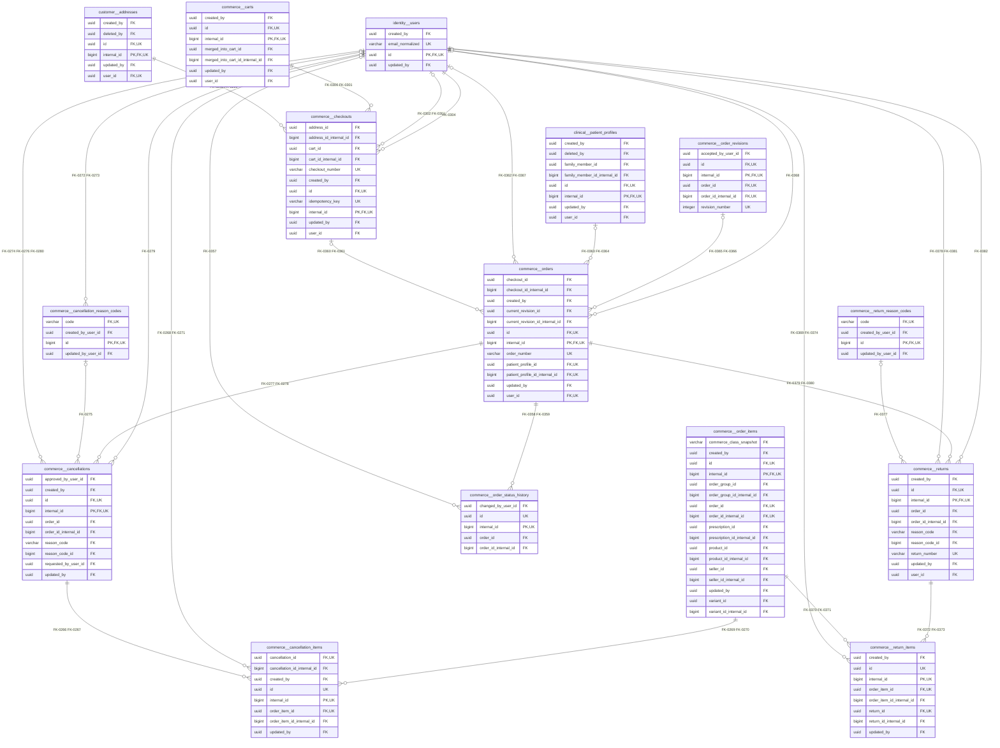
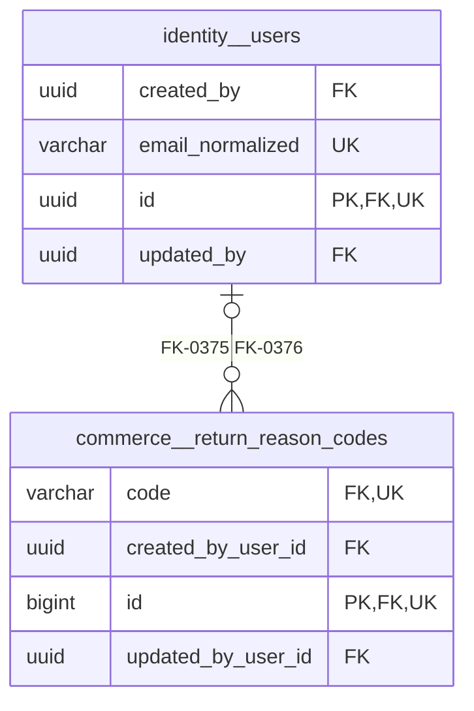

```mermaid
erDiagram
    catalog__commerce_classes {
        varchar code FK, UK
        uuid created_by_user_id FK
        bigint id PK, UK
        uuid updated_by_user_id FK
    }
    catalog__product_variants {
        uuid created_by FK
        uuid deleted_by FK
        uuid id FK, UK
        bigint internal_id PK, FK, UK
        uuid pack_uom_id FK
        bigint pack_uom_id_internal_id FK
        uuid product_id FK
        bigint product_id_internal_id FK
        uuid updated_by FK
    }
    catalog__products {
        uuid brand_id FK
        bigint brand_id_internal_id FK
        uuid category_id FK
        bigint category_id_internal_id FK
        varchar commerce_class FK
        uuid commerce_class_approved_by_user_id FK
        uuid created_by FK
        uuid deleted_by FK
        uuid dosage_form_id FK
        bigint dosage_form_id_internal_id FK
        uuid id FK, UK
        bigint internal_id PK, FK, UK
        uuid manufacturer_id FK
        bigint manufacturer_id_internal_id FK
        uuid updated_by FK
    }
    clinical__prescriptions {
        uuid consultation_id FK
        bigint consultation_id_internal_id FK
        uuid created_by FK
        uuid id FK, UK
        bigint internal_id PK, FK, UK
        uuid patient_profile_id FK, UK
        bigint patient_profile_id_internal_id FK, UK
        uuid prescriber_user_id FK
        uuid reviewed_by_user_id FK
        uuid updated_by FK
        uuid uploaded_by_user_id FK
    }
    commerce__cart_items {
        uuid cart_id FK, UK
        bigint cart_id_internal_id FK
        uuid created_by FK
        uuid id UK
        bigint internal_id PK, UK
        uuid prescription_id FK, UK
        bigint prescription_id_internal_id FK
        uuid product_id FK, UK
        bigint product_id_internal_id FK
        uuid seller_id FK, UK
        bigint seller_id_internal_id FK
        uuid updated_by FK
        uuid variant_id FK, UK
        bigint variant_id_internal_id FK
    }
    commerce__carts {
        uuid created_by FK
        uuid id FK, UK
        bigint internal_id PK, FK, UK
        uuid merged_into_cart_id FK
        bigint merged_into_cart_id_internal_id FK
        uuid updated_by FK
        uuid user_id FK
    }
    commerce__order_allocations {
        uuid created_by FK
        uuid id UK
        bigint internal_id PK, UK
        uuid order_item_id FK
        bigint order_item_id_internal_id FK
        uuid reservation_id FK
        bigint reservation_id_internal_id FK
        uuid seller_id FK
        bigint seller_id_internal_id FK
        uuid updated_by FK
        uuid warehouse_id FK
        bigint warehouse_id_internal_id FK
    }
    commerce__order_charges {
        uuid created_by FK
        uuid id UK
        bigint internal_id PK, UK
        uuid order_id FK
        bigint order_id_internal_id FK
        uuid updated_by FK
    }
    commerce__order_discounts {
        uuid created_by FK
        uuid id UK
        bigint internal_id PK, UK
        uuid order_id FK
        bigint order_id_internal_id FK
        uuid order_item_id FK
        bigint order_item_id_internal_id FK
        uuid promotion_id FK
        bigint promotion_id_internal_id FK
        uuid updated_by FK
    }
    commerce__order_groups {
        uuid created_by FK
        integer group_number UK
        uuid id FK, UK
        bigint internal_id PK, FK, UK
        uuid order_id FK, UK
        bigint order_id_internal_id FK, UK
        uuid seller_id FK
        bigint seller_id_internal_id FK
        uuid updated_by FK
        uuid warehouse_id FK
        bigint warehouse_id_internal_id FK
    }
    commerce__order_items {
        varchar commerce_class_snapshot FK
        uuid created_by FK
        uuid id FK, UK
        bigint internal_id PK, FK, UK
        uuid order_group_id FK
        bigint order_group_id_internal_id FK
        uuid order_id FK, UK
        bigint order_id_internal_id FK, UK
        uuid prescription_id FK
        bigint prescription_id_internal_id FK
        uuid product_id FK
        bigint product_id_internal_id FK
        uuid seller_id FK
        bigint seller_id_internal_id FK
        uuid updated_by FK
        uuid variant_id FK
        bigint variant_id_internal_id FK
    }
    commerce__order_revisions {
        uuid accepted_by_user_id FK
        uuid id FK, UK
        bigint internal_id PK, FK, UK
        uuid order_id FK, UK
        bigint order_id_internal_id FK, UK
        integer revision_number UK
    }
    commerce__orders {
        uuid checkout_id FK
        bigint checkout_id_internal_id FK
        uuid created_by FK
        uuid current_revision_id FK
        bigint current_revision_id_internal_id FK
        uuid id FK, UK
        bigint internal_id PK, FK, UK
        varchar order_number UK
        uuid patient_profile_id FK, UK
        bigint patient_profile_id_internal_id FK, UK
        uuid updated_by FK
        uuid user_id FK, UK
    }
    identity__users {
        uuid created_by FK
        varchar email_normalized UK
        uuid id PK, FK, UK
        uuid updated_by FK
    }
    marketplace__sellers {
        uuid commission_plan_id FK
        bigint commission_plan_id_internal_id FK
        uuid created_by FK
        uuid deleted_by FK
        uuid id FK, UK
        bigint internal_id PK, FK, UK
        uuid organization_id FK
        bigint organization_id_internal_id FK
        uuid updated_by FK
    }
    pricing__promotions {
        uuid created_by FK
        uuid deleted_by FK
        uuid id FK, UK
        bigint internal_id PK, FK, UK
        uuid updated_by FK
    }
    warehouse__stock_reservations {
        uuid bin_id FK
        bigint bin_id_internal_id FK
        uuid created_by FK
        uuid id FK, UK
        bigint internal_id PK, FK, UK
        uuid lot_id FK
        bigint lot_id_internal_id FK
        uuid order_id FK
        bigint order_id_internal_id FK
        uuid order_item_id FK, UK
        bigint order_item_id_internal_id FK, UK
        uuid order_revision_id FK
        bigint order_revision_id_internal_id FK
        varchar reservation_number UK
        uuid updated_by FK
        uuid warehouse_id FK
        bigint warehouse_id_internal_id FK
    }
    warehouse__warehouses {
        uuid created_by FK
        uuid deleted_by FK
        uuid id FK, UK
        bigint internal_id PK, FK, UK
        uuid location_id FK
        bigint location_id_internal_id FK
        uuid organization_id FK
        bigint organization_id_internal_id FK
        uuid updated_by FK
    }
    catalog__commerce_classes o|--o{ commerce__order_items : "FK-0337"
    identity__users o|--o{ commerce__order_items : "FK-0338 FK-0351"
    commerce__order_groups o|--o{ commerce__order_items : "FK-0339 FK-0340 FK-0341 FK-0342"
    commerce__orders ||--o{ commerce__order_items : "FK-0343 FK-0344"
    clinical__prescriptions o|--o{ commerce__order_items : "FK-0345 FK-0346"
    catalog__products ||--o{ commerce__order_items : "FK-0347 FK-0348"
    marketplace__sellers o|--o{ commerce__order_items : "FK-0349 FK-0350"
    catalog__product_variants o|--o{ commerce__order_items : "FK-0352 FK-0353"
    commerce__carts ||--o{ commerce__cart_items : "FK-0281 FK-0282"
    identity__users o|--o{ commerce__cart_items : "FK-0283 FK-0290"
    clinical__prescriptions o|--o{ commerce__cart_items : "FK-0284 FK-0285"
    catalog__products ||--o{ commerce__cart_items : "FK-0286 FK-0287"
    marketplace__sellers o|--o{ commerce__cart_items : "FK-0288 FK-0289"
    catalog__product_variants o|--o{ commerce__cart_items : "FK-0291 FK-0292"
    identity__users o|--o{ commerce__order_groups : "FK-0329 FK-0334"
    commerce__orders ||--o{ commerce__order_groups : "FK-0330 FK-0331"
    marketplace__sellers o|--o{ commerce__order_groups : "FK-0332 FK-0333"
    warehouse__warehouses o|--o{ commerce__order_groups : "FK-0335 FK-0336"
    identity__users o|--o{ commerce__order_allocations : "FK-0305 FK-0314"
    commerce__order_items ||--o{ commerce__order_allocations : "FK-0306 FK-0307"
    warehouse__stock_reservations o|--o{ commerce__order_allocations : "FK-0308 FK-0309 FK-0310 FK-0311"
    marketplace__sellers o|--o{ commerce__order_allocations : "FK-0312 FK-0313"
    warehouse__warehouses ||--o{ commerce__order_allocations : "FK-0315 FK-0316"
    identity__users o|--o{ commerce__carts : "FK-0293 FK-0296 FK-0297"
    commerce__carts o|--o{ commerce__carts : "FK-0294 FK-0295"
    identity__users o|--o{ commerce__order_discounts : "FK-0321 FK-0328"
    commerce__orders ||--o{ commerce__order_discounts : "FK-0322 FK-0323"
    commerce__order_items o|--o{ commerce__order_discounts : "FK-0324 FK-0325"
    pricing__promotions o|--o{ commerce__order_discounts : "FK-0326 FK-0327"
    identity__users o|--o{ commerce__order_charges : "FK-0317 FK-0320"
    commerce__orders ||--o{ commerce__order_charges : "FK-0318 FK-0319"
    identity__users o|--o{ commerce__order_revisions : "FK-0354"
    commerce__orders ||--o{ commerce__order_revisions : "FK-0355 FK-0356"
```

# Commerce ER diagrams

## What this part of the database stores

The `commerce` schema stores carts, checkout, orders, and returns. The names and structural relationships below come from the checked-out database catalog snapshot; business-purpose summaries marked inferred are not product-owner approval.

## Main tables

| Table | Recorded purpose | Table definition |
|---|---|---|
| [`cancellation_items`](../Tables/commerce/cancellation_items.md) | Holds cancellation items records within the commerce domain (shopping cart, checkout, order and returns). Its precise write owner and lifecycle must be accepted during module implementation. (inferred meaning) | [Table contract](../Tables/commerce/cancellation_items.md) |
| [`cancellation_reason_codes`](../Tables/commerce/cancellation_reason_codes.md) | Holds cancellation reason codes records within the commerce domain (shopping cart, checkout, order and returns). Its precise write owner and lifecycle must be accepted during module implementation. (inferred meaning) | [Table contract](../Tables/commerce/cancellation_reason_codes.md) |
| [`cancellations`](../Tables/commerce/cancellations.md) | Holds cancellations records within the commerce domain (shopping cart, checkout, order and returns). Its precise write owner and lifecycle must be accepted during module implementation. (inferred meaning) | [Table contract](../Tables/commerce/cancellations.md) |
| [`cart_items`](../Tables/commerce/cart_items.md) | Holds cart items records within the commerce domain (shopping cart, checkout, order and returns). Its precise write owner and lifecycle must be accepted during module implementation. (inferred meaning) | [Table contract](../Tables/commerce/cart_items.md) |
| [`carts`](../Tables/commerce/carts.md) | Holds carts records within the commerce domain (shopping cart, checkout, order and returns). Its precise write owner and lifecycle must be accepted during module implementation. (inferred meaning) | [Table contract](../Tables/commerce/carts.md) |
| [`checkouts`](../Tables/commerce/checkouts.md) | Holds checkouts records within the commerce domain (shopping cart, checkout, order and returns). Its precise write owner and lifecycle must be accepted during module implementation. (inferred meaning) | [Table contract](../Tables/commerce/checkouts.md) |
| [`order_allocations`](../Tables/commerce/order_allocations.md) | Holds order allocations records within the commerce domain (shopping cart, checkout, order and returns). Its precise write owner and lifecycle must be accepted during module implementation. (inferred meaning) | [Table contract](../Tables/commerce/order_allocations.md) |
| [`order_charges`](../Tables/commerce/order_charges.md) | Holds order charges records within the commerce domain (shopping cart, checkout, order and returns). Its precise write owner and lifecycle must be accepted during module implementation. (inferred meaning) | [Table contract](../Tables/commerce/order_charges.md) |
| [`order_discounts`](../Tables/commerce/order_discounts.md) | Holds order discounts records within the commerce domain (shopping cart, checkout, order and returns). Its precise write owner and lifecycle must be accepted during module implementation. (inferred meaning) | [Table contract](../Tables/commerce/order_discounts.md) |
| [`order_groups`](../Tables/commerce/order_groups.md) | Holds order groups records within the commerce domain (shopping cart, checkout, order and returns). Its precise write owner and lifecycle must be accepted during module implementation. (inferred meaning) | [Table contract](../Tables/commerce/order_groups.md) |
| [`order_items`](../Tables/commerce/order_items.md) | Holds order items records within the commerce domain (shopping cart, checkout, order and returns). Its precise write owner and lifecycle must be accepted during module implementation. (inferred meaning) | [Table contract](../Tables/commerce/order_items.md) |
| [`order_revisions`](../Tables/commerce/order_revisions.md) | Holds order revisions records within the commerce domain (shopping cart, checkout, order and returns). Its precise write owner and lifecycle must be accepted during module implementation. (inferred meaning) | [Table contract](../Tables/commerce/order_revisions.md) |
| [`order_status_history`](../Tables/commerce/order_status_history.md) | Holds order status history records within the commerce domain (shopping cart, checkout, order and returns). Its precise write owner and lifecycle must be accepted during module implementation. (inferred meaning) | [Table contract](../Tables/commerce/order_status_history.md) |
| [`orders`](../Tables/commerce/orders.md) | Holds orders records within the commerce domain (shopping cart, checkout, order and returns). Its precise write owner and lifecycle must be accepted during module implementation. (inferred meaning) | [Table contract](../Tables/commerce/orders.md) |
| [`return_items`](../Tables/commerce/return_items.md) | Holds return items records within the commerce domain (shopping cart, checkout, order and returns). Its precise write owner and lifecycle must be accepted during module implementation. (inferred meaning) | [Table contract](../Tables/commerce/return_items.md) |
| [`return_reason_codes`](../Tables/commerce/return_reason_codes.md) | Holds return reason codes records within the commerce domain (shopping cart, checkout, order and returns). Its precise write owner and lifecycle must be accepted during module implementation. (inferred meaning) | [Table contract](../Tables/commerce/return_reason_codes.md) |
| [`returns`](../Tables/commerce/returns.md) | Holds returns records within the commerce domain (shopping cart, checkout, order and returns). Its precise write owner and lifecycle must be accepted during module implementation. (inferred meaning) | [Table contract](../Tables/commerce/returns.md) |

## ER diagrams

These diagrams show declared PostgreSQL foreign keys from focused source tables. Entity fields include primary keys, unique keys, and FK columns; exact data types remain in the linked table contracts. `PK`, `FK`, and `UK` mark key roles. Relationship cardinality comes from FK nullability and unique constraints/indexes in the recorded catalog.

### Diagram 01 — order_items, cart_items, order_groups, order_allocations, carts, order_discounts, order_charges, order_revisions

This focused view contains every declared FK owned by the listed focus tables. Referenced tables outside that set appear as context. Parallel FK constraints are distinguished by their stable IDs; search those IDs in the [relationship catalog](Relationship-Catalog/commerce.md) for exact columns and actions.

**Entity name mapping**

| Mermaid name | PostgreSQL table |
|---|---|
| `catalog__commerce_classes` | [`catalog.commerce_classes`](../Tables/catalog/commerce_classes.md) |
| `catalog__product_variants` | [`catalog.product_variants`](../Tables/catalog/product_variants.md) |
| `catalog__products` | [`catalog.products`](../Tables/catalog/products.md) |
| `clinical__prescriptions` | [`clinical.prescriptions`](../Tables/clinical/prescriptions.md) |
| `commerce__cart_items` | [`commerce.cart_items`](../Tables/commerce/cart_items.md) |
| `commerce__carts` | [`commerce.carts`](../Tables/commerce/carts.md) |
| `commerce__order_allocations` | [`commerce.order_allocations`](../Tables/commerce/order_allocations.md) |
| `commerce__order_charges` | [`commerce.order_charges`](../Tables/commerce/order_charges.md) |
| `commerce__order_discounts` | [`commerce.order_discounts`](../Tables/commerce/order_discounts.md) |
| `commerce__order_groups` | [`commerce.order_groups`](../Tables/commerce/order_groups.md) |
| `commerce__order_items` | [`commerce.order_items`](../Tables/commerce/order_items.md) |
| `commerce__order_revisions` | [`commerce.order_revisions`](../Tables/commerce/order_revisions.md) |
| `commerce__orders` | [`commerce.orders`](../Tables/commerce/orders.md) |
| `identity__users` | [`identity.users`](../Tables/identity/users.md) |
| `marketplace__sellers` | [`marketplace.sellers`](../Tables/marketplace/sellers.md) |
| `pricing__promotions` | [`pricing.promotions`](../Tables/pricing/promotions.md) |
| `warehouse__stock_reservations` | [`warehouse.stock_reservations`](../Tables/warehouse/stock_reservations.md) |
| `warehouse__warehouses` | [`warehouse.warehouses`](../Tables/warehouse/warehouses.md) |

Coverage: 8 focus tables, 18 entities, 69 FK constraints (69 unique IDs).

### Diagram 02 — orders, order_status_history, cancellations, cancellation_reason_codes, checkouts, cancellation_items, return_items, returns

This focused view contains every declared FK owned by the listed focus tables. Referenced tables outside that set appear as context. Parallel FK constraints are distinguished by their stable IDs; search those IDs in the [relationship catalog](Relationship-Catalog/commerce.md) for exact columns and actions.

**Entity name mapping**

| Mermaid name | PostgreSQL table |
|---|---|
| `clinical__patient_profiles` | [`clinical.patient_profiles`](../Tables/clinical/patient_profiles.md) |
| `commerce__cancellation_items` | [`commerce.cancellation_items`](../Tables/commerce/cancellation_items.md) |
| `commerce__cancellation_reason_codes` | [`commerce.cancellation_reason_codes`](../Tables/commerce/cancellation_reason_codes.md) |
| `commerce__cancellations` | [`commerce.cancellations`](../Tables/commerce/cancellations.md) |
| `commerce__carts` | [`commerce.carts`](../Tables/commerce/carts.md) |
| `commerce__checkouts` | [`commerce.checkouts`](../Tables/commerce/checkouts.md) |
| `commerce__order_items` | [`commerce.order_items`](../Tables/commerce/order_items.md) |
| `commerce__order_revisions` | [`commerce.order_revisions`](../Tables/commerce/order_revisions.md) |
| `commerce__order_status_history` | [`commerce.order_status_history`](../Tables/commerce/order_status_history.md) |
| `commerce__orders` | [`commerce.orders`](../Tables/commerce/orders.md) |
| `commerce__return_items` | [`commerce.return_items`](../Tables/commerce/return_items.md) |
| `commerce__return_reason_codes` | [`commerce.return_reason_codes`](../Tables/commerce/return_reason_codes.md) |
| `commerce__returns` | [`commerce.returns`](../Tables/commerce/returns.md) |
| `customer__addresses` | [`customer.addresses`](../Tables/customer/addresses.md) |
| `identity__users` | [`identity.users`](../Tables/identity/users.md) |

Coverage: 8 focus tables, 15 entities, 46 FK constraints (46 unique IDs).

### Diagram 03 — return_reason_codes

This focused view contains every declared FK owned by the listed focus tables. Referenced tables outside that set appear as context. Parallel FK constraints are distinguished by their stable IDs; search those IDs in the [relationship catalog](Relationship-Catalog/commerce.md) for exact columns and actions.

**Entity name mapping**

| Mermaid name | PostgreSQL table |
|---|---|
| `commerce__return_reason_codes` | [`commerce.return_reason_codes`](../Tables/commerce/return_reason_codes.md) |
| `identity__users` | [`identity.users`](../Tables/identity/users.md) |

Coverage: 1 focus tables, 2 entities, 2 FK constraints (2 unique IDs).

## How the tables connect

- **commerce.cancellation_items → commerce.cancellations:** `cancellation_id_internal_id` references `internal_id`; Each child must reference exactly one parent; each parent may have zero or more child row(s). The database applies `ON DELETE CASCADE`. This keeps the child record tied to an existing parent key.
- **commerce.cancellation_items → commerce.cancellations:** `cancellation_id` references `id`; Each child must reference exactly one parent; each parent may have zero or more child row(s). The database applies `ON DELETE CASCADE`. This keeps the child record tied to an existing parent key.
- **commerce.cancellation_items → identity.users:** `created_by` references `id`; Each child may reference zero or one parent; each parent may have zero or more child row(s). The database applies `ON DELETE RESTRICT`. This keeps the child record tied to an existing parent key.
- **commerce.cancellation_items → commerce.order_items:** `order_item_id_internal_id` references `internal_id`; Each child must reference exactly one parent; each parent may have zero or more child row(s). The database applies `ON DELETE RESTRICT`. This keeps the child record tied to an existing parent key.
- **commerce.cancellation_items → commerce.order_items:** `order_item_id` references `id`; Each child must reference exactly one parent; each parent may have zero or more child row(s). The database applies `ON DELETE RESTRICT`. This keeps the child record tied to an existing parent key.
- **commerce.cancellation_items → identity.users:** `updated_by` references `id`; Each child may reference zero or one parent; each parent may have zero or more child row(s). The database applies `ON DELETE RESTRICT`. This keeps the child record tied to an existing parent key.

Paired public UUID and internal BIGINT foreign keys are real separate constraints. Diagrams use relationship IDs to keep those links readable; each underlying constraint is listed separately in the catalog. The application must keep paired identifiers consistent under the database's numeric-key guards. A relationship does not itself grant read or write permission.

## Important database rules

- The database primary key strategy uses an internal numeric key for most domain rows while retaining public UUID aliases; `identity.users` retains a UUID primary key. The table diagram labels expose the exact keys for each entity.
- A nullable FK permits a child row without that association; it does not make the referenced parent optional when a value is present.
- Composite FKs remain composite in the relationship catalog. Their scope columns must not be dropped when reading the diagram.
- A many-to-many association uses its actual junction table where one exists; no direct association is inferred.
- Authorization, tenant/site scoping, and service write ownership are separate contracts. See the linked database rules and module designs.

## What happens during normal operations

See [WF-003](../../06-Workflows/WF-003-Cart-Quote-and-Reservation.md), [WF-004](../../06-Workflows/WF-004-Prescription-Intake-and-Review.md), [WF-005](../../06-Workflows/WF-005-Payment-and-Confirmation.md), [WF-006](../../06-Workflows/WF-006-Licensed-Site-Allocation.md), [WF-007](../../06-Workflows/WF-007-Picking-Packing-and-Handoff.md), [WF-008](../../06-Workflows/WF-008-Rider-Assignment-and-POD.md), [WF-010](../../06-Workflows/WF-010-Cancellation-Return-and-Refund.md), [WF-013](../../06-Workflows/WF-013-Customer-Support-Triage.md) for the reviewed workflows that touch this schema. The workflows describe business sequencing; these ERDs describe enforced database references.

## Related documents

[Schema overview](../Schema-Overview.md) · [Database rules](../Database-Rules.md) · [Model and parity notes](../Models-and-Parity.md) · [Migration evidence](../Migrations.md) · [Full relationship catalog](Relationship-Catalog.md) · [Non-FK reference review](Logical-References.md) · [Table index](../Tables/commerce/README.md) · [Cart_Checkout HLD](../../03-Modules/Cart_Checkout/HLD.md) · [Cart_Checkout LLD](../../03-Modules/Cart_Checkout/LLD.md) · [Customer_Orders HLD](../../03-Modules/Customer_Orders/HLD.md) · [Customer_Orders LLD](../../03-Modules/Customer_Orders/LLD.md) · [Finance_Payments HLD](../../03-Modules/Finance_Payments/HLD.md) · [Finance_Payments LLD](../../03-Modules/Finance_Payments/LLD.md) · [Order_Operations HLD](../../03-Modules/Order_Operations/HLD.md) · [Order_Operations LLD](../../03-Modules/Order_Operations/LLD.md) · [Pharmacist_Review HLD](../../03-Modules/Pharmacist_Review/HLD.md) · [Pharmacist_Review LLD](../../03-Modules/Pharmacist_Review/LLD.md) · [WF-003](../../06-Workflows/WF-003-Cart-Quote-and-Reservation.md) · [WF-004](../../06-Workflows/WF-004-Prescription-Intake-and-Review.md) · [WF-005](../../06-Workflows/WF-005-Payment-and-Confirmation.md) · [WF-006](../../06-Workflows/WF-006-Licensed-Site-Allocation.md) · [WF-007](../../06-Workflows/WF-007-Picking-Packing-and-Handoff.md) · [WF-008](../../06-Workflows/WF-008-Rider-Assignment-and-POD.md) · [WF-010](../../06-Workflows/WF-010-Cancellation-Return-and-Refund.md) · [WF-013](../../06-Workflows/WF-013-Customer-Support-Triage.md)
