# Compliance ER diagrams

## What this part of the database stores

The `compliance` schema stores regulatory records and retention actions. The names and structural relationships below come from the checked-out database catalog snapshot; business-purpose summaries marked inferred are not product-owner approval.

## Main tables

| Table | Recorded purpose | Table definition |
|---|---|---|
| [`adverse_event_reports`](../Tables/compliance/adverse_event_reports.md) | Holds adverse event reports records within the compliance domain (regulatory documentation and retention actions). Its precise write owner and lifecycle must be accepted during module implementation. (inferred meaning) | [Table contract](../Tables/compliance/adverse_event_reports.md) |
| [`evidence`](../Tables/compliance/evidence.md) | Holds evidence records within the compliance domain (regulatory documentation and retention actions). Its precise write owner and lifecycle must be accepted during module implementation. (inferred meaning) | [Table contract](../Tables/compliance/evidence.md) |
| [`legal_holds`](../Tables/compliance/legal_holds.md) | Holds legal holds records within the compliance domain (regulatory documentation and retention actions). Its precise write owner and lifecycle must be accepted during module implementation. (inferred meaning) | [Table contract](../Tables/compliance/legal_holds.md) |
| [`privacy_requests`](../Tables/compliance/privacy_requests.md) | Holds privacy requests records within the compliance domain (regulatory documentation and retention actions). Its precise write owner and lifecycle must be accepted during module implementation. (inferred meaning) | [Table contract](../Tables/compliance/privacy_requests.md) |
| [`product_recalls`](../Tables/compliance/product_recalls.md) | Holds product recalls records within the compliance domain (regulatory documentation and retention actions). Its precise write owner and lifecycle must be accepted during module implementation. (inferred meaning) | [Table contract](../Tables/compliance/product_recalls.md) |
| [`recall_lots`](../Tables/compliance/recall_lots.md) | Holds recall lots records within the compliance domain (regulatory documentation and retention actions). Its precise write owner and lifecycle must be accepted during module implementation. (inferred meaning) | [Table contract](../Tables/compliance/recall_lots.md) |
| [`regulatory_authorities`](../Tables/compliance/regulatory_authorities.md) | Holds regulatory authorities records within the compliance domain (regulatory documentation and retention actions). Its precise write owner and lifecycle must be accepted during module implementation. (inferred meaning) | [Table contract](../Tables/compliance/regulatory_authorities.md) |
| [`regulatory_registrations`](../Tables/compliance/regulatory_registrations.md) | Holds regulatory registrations records within the compliance domain (regulatory documentation and retention actions). Its precise write owner and lifecycle must be accepted during module implementation. (inferred meaning) | [Table contract](../Tables/compliance/regulatory_registrations.md) |

## ER diagrams

These diagrams show declared PostgreSQL foreign keys from focused source tables. Entity fields include primary keys, unique keys, and FK columns; exact data types remain in the linked table contracts. `PK`, `FK`, and `UK` mark key roles. Relationship cardinality comes from FK nullability and unique constraints/indexes in the recorded catalog.

### Diagram 01 — regulatory_registrations, regulatory_authorities, product_recalls, recall_lots, legal_holds, privacy_requests, evidence, adverse_event_reports

This focused view contains every declared FK owned by the listed focus tables. Referenced tables outside that set appear as context. Parallel FK constraints are distinguished by their stable IDs; search those IDs in the [relationship catalog](Relationship-Catalog/compliance.md) for exact columns and actions.

```mermaid
erDiagram
    catalog__products {
        uuid brand_id FK
        bigint brand_id_internal_id FK
        uuid category_id FK
        bigint category_id_internal_id FK
        varchar commerce_class FK
        uuid commerce_class_approved_by_user_id FK
        uuid created_by FK
        uuid deleted_by FK
        uuid dosage_form_id FK
        bigint dosage_form_id_internal_id FK
        uuid id FK, UK
        bigint internal_id PK, FK, UK
        uuid manufacturer_id FK
        bigint manufacturer_id_internal_id FK
        uuid updated_by FK
    }
    clinical__patient_profiles {
        uuid created_by FK
        uuid deleted_by FK
        uuid family_member_id FK
        bigint family_member_id_internal_id FK
        uuid id FK, UK
        bigint internal_id PK, FK, UK
        uuid updated_by FK
        uuid user_id FK
    }
    clinical__prescriptions {
        uuid consultation_id FK
        bigint consultation_id_internal_id FK
        uuid created_by FK
        uuid id FK, UK
        bigint internal_id PK, FK, UK
        uuid patient_profile_id FK, UK
        bigint patient_profile_id_internal_id FK, UK
        uuid prescriber_user_id FK
        uuid reviewed_by_user_id FK
        uuid updated_by FK
        uuid uploaded_by_user_id FK
    }
    compliance__adverse_event_reports {
        uuid created_by FK
        uuid id UK
        bigint internal_id PK, UK
        uuid patient_profile_id FK
        bigint patient_profile_id_internal_id FK
        uuid prescription_id FK
        bigint prescription_id_internal_id FK
        uuid product_id FK
        bigint product_id_internal_id FK
        varchar report_number UK
        uuid reported_by_user_id FK
        uuid updated_by FK
    }
    compliance__evidence {
        uuid file_object_id FK
        bigint file_object_id_internal_id FK
        uuid id UK
        bigint internal_id PK, UK
    }
    compliance__legal_holds {
        uuid created_by FK
        uuid deleted_by FK
        varchar hold_number UK
        uuid id UK
        bigint internal_id PK, UK
        uuid updated_by FK
    }
    compliance__privacy_requests {
        uuid created_by FK
        uuid id UK
        bigint internal_id PK, UK
        varchar request_number UK
        uuid updated_by FK
        uuid user_id FK
    }
    compliance__product_recalls {
        uuid authority_id FK
        bigint authority_id_internal_id FK
        uuid created_by FK
        uuid id FK, UK
        bigint internal_id PK, FK, UK
        uuid product_id FK
        bigint product_id_internal_id FK
        varchar recall_number UK
        uuid updated_by FK
    }
    compliance__recall_lots {
        uuid created_by FK
        uuid id UK
        bigint internal_id PK, UK
        uuid lot_id FK, UK
        bigint lot_id_internal_id FK
        uuid recall_id FK, UK
        bigint recall_id_internal_id FK
        uuid updated_by FK
    }
    compliance__regulatory_authorities {
        uuid created_by FK
        uuid deleted_by FK
        uuid id FK, UK
        bigint internal_id PK, FK, UK
        uuid updated_by FK
    }
    compliance__regulatory_registrations {
        uuid authority_id FK, UK
        bigint authority_id_internal_id FK
        uuid created_by FK
        uuid deleted_by FK
        uuid document_file_id FK
        bigint document_file_id_internal_id FK
        uuid id UK
        bigint internal_id PK, UK
        uuid location_id FK
        bigint location_id_internal_id FK
        uuid organization_id FK
        bigint organization_id_internal_id FK
        varchar registration_number UK
        varchar registration_type UK
        uuid updated_by FK
    }
    identity__users {
        uuid created_by FK
        varchar email_normalized UK
        uuid id PK, FK, UK
        uuid updated_by FK
    }
    organization__locations {
        varchar code UK
        uuid created_by FK
        uuid deleted_by FK
        uuid id FK, UK
        bigint internal_id PK, FK, UK
        uuid organization_id FK, UK
        bigint organization_id_internal_id FK
        uuid updated_by FK
    }
    organization__organizations {
        uuid created_by FK
        uuid deleted_by FK
        uuid id FK, UK
        bigint internal_id PK, FK, UK
        uuid updated_by FK
    }
    platform__file_objects {
        varchar bucket UK
        uuid created_by FK
        uuid deleted_by FK
        uuid id FK, UK
        bigint internal_id PK, FK, UK
        varchar object_key UK
        uuid updated_by FK
        uuid uploaded_by_user_id FK
    }
    warehouse__inventory_lots {
        varchar batch_number UK
        uuid created_by FK
        date expires_at UK
        uuid goods_receipt_item_id FK
        bigint goods_receipt_item_id_internal_id FK
        uuid id FK, UK
        bigint internal_id PK, FK, UK
        uuid product_id FK, UK
        bigint product_id_internal_id FK
        uuid supplier_id FK
        bigint supplier_id_internal_id FK
        uuid updated_by FK
        uuid variant_id FK, UK
        bigint variant_id_internal_id FK
        uuid warehouse_id FK, UK
        bigint warehouse_id_internal_id FK
    }
    identity__users o|--o{ compliance__regulatory_registrations : "FK-0417 FK-0418 FK-0425"
    platform__file_objects o|--o{ compliance__regulatory_registrations : "FK-0420 FK-0419"
    compliance__regulatory_authorities ||--o{ compliance__regulatory_registrations : "FK-0416 FK-0415"
    organization__organizations o|--o{ compliance__regulatory_registrations : "FK-0423 FK-0424"
    organization__locations o|--o{ compliance__regulatory_registrations : "FK-0422 FK-0421"
    identity__users o|--o{ compliance__regulatory_authorities : "FK-0412 FK-0413 FK-0414"
    identity__users o|--o{ compliance__product_recalls : "FK-0402 FK-0405"
    catalog__products ||--o{ compliance__product_recalls : "FK-0403 FK-0404"
    compliance__regulatory_authorities o|--o{ compliance__product_recalls : "FK-0401 FK-0400"
    identity__users o|--o{ compliance__recall_lots : "FK-0406 FK-0411"
    warehouse__inventory_lots ||--o{ compliance__recall_lots : "FK-0407 FK-0408"
    compliance__product_recalls ||--o{ compliance__recall_lots : "FK-0409 FK-0410"
    identity__users o|--o{ compliance__legal_holds : "FK-0394 FK-0395 FK-0396"
    identity__users ||--o{ compliance__privacy_requests : "FK-0399"
    identity__users o|--o{ compliance__privacy_requests : "FK-0397 FK-0398"
    platform__file_objects o|--o{ compliance__evidence : "FK-0392 FK-0393"
    identity__users o|--o{ compliance__adverse_event_reports : "FK-0383 FK-0391 FK-0390"
    clinical__prescriptions o|--o{ compliance__adverse_event_reports : "FK-0387 FK-0386"
    clinical__patient_profiles o|--o{ compliance__adverse_event_reports : "FK-0384 FK-0385"
    catalog__products o|--o{ compliance__adverse_event_reports : "FK-0388 FK-0389"
```

**Entity name mapping**

| Mermaid name | PostgreSQL table |
|---|---|
| `catalog__products` | [`catalog.products`](../Tables/catalog/products.md) |
| `clinical__patient_profiles` | [`clinical.patient_profiles`](../Tables/clinical/patient_profiles.md) |
| `clinical__prescriptions` | [`clinical.prescriptions`](../Tables/clinical/prescriptions.md) |
| `compliance__adverse_event_reports` | [`compliance.adverse_event_reports`](../Tables/compliance/adverse_event_reports.md) |
| `compliance__evidence` | [`compliance.evidence`](../Tables/compliance/evidence.md) |
| `compliance__legal_holds` | [`compliance.legal_holds`](../Tables/compliance/legal_holds.md) |
| `compliance__privacy_requests` | [`compliance.privacy_requests`](../Tables/compliance/privacy_requests.md) |
| `compliance__product_recalls` | [`compliance.product_recalls`](../Tables/compliance/product_recalls.md) |
| `compliance__recall_lots` | [`compliance.recall_lots`](../Tables/compliance/recall_lots.md) |
| `compliance__regulatory_authorities` | [`compliance.regulatory_authorities`](../Tables/compliance/regulatory_authorities.md) |
| `compliance__regulatory_registrations` | [`compliance.regulatory_registrations`](../Tables/compliance/regulatory_registrations.md) |
| `identity__users` | [`identity.users`](../Tables/identity/users.md) |
| `organization__locations` | [`organization.locations`](../Tables/organization/locations.md) |
| `organization__organizations` | [`organization.organizations`](../Tables/organization/organizations.md) |
| `platform__file_objects` | [`platform.file_objects`](../Tables/platform/file_objects.md) |
| `warehouse__inventory_lots` | [`warehouse.inventory_lots`](../Tables/warehouse/inventory_lots.md) |

Coverage: 8 focus tables, 16 entities, 43 FK constraints (43 unique IDs).

## How the tables connect

- **compliance.adverse_event_reports → identity.users:** `created_by` references `id`; Each child may reference zero or one parent; each parent may have zero or more child row(s). The database applies `ON DELETE RESTRICT`. This keeps the child record tied to an existing parent key.
- **compliance.adverse_event_reports → clinical.patient_profiles:** `patient_profile_id` references `id`; Each child may reference zero or one parent; each parent may have zero or more child row(s). The database applies `ON DELETE SET NULL`. This keeps the child record tied to an existing parent key.
- **compliance.adverse_event_reports → clinical.patient_profiles:** `patient_profile_id_internal_id` references `internal_id`; Each child may reference zero or one parent; each parent may have zero or more child row(s). The database applies `ON DELETE SET NULL`. This keeps the child record tied to an existing parent key.
- **compliance.adverse_event_reports → clinical.prescriptions:** `prescription_id_internal_id` references `internal_id`; Each child may reference zero or one parent; each parent may have zero or more child row(s). The database applies `ON DELETE SET NULL`. This keeps the child record tied to an existing parent key.
- **compliance.adverse_event_reports → clinical.prescriptions:** `prescription_id` references `id`; Each child may reference zero or one parent; each parent may have zero or more child row(s). The database applies `ON DELETE SET NULL`. This keeps the child record tied to an existing parent key.
- **compliance.adverse_event_reports → catalog.products:** `product_id` references `id`; Each child may reference zero or one parent; each parent may have zero or more child row(s). The database applies `ON DELETE SET NULL`. This keeps the child record tied to an existing parent key.

Paired public UUID and internal BIGINT foreign keys are real separate constraints. Diagrams use relationship IDs to keep those links readable; each underlying constraint is listed separately in the catalog. The application must keep paired identifiers consistent under the database's numeric-key guards. A relationship does not itself grant read or write permission.

## Important database rules

- The database primary key strategy uses an internal numeric key for most domain rows while retaining public UUID aliases; `identity.users` retains a UUID primary key. The table diagram labels expose the exact keys for each entity.
- A nullable FK permits a child row without that association; it does not make the referenced parent optional when a value is present.
- Composite FKs remain composite in the relationship catalog. Their scope columns must not be dropped when reading the diagram.
- A many-to-many association uses its actual junction table where one exists; no direct association is inferred.
- Authorization, tenant/site scoping, and service write ownership are separate contracts. See the linked database rules and module designs.

## What happens during normal operations

No dedicated workflow from the 14 documented workflows is mapped to this schema. It is still represented because it exists in the checked-out database catalog.

## Related documents

[Schema overview](../Schema-Overview.md) · [Database rules](../Database-Rules.md) · [Model and parity notes](../Models-and-Parity.md) · [Migration evidence](../Migrations.md) · [Full relationship catalog](Relationship-Catalog.md) · [Non-FK reference review](Logical-References.md) · [Table index](../Tables/compliance/README.md) · [Audit HLD](../../03-Modules/Audit/HLD.md) · [Audit LLD](../../03-Modules/Audit/LLD.md)
