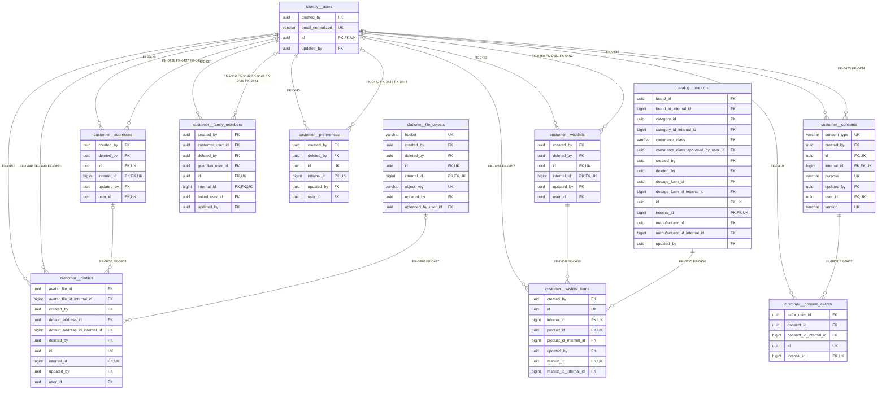

# Customer ER diagrams

## What this part of the database stores

The `customer` schema stores customer profiles and addresses. The names and structural relationships below come from the checked-out database catalog snapshot; business-purpose summaries marked inferred are not product-owner approval.

## Main tables

| Table | Recorded purpose | Table definition |
|---|---|---|
| [`addresses`](../Tables/customer/addresses.md) | Holds addresses records within the customer domain (customer profiles and addresses). Its precise write owner and lifecycle must be accepted during module implementation. (inferred meaning) | [Table contract](../Tables/customer/addresses.md) |
| [`consent_events`](../Tables/customer/consent_events.md) | Holds consent events records within the customer domain (customer profiles and addresses). Its precise write owner and lifecycle must be accepted during module implementation. (inferred meaning) | [Table contract](../Tables/customer/consent_events.md) |
| [`consents`](../Tables/customer/consents.md) | Holds consents records within the customer domain (customer profiles and addresses). Its precise write owner and lifecycle must be accepted during module implementation. (inferred meaning) | [Table contract](../Tables/customer/consents.md) |
| [`family_members`](../Tables/customer/family_members.md) | Holds family members records within the customer domain (customer profiles and addresses). Its precise write owner and lifecycle must be accepted during module implementation. (inferred meaning) | [Table contract](../Tables/customer/family_members.md) |
| [`preferences`](../Tables/customer/preferences.md) | Holds preferences records within the customer domain (customer profiles and addresses). Its precise write owner and lifecycle must be accepted during module implementation. (inferred meaning) | [Table contract](../Tables/customer/preferences.md) |
| [`profiles`](../Tables/customer/profiles.md) | Holds profiles records within the customer domain (customer profiles and addresses). Its precise write owner and lifecycle must be accepted during module implementation. (inferred meaning) | [Table contract](../Tables/customer/profiles.md) |
| [`wishlist_items`](../Tables/customer/wishlist_items.md) | Holds wishlist items records within the customer domain (customer profiles and addresses). Its precise write owner and lifecycle must be accepted during module implementation. (inferred meaning) | [Table contract](../Tables/customer/wishlist_items.md) |
| [`wishlists`](../Tables/customer/wishlists.md) | Holds wishlists records within the customer domain (customer profiles and addresses). Its precise write owner and lifecycle must be accepted during module implementation. (inferred meaning) | [Table contract](../Tables/customer/wishlists.md) |

## ER diagrams

These diagrams show declared PostgreSQL foreign keys from focused source tables. Entity fields include primary keys, unique keys, and FK columns; exact data types remain in the linked table contracts. `PK`, `FK`, and `UK` mark key roles. Relationship cardinality comes from FK nullability and unique constraints/indexes in the recorded catalog.

### Diagram 01 — profiles, addresses, family_members, preferences, wishlists, wishlist_items, consents, consent_events

This focused view contains every declared FK owned by the listed focus tables. Referenced tables outside that set appear as context. Parallel FK constraints are distinguished by their stable IDs; search those IDs in the [relationship catalog](Relationship-Catalog/customer.md) for exact columns and actions.

**Entity name mapping**

| Mermaid name | PostgreSQL table |
|---|---|
| `catalog__products` | [`catalog.products`](../Tables/catalog/products.md) |
| `customer__addresses` | [`customer.addresses`](../Tables/customer/addresses.md) |
| `customer__consent_events` | [`customer.consent_events`](../Tables/customer/consent_events.md) |
| `customer__consents` | [`customer.consents`](../Tables/customer/consents.md) |
| `customer__family_members` | [`customer.family_members`](../Tables/customer/family_members.md) |
| `customer__preferences` | [`customer.preferences`](../Tables/customer/preferences.md) |
| `customer__profiles` | [`customer.profiles`](../Tables/customer/profiles.md) |
| `customer__wishlist_items` | [`customer.wishlist_items`](../Tables/customer/wishlist_items.md) |
| `customer__wishlists` | [`customer.wishlists`](../Tables/customer/wishlists.md) |
| `identity__users` | [`identity.users`](../Tables/identity/users.md) |
| `platform__file_objects` | [`platform.file_objects`](../Tables/platform/file_objects.md) |

Coverage: 8 focus tables, 11 entities, 38 FK constraints (38 unique IDs).

## How the tables connect

- **customer.addresses → identity.users:** `created_by` references `id`; Each child may reference zero or one parent; each parent may have zero or more child row(s). The database applies `ON DELETE RESTRICT`. This keeps the child record tied to an existing parent key.
- **customer.addresses → identity.users:** `deleted_by` references `id`; Each child may reference zero or one parent; each parent may have zero or more child row(s). The database applies `ON DELETE RESTRICT`. This keeps the child record tied to an existing parent key.
- **customer.addresses → identity.users:** `updated_by` references `id`; Each child may reference zero or one parent; each parent may have zero or more child row(s). The database applies `ON DELETE RESTRICT`. This keeps the child record tied to an existing parent key.
- **customer.addresses → identity.users:** `user_id` references `id`; Each child must reference exactly one parent; each parent may have zero or more child row(s). The database applies `ON DELETE CASCADE`. This keeps the child record tied to an existing parent key.
- **customer.consent_events → identity.users:** `actor_user_id` references `id`; Each child may reference zero or one parent; each parent may have zero or more child row(s). The database applies `ON DELETE RESTRICT`. This keeps the child record tied to an existing parent key.
- **customer.consent_events → customer.consents:** `consent_id` references `id`; Each child must reference exactly one parent; each parent may have zero or more child row(s). The database applies `ON DELETE CASCADE`. This keeps the child record tied to an existing parent key.

Paired public UUID and internal BIGINT foreign keys are real separate constraints. Diagrams use relationship IDs to keep those links readable; each underlying constraint is listed separately in the catalog. The application must keep paired identifiers consistent under the database's numeric-key guards. A relationship does not itself grant read or write permission.

## Important database rules

- The database primary key strategy uses an internal numeric key for most domain rows while retaining public UUID aliases; `identity.users` retains a UUID primary key. The table diagram labels expose the exact keys for each entity.
- A nullable FK permits a child row without that association; it does not make the referenced parent optional when a value is present.
- Composite FKs remain composite in the relationship catalog. Their scope columns must not be dropped when reading the diagram.
- A many-to-many association uses its actual junction table where one exists; no direct association is inferred.
- Authorization, tenant/site scoping, and service write ownership are separate contracts. See the linked database rules and module designs.

## What happens during normal operations

See [WF-001](../../06-Workflows/WF-001-Identity-and-Session.md), [WF-003](../../06-Workflows/WF-003-Cart-Quote-and-Reservation.md) for the reviewed workflows that touch this schema. The workflows describe business sequencing; these ERDs describe enforced database references.

## Related documents

[Schema overview](../Schema-Overview.md) · [Database rules](../Database-Rules.md) · [Model and parity notes](../Models-and-Parity.md) · [Migration evidence](../Migrations.md) · [Full relationship catalog](Relationship-Catalog.md) · [Non-FK reference review](Logical-References.md) · [Table index](../Tables/customer/README.md) · [Customer_Accounts HLD](../../03-Modules/Customer_Accounts/HLD.md) · [Customer_Accounts LLD](../../03-Modules/Customer_Accounts/LLD.md) · [WF-001](../../06-Workflows/WF-001-Identity-and-Session.md) · [WF-003](../../06-Workflows/WF-003-Cart-Quote-and-Reservation.md)
