# Finance ER diagrams

## What this part of the database stores

The `finance` schema stores invoices, ledgers, and settlements. The names and structural relationships below come from the checked-out database catalog snapshot; business-purpose summaries marked inferred are not product-owner approval.

## Main tables

| Table | Recorded purpose | Table definition |
|---|---|---|
| [`accounts`](../Tables/finance/accounts.md) | Holds accounts records within the finance domain (invoicing, ledgers and settlement). Its precise write owner and lifecycle must be accepted during module implementation. (inferred meaning) | [Table contract](../Tables/finance/accounts.md) |
| [`credit_notes`](../Tables/finance/credit_notes.md) | Holds credit notes records within the finance domain (invoicing, ledgers and settlement). Its precise write owner and lifecycle must be accepted during module implementation. (inferred meaning) | [Table contract](../Tables/finance/credit_notes.md) |
| [`invoice_items`](../Tables/finance/invoice_items.md) | Holds invoice items records within the finance domain (invoicing, ledgers and settlement). Its precise write owner and lifecycle must be accepted during module implementation. (inferred meaning) | [Table contract](../Tables/finance/invoice_items.md) |
| [`invoices`](../Tables/finance/invoices.md) | Holds invoices records within the finance domain (invoicing, ledgers and settlement). Its precise write owner and lifecycle must be accepted during module implementation. (inferred meaning) | [Table contract](../Tables/finance/invoices.md) |
| [`journal_entries`](../Tables/finance/journal_entries.md) | Holds journal entries records within the finance domain (invoicing, ledgers and settlement). Its precise write owner and lifecycle must be accepted during module implementation. (inferred meaning) | [Table contract](../Tables/finance/journal_entries.md) |
| [`journal_lines`](../Tables/finance/journal_lines.md) | Holds journal lines records within the finance domain (invoicing, ledgers and settlement). Its precise write owner and lifecycle must be accepted during module implementation. (inferred meaning) | [Table contract](../Tables/finance/journal_lines.md) |
| [`settlement_items`](../Tables/finance/settlement_items.md) | Holds settlement items records within the finance domain (invoicing, ledgers and settlement). Its precise write owner and lifecycle must be accepted during module implementation. (inferred meaning) | [Table contract](../Tables/finance/settlement_items.md) |
| [`settlement_runs`](../Tables/finance/settlement_runs.md) | Holds settlement runs records within the finance domain (invoicing, ledgers and settlement). Its precise write owner and lifecycle must be accepted during module implementation. (inferred meaning) | [Table contract](../Tables/finance/settlement_runs.md) |

## ER diagrams

These diagrams show declared PostgreSQL foreign keys from focused source tables. Entity fields include primary keys, unique keys, and FK columns; exact data types remain in the linked table contracts. `PK`, `FK`, and `UK` mark key roles. Relationship cardinality comes from FK nullability and unique constraints/indexes in the recorded catalog.

### Diagram 01 — credit_notes, invoices, settlement_runs, invoice_items, settlement_items, accounts, journal_entries, journal_lines

This focused view contains every declared FK owned by the listed focus tables. Referenced tables outside that set appear as context. Parallel FK constraints are distinguished by their stable IDs; search those IDs in the [relationship catalog](Relationship-Catalog/finance.md) for exact columns and actions.

```mermaid
erDiagram
    commerce__order_groups {
        uuid created_by FK
        integer group_number UK
        uuid id FK, UK
        bigint internal_id PK, FK, UK
        uuid order_id FK, UK
        bigint order_id_internal_id FK, UK
        uuid seller_id FK
        bigint seller_id_internal_id FK
        uuid updated_by FK
        uuid warehouse_id FK
        bigint warehouse_id_internal_id FK
    }
    commerce__order_items {
        varchar commerce_class_snapshot FK
        uuid created_by FK
        uuid id FK, UK
        bigint internal_id PK, FK, UK
        uuid order_group_id FK
        bigint order_group_id_internal_id FK
        uuid order_id FK, UK
        bigint order_id_internal_id FK, UK
        uuid prescription_id FK
        bigint prescription_id_internal_id FK
        uuid product_id FK
        bigint product_id_internal_id FK
        uuid seller_id FK
        bigint seller_id_internal_id FK
        uuid updated_by FK
        uuid variant_id FK
        bigint variant_id_internal_id FK
    }
    commerce__orders {
        uuid checkout_id FK
        bigint checkout_id_internal_id FK
        uuid created_by FK
        uuid current_revision_id FK
        bigint current_revision_id_internal_id FK
        uuid id FK, UK
        bigint internal_id PK, FK, UK
        varchar order_number UK
        uuid patient_profile_id FK, UK
        bigint patient_profile_id_internal_id FK, UK
        uuid updated_by FK
        uuid user_id FK, UK
    }
    finance__accounts {
        uuid created_by FK
        uuid deleted_by FK
        uuid id FK, UK
        bigint internal_id PK, FK, UK
        uuid parent_account_id FK
        bigint parent_account_id_internal_id FK
        uuid updated_by FK
    }
    finance__credit_notes {
        uuid created_by FK
        varchar credit_note_number UK
        uuid document_file_id FK
        bigint document_file_id_internal_id FK
        uuid id UK
        bigint internal_id PK, UK
        uuid invoice_id FK
        bigint invoice_id_internal_id FK
        uuid refund_id FK
        bigint refund_id_internal_id FK
        uuid updated_by FK
    }
    finance__invoice_items {
        uuid created_by FK
        uuid id UK
        bigint internal_id PK, UK
        uuid invoice_id FK
        bigint invoice_id_internal_id FK
        uuid order_item_id FK
        bigint order_item_id_internal_id FK
        uuid updated_by FK
    }
    finance__invoices {
        uuid created_by FK
        uuid document_file_id FK
        bigint document_file_id_internal_id FK
        uuid id FK, UK
        bigint internal_id PK, FK, UK
        varchar invoice_number UK
        uuid order_id FK
        bigint order_id_internal_id FK
        uuid seller_id FK
        bigint seller_id_internal_id FK
        uuid updated_by FK
    }
    finance__journal_entries {
        uuid created_by FK
        varchar entry_number UK
        uuid id FK, UK
        bigint internal_id PK, FK, UK
        uuid reversed_entry_id FK
        bigint reversed_entry_id_internal_id FK
        uuid updated_by FK
    }
    finance__journal_lines {
        uuid account_id FK
        bigint account_id_internal_id FK
        uuid id UK
        bigint internal_id PK, UK
        uuid journal_entry_id FK
        bigint journal_entry_id_internal_id FK
    }
    finance__settlement_items {
        uuid id UK
        bigint internal_id PK, UK
        uuid order_group_id FK
        bigint order_group_id_internal_id FK
        uuid order_id FK
        bigint order_id_internal_id FK
        uuid settlement_run_id FK
        bigint settlement_run_id_internal_id FK
    }
    finance__settlement_runs {
        uuid created_by FK
        uuid id FK, UK
        bigint internal_id PK, FK, UK
        varchar run_number UK
        uuid seller_id FK
        bigint seller_id_internal_id FK
        uuid updated_by FK
    }
    identity__users {
        uuid created_by FK
        varchar email_normalized UK
        uuid id PK, FK, UK
        uuid updated_by FK
    }
    marketplace__sellers {
        uuid commission_plan_id FK
        bigint commission_plan_id_internal_id FK
        uuid created_by FK
        uuid deleted_by FK
        uuid id FK, UK
        bigint internal_id PK, FK, UK
        uuid organization_id FK
        bigint organization_id_internal_id FK
        uuid updated_by FK
    }
    payment__refunds {
        uuid created_by FK
        uuid id FK, UK
        varchar idempotency_key UK
        bigint internal_id PK, FK, UK
        uuid order_id FK
        bigint order_id_internal_id FK
        uuid order_revision_id FK, UK
        bigint order_revision_id_internal_id FK, UK
        uuid payment_transaction_id FK
        bigint payment_transaction_id_internal_id FK
        varchar reason_code FK
        bigint reason_code_id FK
        varchar refund_number UK
        uuid return_id FK
        bigint return_id_internal_id FK
        uuid updated_by FK
    }
    platform__file_objects {
        varchar bucket UK
        uuid created_by FK
        uuid deleted_by FK
        uuid id FK, UK
        bigint internal_id PK, FK, UK
        varchar object_key UK
        uuid updated_by FK
        uuid uploaded_by_user_id FK
    }
    identity__users o|--o{ finance__credit_notes : "FK-0548 FK-0555"
    platform__file_objects o|--o{ finance__credit_notes : "FK-0549 FK-0550"
    payment__refunds o|--o{ finance__credit_notes : "FK-0553 FK-0554"
    finance__invoices ||--o{ finance__credit_notes : "FK-0551 FK-0552"
    identity__users o|--o{ finance__invoices : "FK-0562 FK-0569"
    marketplace__sellers o|--o{ finance__invoices : "FK-0567 FK-0568"
    commerce__orders ||--o{ finance__invoices : "FK-0565 FK-0566"
    platform__file_objects o|--o{ finance__invoices : "FK-0563 FK-0564"
    identity__users o|--o{ finance__settlement_runs : "FK-0584 FK-0587"
    marketplace__sellers ||--o{ finance__settlement_runs : "FK-0585 FK-0586"
    identity__users o|--o{ finance__invoice_items : "FK-0556 FK-0561"
    finance__invoices ||--o{ finance__invoice_items : "FK-0557 FK-0558"
    commerce__order_items o|--o{ finance__invoice_items : "FK-0559 FK-0560"
    finance__settlement_runs ||--o{ finance__settlement_items : "FK-0583 FK-0582"
    commerce__order_groups o|--o{ finance__settlement_items : "FK-0578 FK-0579"
    commerce__orders ||--o{ finance__settlement_items : "FK-0580 FK-0581"
    identity__users o|--o{ finance__accounts : "FK-0543 FK-0544 FK-0547"
    finance__accounts o|--o{ finance__accounts : "FK-0545 FK-0546"
    identity__users o|--o{ finance__journal_entries : "FK-0570 FK-0573"
    finance__journal_entries o|--o{ finance__journal_entries : "FK-0572 FK-0571"
    finance__accounts ||--o{ finance__journal_lines : "FK-0574 FK-0575"
    finance__journal_entries ||--o{ finance__journal_lines : "FK-0577 FK-0576"
```

**Entity name mapping**

| Mermaid name | PostgreSQL table |
|---|---|
| `commerce__order_groups` | [`commerce.order_groups`](../Tables/commerce/order_groups.md) |
| `commerce__order_items` | [`commerce.order_items`](../Tables/commerce/order_items.md) |
| `commerce__orders` | [`commerce.orders`](../Tables/commerce/orders.md) |
| `finance__accounts` | [`finance.accounts`](../Tables/finance/accounts.md) |
| `finance__credit_notes` | [`finance.credit_notes`](../Tables/finance/credit_notes.md) |
| `finance__invoice_items` | [`finance.invoice_items`](../Tables/finance/invoice_items.md) |
| `finance__invoices` | [`finance.invoices`](../Tables/finance/invoices.md) |
| `finance__journal_entries` | [`finance.journal_entries`](../Tables/finance/journal_entries.md) |
| `finance__journal_lines` | [`finance.journal_lines`](../Tables/finance/journal_lines.md) |
| `finance__settlement_items` | [`finance.settlement_items`](../Tables/finance/settlement_items.md) |
| `finance__settlement_runs` | [`finance.settlement_runs`](../Tables/finance/settlement_runs.md) |
| `identity__users` | [`identity.users`](../Tables/identity/users.md) |
| `marketplace__sellers` | [`marketplace.sellers`](../Tables/marketplace/sellers.md) |
| `payment__refunds` | [`payment.refunds`](../Tables/payment/refunds.md) |
| `platform__file_objects` | [`platform.file_objects`](../Tables/platform/file_objects.md) |

Coverage: 8 focus tables, 15 entities, 45 FK constraints (45 unique IDs).

## How the tables connect

- **finance.accounts → identity.users:** `created_by` references `id`; Each child may reference zero or one parent; each parent may have zero or more child row(s). The database applies `ON DELETE RESTRICT`. This keeps the child record tied to an existing parent key.
- **finance.accounts → identity.users:** `deleted_by` references `id`; Each child may reference zero or one parent; each parent may have zero or more child row(s). The database applies `ON DELETE RESTRICT`. This keeps the child record tied to an existing parent key.
- **finance.accounts → finance.accounts:** `parent_account_id` references `id`; Each child may reference zero or one parent; each parent may have zero or more child row(s). The database applies `ON DELETE SET NULL`. This keeps the child record tied to an existing parent key.
- **finance.accounts → finance.accounts:** `parent_account_id_internal_id` references `internal_id`; Each child may reference zero or one parent; each parent may have zero or more child row(s). The database applies `ON DELETE SET NULL`. This keeps the child record tied to an existing parent key.
- **finance.accounts → identity.users:** `updated_by` references `id`; Each child may reference zero or one parent; each parent may have zero or more child row(s). The database applies `ON DELETE RESTRICT`. This keeps the child record tied to an existing parent key.
- **finance.credit_notes → identity.users:** `created_by` references `id`; Each child may reference zero or one parent; each parent may have zero or more child row(s). The database applies `ON DELETE RESTRICT`. This keeps the child record tied to an existing parent key.

Paired public UUID and internal BIGINT foreign keys are real separate constraints. Diagrams use relationship IDs to keep those links readable; each underlying constraint is listed separately in the catalog. The application must keep paired identifiers consistent under the database's numeric-key guards. A relationship does not itself grant read or write permission.

## Important database rules

- The database primary key strategy uses an internal numeric key for most domain rows while retaining public UUID aliases; `identity.users` retains a UUID primary key. The table diagram labels expose the exact keys for each entity.
- A nullable FK permits a child row without that association; it does not make the referenced parent optional when a value is present.
- Composite FKs remain composite in the relationship catalog. Their scope columns must not be dropped when reading the diagram.
- A many-to-many association uses its actual junction table where one exists; no direct association is inferred.
- Authorization, tenant/site scoping, and service write ownership are separate contracts. See the linked database rules and module designs.

## What happens during normal operations

See [WF-005](../../06-Workflows/WF-005-Payment-and-Confirmation.md), [WF-009](../../06-Workflows/WF-009-COD-Collection.md), [WF-010](../../06-Workflows/WF-010-Cancellation-Return-and-Refund.md), [WF-012](../../06-Workflows/WF-012-Report-Export-and-Audit.md) for the reviewed workflows that touch this schema. The workflows describe business sequencing; these ERDs describe enforced database references.

## Related documents

[Schema overview](../Schema-Overview.md) · [Database rules](../Database-Rules.md) · [Model and parity notes](../Models-and-Parity.md) · [Migration evidence](../Migrations.md) · [Full relationship catalog](Relationship-Catalog.md) · [Non-FK reference review](Logical-References.md) · [Table index](../Tables/finance/README.md) · [Finance_Payments HLD](../../03-Modules/Finance_Payments/HLD.md) · [Finance_Payments LLD](../../03-Modules/Finance_Payments/LLD.md) · [Reporting HLD](../../03-Modules/Reporting/HLD.md) · [Reporting LLD](../../03-Modules/Reporting/LLD.md) · [WF-005](../../06-Workflows/WF-005-Payment-and-Confirmation.md) · [WF-009](../../06-Workflows/WF-009-COD-Collection.md) · [WF-010](../../06-Workflows/WF-010-Cancellation-Return-and-Refund.md) · [WF-012](../../06-Workflows/WF-012-Report-Export-and-Audit.md)
