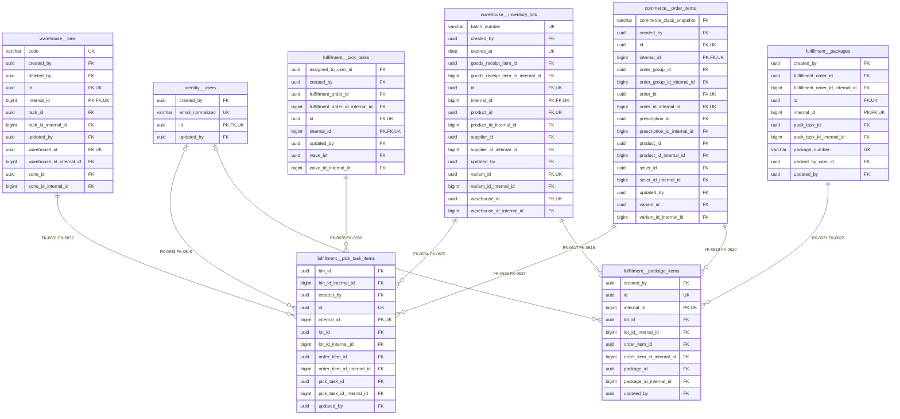

```mermaid
erDiagram
    commerce__order_groups {
        uuid created_by FK
        integer group_number UK
        uuid id FK, UK
        bigint internal_id PK, FK, UK
        uuid order_id FK, UK
        bigint order_id_internal_id FK, UK
        uuid seller_id FK
        bigint seller_id_internal_id FK
        uuid updated_by FK
        uuid warehouse_id FK
        bigint warehouse_id_internal_id FK
    }
    commerce__order_items {
        varchar commerce_class_snapshot FK
        uuid created_by FK
        uuid id FK, UK
        bigint internal_id PK, FK, UK
        uuid order_group_id FK
        bigint order_group_id_internal_id FK
        uuid order_id FK, UK
        bigint order_id_internal_id FK, UK
        uuid prescription_id FK
        bigint prescription_id_internal_id FK
        uuid product_id FK
        bigint product_id_internal_id FK
        uuid seller_id FK
        bigint seller_id_internal_id FK
        uuid updated_by FK
        uuid variant_id FK
        bigint variant_id_internal_id FK
    }
    commerce__order_revisions {
        uuid accepted_by_user_id FK
        uuid id FK, UK
        bigint internal_id PK, FK, UK
        uuid order_id FK, UK
        bigint order_id_internal_id FK, UK
        integer revision_number UK
    }
    commerce__orders {
        uuid checkout_id FK
        bigint checkout_id_internal_id FK
        uuid created_by FK
        uuid current_revision_id FK
        bigint current_revision_id_internal_id FK
        uuid id FK, UK
        bigint internal_id PK, FK, UK
        varchar order_number UK
        uuid patient_profile_id FK, UK
        bigint patient_profile_id_internal_id FK, UK
        uuid updated_by FK
        uuid user_id FK, UK
    }
    fulfillment__fulfillment_events {
        uuid actor_user_id FK
        uuid fulfillment_order_id FK
        bigint fulfillment_order_id_internal_id FK
        uuid id UK
        bigint internal_id PK, UK
    }
    fulfillment__fulfillment_order_items {
        uuid created_by FK
        uuid fulfillment_order_id FK, UK
        bigint fulfillment_order_id_internal_id FK
        uuid id UK
        bigint internal_id PK, UK
        uuid order_item_id FK, UK
        bigint order_item_id_internal_id FK
        uuid updated_by FK
    }
    fulfillment__fulfillment_orders {
        uuid created_by FK
        varchar fulfillment_number UK
        uuid id FK, UK
        bigint internal_id PK, FK, UK
        uuid order_group_id FK
        bigint order_group_id_internal_id FK
        uuid order_id FK
        bigint order_id_internal_id FK
        uuid order_revision_id FK
        bigint order_revision_id_internal_id FK
        uuid seller_id FK
        bigint seller_id_internal_id FK
        uuid updated_by FK
        uuid warehouse_id FK
        bigint warehouse_id_internal_id FK
        uuid wave_id FK
        bigint wave_id_internal_id FK
    }
    fulfillment__pack_tasks {
        uuid assigned_to_user_id FK
        uuid created_by FK
        uuid fulfillment_order_id FK
        bigint fulfillment_order_id_internal_id FK
        uuid id FK, UK
        bigint internal_id PK, FK, UK
        uuid updated_by FK
    }
    fulfillment__packages {
        uuid created_by FK
        uuid fulfillment_order_id FK
        bigint fulfillment_order_id_internal_id FK
        uuid id FK, UK
        bigint internal_id PK, FK, UK
        uuid pack_task_id FK
        bigint pack_task_id_internal_id FK
        varchar package_number UK
        uuid packed_by_user_id FK
        uuid updated_by FK
    }
    fulfillment__pick_tasks {
        uuid assigned_to_user_id FK
        uuid created_by FK
        uuid fulfillment_order_id FK
        bigint fulfillment_order_id_internal_id FK
        uuid id FK, UK
        bigint internal_id PK, FK, UK
        uuid updated_by FK
        uuid wave_id FK
        bigint wave_id_internal_id FK
    }
    fulfillment__picking_wave_orders {
        uuid created_by FK
        uuid fulfillment_order_id FK, UK
        bigint fulfillment_order_id_internal_id FK
        uuid id UK
        bigint internal_id PK, UK
        uuid updated_by FK
        uuid wave_id FK, UK
        bigint wave_id_internal_id FK
    }
    fulfillment__picking_waves {
        uuid created_by FK
        uuid id FK, UK
        bigint internal_id PK, FK, UK
        uuid updated_by FK
        uuid warehouse_id FK, UK
        bigint warehouse_id_internal_id FK, UK
        varchar wave_number UK
    }
    identity__users {
        uuid created_by FK
        varchar email_normalized UK
        uuid id PK, FK, UK
        uuid updated_by FK
    }
    marketplace__sellers {
        uuid commission_plan_id FK
        bigint commission_plan_id_internal_id FK
        uuid created_by FK
        uuid deleted_by FK
        uuid id FK, UK
        bigint internal_id PK, FK, UK
        uuid organization_id FK
        bigint organization_id_internal_id FK
        uuid updated_by FK
    }
    warehouse__warehouses {
        uuid created_by FK
        uuid deleted_by FK
        uuid id FK, UK
        bigint internal_id PK, FK, UK
        uuid location_id FK
        bigint location_id_internal_id FK
        uuid organization_id FK
        bigint organization_id_internal_id FK
        uuid updated_by FK
    }
    fulfillment__picking_waves o|--o{ fulfillment__fulfillment_orders : "FK-0597 FK-0598"
    identity__users o|--o{ fulfillment__fulfillment_orders : "FK-0599 FK-0608"
    commerce__order_groups o|--o{ fulfillment__fulfillment_orders : "FK-0600 FK-0601"
    commerce__orders ||--o{ fulfillment__fulfillment_orders : "FK-0602 FK-0603"
    commerce__order_revisions o|--o{ fulfillment__fulfillment_orders : "FK-0604 FK-0605"
    marketplace__sellers o|--o{ fulfillment__fulfillment_orders : "FK-0606 FK-0607"
    warehouse__warehouses ||--o{ fulfillment__fulfillment_orders : "FK-0609 FK-0610"
    identity__users o|--o{ fulfillment__picking_waves : "FK-0654 FK-0655"
    warehouse__warehouses ||--o{ fulfillment__picking_waves : "FK-0656 FK-0657"
    identity__users o|--o{ fulfillment__pick_tasks : "FK-0641 FK-0642 FK-0645"
    fulfillment__fulfillment_orders ||--o{ fulfillment__pick_tasks : "FK-0643 FK-0644"
    fulfillment__picking_waves o|--o{ fulfillment__pick_tasks : "FK-0646 FK-0647"
    identity__users o|--o{ fulfillment__picking_wave_orders : "FK-0648 FK-0651"
    fulfillment__fulfillment_orders ||--o{ fulfillment__picking_wave_orders : "FK-0649 FK-0650"
    fulfillment__picking_waves ||--o{ fulfillment__picking_wave_orders : "FK-0652 FK-0653"
    identity__users o|--o{ fulfillment__pack_tasks : "FK-0611 FK-0612 FK-0615"
    fulfillment__fulfillment_orders ||--o{ fulfillment__pack_tasks : "FK-0613 FK-0614"
    identity__users o|--o{ fulfillment__packages : "FK-0624 FK-0629 FK-0630"
    fulfillment__fulfillment_orders ||--o{ fulfillment__packages : "FK-0625 FK-0626"
    fulfillment__pack_tasks o|--o{ fulfillment__packages : "FK-0627 FK-0628"
    identity__users o|--o{ fulfillment__fulfillment_events : "FK-0588"
    fulfillment__fulfillment_orders ||--o{ fulfillment__fulfillment_events : "FK-0589 FK-0590"
    identity__users o|--o{ fulfillment__fulfillment_order_items : "FK-0591 FK-0596"
    fulfillment__fulfillment_orders ||--o{ fulfillment__fulfillment_order_items : "FK-0592 FK-0593"
    commerce__order_items ||--o{ fulfillment__fulfillment_order_items : "FK-0594 FK-0595"
```

# Fulfillment ER diagrams

## What this part of the database stores

The `fulfillment` schema stores picking, packing, and shipment preparation. The names and structural relationships below come from the checked-out database catalog snapshot; business-purpose summaries marked inferred are not product-owner approval.

## Main tables

| Table | Recorded purpose | Table definition |
|---|---|---|
| [`fulfillment_events`](../Tables/fulfillment/fulfillment_events.md) | Holds fulfillment events records within the fulfillment domain (picking, packing, and shipment preparation). Its precise write owner and lifecycle must be accepted during module implementation. (inferred meaning) | [Table contract](../Tables/fulfillment/fulfillment_events.md) |
| [`fulfillment_order_items`](../Tables/fulfillment/fulfillment_order_items.md) | Holds fulfillment order items records within the fulfillment domain (picking, packing, and shipment preparation). Its precise write owner and lifecycle must be accepted during module implementation. (inferred meaning) | [Table contract](../Tables/fulfillment/fulfillment_order_items.md) |
| [`fulfillment_orders`](../Tables/fulfillment/fulfillment_orders.md) | Holds fulfillment orders records within the fulfillment domain (picking, packing, and shipment preparation). Its precise write owner and lifecycle must be accepted during module implementation. (inferred meaning) | [Table contract](../Tables/fulfillment/fulfillment_orders.md) |
| [`pack_tasks`](../Tables/fulfillment/pack_tasks.md) | Holds pack tasks records within the fulfillment domain (picking, packing, and shipment preparation). Its precise write owner and lifecycle must be accepted during module implementation. (inferred meaning) | [Table contract](../Tables/fulfillment/pack_tasks.md) |
| [`package_items`](../Tables/fulfillment/package_items.md) | Holds package items records within the fulfillment domain (picking, packing, and shipment preparation). Its precise write owner and lifecycle must be accepted during module implementation. (inferred meaning) | [Table contract](../Tables/fulfillment/package_items.md) |
| [`packages`](../Tables/fulfillment/packages.md) | Holds packages records within the fulfillment domain (picking, packing, and shipment preparation). Its precise write owner and lifecycle must be accepted during module implementation. (inferred meaning) | [Table contract](../Tables/fulfillment/packages.md) |
| [`pick_task_items`](../Tables/fulfillment/pick_task_items.md) | Holds pick task items records within the fulfillment domain (picking, packing, and shipment preparation). Its precise write owner and lifecycle must be accepted during module implementation. (inferred meaning) | [Table contract](../Tables/fulfillment/pick_task_items.md) |
| [`pick_tasks`](../Tables/fulfillment/pick_tasks.md) | Holds pick tasks records within the fulfillment domain (picking, packing, and shipment preparation). Its precise write owner and lifecycle must be accepted during module implementation. (inferred meaning) | [Table contract](../Tables/fulfillment/pick_tasks.md) |
| [`picking_wave_orders`](../Tables/fulfillment/picking_wave_orders.md) | Holds picking wave orders records within the fulfillment domain (picking, packing, and shipment preparation). Its precise write owner and lifecycle must be accepted during module implementation. (inferred meaning) | [Table contract](../Tables/fulfillment/picking_wave_orders.md) |
| [`picking_waves`](../Tables/fulfillment/picking_waves.md) | Holds picking waves records within the fulfillment domain (picking, packing, and shipment preparation). Its precise write owner and lifecycle must be accepted during module implementation. (inferred meaning) | [Table contract](../Tables/fulfillment/picking_waves.md) |

## ER diagrams

These diagrams show declared PostgreSQL foreign keys from focused source tables. Entity fields include primary keys, unique keys, and FK columns; exact data types remain in the linked table contracts. `PK`, `FK`, and `UK` mark key roles. Relationship cardinality comes from FK nullability and unique constraints/indexes in the recorded catalog.

### Diagram 01 — fulfillment_orders, picking_waves, pick_tasks, picking_wave_orders, pack_tasks, packages, fulfillment_events, fulfillment_order_items

This focused view contains every declared FK owned by the listed focus tables. Referenced tables outside that set appear as context. Parallel FK constraints are distinguished by their stable IDs; search those IDs in the [relationship catalog](Relationship-Catalog/fulfillment.md) for exact columns and actions.

**Entity name mapping**

| Mermaid name | PostgreSQL table |
|---|---|
| `commerce__order_groups` | [`commerce.order_groups`](../Tables/commerce/order_groups.md) |
| `commerce__order_items` | [`commerce.order_items`](../Tables/commerce/order_items.md) |
| `commerce__order_revisions` | [`commerce.order_revisions`](../Tables/commerce/order_revisions.md) |
| `commerce__orders` | [`commerce.orders`](../Tables/commerce/orders.md) |
| `fulfillment__fulfillment_events` | [`fulfillment.fulfillment_events`](../Tables/fulfillment/fulfillment_events.md) |
| `fulfillment__fulfillment_order_items` | [`fulfillment.fulfillment_order_items`](../Tables/fulfillment/fulfillment_order_items.md) |
| `fulfillment__fulfillment_orders` | [`fulfillment.fulfillment_orders`](../Tables/fulfillment/fulfillment_orders.md) |
| `fulfillment__pack_tasks` | [`fulfillment.pack_tasks`](../Tables/fulfillment/pack_tasks.md) |
| `fulfillment__packages` | [`fulfillment.packages`](../Tables/fulfillment/packages.md) |
| `fulfillment__pick_tasks` | [`fulfillment.pick_tasks`](../Tables/fulfillment/pick_tasks.md) |
| `fulfillment__picking_wave_orders` | [`fulfillment.picking_wave_orders`](../Tables/fulfillment/picking_wave_orders.md) |
| `fulfillment__picking_waves` | [`fulfillment.picking_waves`](../Tables/fulfillment/picking_waves.md) |
| `identity__users` | [`identity.users`](../Tables/identity/users.md) |
| `marketplace__sellers` | [`marketplace.sellers`](../Tables/marketplace/sellers.md) |
| `warehouse__warehouses` | [`warehouse.warehouses`](../Tables/warehouse/warehouses.md) |

Coverage: 8 focus tables, 15 entities, 52 FK constraints (52 unique IDs).

### Diagram 02 — pick_task_items, package_items

This focused view contains every declared FK owned by the listed focus tables. Referenced tables outside that set appear as context. Parallel FK constraints are distinguished by their stable IDs; search those IDs in the [relationship catalog](Relationship-Catalog/fulfillment.md) for exact columns and actions.

**Entity name mapping**

| Mermaid name | PostgreSQL table |
|---|---|
| `commerce__order_items` | [`commerce.order_items`](../Tables/commerce/order_items.md) |
| `fulfillment__package_items` | [`fulfillment.package_items`](../Tables/fulfillment/package_items.md) |
| `fulfillment__packages` | [`fulfillment.packages`](../Tables/fulfillment/packages.md) |
| `fulfillment__pick_task_items` | [`fulfillment.pick_task_items`](../Tables/fulfillment/pick_task_items.md) |
| `fulfillment__pick_tasks` | [`fulfillment.pick_tasks`](../Tables/fulfillment/pick_tasks.md) |
| `identity__users` | [`identity.users`](../Tables/identity/users.md) |
| `warehouse__bins` | [`warehouse.bins`](../Tables/warehouse/bins.md) |
| `warehouse__inventory_lots` | [`warehouse.inventory_lots`](../Tables/warehouse/inventory_lots.md) |

Coverage: 2 focus tables, 8 entities, 18 FK constraints (18 unique IDs).

## How the tables connect

- **fulfillment.fulfillment_events → identity.users:** `actor_user_id` references `id`; Each child may reference zero or one parent; each parent may have zero or more child row(s). The database applies `ON DELETE RESTRICT`. This keeps the child record tied to an existing parent key.
- **fulfillment.fulfillment_events → fulfillment.fulfillment_orders:** `fulfillment_order_id_internal_id` references `internal_id`; Each child must reference exactly one parent; each parent may have zero or more child row(s). The database applies `ON DELETE CASCADE`. This keeps the child record tied to an existing parent key.
- **fulfillment.fulfillment_events → fulfillment.fulfillment_orders:** `fulfillment_order_id` references `id`; Each child must reference exactly one parent; each parent may have zero or more child row(s). The database applies `ON DELETE CASCADE`. This keeps the child record tied to an existing parent key.
- **fulfillment.fulfillment_order_items → identity.users:** `created_by` references `id`; Each child may reference zero or one parent; each parent may have zero or more child row(s). The database applies `ON DELETE RESTRICT`. This keeps the child record tied to an existing parent key.
- **fulfillment.fulfillment_order_items → fulfillment.fulfillment_orders:** `fulfillment_order_id` references `id`; Each child must reference exactly one parent; each parent may have zero or more child row(s). The database applies `ON DELETE CASCADE`. This keeps the child record tied to an existing parent key.
- **fulfillment.fulfillment_order_items → fulfillment.fulfillment_orders:** `fulfillment_order_id_internal_id` references `internal_id`; Each child must reference exactly one parent; each parent may have zero or more child row(s). The database applies `ON DELETE CASCADE`. This keeps the child record tied to an existing parent key.

Paired public UUID and internal BIGINT foreign keys are real separate constraints. Diagrams use relationship IDs to keep those links readable; each underlying constraint is listed separately in the catalog. The application must keep paired identifiers consistent under the database's numeric-key guards. A relationship does not itself grant read or write permission.

## Important database rules

- The database primary key strategy uses an internal numeric key for most domain rows while retaining public UUID aliases; `identity.users` retains a UUID primary key. The table diagram labels expose the exact keys for each entity.
- A nullable FK permits a child row without that association; it does not make the referenced parent optional when a value is present.
- Composite FKs remain composite in the relationship catalog. Their scope columns must not be dropped when reading the diagram.
- A many-to-many association uses its actual junction table where one exists; no direct association is inferred.
- Authorization, tenant/site scoping, and service write ownership are separate contracts. See the linked database rules and module designs.

## What happens during normal operations

See [WF-007](../../06-Workflows/WF-007-Picking-Packing-and-Handoff.md), [WF-008](../../06-Workflows/WF-008-Rider-Assignment-and-POD.md) for the reviewed workflows that touch this schema. The workflows describe business sequencing; these ERDs describe enforced database references.

## Related documents

[Schema overview](../Schema-Overview.md) · [Database rules](../Database-Rules.md) · [Model and parity notes](../Models-and-Parity.md) · [Migration evidence](../Migrations.md) · [Full relationship catalog](Relationship-Catalog.md) · [Non-FK reference review](Logical-References.md) · [Table index](../Tables/fulfillment/README.md) · [Order_Operations HLD](../../03-Modules/Order-Management/HLD.md) · [Order_Operations LLD](../../03-Modules/Order-Management/LLD.md) · [Store_Operations HLD](../../03-Modules/Store-Operations/HLD.md) · [Store_Operations LLD](../../03-Modules/Store-Operations/LLD.md) · [WF-007](../../06-Workflows/WF-007-Picking-Packing-and-Handoff.md) · [WF-008](../../06-Workflows/WF-008-Rider-Assignment-and-POD.md)
