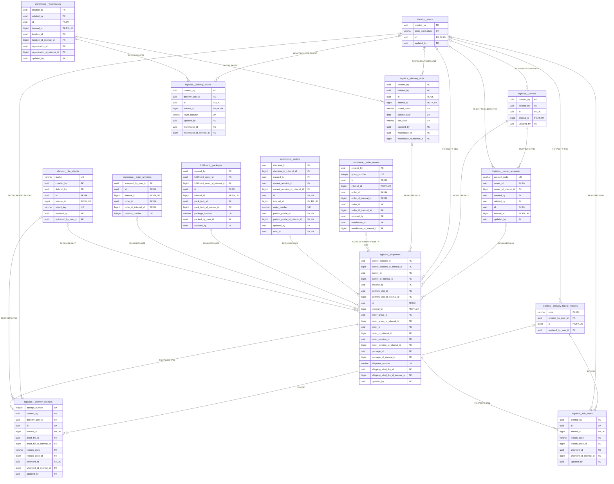

```mermaid
erDiagram
    commerce__returns {
        uuid created_by FK
        uuid id FK, UK
        bigint internal_id PK, FK, UK
        uuid order_id FK
        bigint order_id_internal_id FK
        varchar reason_code FK
        bigint reason_code_id FK
        varchar return_number UK
        uuid updated_by FK
        uuid user_id FK
    }
    identity__users {
        uuid created_by FK
        varchar email_normalized UK
        uuid id PK, FK, UK
        uuid updated_by FK
    }
    logistics__carriers {
        uuid created_by FK
        uuid deleted_by FK
        uuid id FK, UK
        bigint internal_id PK, FK, UK
        uuid updated_by FK
    }
    logistics__delivery_assignments {
        uuid created_by FK
        uuid delivery_user_id FK
        uuid id FK, UK
        bigint internal_id PK, FK, UK
        uuid route_id FK
        bigint route_id_internal_id FK
        uuid shipment_id FK, UK
        bigint shipment_id_internal_id FK, UK
        uuid updated_by FK
    }
    logistics__delivery_location_updates {
        uuid assignment_id FK
        bigint assignment_id_internal_id FK
        uuid delivery_user_id FK
        uuid id UK
        bigint internal_id PK, UK
        bigint shift_id FK
    }
    logistics__delivery_otp_challenges {
        uuid assignment_id FK
        bigint assignment_id_internal_id FK
        uuid id UK
        bigint internal_id PK, UK
        uuid shipment_id FK
        bigint shipment_id_internal_id FK
    }
    logistics__delivery_routes {
        uuid created_by FK
        uuid delivery_user_id FK
        uuid id FK, UK
        bigint internal_id PK, FK, UK
        varchar route_number UK
        uuid updated_by FK
        uuid warehouse_id FK
        bigint warehouse_id_internal_id FK
    }
    logistics__reverse_shipments {
        uuid carrier_id FK
        bigint carrier_id_internal_id FK
        uuid created_by FK
        uuid id UK
        bigint internal_id PK, UK
        uuid return_id FK
        bigint return_id_internal_id FK
        varchar reverse_shipment_number UK
        uuid updated_by FK
    }
    logistics__rider_shifts {
        bigint id PK, FK, UK
        uuid rider_user_id FK, UK
    }
    logistics__serviceability_rules {
        uuid carrier_id FK, UK
        bigint carrier_id_internal_id FK
        uuid created_by FK
        uuid deleted_by FK
        varchar destination_postal_code UK
        uuid id UK
        bigint internal_id PK, UK
        varchar origin_postal_code UK
        varchar service_type UK
        uuid updated_by FK
    }
    logistics__shipment_events {
        uuid carrier_id FK
        bigint carrier_id_internal_id FK
        uuid id UK
        bigint internal_id PK, UK
        uuid shipment_id FK
        bigint shipment_id_internal_id FK
    }
    logistics__shipments {
        uuid carrier_account_id FK
        bigint carrier_account_id_internal_id FK
        uuid carrier_id FK
        bigint carrier_id_internal_id FK
        uuid created_by FK
        uuid delivery_slot_id FK
        bigint delivery_slot_id_internal_id FK
        uuid id FK, UK
        bigint internal_id PK, FK, UK
        uuid order_group_id FK
        bigint order_group_id_internal_id FK
        uuid order_id FK
        bigint order_id_internal_id FK
        uuid order_revision_id FK
        bigint order_revision_id_internal_id FK
        uuid package_id FK
        bigint package_id_internal_id FK
        varchar shipment_number UK
        uuid shipping_label_file_id FK
        bigint shipping_label_file_id_internal_id FK
        uuid updated_by FK
    }
    identity__users o|--o{ logistics__delivery_assignments : "FK-0753 FK-0759"
    identity__users ||--o{ logistics__delivery_assignments : "FK-0754"
    logistics__delivery_routes o|--o{ logistics__delivery_assignments : "FK-0755 FK-0756"
    logistics__shipments ||--o{ logistics__delivery_assignments : "FK-0757 FK-0758"
    logistics__shipments ||--o{ logistics__delivery_otp_challenges : "FK-0774 FK-0775"
    logistics__delivery_assignments ||--o{ logistics__delivery_otp_challenges : "FK-0776 FK-0777"
    logistics__delivery_assignments ||--o{ logistics__delivery_location_updates : "FK-0770 FK-0771"
    identity__users ||--o{ logistics__delivery_location_updates : "FK-0772"
    logistics__rider_shifts o|--o{ logistics__delivery_location_updates : "FK-0773"
    identity__users ||--o{ logistics__rider_shifts : "FK-0799"
    logistics__carriers ||--o{ logistics__serviceability_rules : "FK-0800 FK-0801"
    identity__users o|--o{ logistics__serviceability_rules : "FK-0802 FK-0803 FK-0804"
    logistics__carriers o|--o{ logistics__shipment_events : "FK-0805 FK-0806"
    logistics__shipments ||--o{ logistics__shipment_events : "FK-0807 FK-0808"
    logistics__carriers o|--o{ logistics__reverse_shipments : "FK-0793 FK-0794"
    identity__users o|--o{ logistics__reverse_shipments : "FK-0795 FK-0798"
    commerce__returns ||--o{ logistics__reverse_shipments : "FK-0796 FK-0797"
```

# Logistics ER diagrams

## What this part of the database stores

The `logistics` schema stores riders, shipments, and delivery. The names and structural relationships below come from the checked-out database catalog snapshot; business-purpose summaries marked inferred are not product-owner approval.

## Main tables

| Table | Recorded purpose | Table definition |
|---|---|---|
| [`carrier_accounts`](../Tables/logistics/carrier_accounts.md) | Holds carrier accounts records within the logistics domain (riders, shipments, tracking and delivery). Its precise write owner and lifecycle must be accepted during module implementation. (inferred meaning) | [Table contract](../Tables/logistics/carrier_accounts.md) |
| [`carriers`](../Tables/logistics/carriers.md) | Holds carriers records within the logistics domain (riders, shipments, tracking and delivery). Its precise write owner and lifecycle must be accepted during module implementation. (inferred meaning) | [Table contract](../Tables/logistics/carriers.md) |
| [`delivery_assignments`](../Tables/logistics/delivery_assignments.md) | Holds delivery assignments records within the logistics domain (riders, shipments, tracking and delivery). Its precise write owner and lifecycle must be accepted during module implementation. (inferred meaning) | [Table contract](../Tables/logistics/delivery_assignments.md) |
| [`delivery_attempts`](../Tables/logistics/delivery_attempts.md) | Holds delivery attempts records within the logistics domain (riders, shipments, tracking and delivery). Its precise write owner and lifecycle must be accepted during module implementation. (inferred meaning) | [Table contract](../Tables/logistics/delivery_attempts.md) |
| [`delivery_failure_reasons`](../Tables/logistics/delivery_failure_reasons.md) | Holds delivery failure reasons records within the logistics domain (riders, shipments, tracking and delivery). Its precise write owner and lifecycle must be accepted during module implementation. (inferred meaning) | [Table contract](../Tables/logistics/delivery_failure_reasons.md) |
| [`delivery_location_updates`](../Tables/logistics/delivery_location_updates.md) | Holds delivery location updates records within the logistics domain (riders, shipments, tracking and delivery). Its precise write owner and lifecycle must be accepted during module implementation. (inferred meaning) | [Table contract](../Tables/logistics/delivery_location_updates.md) |
| [`delivery_otp_challenges`](../Tables/logistics/delivery_otp_challenges.md) | Holds delivery otp challenges records within the logistics domain (riders, shipments, tracking and delivery). Its precise write owner and lifecycle must be accepted during module implementation. (inferred meaning) | [Table contract](../Tables/logistics/delivery_otp_challenges.md) |
| [`delivery_routes`](../Tables/logistics/delivery_routes.md) | Holds delivery routes records within the logistics domain (riders, shipments, tracking and delivery). Its precise write owner and lifecycle must be accepted during module implementation. (inferred meaning) | [Table contract](../Tables/logistics/delivery_routes.md) |
| [`delivery_slots`](../Tables/logistics/delivery_slots.md) | Holds delivery slots records within the logistics domain (riders, shipments, tracking and delivery). Its precise write owner and lifecycle must be accepted during module implementation. (inferred meaning) | [Table contract](../Tables/logistics/delivery_slots.md) |
| [`ndr_cases`](../Tables/logistics/ndr_cases.md) | Holds ndr cases records within the logistics domain (riders, shipments, tracking and delivery). Its precise write owner and lifecycle must be accepted during module implementation. (inferred meaning) | [Table contract](../Tables/logistics/ndr_cases.md) |
| [`reverse_shipments`](../Tables/logistics/reverse_shipments.md) | Holds reverse shipments records within the logistics domain (riders, shipments, tracking and delivery). Its precise write owner and lifecycle must be accepted during module implementation. (inferred meaning) | [Table contract](../Tables/logistics/reverse_shipments.md) |
| [`rider_shifts`](../Tables/logistics/rider_shifts.md) | Holds rider shifts records within the logistics domain (riders, shipments, tracking and delivery). Its precise write owner and lifecycle must be accepted during module implementation. (inferred meaning) | [Table contract](../Tables/logistics/rider_shifts.md) |
| [`serviceability_rules`](../Tables/logistics/serviceability_rules.md) | Holds serviceability rules records within the logistics domain (riders, shipments, tracking and delivery). Its precise write owner and lifecycle must be accepted during module implementation. (inferred meaning) | [Table contract](../Tables/logistics/serviceability_rules.md) |
| [`shipment_events`](../Tables/logistics/shipment_events.md) | Holds shipment events records within the logistics domain (riders, shipments, tracking and delivery). Its precise write owner and lifecycle must be accepted during module implementation. (inferred meaning) | [Table contract](../Tables/logistics/shipment_events.md) |
| [`shipments`](../Tables/logistics/shipments.md) | Holds shipments records within the logistics domain (riders, shipments, tracking and delivery). Its precise write owner and lifecycle must be accepted during module implementation. (inferred meaning) | [Table contract](../Tables/logistics/shipments.md) |

## ER diagrams

These diagrams show declared PostgreSQL foreign keys from focused source tables. Entity fields include primary keys, unique keys, and FK columns; exact data types remain in the linked table contracts. `PK`, `FK`, and `UK` mark key roles. Relationship cardinality comes from FK nullability and unique constraints/indexes in the recorded catalog.

### Diagram 01 — shipments, carrier_accounts, carriers, delivery_attempts, ndr_cases, delivery_failure_reasons, delivery_slots, delivery_routes

This focused view contains every declared FK owned by the listed focus tables. Referenced tables outside that set appear as context. Parallel FK constraints are distinguished by their stable IDs; search those IDs in the [relationship catalog](Relationship-Catalog/logistics.md) for exact columns and actions.

**Entity name mapping**

| Mermaid name | PostgreSQL table |
|---|---|
| `commerce__order_groups` | [`commerce.order_groups`](../Tables/commerce/order_groups.md) |
| `commerce__order_revisions` | [`commerce.order_revisions`](../Tables/commerce/order_revisions.md) |
| `commerce__orders` | [`commerce.orders`](../Tables/commerce/orders.md) |
| `fulfillment__packages` | [`fulfillment.packages`](../Tables/fulfillment/packages.md) |
| `identity__users` | [`identity.users`](../Tables/identity/users.md) |
| `logistics__carrier_accounts` | [`logistics.carrier_accounts`](../Tables/logistics/carrier_accounts.md) |
| `logistics__carriers` | [`logistics.carriers`](../Tables/logistics/carriers.md) |
| `logistics__delivery_attempts` | [`logistics.delivery_attempts`](../Tables/logistics/delivery_attempts.md) |
| `logistics__delivery_failure_reasons` | [`logistics.delivery_failure_reasons`](../Tables/logistics/delivery_failure_reasons.md) |
| `logistics__delivery_routes` | [`logistics.delivery_routes`](../Tables/logistics/delivery_routes.md) |
| `logistics__delivery_slots` | [`logistics.delivery_slots`](../Tables/logistics/delivery_slots.md) |
| `logistics__ndr_cases` | [`logistics.ndr_cases`](../Tables/logistics/ndr_cases.md) |
| `logistics__shipments` | [`logistics.shipments`](../Tables/logistics/shipments.md) |
| `platform__file_objects` | [`platform.file_objects`](../Tables/platform/file_objects.md) |
| `warehouse__warehouses` | [`warehouse.warehouses`](../Tables/warehouse/warehouses.md) |

Coverage: 8 focus tables, 15 entities, 53 FK constraints (53 unique IDs).

### Diagram 02 — delivery_assignments, delivery_otp_challenges, delivery_location_updates, rider_shifts, serviceability_rules, shipment_events, reverse_shipments

This focused view contains every declared FK owned by the listed focus tables. Referenced tables outside that set appear as context. Parallel FK constraints are distinguished by their stable IDs; search those IDs in the [relationship catalog](Relationship-Catalog/logistics.md) for exact columns and actions.

**Entity name mapping**

| Mermaid name | PostgreSQL table |
|---|---|
| `commerce__returns` | [`commerce.returns`](../Tables/commerce/returns.md) |
| `identity__users` | [`identity.users`](../Tables/identity/users.md) |
| `logistics__carriers` | [`logistics.carriers`](../Tables/logistics/carriers.md) |
| `logistics__delivery_assignments` | [`logistics.delivery_assignments`](../Tables/logistics/delivery_assignments.md) |
| `logistics__delivery_location_updates` | [`logistics.delivery_location_updates`](../Tables/logistics/delivery_location_updates.md) |
| `logistics__delivery_otp_challenges` | [`logistics.delivery_otp_challenges`](../Tables/logistics/delivery_otp_challenges.md) |
| `logistics__delivery_routes` | [`logistics.delivery_routes`](../Tables/logistics/delivery_routes.md) |
| `logistics__reverse_shipments` | [`logistics.reverse_shipments`](../Tables/logistics/reverse_shipments.md) |
| `logistics__rider_shifts` | [`logistics.rider_shifts`](../Tables/logistics/rider_shifts.md) |
| `logistics__serviceability_rules` | [`logistics.serviceability_rules`](../Tables/logistics/serviceability_rules.md) |
| `logistics__shipment_events` | [`logistics.shipment_events`](../Tables/logistics/shipment_events.md) |
| `logistics__shipments` | [`logistics.shipments`](../Tables/logistics/shipments.md) |

Coverage: 7 focus tables, 12 entities, 31 FK constraints (31 unique IDs).

## How the tables connect

- **logistics.carrier_accounts → logistics.carriers:** `carrier_id` references `id`; Each child must reference exactly one parent; each parent may have zero or more child row(s). The database applies `ON DELETE CASCADE`. This keeps the child record tied to an existing parent key.
- **logistics.carrier_accounts → logistics.carriers:** `carrier_id_internal_id` references `internal_id`; Each child must reference exactly one parent; each parent may have zero or more child row(s). The database applies `ON DELETE CASCADE`. This keeps the child record tied to an existing parent key.
- **logistics.carrier_accounts → identity.users:** `created_by` references `id`; Each child may reference zero or one parent; each parent may have zero or more child row(s). The database applies `ON DELETE RESTRICT`. This keeps the child record tied to an existing parent key.
- **logistics.carrier_accounts → identity.users:** `deleted_by` references `id`; Each child may reference zero or one parent; each parent may have zero or more child row(s). The database applies `ON DELETE RESTRICT`. This keeps the child record tied to an existing parent key.
- **logistics.carrier_accounts → identity.users:** `updated_by` references `id`; Each child may reference zero or one parent; each parent may have zero or more child row(s). The database applies `ON DELETE RESTRICT`. This keeps the child record tied to an existing parent key.
- **logistics.carriers → identity.users:** `created_by` references `id`; Each child may reference zero or one parent; each parent may have zero or more child row(s). The database applies `ON DELETE RESTRICT`. This keeps the child record tied to an existing parent key.

Paired public UUID and internal BIGINT foreign keys are real separate constraints. Diagrams use relationship IDs to keep those links readable; each underlying constraint is listed separately in the catalog. The application must keep paired identifiers consistent under the database's numeric-key guards. A relationship does not itself grant read or write permission.

## Important database rules

- The database primary key strategy uses an internal numeric key for most domain rows while retaining public UUID aliases; `identity.users` retains a UUID primary key. The table diagram labels expose the exact keys for each entity.
- A nullable FK permits a child row without that association; it does not make the referenced parent optional when a value is present.
- Composite FKs remain composite in the relationship catalog. Their scope columns must not be dropped when reading the diagram.
- A many-to-many association uses its actual junction table where one exists; no direct association is inferred.
- Authorization, tenant/site scoping, and service write ownership are separate contracts. See the linked database rules and module designs.

## What happens during normal operations

See [WF-008](../../06-Workflows/WF-008-Rider-Assignment-and-POD.md), [WF-009](../../06-Workflows/WF-009-COD-Collection.md), [WF-010](../../06-Workflows/WF-010-Cancellation-Return-and-Refund.md) for the reviewed workflows that touch this schema. The workflows describe business sequencing; these ERDs describe enforced database references.

## Related documents

[Schema overview](../Schema-Overview.md) · [Database rules](../Database-Rules.md) · [Model and parity notes](../Models-and-Parity.md) · [Migration evidence](../Migrations.md) · [Full relationship catalog](Relationship-Catalog.md) · [Non-FK reference review](Logical-References.md) · [Table index](../Tables/logistics/README.md) · [Customer_Orders HLD](../../03-Modules/Customer_Orders/HLD.md) · [Customer_Orders LLD](../../03-Modules/Customer_Orders/LLD.md) · [Delivery_Operations HLD](../../03-Modules/Delivery_Operations/HLD.md) · [Delivery_Operations LLD](../../03-Modules/Delivery_Operations/LLD.md) · [Rider_App HLD](../../03-Modules/Rider_App/HLD.md) · [Rider_App LLD](../../03-Modules/Rider_App/LLD.md) · [WF-008](../../06-Workflows/WF-008-Rider-Assignment-and-POD.md) · [WF-009](../../06-Workflows/WF-009-COD-Collection.md) · [WF-010](../../06-Workflows/WF-010-Cancellation-Return-and-Refund.md)
