# Marketplace ER diagrams

## What this part of the database stores

The `marketplace` schema stores sellers and listings. The names and structural relationships below come from the checked-out database catalog snapshot; business-purpose summaries marked inferred are not product-owner approval.

## Main tables

| Table | Recorded purpose | Table definition |
|---|---|---|
| [`commission_plans`](../Tables/marketplace/commission_plans.md) | Holds commission plans records within the marketplace domain (sellers and commercial listings). Its precise write owner and lifecycle must be accepted during module implementation. (inferred meaning) | [Table contract](../Tables/marketplace/commission_plans.md) |
| [`seller_commission_assignments`](../Tables/marketplace/seller_commission_assignments.md) | Holds seller commission assignments records within the marketplace domain (sellers and commercial listings). Its precise write owner and lifecycle must be accepted during module implementation. (inferred meaning) | [Table contract](../Tables/marketplace/seller_commission_assignments.md) |
| [`seller_locations`](../Tables/marketplace/seller_locations.md) | Holds seller locations records within the marketplace domain (sellers and commercial listings). Its precise write owner and lifecycle must be accepted during module implementation. (inferred meaning) | [Table contract](../Tables/marketplace/seller_locations.md) |
| [`seller_product_listings`](../Tables/marketplace/seller_product_listings.md) | Holds seller product listings records within the marketplace domain (sellers and commercial listings). Its precise write owner and lifecycle must be accepted during module implementation. (inferred meaning) | [Table contract](../Tables/marketplace/seller_product_listings.md) |
| [`seller_ratings`](../Tables/marketplace/seller_ratings.md) | Holds seller ratings records within the marketplace domain (sellers and commercial listings). Its precise write owner and lifecycle must be accepted during module implementation. (inferred meaning) | [Table contract](../Tables/marketplace/seller_ratings.md) |
| [`seller_service_levels`](../Tables/marketplace/seller_service_levels.md) | Holds seller service levels records within the marketplace domain (sellers and commercial listings). Its precise write owner and lifecycle must be accepted during module implementation. (inferred meaning) | [Table contract](../Tables/marketplace/seller_service_levels.md) |
| [`sellers`](../Tables/marketplace/sellers.md) | Holds sellers records within the marketplace domain (sellers and commercial listings). Its precise write owner and lifecycle must be accepted during module implementation. (inferred meaning) | [Table contract](../Tables/marketplace/sellers.md) |

## ER diagrams

These diagrams show declared PostgreSQL foreign keys from focused source tables. Entity fields include primary keys, unique keys, and FK columns; exact data types remain in the linked table contracts. `PK`, `FK`, and `UK` mark key roles. Relationship cardinality comes from FK nullability and unique constraints/indexes in the recorded catalog.

### Diagram 01 — seller_locations, seller_service_levels, sellers, seller_commission_assignments, commission_plans, seller_ratings, seller_product_listings

This focused view contains every declared FK owned by the listed focus tables. Referenced tables outside that set appear as context. Parallel FK constraints are distinguished by their stable IDs; search those IDs in the [relationship catalog](Relationship-Catalog/marketplace.md) for exact columns and actions.

```mermaid
erDiagram
    catalog__product_variants {
        uuid created_by FK
        uuid deleted_by FK
        uuid id FK, UK
        bigint internal_id PK, FK, UK
        uuid pack_uom_id FK
        bigint pack_uom_id_internal_id FK
        uuid product_id FK
        bigint product_id_internal_id FK
        uuid updated_by FK
    }
    catalog__products {
        uuid brand_id FK
        bigint brand_id_internal_id FK
        uuid category_id FK
        bigint category_id_internal_id FK
        varchar commerce_class FK
        uuid commerce_class_approved_by_user_id FK
        uuid created_by FK
        uuid deleted_by FK
        uuid dosage_form_id FK
        bigint dosage_form_id_internal_id FK
        uuid id FK, UK
        bigint internal_id PK, FK, UK
        uuid manufacturer_id FK
        bigint manufacturer_id_internal_id FK
        uuid updated_by FK
    }
    commerce__orders {
        uuid checkout_id FK
        bigint checkout_id_internal_id FK
        uuid created_by FK
        uuid current_revision_id FK
        bigint current_revision_id_internal_id FK
        uuid id FK, UK
        bigint internal_id PK, FK, UK
        varchar order_number UK
        uuid patient_profile_id FK, UK
        bigint patient_profile_id_internal_id FK, UK
        uuid updated_by FK
        uuid user_id FK, UK
    }
    identity__users {
        uuid created_by FK
        varchar email_normalized UK
        uuid id PK, FK, UK
        uuid updated_by FK
    }
    marketplace__commission_plans {
        uuid created_by FK
        uuid deleted_by FK
        uuid id FK, UK
        bigint internal_id PK, FK, UK
        uuid updated_by FK
    }
    marketplace__seller_commission_assignments {
        uuid commission_plan_id FK
        bigint commission_plan_id_internal_id FK
        uuid created_by FK
        uuid id UK
        bigint internal_id PK, UK
        uuid seller_id FK
        bigint seller_id_internal_id FK
        uuid updated_by FK
    }
    marketplace__seller_locations {
        uuid approved_by_user_id FK
        uuid created_by FK
        uuid id UK
        bigint internal_id PK, UK
        uuid license_id FK
        bigint license_id_internal_id FK
        uuid location_id FK, UK
        bigint location_id_internal_id FK
        uuid seller_id FK, UK
        bigint seller_id_internal_id FK
        uuid updated_by FK
        uuid warehouse_id FK
        bigint warehouse_id_internal_id FK
    }
    marketplace__seller_product_listings {
        uuid created_by FK
        uuid deleted_by FK
        uuid id UK
        bigint internal_id PK, UK
        uuid product_id FK, UK
        bigint product_id_internal_id FK
        uuid seller_id FK, UK
        bigint seller_id_internal_id FK
        uuid updated_by FK
        uuid variant_id FK, UK
        bigint variant_id_internal_id FK
    }
    marketplace__seller_ratings {
        uuid id UK
        bigint internal_id PK, UK
        uuid order_id FK, UK
        bigint order_id_internal_id FK
        uuid seller_id FK, UK
        bigint seller_id_internal_id FK
        uuid user_id FK, UK
    }
    marketplace__seller_service_levels {
        uuid created_by FK
        uuid id UK
        bigint internal_id PK, UK
        timestamptz metric_date UK
        uuid seller_id FK, UK
        bigint seller_id_internal_id FK
        uuid updated_by FK
    }
    marketplace__sellers {
        uuid commission_plan_id FK
        bigint commission_plan_id_internal_id FK
        uuid created_by FK
        uuid deleted_by FK
        uuid id FK, UK
        bigint internal_id PK, FK, UK
        uuid organization_id FK
        bigint organization_id_internal_id FK
        uuid updated_by FK
    }
    organization__licenses {
        uuid created_by FK
        uuid deleted_by FK
        uuid document_file_id FK
        bigint document_file_id_internal_id FK
        uuid id FK, UK
        bigint internal_id PK, FK, UK
        varchar license_number UK
        varchar license_type UK
        uuid location_id FK
        bigint location_id_internal_id FK
        uuid organization_id FK
        bigint organization_id_internal_id FK
        uuid updated_by FK
    }
    organization__locations {
        varchar code UK
        uuid created_by FK
        uuid deleted_by FK
        uuid id FK, UK
        bigint internal_id PK, FK, UK
        uuid organization_id FK, UK
        bigint organization_id_internal_id FK
        uuid updated_by FK
    }
    organization__organizations {
        uuid created_by FK
        uuid deleted_by FK
        uuid id FK, UK
        bigint internal_id PK, FK, UK
        uuid updated_by FK
    }
    warehouse__warehouses {
        uuid created_by FK
        uuid deleted_by FK
        uuid id FK, UK
        bigint internal_id PK, FK, UK
        uuid location_id FK
        bigint location_id_internal_id FK
        uuid organization_id FK
        bigint organization_id_internal_id FK
        uuid updated_by FK
    }
    identity__users o|--o{ marketplace__seller_locations : "FK-0838 FK-0839 FK-0846"
    organization__licenses o|--o{ marketplace__seller_locations : "FK-0840 FK-0841"
    organization__locations ||--o{ marketplace__seller_locations : "FK-0842 FK-0843"
    marketplace__sellers ||--o{ marketplace__seller_locations : "FK-0844 FK-0845"
    warehouse__warehouses o|--o{ marketplace__seller_locations : "FK-0847 FK-0848"
    identity__users o|--o{ marketplace__seller_service_levels : "FK-0863 FK-0866"
    marketplace__sellers ||--o{ marketplace__seller_service_levels : "FK-0864 FK-0865"
    marketplace__commission_plans o|--o{ marketplace__sellers : "FK-0867 FK-0868"
    identity__users o|--o{ marketplace__sellers : "FK-0869 FK-0870 FK-0873"
    organization__organizations ||--o{ marketplace__sellers : "FK-0871 FK-0872"
    marketplace__commission_plans ||--o{ marketplace__seller_commission_assignments : "FK-0832 FK-0833"
    identity__users o|--o{ marketplace__seller_commission_assignments : "FK-0834 FK-0837"
    marketplace__sellers ||--o{ marketplace__seller_commission_assignments : "FK-0835 FK-0836"
    identity__users o|--o{ marketplace__commission_plans : "FK-0829 FK-0830 FK-0831"
    commerce__orders ||--o{ marketplace__seller_ratings : "FK-0858 FK-0859"
    marketplace__sellers ||--o{ marketplace__seller_ratings : "FK-0860 FK-0861"
    identity__users ||--o{ marketplace__seller_ratings : "FK-0862"
    identity__users o|--o{ marketplace__seller_product_listings : "FK-0849 FK-0850 FK-0855"
    catalog__products ||--o{ marketplace__seller_product_listings : "FK-0851 FK-0852"
    marketplace__sellers ||--o{ marketplace__seller_product_listings : "FK-0853 FK-0854"
    catalog__product_variants o|--o{ marketplace__seller_product_listings : "FK-0856 FK-0857"
```

**Entity name mapping**

| Mermaid name | PostgreSQL table |
|---|---|
| `catalog__product_variants` | [`catalog.product_variants`](../Tables/catalog/product_variants.md) |
| `catalog__products` | [`catalog.products`](../Tables/catalog/products.md) |
| `commerce__orders` | [`commerce.orders`](../Tables/commerce/orders.md) |
| `identity__users` | [`identity.users`](../Tables/identity/users.md) |
| `marketplace__commission_plans` | [`marketplace.commission_plans`](../Tables/marketplace/commission_plans.md) |
| `marketplace__seller_commission_assignments` | [`marketplace.seller_commission_assignments`](../Tables/marketplace/seller_commission_assignments.md) |
| `marketplace__seller_locations` | [`marketplace.seller_locations`](../Tables/marketplace/seller_locations.md) |
| `marketplace__seller_product_listings` | [`marketplace.seller_product_listings`](../Tables/marketplace/seller_product_listings.md) |
| `marketplace__seller_ratings` | [`marketplace.seller_ratings`](../Tables/marketplace/seller_ratings.md) |
| `marketplace__seller_service_levels` | [`marketplace.seller_service_levels`](../Tables/marketplace/seller_service_levels.md) |
| `marketplace__sellers` | [`marketplace.sellers`](../Tables/marketplace/sellers.md) |
| `organization__licenses` | [`organization.licenses`](../Tables/organization/licenses.md) |
| `organization__locations` | [`organization.locations`](../Tables/organization/locations.md) |
| `organization__organizations` | [`organization.organizations`](../Tables/organization/organizations.md) |
| `warehouse__warehouses` | [`warehouse.warehouses`](../Tables/warehouse/warehouses.md) |

Coverage: 7 focus tables, 15 entities, 45 FK constraints (45 unique IDs).

## How the tables connect

- **marketplace.commission_plans → identity.users:** `created_by` references `id`; Each child may reference zero or one parent; each parent may have zero or more child row(s). The database applies `ON DELETE RESTRICT`. This keeps the child record tied to an existing parent key.
- **marketplace.commission_plans → identity.users:** `deleted_by` references `id`; Each child may reference zero or one parent; each parent may have zero or more child row(s). The database applies `ON DELETE RESTRICT`. This keeps the child record tied to an existing parent key.
- **marketplace.commission_plans → identity.users:** `updated_by` references `id`; Each child may reference zero or one parent; each parent may have zero or more child row(s). The database applies `ON DELETE RESTRICT`. This keeps the child record tied to an existing parent key.
- **marketplace.seller_commission_assignments → marketplace.commission_plans:** `commission_plan_id` references `id`; Each child must reference exactly one parent; each parent may have zero or more child row(s). The database applies `ON DELETE RESTRICT`. This keeps the child record tied to an existing parent key.
- **marketplace.seller_commission_assignments → marketplace.commission_plans:** `commission_plan_id_internal_id` references `internal_id`; Each child must reference exactly one parent; each parent may have zero or more child row(s). The database applies `ON DELETE RESTRICT`. This keeps the child record tied to an existing parent key.
- **marketplace.seller_commission_assignments → identity.users:** `created_by` references `id`; Each child may reference zero or one parent; each parent may have zero or more child row(s). The database applies `ON DELETE RESTRICT`. This keeps the child record tied to an existing parent key.

Paired public UUID and internal BIGINT foreign keys are real separate constraints. Diagrams use relationship IDs to keep those links readable; each underlying constraint is listed separately in the catalog. The application must keep paired identifiers consistent under the database's numeric-key guards. A relationship does not itself grant read or write permission.

## Important database rules

- The database primary key strategy uses an internal numeric key for most domain rows while retaining public UUID aliases; `identity.users` retains a UUID primary key. The table diagram labels expose the exact keys for each entity.
- A nullable FK permits a child row without that association; it does not make the referenced parent optional when a value is present.
- Composite FKs remain composite in the relationship catalog. Their scope columns must not be dropped when reading the diagram.
- A many-to-many association uses its actual junction table where one exists; no direct association is inferred.
- Authorization, tenant/site scoping, and service write ownership are separate contracts. See the linked database rules and module designs.

## What happens during normal operations

No dedicated workflow from the 14 documented workflows is mapped to this schema. It is still represented because it exists in the checked-out database catalog.

## Related documents

[Schema overview](../Schema-Overview.md) · [Database rules](../Database-Rules.md) · [Model and parity notes](../Models-and-Parity.md) · [Migration evidence](../Migrations.md) · [Full relationship catalog](Relationship-Catalog.md) · [Non-FK reference review](Logical-References.md) · [Table index](../Tables/marketplace/README.md) · [Product_Catalog HLD](../../03-Modules/Product_Catalog/HLD.md) · [Product_Catalog LLD](../../03-Modules/Product_Catalog/LLD.md)
