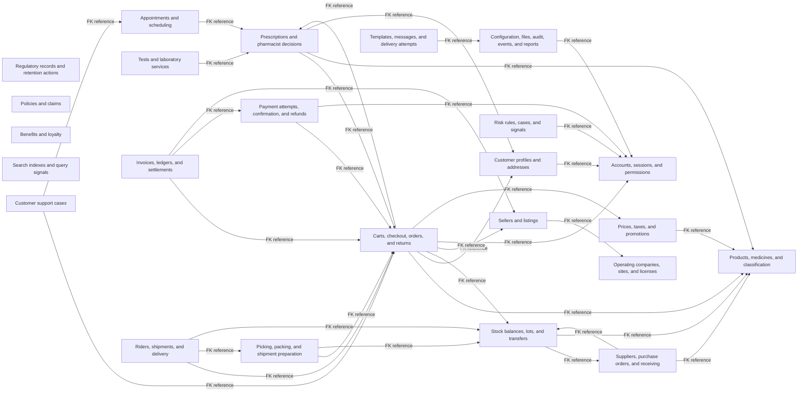

# Cross-domain relationships

## What this view shows

This page summarizes foreign keys whose child and parent tables belong to different schemas. It does not draw workflow-only connections as database FKs. The catalog snapshot contains **894 cross-schema FKs across 92 ordered schema pairs**; every exact constraint is in the [relationship catalog](Relationship-Catalog.md).

## Business-level cross-domain map

The arrows point from a child schema to its referenced parent schema. They show only representative connections to keep the map readable. Each label points to the corresponding schema-level catalog; all **92** cross-schema pairs, not just the representative map arrows, are listed below.

## Complete schema-pair index

| Child schema → parent schema | FK count | Example FK columns and constraints | Business reason | Full details |
|---|---:|---|---|---|
| `appointment` → `clinical` | 6 | `patient_profile_id_internal_id` → `internal_id` (fk_appointment_appointments_patient_profile_id_patient__c088) `patient_profile_id` → `id` (fk_appointment_appointments_patient_profile_id_patient_profiles) `practitioner_profile_id` → `id` (fk_appointment_appointments_practitioner_profile_id_pra_450f) | The appointments and scheduling records reference prescriptions and pharmacist decisions keys to preserve the recorded domain links. | [appointment FK catalog](Relationship-Catalog/appointment.md) |
| `appointment` → `identity` | 19 | `created_by` → `id` (fk_appointment_appointment_slots_created_by_users) `updated_by` → `id` (fk_appointment_appointment_slots_updated_by_users) `actor_user_id` → `id` (fk_appointment_appointment_status_history_actor_user_id_users) | The appointments and scheduling records reference accounts, sessions, and permissions keys to preserve the recorded domain links. | [appointment FK catalog](Relationship-Catalog/appointment.md) |
| `appointment` → `organization` | 4 | `location_id_internal_id` → `internal_id` (fk_appointment_practitioner_services_location_id_locati_e2b2) `location_id` → `id` (fk_appointment_practitioner_services_location_id_locations) `organization_id` → `id` (fk_appointment_practitioner_services_organization_id_or_328c) | The appointments and scheduling records reference operating companies, sites, and licenses keys to preserve the recorded domain links. | [appointment FK catalog](Relationship-Catalog/appointment.md) |
| `appointment` → `platform` | 2 | `recording_file_id` → `id` (fk_appointment_teleconsultation_sessions_recording_file_7410) `recording_file_id_internal_id` → `internal_id` (fk_appointment_teleconsultation_sessions_recording_file_885a) | The appointments and scheduling records reference configuration, files, audit, events, and reports keys to preserve the recorded domain links. | [appointment FK catalog](Relationship-Catalog/appointment.md) |
| `catalog` → `identity` | 50 | `created_by` → `id` (fk_catalog_brands_created_by_users) `deleted_by` → `id` (fk_catalog_brands_deleted_by_users) `updated_by` → `id` (fk_catalog_brands_updated_by_users) | The products, medicines, and classification records reference accounts, sessions, and permissions keys to preserve the recorded domain links. | [catalog FK catalog](Relationship-Catalog/catalog.md) |
| `catalog` → `organization` | 4 | `owner_organization_id` → `id` (fk_catalog_brands_owner_organization_id_organizations) `owner_organization_id_internal_id` → `internal_id` (fk_catalog_brands_owner_organization_id_organizations_numeric) `organization_id` → `id` (fk_catalog_manufacturers_organization_id_organizations) | The products, medicines, and classification records reference operating companies, sites, and licenses keys to preserve the recorded domain links. | [catalog FK catalog](Relationship-Catalog/catalog.md) |
| `catalog` → `platform` | 4 | `logo_file_id` → `id` (fk_catalog_brands_logo_file_id_file_objects) `logo_file_id_internal_id` → `internal_id` (fk_catalog_brands_logo_file_id_file_objects_numeric) `file_object_id` → `id` (fk_catalog_product_media_file_object_id_file_objects) | The products, medicines, and classification records reference configuration, files, audit, events, and reports keys to preserve the recorded domain links. | [catalog FK catalog](Relationship-Catalog/catalog.md) |
| `clinical` → `appointment` | 2 | `appointment_id` → `id` (fk_clinical_consultations_appointment_id_appointments) `appointment_id_internal_id` → `internal_id` (fk_clinical_consultations_appointment_id_appointments_numeric) | The prescriptions and pharmacist decisions records reference appointments and scheduling keys to preserve the recorded domain links. | [clinical FK catalog](Relationship-Catalog/clinical.md) |
| `clinical` → `catalog` | 4 | `product_id` → `id` (fk_clinical_patient_medications_product_id_products) `product_id_internal_id` → `internal_id` (fk_clinical_patient_medications_product_id_products_numeric) `product_id` → `id` (fk_clinical_prescription_items_product_id_products) | The prescriptions and pharmacist decisions records reference products, medicines, and classification keys to preserve the recorded domain links. | [clinical FK catalog](Relationship-Catalog/clinical.md) |
| `clinical` → `commerce` | 6 | `order_item_id, order_id` → `id, order_id` (fk_clinical_review_items_item_order) `order_item_id_internal_id, order_id_internal_id` → `internal_id, order_id_internal_id` (fk_clinical_review_items_item_order_numeric) `order_id` → `id` (fk_clinical_order_reviews_order_id_orders) | The prescriptions and pharmacist decisions records reference carts, checkout, orders, and returns keys to preserve the recorded domain links. | [clinical FK catalog](Relationship-Catalog/clinical.md) |
| `clinical` → `customer` | 2 | `family_member_id_internal_id` → `internal_id` (fk_clinical_patient_profiles_family_member_id_family_me_da24) `family_member_id` → `id` (fk_clinical_patient_profiles_family_member_id_family_members) | The prescriptions and pharmacist decisions records reference customer profiles and addresses keys to preserve the recorded domain links. | [clinical FK catalog](Relationship-Catalog/clinical.md) |
| `clinical` → `identity` | 43 | `created_by` → `id` (fk_clinical_care_episodes_created_by_users) `deleted_by` → `id` (fk_clinical_care_episodes_deleted_by_users) `updated_by` → `id` (fk_clinical_care_episodes_updated_by_users) | The prescriptions and pharmacist decisions records reference accounts, sessions, and permissions keys to preserve the recorded domain links. | [clinical FK catalog](Relationship-Catalog/clinical.md) |
| `clinical` → `organization` | 4 | `location_id_internal_id` → `internal_id` (fk_clinical_practitioner_organizations_location_id_loca_a76c) `location_id` → `id` (fk_clinical_practitioner_organizations_location_id_locations) `organization_id_internal_id` → `internal_id` (fk_clinical_practitioner_organizations_organization_id__4223) | The prescriptions and pharmacist decisions records reference operating companies, sites, and licenses keys to preserve the recorded domain links. | [clinical FK catalog](Relationship-Catalog/clinical.md) |
| `clinical` → `platform` | 2 | `file_object_id_internal_id` → `internal_id` (fk_clinical_prescription_documents_file_object_id_file__7c34) `file_object_id` → `id` (fk_clinical_prescription_documents_file_object_id_file_objects) | The prescriptions and pharmacist decisions records reference configuration, files, audit, events, and reports keys to preserve the recorded domain links. | [clinical FK catalog](Relationship-Catalog/clinical.md) |
| `commerce` → `catalog` | 9 | `product_id` → `id` (fk_commerce_cart_items_product_id_products) `product_id_internal_id` → `internal_id` (fk_commerce_cart_items_product_id_products_numeric) `variant_id` → `id` (fk_commerce_cart_items_variant_id_product_variants) | The carts, checkout, orders, and returns records reference products, medicines, and classification keys to preserve the recorded domain links. | [commerce FK catalog](Relationship-Catalog/commerce.md) |
| `commerce` → `clinical` | 6 | `prescription_id` → `id` (fk_commerce_cart_items_prescription_id_prescriptions) `prescription_id_internal_id` → `internal_id` (fk_commerce_cart_items_prescription_id_prescriptions_numeric) `prescription_id` → `id` (fk_commerce_order_items_prescription_id_prescriptions) | The carts, checkout, orders, and returns records reference prescriptions and pharmacist decisions keys to preserve the recorded domain links. | [commerce FK catalog](Relationship-Catalog/commerce.md) |
| `commerce` → `customer` | 2 | `address_id` → `id` (fk_commerce_checkouts_address_id_addresses) `address_id_internal_id` → `internal_id` (fk_commerce_checkouts_address_id_addresses_numeric) | The carts, checkout, orders, and returns records reference customer profiles and addresses keys to preserve the recorded domain links. | [commerce FK catalog](Relationship-Catalog/commerce.md) |
| `commerce` → `identity` | 38 | `created_by` → `id` (fk_commerce_cancellation_items_created_by_users) `updated_by` → `id` (fk_commerce_cancellation_items_updated_by_users) `created_by_user_id` → `id` (fk_commerce_cancellation_reason_codes_created_by_user_id_users) | The carts, checkout, orders, and returns records reference accounts, sessions, and permissions keys to preserve the recorded domain links. | [commerce FK catalog](Relationship-Catalog/commerce.md) |
| `commerce` → `marketplace` | 8 | `seller_id` → `id` (fk_commerce_cart_items_seller_id_sellers) `seller_id_internal_id` → `internal_id` (fk_commerce_cart_items_seller_id_sellers_numeric) `seller_id` → `id` (fk_commerce_order_allocations_seller_id_sellers) | The carts, checkout, orders, and returns records reference sellers and listings keys to preserve the recorded domain links. | [commerce FK catalog](Relationship-Catalog/commerce.md) |
| `commerce` → `pricing` | 2 | `promotion_id` → `id` (fk_commerce_order_discounts_promotion_id_promotions) `promotion_id_internal_id` → `internal_id` (fk_commerce_order_discounts_promotion_id_promotions_numeric) | The carts, checkout, orders, and returns records reference prices, taxes, and promotions keys to preserve the recorded domain links. | [commerce FK catalog](Relationship-Catalog/commerce.md) |
| `commerce` → `warehouse` | 8 | `reservation_id_internal_id` → `internal_id` (fk_commerce_order_allocations_reservation_id_stock_rese_0af9) `reservation_id` → `id` (fk_commerce_order_allocations_reservation_id_stock_reservations) `reservation_id, order_item_id` → `id, order_item_id` (fk_commerce_order_allocations_reservation_item) | The carts, checkout, orders, and returns records reference stock balances, lots, and transfers keys to preserve the recorded domain links. | [commerce FK catalog](Relationship-Catalog/commerce.md) |
| `compliance` → `catalog` | 4 | `product_id` → `id` (fk_compliance_adverse_event_reports_product_id_products) `product_id_internal_id` → `internal_id` (fk_compliance_adverse_event_reports_product_id_products_numeric) `product_id` → `id` (fk_compliance_product_recalls_product_id_products) | The regulatory records and retention actions records reference products, medicines, and classification keys to preserve the recorded domain links. | [compliance FK catalog](Relationship-Catalog/compliance.md) |
| `compliance` → `clinical` | 4 | `patient_profile_id` → `id` (fk_compliance_adverse_event_reports_patient_profile_id__4b0b) `patient_profile_id_internal_id` → `internal_id` (fk_compliance_adverse_event_reports_patient_profile_id__6d1c) `prescription_id_internal_id` → `internal_id` (fk_compliance_adverse_event_reports_prescription_id_pre_401a) | The regulatory records and retention actions records reference prescriptions and pharmacist decisions keys to preserve the recorded domain links. | [compliance FK catalog](Relationship-Catalog/compliance.md) |
| `compliance` → `identity` | 19 | `created_by` → `id` (fk_compliance_adverse_event_reports_created_by_users) `reported_by_user_id` → `id` (fk_compliance_adverse_event_reports_reported_by_user_id_users) `updated_by` → `id` (fk_compliance_adverse_event_reports_updated_by_users) | The regulatory records and retention actions records reference accounts, sessions, and permissions keys to preserve the recorded domain links. | [compliance FK catalog](Relationship-Catalog/compliance.md) |
| `compliance` → `organization` | 4 | `location_id_internal_id` → `internal_id` (fk_compliance_regulatory_registrations_location_id_loca_65e3) `location_id` → `id` (fk_compliance_regulatory_registrations_location_id_locations) `organization_id` → `id` (fk_compliance_regulatory_registrations_organization_id__7f52) | The regulatory records and retention actions records reference operating companies, sites, and licenses keys to preserve the recorded domain links. | [compliance FK catalog](Relationship-Catalog/compliance.md) |
| `compliance` → `platform` | 4 | `file_object_id` → `id` (fk_compliance_evidence_file_object_id_file_objects) `file_object_id_internal_id` → `internal_id` (fk_compliance_evidence_file_object_id_file_objects_numeric) `document_file_id_internal_id` → `internal_id` (fk_compliance_regulatory_registrations_document_file_id_1e84) | The regulatory records and retention actions records reference configuration, files, audit, events, and reports keys to preserve the recorded domain links. | [compliance FK catalog](Relationship-Catalog/compliance.md) |
| `compliance` → `warehouse` | 2 | `lot_id` → `id` (fk_compliance_recall_lots_lot_id_inventory_lots) `lot_id_internal_id` → `internal_id` (fk_compliance_recall_lots_lot_id_inventory_lots_numeric) | The regulatory records and retention actions records reference stock balances, lots, and transfers keys to preserve the recorded domain links. | [compliance FK catalog](Relationship-Catalog/compliance.md) |
| `customer` → `catalog` | 2 | `product_id` → `id` (fk_customer_wishlist_items_product_id_products) `product_id_internal_id` → `internal_id` (fk_customer_wishlist_items_product_id_products_numeric) | The customer profiles and addresses records reference products, medicines, and classification keys to preserve the recorded domain links. | [customer FK catalog](Relationship-Catalog/customer.md) |
| `customer` → `identity` | 28 | `created_by` → `id` (fk_customer_addresses_created_by_users) `deleted_by` → `id` (fk_customer_addresses_deleted_by_users) `updated_by` → `id` (fk_customer_addresses_updated_by_users) | The customer profiles and addresses records reference accounts, sessions, and permissions keys to preserve the recorded domain links. | [customer FK catalog](Relationship-Catalog/customer.md) |
| `customer` → `platform` | 2 | `avatar_file_id` → `id` (fk_customer_profiles_avatar_file_id_file_objects) `avatar_file_id_internal_id` → `internal_id` (fk_customer_profiles_avatar_file_id_file_objects_numeric) | The customer profiles and addresses records reference configuration, files, audit, events, and reports keys to preserve the recorded domain links. | [customer FK catalog](Relationship-Catalog/customer.md) |
| `diagnostics` → `clinical` | 2 | `patient_profile_id_internal_id` → `internal_id` (fk_diagnostics_diagnostic_orders_patient_profile_id_pat_0689) `patient_profile_id` → `id` (fk_diagnostics_diagnostic_orders_patient_profile_id_pat_4a11) | The tests and laboratory services records reference prescriptions and pharmacist decisions keys to preserve the recorded domain links. | [diagnostics FK catalog](Relationship-Catalog/diagnostics.md) |
| `diagnostics` → `customer` | 2 | `address_id` → `id` (fk_diagnostics_diagnostic_orders_address_id_addresses) `address_id_internal_id` → `internal_id` (fk_diagnostics_diagnostic_orders_address_id_addresses_numeric) | The tests and laboratory services records reference customer profiles and addresses keys to preserve the recorded domain links. | [diagnostics FK catalog](Relationship-Catalog/diagnostics.md) |
| `diagnostics` → `identity` | 33 | `created_by` → `id` (fk_diagnostics_diagnostic_order_items_created_by_users) `updated_by` → `id` (fk_diagnostics_diagnostic_order_items_updated_by_users) `created_by` → `id` (fk_diagnostics_diagnostic_orders_created_by_users) | The tests and laboratory services records reference accounts, sessions, and permissions keys to preserve the recorded domain links. | [diagnostics FK catalog](Relationship-Catalog/diagnostics.md) |
| `diagnostics` → `organization` | 4 | `location_id` → `id` (fk_diagnostics_lab_locations_location_id_locations) `location_id_internal_id` → `internal_id` (fk_diagnostics_lab_locations_location_id_locations_numeric) `organization_id_internal_id` → `internal_id` (fk_diagnostics_lab_providers_organization_id_organizati_15a2) | The tests and laboratory services records reference operating companies, sites, and licenses keys to preserve the recorded domain links. | [diagnostics FK catalog](Relationship-Catalog/diagnostics.md) |
| `diagnostics` → `platform` | 2 | `file_object_id_internal_id` → `internal_id` (fk_diagnostics_diagnostic_reports_file_object_id_file_o_e8a0) `file_object_id` → `id` (fk_diagnostics_diagnostic_reports_file_object_id_file_objects) | The tests and laboratory services records reference configuration, files, audit, events, and reports keys to preserve the recorded domain links. | [diagnostics FK catalog](Relationship-Catalog/diagnostics.md) |
| `finance` → `commerce` | 8 | `order_item_id` → `id` (fk_finance_invoice_items_order_item_id_order_items) `order_item_id_internal_id` → `internal_id` (fk_finance_invoice_items_order_item_id_order_items_numeric) `order_id` → `id` (fk_finance_invoices_order_id_orders) | The invoices, ledgers, and settlements records reference carts, checkout, orders, and returns keys to preserve the recorded domain links. | [finance FK catalog](Relationship-Catalog/finance.md) |
| `finance` → `identity` | 13 | `created_by` → `id` (fk_finance_accounts_created_by_users) `deleted_by` → `id` (fk_finance_accounts_deleted_by_users) `updated_by` → `id` (fk_finance_accounts_updated_by_users) | The invoices, ledgers, and settlements records reference accounts, sessions, and permissions keys to preserve the recorded domain links. | [finance FK catalog](Relationship-Catalog/finance.md) |
| `finance` → `marketplace` | 4 | `seller_id` → `id` (fk_finance_invoices_seller_id_sellers) `seller_id_internal_id` → `internal_id` (fk_finance_invoices_seller_id_sellers_numeric) `seller_id` → `id` (fk_finance_settlement_runs_seller_id_sellers) | The invoices, ledgers, and settlements records reference sellers and listings keys to preserve the recorded domain links. | [finance FK catalog](Relationship-Catalog/finance.md) |
| `finance` → `payment` | 2 | `refund_id` → `id` (fk_finance_credit_notes_refund_id_refunds) `refund_id_internal_id` → `internal_id` (fk_finance_credit_notes_refund_id_refunds_numeric) | The invoices, ledgers, and settlements records reference payment attempts, confirmation, and refunds keys to preserve the recorded domain links. | [finance FK catalog](Relationship-Catalog/finance.md) |
| `finance` → `platform` | 4 | `document_file_id` → `id` (fk_finance_credit_notes_document_file_id_file_objects) `document_file_id_internal_id` → `internal_id` (fk_finance_credit_notes_document_file_id_file_objects_numeric) `document_file_id` → `id` (fk_finance_invoices_document_file_id_file_objects) | The invoices, ledgers, and settlements records reference configuration, files, audit, events, and reports keys to preserve the recorded domain links. | [finance FK catalog](Relationship-Catalog/finance.md) |
| `fulfillment` → `commerce` | 12 | `order_item_id` → `id` (fk_fulfillment_fulfillment_order_items_order_item_id_or_9354) `order_item_id_internal_id` → `internal_id` (fk_fulfillment_fulfillment_order_items_order_item_id_or_caeb) `order_group_id_internal_id` → `internal_id` (fk_fulfillment_fulfillment_orders_order_group_id_order__b1eb) | The picking, packing, and shipment preparation records reference carts, checkout, orders, and returns keys to preserve the recorded domain links. | [fulfillment FK catalog](Relationship-Catalog/fulfillment.md) |
| `fulfillment` → `identity` | 22 | `actor_user_id` → `id` (fk_fulfillment_fulfillment_events_actor_user_id_users) `created_by` → `id` (fk_fulfillment_fulfillment_order_items_created_by_users) `updated_by` → `id` (fk_fulfillment_fulfillment_order_items_updated_by_users) | The picking, packing, and shipment preparation records reference accounts, sessions, and permissions keys to preserve the recorded domain links. | [fulfillment FK catalog](Relationship-Catalog/fulfillment.md) |
| `fulfillment` → `marketplace` | 2 | `seller_id` → `id` (fk_fulfillment_fulfillment_orders_seller_id_sellers) `seller_id_internal_id` → `internal_id` (fk_fulfillment_fulfillment_orders_seller_id_sellers_numeric) | The picking, packing, and shipment preparation records reference sellers and listings keys to preserve the recorded domain links. | [fulfillment FK catalog](Relationship-Catalog/fulfillment.md) |
| `fulfillment` → `warehouse` | 10 | `warehouse_id_internal_id` → `internal_id` (fk_fulfillment_fulfillment_orders_warehouse_id_warehous_f861) `warehouse_id` → `id` (fk_fulfillment_fulfillment_orders_warehouse_id_warehouses) `lot_id` → `id` (fk_fulfillment_package_items_lot_id_inventory_lots) | The picking, packing, and shipment preparation records reference stock balances, lots, and transfers keys to preserve the recorded domain links. | [fulfillment FK catalog](Relationship-Catalog/fulfillment.md) |
| `identity` → `platform` | 2 | `avatar_file_id` → `id` (fk_identity_user_profiles_avatar_file_id_file_objects) `avatar_file_id_internal_id` → `internal_id` (fk_identity_user_profiles_avatar_file_id_file_objects_numeric) | The accounts, sessions, and permissions records reference configuration, files, audit, events, and reports keys to preserve the recorded domain links. | [identity FK catalog](Relationship-Catalog/identity.md) |
| `insurance` → `clinical` | 6 | `patient_profile_id` → `id` (fk_insurance_claims_patient_profile_id_patient_profiles) `patient_profile_id_internal_id` → `internal_id` (fk_insurance_claims_patient_profile_id_patient_profiles_numeric) `patient_profile_id_internal_id` → `internal_id` (fk_insurance_policies_patient_profile_id_patient_profil_0c08) | The policies and claims records reference prescriptions and pharmacist decisions keys to preserve the recorded domain links. | [insurance FK catalog](Relationship-Catalog/insurance.md) |
| `insurance` → `identity` | 16 | `created_by` → `id` (fk_insurance_claim_documents_created_by_users) `updated_by` → `id` (fk_insurance_claim_documents_updated_by_users) `created_by` → `id` (fk_insurance_claims_created_by_users) | The policies and claims records reference accounts, sessions, and permissions keys to preserve the recorded domain links. | [insurance FK catalog](Relationship-Catalog/insurance.md) |
| `insurance` → `organization` | 4 | `organization_id` → `id` (fk_insurance_insurers_organization_id_organizations) `organization_id_internal_id` → `internal_id` (fk_insurance_insurers_organization_id_organizations_numeric) `organization_id` → `id` (fk_insurance_tpas_organization_id_organizations) | The policies and claims records reference operating companies, sites, and licenses keys to preserve the recorded domain links. | [insurance FK catalog](Relationship-Catalog/insurance.md) |
| `insurance` → `platform` | 2 | `file_object_id_internal_id` → `internal_id` (fk_insurance_claim_documents_file_object_id_file_object_2e7f) `file_object_id` → `id` (fk_insurance_claim_documents_file_object_id_file_objects) | The policies and claims records reference configuration, files, audit, events, and reports keys to preserve the recorded domain links. | [insurance FK catalog](Relationship-Catalog/insurance.md) |
| `logistics` → `commerce` | 10 | `return_id` → `id` (fk_logistics_reverse_shipments_return_id_returns) `return_id_internal_id` → `internal_id` (fk_logistics_reverse_shipments_return_id_returns_numeric) `order_group_id, order_id` → `id, order_id` (fk_logistics_shipments_group_order) | The riders, shipments, and delivery records reference carts, checkout, orders, and returns keys to preserve the recorded domain links. | [logistics FK catalog](Relationship-Catalog/logistics.md) |
| `logistics` → `fulfillment` | 2 | `package_id` → `id` (fk_logistics_shipments_package_id_packages) `package_id_internal_id` → `internal_id` (fk_logistics_shipments_package_id_packages_numeric) | The riders, shipments, and delivery records reference picking, packing, and shipment preparation keys to preserve the recorded domain links. | [logistics FK catalog](Relationship-Catalog/logistics.md) |
| `logistics` → `identity` | 31 | `created_by` → `id` (fk_logistics_carrier_accounts_created_by_users) `deleted_by` → `id` (fk_logistics_carrier_accounts_deleted_by_users) `updated_by` → `id` (fk_logistics_carrier_accounts_updated_by_users) | The riders, shipments, and delivery records reference accounts, sessions, and permissions keys to preserve the recorded domain links. | [logistics FK catalog](Relationship-Catalog/logistics.md) |
| `logistics` → `platform` | 4 | `proof_file_id_internal_id` → `internal_id` (fk_logistics_delivery_attempts_proof_file_id_file_objec_b2c0) `proof_file_id` → `id` (fk_logistics_delivery_attempts_proof_file_id_file_objects) `shipping_label_file_id_internal_id` → `internal_id` (fk_logistics_shipments_shipping_label_file_id_file_obje_c402) | The riders, shipments, and delivery records reference configuration, files, audit, events, and reports keys to preserve the recorded domain links. | [logistics FK catalog](Relationship-Catalog/logistics.md) |
| `logistics` → `warehouse` | 4 | `warehouse_id` → `id` (fk_logistics_delivery_routes_warehouse_id_warehouses) `warehouse_id_internal_id` → `internal_id` (fk_logistics_delivery_routes_warehouse_id_warehouses_numeric) `warehouse_id` → `id` (fk_logistics_delivery_slots_warehouse_id_warehouses) | The riders, shipments, and delivery records reference stock balances, lots, and transfers keys to preserve the recorded domain links. | [logistics FK catalog](Relationship-Catalog/logistics.md) |
| `marketplace` → `catalog` | 4 | `product_id_internal_id` → `internal_id` (fk_marketplace_seller_product_listings_product_id_produ_4e59) `product_id` → `id` (fk_marketplace_seller_product_listings_product_id_products) `variant_id` → `id` (fk_marketplace_seller_product_listings_variant_id_produ_4a78) | The sellers and listings records reference products, medicines, and classification keys to preserve the recorded domain links. | [marketplace FK catalog](Relationship-Catalog/marketplace.md) |
| `marketplace` → `commerce` | 2 | `order_id, user_id` → `id, user_id` (fk_domain_marketplace_seller_ratings_order_id) `order_id_internal_id, user_id` → `internal_id, user_id` (fk_domain_marketplace_seller_ratings_order_id_numeric) | The sellers and listings records reference carts, checkout, orders, and returns keys to preserve the recorded domain links. | [marketplace FK catalog](Relationship-Catalog/marketplace.md) |
| `marketplace` → `identity` | 17 | `created_by` → `id` (fk_marketplace_commission_plans_created_by_users) `deleted_by` → `id` (fk_marketplace_commission_plans_deleted_by_users) `updated_by` → `id` (fk_marketplace_commission_plans_updated_by_users) | The sellers and listings records reference accounts, sessions, and permissions keys to preserve the recorded domain links. | [marketplace FK catalog](Relationship-Catalog/marketplace.md) |
| `marketplace` → `organization` | 6 | `license_id` → `id` (fk_marketplace_seller_locations_license_id_licenses) `license_id_internal_id` → `internal_id` (fk_marketplace_seller_locations_license_id_licenses_numeric) `location_id` → `id` (fk_marketplace_seller_locations_location_id_locations) | The sellers and listings records reference operating companies, sites, and licenses keys to preserve the recorded domain links. | [marketplace FK catalog](Relationship-Catalog/marketplace.md) |
| `marketplace` → `warehouse` | 2 | `warehouse_id` → `id` (fk_marketplace_seller_locations_warehouse_id_warehouses) `warehouse_id_internal_id` → `internal_id` (fk_marketplace_seller_locations_warehouse_id_warehouses_numeric) | The sellers and listings records reference stock balances, lots, and transfers keys to preserve the recorded domain links. | [marketplace FK catalog](Relationship-Catalog/marketplace.md) |
| `membership` → `identity` | 12 | `created_by` → `id` (fk_membership_loyalty_accounts_created_by_users) `updated_by` → `id` (fk_membership_loyalty_accounts_updated_by_users) `user_id` → `id` (fk_membership_loyalty_accounts_user_id_users) | The benefits and loyalty records reference accounts, sessions, and permissions keys to preserve the recorded domain links. | [membership FK catalog](Relationship-Catalog/membership.md) |
| `membership` → `payment` | 2 | `payment_method_id` → `id` (fk_membership_subscriptions_payment_method_id_customer__142d) `payment_method_id_internal_id` → `internal_id` (fk_membership_subscriptions_payment_method_id_customer__d281) | The benefits and loyalty records reference payment attempts, confirmation, and refunds keys to preserve the recorded domain links. | [membership FK catalog](Relationship-Catalog/membership.md) |
| `notification` → `identity` | 28 | `created_by` → `id` (fk_notification_device_endpoints_created_by_users) `deleted_by` → `id` (fk_notification_device_endpoints_deleted_by_users) `updated_by` → `id` (fk_notification_device_endpoints_updated_by_users) | The templates, messages, and delivery attempts records reference accounts, sessions, and permissions keys to preserve the recorded domain links. | [notification FK catalog](Relationship-Catalog/notification.md) |
| `notification` → `platform` | 4 | `image_file_id_internal_id` → `internal_id` (fk_notification_in_app_notifications_image_file_id_file_ce63) `image_file_id` → `id` (fk_notification_in_app_notifications_image_file_id_file_objects) `file_object_id_internal_id` → `internal_id` (fk_notification_message_attachments_file_object_id_file_0d0a) | The templates, messages, and delivery attempts records reference configuration, files, audit, events, and reports keys to preserve the recorded domain links. | [notification FK catalog](Relationship-Catalog/notification.md) |
| `organization` → `identity` | 19 | `created_by` → `id` (fk_organization_bank_accounts_created_by_users) `deleted_by` → `id` (fk_organization_bank_accounts_deleted_by_users) `updated_by` → `id` (fk_organization_bank_accounts_updated_by_users) | The operating companies, sites, and licenses records reference accounts, sessions, and permissions keys to preserve the recorded domain links. | [organization FK catalog](Relationship-Catalog/organization.md) |
| `organization` → `platform` | 2 | `document_file_id` → `id` (fk_organization_licenses_document_file_id_file_objects) `document_file_id_internal_id` → `internal_id` (fk_organization_licenses_document_file_id_file_objects_numeric) | The operating companies, sites, and licenses records reference configuration, files, audit, events, and reports keys to preserve the recorded domain links. | [organization FK catalog](Relationship-Catalog/organization.md) |
| `payment` → `commerce` | 18 | `order_id` → `id` (fk_payment_chargebacks_order_id_orders) `order_id_internal_id` → `internal_id` (fk_payment_chargebacks_order_id_orders_numeric) `order_id` → `id` (fk_payment_cod_collections_order_id_orders) | The payment attempts, confirmation, and refunds records reference carts, checkout, orders, and returns keys to preserve the recorded domain links. | [payment FK catalog](Relationship-Catalog/payment.md) |
| `payment` → `identity` | 26 | `created_by` → `id` (fk_payment_chargebacks_created_by_users) `updated_by` → `id` (fk_payment_chargebacks_updated_by_users) `collected_by_user_id` → `id` (fk_payment_cod_collections_collected_by_user_id_users) | The payment attempts, confirmation, and refunds records reference accounts, sessions, and permissions keys to preserve the recorded domain links. | [payment FK catalog](Relationship-Catalog/payment.md) |
| `payment` → `logistics` | 2 | `shipment_id` → `id` (fk_payment_cod_collections_shipment_id_shipments) `shipment_id_internal_id` → `internal_id` (fk_payment_cod_collections_shipment_id_shipments_numeric) | The payment attempts, confirmation, and refunds records reference riders, shipments, and delivery keys to preserve the recorded domain links. | [payment FK catalog](Relationship-Catalog/payment.md) |
| `payment` → `platform` | 2 | `source_file_id_internal_id` → `internal_id` (fk_payment_reconciliation_runs_source_file_id_file_obje_5a14) `source_file_id` → `id` (fk_payment_reconciliation_runs_source_file_id_file_objects) | The payment attempts, confirmation, and refunds records reference configuration, files, audit, events, and reports keys to preserve the recorded domain links. | [payment FK catalog](Relationship-Catalog/payment.md) |
| `platform` → `identity` | 44 | `created_by` → `id` (fk_platform_application_settings_created_by_users) `deleted_by` → `id` (fk_platform_application_settings_deleted_by_users) `updated_by` → `id` (fk_platform_application_settings_updated_by_users) | The configuration, files, audit, events, and reports records reference accounts, sessions, and permissions keys to preserve the recorded domain links. | [platform FK catalog](Relationship-Catalog/platform.md) |
| `pricing` → `catalog` | 4 | `product_id` → `id` (fk_pricing_product_prices_product_id_products) `product_id_internal_id` → `internal_id` (fk_pricing_product_prices_product_id_products_numeric) `variant_id` → `id` (fk_pricing_product_prices_variant_id_product_variants) | The prices, taxes, and promotions records reference products, medicines, and classification keys to preserve the recorded domain links. | [pricing FK catalog](Relationship-Catalog/pricing.md) |
| `pricing` → `commerce` | 2 | `order_id, user_id` → `id, user_id` (fk_domain_pricing_promotion_redemptions_order_id) `order_id_internal_id, user_id` → `internal_id, user_id` (fk_domain_pricing_promotion_redemptions_order_id_numeric) | The prices, taxes, and promotions records reference carts, checkout, orders, and returns keys to preserve the recorded domain links. | [pricing FK catalog](Relationship-Catalog/pricing.md) |
| `pricing` → `identity` | 19 | `assigned_user_id` → `id` (fk_pricing_coupon_codes_assigned_user_id_users) `created_by` → `id` (fk_pricing_coupon_codes_created_by_users) `deleted_by` → `id` (fk_pricing_coupon_codes_deleted_by_users) | The prices, taxes, and promotions records reference accounts, sessions, and permissions keys to preserve the recorded domain links. | [pricing FK catalog](Relationship-Catalog/pricing.md) |
| `pricing` → `marketplace` | 2 | `seller_id` → `id` (fk_domain_pricing_price_books_seller_id) `seller_id_internal_id` → `internal_id` (fk_domain_pricing_price_books_seller_id_numeric) | The prices, taxes, and promotions records reference sellers and listings keys to preserve the recorded domain links. | [pricing FK catalog](Relationship-Catalog/pricing.md) |
| `pricing` → `warehouse` | 2 | `warehouse_id` → `id` (fk_pricing_price_books_warehouse_id_warehouses) `warehouse_id_internal_id` → `internal_id` (fk_pricing_price_books_warehouse_id_warehouses_numeric) | The prices, taxes, and promotions records reference stock balances, lots, and transfers keys to preserve the recorded domain links. | [pricing FK catalog](Relationship-Catalog/pricing.md) |
| `procurement` → `catalog` | 12 | `product_id` → `id` (fk_procurement_purchase_order_items_product_id_products) `product_id_internal_id` → `internal_id` (fk_procurement_purchase_order_items_product_id_products_numeric) `variant_id_internal_id` → `internal_id` (fk_procurement_purchase_order_items_variant_id_product__7c24) | The suppliers, purchase orders, and receiving records reference products, medicines, and classification keys to preserve the recorded domain links. | [procurement FK catalog](Relationship-Catalog/procurement.md) |
| `procurement` → `identity` | 33 | `created_by` → `id` (fk_procurement_goods_receipt_items_created_by_users) `updated_by` → `id` (fk_procurement_goods_receipt_items_updated_by_users) `checked_by_user_id` → `id` (fk_procurement_goods_receipt_quality_checks_checked_by__6713) | The suppliers, purchase orders, and receiving records reference accounts, sessions, and permissions keys to preserve the recorded domain links. | [procurement FK catalog](Relationship-Catalog/procurement.md) |
| `procurement` → `organization` | 2 | `organization_id` → `id` (fk_procurement_suppliers_organization_id_organizations) `organization_id_internal_id` → `internal_id` (fk_procurement_suppliers_organization_id_organizations_numeric) | The suppliers, purchase orders, and receiving records reference operating companies, sites, and licenses keys to preserve the recorded domain links. | [procurement FK catalog](Relationship-Catalog/procurement.md) |
| `procurement` → `platform` | 4 | `document_file_id_internal_id` → `internal_id` (fk_procurement_supplier_invoices_document_file_id_file__3eb3) `document_file_id` → `id` (fk_procurement_supplier_invoices_document_file_id_file_objects) `document_file_id_internal_id` → `internal_id` (fk_procurement_supplier_licenses_document_file_id_file__c5bf) | The suppliers, purchase orders, and receiving records reference configuration, files, audit, events, and reports keys to preserve the recorded domain links. | [procurement FK catalog](Relationship-Catalog/procurement.md) |
| `procurement` → `warehouse` | 10 | `warehouse_id` → `id` (fk_procurement_goods_receipts_warehouse_id_warehouses) `warehouse_id_internal_id` → `internal_id` (fk_procurement_goods_receipts_warehouse_id_warehouses_numeric) `warehouse_id` → `id` (fk_procurement_purchase_orders_warehouse_id_warehouses) | The suppliers, purchase orders, and receiving records reference stock balances, lots, and transfers keys to preserve the recorded domain links. | [procurement FK catalog](Relationship-Catalog/procurement.md) |
| `risk` → `identity` | 10 | `user_id` → `id` (fk_risk_assessments_user_id_users) `created_by` → `id` (fk_risk_blocklists_created_by_users) `deleted_by` → `id` (fk_risk_blocklists_deleted_by_users) | The risk rules, cases, and signals records reference accounts, sessions, and permissions keys to preserve the recorded domain links. | [risk FK catalog](Relationship-Catalog/risk.md) |
| `search` → `identity` | 11 | `created_by` → `id` (fk_search_documents_created_by_users) `updated_by` → `id` (fk_search_documents_updated_by_users) `created_by` → `id` (fk_search_indexing_jobs_created_by_users) | The search indexes and query signals records reference accounts, sessions, and permissions keys to preserve the recorded domain links. | [search FK catalog](Relationship-Catalog/search.md) |
| `support` → `appointment` | 2 | `appointment_id` → `id` (fk_support_tickets_appointment_id_appointments) `appointment_id_internal_id` → `internal_id` (fk_support_tickets_appointment_id_appointments_numeric) | The customer support cases records reference appointments and scheduling keys to preserve the recorded domain links. | [support FK catalog](Relationship-Catalog/support.md) |
| `support` → `commerce` | 2 | `order_id` → `id` (fk_support_tickets_order_id_orders) `order_id_internal_id` → `internal_id` (fk_support_tickets_order_id_orders_numeric) | The customer support cases records reference carts, checkout, orders, and returns keys to preserve the recorded domain links. | [support FK catalog](Relationship-Catalog/support.md) |
| `support` → `diagnostics` | 2 | `diagnostic_order_id_internal_id` → `internal_id` (fk_support_tickets_diagnostic_order_id_diagnostic_order_e812) `diagnostic_order_id` → `id` (fk_support_tickets_diagnostic_order_id_diagnostic_orders) | The customer support cases records reference tests and laboratory services keys to preserve the recorded domain links. | [support FK catalog](Relationship-Catalog/support.md) |
| `support` → `identity` | 20 | `created_by` → `id` (fk_support_sla_policies_created_by_users) `deleted_by` → `id` (fk_support_sla_policies_deleted_by_users) `updated_by` → `id` (fk_support_sla_policies_updated_by_users) | The customer support cases records reference accounts, sessions, and permissions keys to preserve the recorded domain links. | [support FK catalog](Relationship-Catalog/support.md) |
| `support` → `platform` | 2 | `file_object_id_internal_id` → `internal_id` (fk_support_ticket_attachments_file_object_id_file_objec_8e8b) `file_object_id` → `id` (fk_support_ticket_attachments_file_object_id_file_objects) | The customer support cases records reference configuration, files, audit, events, and reports keys to preserve the recorded domain links. | [support FK catalog](Relationship-Catalog/support.md) |
| `warehouse` → `catalog` | 8 | `product_id` → `id` (fk_warehouse_inventory_lots_product_id_products) `product_id_internal_id` → `internal_id` (fk_warehouse_inventory_lots_product_id_products_numeric) `variant_id` → `id` (fk_warehouse_inventory_lots_variant_id_product_variants) | The stock balances, lots, and transfers records reference products, medicines, and classification keys to preserve the recorded domain links. | [warehouse FK catalog](Relationship-Catalog/warehouse.md) |
| `warehouse` → `commerce` | 4 | `order_item_id, order_id` → `id, order_id` (fk_warehouse_stock_reservations_item_order) `order_item_id_internal_id, order_id_internal_id` → `internal_id, order_id_internal_id` (fk_warehouse_stock_reservations_item_order_numeric) `order_revision_id, order_id` → `id, order_id` (fk_warehouse_stock_reservations_revision_scope) | The stock balances, lots, and transfers records reference carts, checkout, orders, and returns keys to preserve the recorded domain links. | [warehouse FK catalog](Relationship-Catalog/warehouse.md) |
| `warehouse` → `identity` | 48 | `created_by` → `id` (fk_warehouse_aisles_created_by_users) `deleted_by` → `id` (fk_warehouse_aisles_deleted_by_users) `updated_by` → `id` (fk_warehouse_aisles_updated_by_users) | The stock balances, lots, and transfers records reference accounts, sessions, and permissions keys to preserve the recorded domain links. | [warehouse FK catalog](Relationship-Catalog/warehouse.md) |
| `warehouse` → `organization` | 4 | `location_id` → `id` (fk_warehouse_warehouses_location_id_locations) `location_id_internal_id` → `internal_id` (fk_warehouse_warehouses_location_id_locations_numeric) `organization_id` → `id` (fk_warehouse_warehouses_organization_id_organizations) | The stock balances, lots, and transfers records reference operating companies, sites, and licenses keys to preserve the recorded domain links. | [warehouse FK catalog](Relationship-Catalog/warehouse.md) |
| `warehouse` → `procurement` | 6 | `goods_receipt_item_id` → `id` (fk_warehouse_inventory_lots_goods_receipt_item_id_goods_b158) `goods_receipt_item_id_internal_id` → `internal_id` (fk_warehouse_inventory_lots_goods_receipt_item_id_goods_b952) `supplier_id` → `id` (fk_warehouse_inventory_lots_supplier_id_suppliers) | The stock balances, lots, and transfers records reference suppliers, purchase orders, and receiving keys to preserve the recorded domain links. | [warehouse FK catalog](Relationship-Catalog/warehouse.md) |

## Common business paths

- **Checkout and orders:** `commerce` has declared references to `catalog`, `customer`, `clinical`, `warehouse`, `marketplace`, `identity`, and `pricing`. The exact parent tables and keys are listed under the `commerce` catalog; the order workflow may cross other domains through intermediate records rather than a direct FK.
- **Money:** `payment` and `finance` reference commerce records; `finance` also has recorded references to payment and marketplace. A payment attempt, invoice, settlement, and delivered parcel remain separate facts.
- **Physical fulfillment:** `fulfillment` references commerce and warehouse records; `logistics` references fulfillment, commerce, warehouse, identity, and platform records. Do not infer that a shipment is a direct child of an order unless the exact FK row states it.
- **Supply:** `procurement` references catalog and warehouse records; warehouse records also refer back to procurement where declared. Actual joins use the recorded source/target columns in the catalog.
- **Clinical review:** `clinical` has FKs to commerce, catalog, customer, organization, platform, and identity. Patient ownership and access rules remain separate from these referential constraints.

For sensitive domains, a foreign key guarantees referential integrity only. It does not authorize staff, customers, riders, or reporting services to read the referenced data.
