# Pricing ER diagrams

## What this part of the database stores

The `pricing` schema stores prices, taxes, and promotions. The names and structural relationships below come from the checked-out database catalog snapshot; business-purpose summaries marked inferred are not product-owner approval.

## Main tables

| Table | Recorded purpose | Table definition |
|---|---|---|
| [`coupon_codes`](../Tables/pricing/coupon_codes.md) | Holds coupon codes records within the pricing domain (prices, taxes, promotions). Its precise write owner and lifecycle must be accepted during module implementation. (inferred meaning) | [Table contract](../Tables/pricing/coupon_codes.md) |
| [`price_books`](../Tables/pricing/price_books.md) | Holds price books records within the pricing domain (prices, taxes, promotions). Its precise write owner and lifecycle must be accepted during module implementation. (inferred meaning) | [Table contract](../Tables/pricing/price_books.md) |
| [`pricing_evaluations`](../Tables/pricing/pricing_evaluations.md) | Holds pricing evaluations records within the pricing domain (prices, taxes, promotions). Its precise write owner and lifecycle must be accepted during module implementation. (inferred meaning) | [Table contract](../Tables/pricing/pricing_evaluations.md) |
| [`product_prices`](../Tables/pricing/product_prices.md) | Holds product prices records within the pricing domain (prices, taxes, promotions). Its precise write owner and lifecycle must be accepted during module implementation. (inferred meaning) | [Table contract](../Tables/pricing/product_prices.md) |
| [`promotion_redemptions`](../Tables/pricing/promotion_redemptions.md) | Holds promotion redemptions records within the pricing domain (prices, taxes, promotions). Its precise write owner and lifecycle must be accepted during module implementation. (inferred meaning) | [Table contract](../Tables/pricing/promotion_redemptions.md) |
| [`promotion_versions`](../Tables/pricing/promotion_versions.md) | Holds promotion versions records within the pricing domain (prices, taxes, promotions). Its precise write owner and lifecycle must be accepted during module implementation. (inferred meaning) | [Table contract](../Tables/pricing/promotion_versions.md) |
| [`promotions`](../Tables/pricing/promotions.md) | Holds promotions records within the pricing domain (prices, taxes, promotions). Its precise write owner and lifecycle must be accepted during module implementation. (inferred meaning) | [Table contract](../Tables/pricing/promotions.md) |
| [`tax_rules`](../Tables/pricing/tax_rules.md) | Holds tax rules records within the pricing domain (prices, taxes, promotions). Its precise write owner and lifecycle must be accepted during module implementation. (inferred meaning) | [Table contract](../Tables/pricing/tax_rules.md) |

## ER diagrams

These diagrams show declared PostgreSQL foreign keys from focused source tables. Entity fields include primary keys, unique keys, and FK columns; exact data types remain in the linked table contracts. `PK`, `FK`, and `UK` mark key roles. Relationship cardinality comes from FK nullability and unique constraints/indexes in the recorded catalog.

### Diagram 01 — promotion_redemptions, coupon_codes, promotion_versions, promotions, tax_rules, pricing_evaluations, price_books, product_prices

This focused view contains every declared FK owned by the listed focus tables. Referenced tables outside that set appear as context. Parallel FK constraints are distinguished by their stable IDs; search those IDs in the [relationship catalog](Relationship-Catalog/pricing.md) for exact columns and actions.

```mermaid
erDiagram
    catalog__product_variants {
        uuid created_by FK
        uuid deleted_by FK
        uuid id FK, UK
        bigint internal_id PK, FK, UK
        uuid pack_uom_id FK
        bigint pack_uom_id_internal_id FK
        uuid product_id FK
        bigint product_id_internal_id FK
        uuid updated_by FK
    }
    catalog__products {
        uuid brand_id FK
        bigint brand_id_internal_id FK
        uuid category_id FK
        bigint category_id_internal_id FK
        varchar commerce_class FK
        uuid commerce_class_approved_by_user_id FK
        uuid created_by FK
        uuid deleted_by FK
        uuid dosage_form_id FK
        bigint dosage_form_id_internal_id FK
        uuid id FK, UK
        bigint internal_id PK, FK, UK
        uuid manufacturer_id FK
        bigint manufacturer_id_internal_id FK
        uuid updated_by FK
    }
    commerce__orders {
        uuid checkout_id FK
        bigint checkout_id_internal_id FK
        uuid created_by FK
        uuid current_revision_id FK
        bigint current_revision_id_internal_id FK
        uuid id FK, UK
        bigint internal_id PK, FK, UK
        varchar order_number UK
        uuid patient_profile_id FK, UK
        bigint patient_profile_id_internal_id FK, UK
        uuid updated_by FK
        uuid user_id FK, UK
    }
    identity__users {
        uuid created_by FK
        varchar email_normalized UK
        uuid id PK, FK, UK
        uuid updated_by FK
    }
    marketplace__sellers {
        uuid commission_plan_id FK
        bigint commission_plan_id_internal_id FK
        uuid created_by FK
        uuid deleted_by FK
        uuid id FK, UK
        bigint internal_id PK, FK, UK
        uuid organization_id FK
        bigint organization_id_internal_id FK
        uuid updated_by FK
    }
    pricing__coupon_codes {
        uuid assigned_user_id FK
        uuid created_by FK
        uuid deleted_by FK
        uuid id FK, UK
        bigint internal_id PK, FK, UK
        uuid promotion_id FK
        bigint promotion_id_internal_id FK
        uuid updated_by FK
    }
    pricing__price_books {
        uuid created_by FK
        uuid deleted_by FK
        uuid id FK, UK
        bigint internal_id PK, FK, UK
        uuid seller_id FK
        bigint seller_id_internal_id FK
        uuid updated_by FK
        uuid warehouse_id FK
        bigint warehouse_id_internal_id FK
    }
    pricing__pricing_evaluations {
        uuid id UK
        bigint internal_id PK, UK
        uuid user_id FK
    }
    pricing__product_prices {
        uuid created_by FK
        uuid id UK
        bigint internal_id PK, UK
        uuid price_book_id FK, UK
        bigint price_book_id_internal_id FK
        uuid product_id FK, UK
        bigint product_id_internal_id FK
        uuid updated_by FK
        timestamptz valid_from UK
        uuid variant_id FK, UK
        bigint variant_id_internal_id FK
    }
    pricing__promotion_redemptions {
        uuid coupon_code_id FK
        bigint coupon_code_id_internal_id FK
        uuid id UK
        varchar idempotency_key UK
        bigint internal_id PK, UK
        uuid order_id FK
        bigint order_id_internal_id FK
        uuid promotion_id FK
        bigint promotion_id_internal_id FK
        uuid promotion_version_id FK
        bigint promotion_version_id_internal_id FK
        uuid user_id FK
    }
    pricing__promotion_versions {
        uuid created_by FK
        uuid id FK, UK
        bigint internal_id PK, FK, UK
        uuid promotion_id FK, UK
        bigint promotion_id_internal_id FK
        uuid updated_by FK
        integer version_no UK
    }
    pricing__promotions {
        uuid created_by FK
        uuid deleted_by FK
        uuid id FK, UK
        bigint internal_id PK, FK, UK
        uuid updated_by FK
    }
    pricing__tax_rules {
        uuid created_by FK
        uuid deleted_by FK
        uuid id UK
        bigint internal_id PK, UK
        uuid updated_by FK
    }
    warehouse__warehouses {
        uuid created_by FK
        uuid deleted_by FK
        uuid id FK, UK
        bigint internal_id PK, FK, UK
        uuid location_id FK
        bigint location_id_internal_id FK
        uuid organization_id FK
        bigint organization_id_internal_id FK
        uuid updated_by FK
    }
    commerce__orders o|--o{ pricing__promotion_redemptions : "FK-1135 FK-1136"
    pricing__coupon_codes o|--o{ pricing__promotion_redemptions : "FK-1137 FK-1138"
    pricing__promotions ||--o{ pricing__promotion_redemptions : "FK-1139 FK-1140"
    pricing__promotion_versions o|--o{ pricing__promotion_redemptions : "FK-1141 FK-1142"
    identity__users ||--o{ pricing__promotion_redemptions : "FK-1143"
    identity__users o|--o{ pricing__coupon_codes : "FK-1113 FK-1114 FK-1115 FK-1118"
    pricing__promotions ||--o{ pricing__coupon_codes : "FK-1116 FK-1117"
    identity__users o|--o{ pricing__promotion_versions : "FK-1144 FK-1147"
    pricing__promotions ||--o{ pricing__promotion_versions : "FK-1145 FK-1146"
    identity__users o|--o{ pricing__promotions : "FK-1148 FK-1149 FK-1150"
    identity__users o|--o{ pricing__tax_rules : "FK-1151 FK-1152 FK-1153"
    identity__users o|--o{ pricing__pricing_evaluations : "FK-1126"
    marketplace__sellers o|--o{ pricing__price_books : "FK-1119 FK-1120"
    identity__users o|--o{ pricing__price_books : "FK-1121 FK-1122 FK-1123"
    warehouse__warehouses o|--o{ pricing__price_books : "FK-1124 FK-1125"
    identity__users o|--o{ pricing__product_prices : "FK-1127 FK-1132"
    pricing__price_books ||--o{ pricing__product_prices : "FK-1128 FK-1129"
    catalog__products ||--o{ pricing__product_prices : "FK-1130 FK-1131"
    catalog__product_variants o|--o{ pricing__product_prices : "FK-1133 FK-1134"
```

**Entity name mapping**

| Mermaid name | PostgreSQL table |
|---|---|
| `catalog__product_variants` | [`catalog.product_variants`](../Tables/catalog/product_variants.md) |
| `catalog__products` | [`catalog.products`](../Tables/catalog/products.md) |
| `commerce__orders` | [`commerce.orders`](../Tables/commerce/orders.md) |
| `identity__users` | [`identity.users`](../Tables/identity/users.md) |
| `marketplace__sellers` | [`marketplace.sellers`](../Tables/marketplace/sellers.md) |
| `pricing__coupon_codes` | [`pricing.coupon_codes`](../Tables/pricing/coupon_codes.md) |
| `pricing__price_books` | [`pricing.price_books`](../Tables/pricing/price_books.md) |
| `pricing__pricing_evaluations` | [`pricing.pricing_evaluations`](../Tables/pricing/pricing_evaluations.md) |
| `pricing__product_prices` | [`pricing.product_prices`](../Tables/pricing/product_prices.md) |
| `pricing__promotion_redemptions` | [`pricing.promotion_redemptions`](../Tables/pricing/promotion_redemptions.md) |
| `pricing__promotion_versions` | [`pricing.promotion_versions`](../Tables/pricing/promotion_versions.md) |
| `pricing__promotions` | [`pricing.promotions`](../Tables/pricing/promotions.md) |
| `pricing__tax_rules` | [`pricing.tax_rules`](../Tables/pricing/tax_rules.md) |
| `warehouse__warehouses` | [`warehouse.warehouses`](../Tables/warehouse/warehouses.md) |

Coverage: 8 focus tables, 14 entities, 41 FK constraints (41 unique IDs).

## How the tables connect

- **pricing.coupon_codes → identity.users:** `assigned_user_id` references `id`; Each child may reference zero or one parent; each parent may have zero or more child row(s). The database applies `ON DELETE CASCADE`. This keeps the child record tied to an existing parent key.
- **pricing.coupon_codes → identity.users:** `created_by` references `id`; Each child may reference zero or one parent; each parent may have zero or more child row(s). The database applies `ON DELETE RESTRICT`. This keeps the child record tied to an existing parent key.
- **pricing.coupon_codes → identity.users:** `deleted_by` references `id`; Each child may reference zero or one parent; each parent may have zero or more child row(s). The database applies `ON DELETE RESTRICT`. This keeps the child record tied to an existing parent key.
- **pricing.coupon_codes → pricing.promotions:** `promotion_id` references `id`; Each child must reference exactly one parent; each parent may have zero or more child row(s). The database applies `ON DELETE CASCADE`. This keeps the child record tied to an existing parent key.
- **pricing.coupon_codes → pricing.promotions:** `promotion_id_internal_id` references `internal_id`; Each child must reference exactly one parent; each parent may have zero or more child row(s). The database applies `ON DELETE CASCADE`. This keeps the child record tied to an existing parent key.
- **pricing.coupon_codes → identity.users:** `updated_by` references `id`; Each child may reference zero or one parent; each parent may have zero or more child row(s). The database applies `ON DELETE RESTRICT`. This keeps the child record tied to an existing parent key.

Paired public UUID and internal BIGINT foreign keys are real separate constraints. Diagrams use relationship IDs to keep those links readable; each underlying constraint is listed separately in the catalog. The application must keep paired identifiers consistent under the database's numeric-key guards. A relationship does not itself grant read or write permission.

## Important database rules

- The database primary key strategy uses an internal numeric key for most domain rows while retaining public UUID aliases; `identity.users` retains a UUID primary key. The table diagram labels expose the exact keys for each entity.
- A nullable FK permits a child row without that association; it does not make the referenced parent optional when a value is present.
- Composite FKs remain composite in the relationship catalog. Their scope columns must not be dropped when reading the diagram.
- A many-to-many association uses its actual junction table where one exists; no direct association is inferred.
- Authorization, tenant/site scoping, and service write ownership are separate contracts. See the linked database rules and module designs.

## What happens during normal operations

See [WF-002](../../06-Workflows/WF-002-Search-and-Availability.md), [WF-003](../../06-Workflows/WF-003-Cart-Quote-and-Reservation.md) for the reviewed workflows that touch this schema. The workflows describe business sequencing; these ERDs describe enforced database references.

## Related documents

[Schema overview](../Schema-Overview.md) · [Database rules](../Database-Rules.md) · [Model and parity notes](../Models-and-Parity.md) · [Migration evidence](../Migrations.md) · [Full relationship catalog](Relationship-Catalog.md) · [Non-FK reference review](Logical-References.md) · [Table index](../Tables/pricing/README.md) · [Cart_Checkout HLD](../../03-Modules/Cart-Checkout/HLD.md) · [Cart_Checkout LLD](../../03-Modules/Cart-Checkout/LLD.md) · [Product_Catalog HLD](../../03-Modules/Product-Catalog/HLD.md) · [Product_Catalog LLD](../../03-Modules/Product-Catalog/LLD.md) · [WF-002](../../06-Workflows/WF-002-Search-and-Availability.md) · [WF-003](../../06-Workflows/WF-003-Cart-Quote-and-Reservation.md)
