```mermaid
erDiagram
    catalog__product_variants {
        uuid created_by FK
        uuid deleted_by FK
        uuid id FK, UK
        bigint internal_id PK, FK, UK
        uuid pack_uom_id FK
        bigint pack_uom_id_internal_id FK
        uuid product_id FK
        bigint product_id_internal_id FK
        uuid updated_by FK
    }
    catalog__products {
        uuid brand_id FK
        bigint brand_id_internal_id FK
        uuid category_id FK
        bigint category_id_internal_id FK
        varchar commerce_class FK
        uuid commerce_class_approved_by_user_id FK
        uuid created_by FK
        uuid deleted_by FK
        uuid dosage_form_id FK
        bigint dosage_form_id_internal_id FK
        uuid id FK, UK
        bigint internal_id PK, FK, UK
        uuid manufacturer_id FK
        bigint manufacturer_id_internal_id FK
        uuid updated_by FK
    }
    identity__users {
        uuid created_by FK
        varchar email_normalized UK
        uuid id PK, FK, UK
        uuid updated_by FK
    }
    platform__file_objects {
        varchar bucket UK
        uuid created_by FK
        uuid deleted_by FK
        uuid id FK, UK
        bigint internal_id PK, FK, UK
        varchar object_key UK
        uuid updated_by FK
        uuid uploaded_by_user_id FK
    }
    procurement__goods_receipts {
        uuid created_by FK
        varchar grn_number UK
        uuid id FK, UK
        bigint internal_id PK, FK, UK
        uuid purchase_order_id FK
        bigint purchase_order_id_internal_id FK
        uuid received_by_user_id FK
        uuid supplier_invoice_id FK
        bigint supplier_invoice_id_internal_id FK
        uuid updated_by FK
        uuid warehouse_id FK
        bigint warehouse_id_internal_id FK
    }
    procurement__purchase_order_items {
        uuid created_by FK
        uuid id FK, UK
        bigint internal_id PK, FK, UK
        uuid product_id FK
        bigint product_id_internal_id FK
        uuid purchase_order_id FK
        bigint purchase_order_id_internal_id FK
        uuid supplier_product_id FK
        bigint supplier_product_id_internal_id FK
        uuid updated_by FK
        uuid variant_id FK
        bigint variant_id_internal_id FK
    }
    procurement__purchase_orders {
        uuid approved_by_user_id FK
        uuid created_by FK
        uuid id FK, UK
        bigint internal_id PK, FK, UK
        varchar po_number UK
        uuid requisition_id FK
        bigint requisition_id_internal_id FK
        uuid supplier_id FK
        bigint supplier_id_internal_id FK
        uuid updated_by FK
        uuid warehouse_id FK
        bigint warehouse_id_internal_id FK
    }
    procurement__purchase_requisition_items {
        uuid created_by FK
        uuid id UK
        bigint internal_id PK, UK
        uuid product_id FK, UK
        bigint product_id_internal_id FK
        uuid requisition_id FK, UK
        bigint requisition_id_internal_id FK
        uuid updated_by FK
        uuid variant_id FK, UK
        bigint variant_id_internal_id FK
    }
    procurement__purchase_requisitions {
        uuid created_by FK
        uuid id FK, UK
        bigint internal_id PK, FK, UK
        uuid requested_by_user_id FK
        varchar requisition_number UK
        uuid updated_by FK
        uuid warehouse_id FK
        bigint warehouse_id_internal_id FK
    }
    procurement__purchase_returns {
        uuid created_by FK
        uuid id FK, UK
        bigint internal_id PK, FK, UK
        varchar return_number UK
        uuid supplier_id FK
        bigint supplier_id_internal_id FK
        uuid updated_by FK
        uuid warehouse_id FK
        bigint warehouse_id_internal_id FK
    }
    procurement__supplier_invoices {
        uuid created_by FK
        uuid document_file_id FK
        bigint document_file_id_internal_id FK
        uuid id FK, UK
        bigint internal_id PK, FK, UK
        varchar invoice_number UK
        uuid purchase_order_id FK
        bigint purchase_order_id_internal_id FK
        uuid supplier_id FK, UK
        bigint supplier_id_internal_id FK
        uuid updated_by FK
    }
    procurement__supplier_products {
        uuid created_by FK
        uuid deleted_by FK
        uuid id FK, UK
        bigint internal_id PK, FK, UK
        uuid product_id FK, UK
        bigint product_id_internal_id FK
        uuid supplier_id FK, UK
        bigint supplier_id_internal_id FK
        varchar supplier_sku UK
        uuid updated_by FK
        uuid variant_id FK
        bigint variant_id_internal_id FK
    }
    procurement__suppliers {
        uuid created_by FK
        uuid deleted_by FK
        uuid id FK, UK
        bigint internal_id PK, FK, UK
        uuid organization_id FK
        bigint organization_id_internal_id FK
        uuid updated_by FK
    }
    warehouse__warehouses {
        uuid created_by FK
        uuid deleted_by FK
        uuid id FK, UK
        bigint internal_id PK, FK, UK
        uuid location_id FK
        bigint location_id_internal_id FK
        uuid organization_id FK
        bigint organization_id_internal_id FK
        uuid updated_by FK
    }
    identity__users o|--o{ procurement__purchase_order_items : "FK-1174 FK-1181"
    catalog__products ||--o{ procurement__purchase_order_items : "FK-1175 FK-1176"
    procurement__purchase_orders ||--o{ procurement__purchase_order_items : "FK-1177 FK-1178"
    procurement__supplier_products o|--o{ procurement__purchase_order_items : "FK-1179 FK-1180"
    catalog__product_variants o|--o{ procurement__purchase_order_items : "FK-1182 FK-1183"
    identity__users o|--o{ procurement__supplier_products : "FK-1233 FK-1234 FK-1239"
    catalog__products ||--o{ procurement__supplier_products : "FK-1235 FK-1236"
    procurement__suppliers ||--o{ procurement__supplier_products : "FK-1237 FK-1238"
    catalog__product_variants o|--o{ procurement__supplier_products : "FK-1240 FK-1241"
    identity__users o|--o{ procurement__purchase_orders : "FK-1184 FK-1185 FK-1190"
    procurement__purchase_requisitions o|--o{ procurement__purchase_orders : "FK-1186 FK-1187"
    procurement__suppliers ||--o{ procurement__purchase_orders : "FK-1188 FK-1189"
    warehouse__warehouses ||--o{ procurement__purchase_orders : "FK-1191 FK-1192"
    identity__users o|--o{ procurement__purchase_requisition_items : "FK-1193 FK-1198"
    catalog__products ||--o{ procurement__purchase_requisition_items : "FK-1194 FK-1195"
    procurement__purchase_requisitions ||--o{ procurement__purchase_requisition_items : "FK-1196 FK-1197"
    catalog__product_variants o|--o{ procurement__purchase_requisition_items : "FK-1199 FK-1200"
    identity__users o|--o{ procurement__purchase_requisitions : "FK-1201 FK-1203"
    identity__users ||--o{ procurement__purchase_requisitions : "FK-1202"
    warehouse__warehouses ||--o{ procurement__purchase_requisitions : "FK-1204 FK-1205"
    identity__users o|--o{ procurement__purchase_returns : "FK-1212 FK-1215"
    procurement__suppliers ||--o{ procurement__purchase_returns : "FK-1213 FK-1214"
    warehouse__warehouses ||--o{ procurement__purchase_returns : "FK-1216 FK-1217"
    identity__users o|--o{ procurement__goods_receipts : "FK-1165 FK-1171"
    procurement__purchase_orders ||--o{ procurement__goods_receipts : "FK-1166 FK-1167"
    identity__users ||--o{ procurement__goods_receipts : "FK-1168"
    procurement__supplier_invoices o|--o{ procurement__goods_receipts : "FK-1169 FK-1170"
    warehouse__warehouses ||--o{ procurement__goods_receipts : "FK-1172 FK-1173"
    identity__users o|--o{ procurement__supplier_invoices : "FK-1218 FK-1225"
    platform__file_objects o|--o{ procurement__supplier_invoices : "FK-1219 FK-1220"
    procurement__purchase_orders o|--o{ procurement__supplier_invoices : "FK-1221 FK-1222"
    procurement__suppliers ||--o{ procurement__supplier_invoices : "FK-1223 FK-1224"
```

```mermaid
erDiagram
    identity__users {
        uuid created_by FK
        varchar email_normalized UK
        uuid id PK, FK, UK
        uuid updated_by FK
    }
    organization__organizations {
        uuid created_by FK
        uuid deleted_by FK
        uuid id FK, UK
        bigint internal_id PK, FK, UK
        uuid updated_by FK
    }
    platform__file_objects {
        varchar bucket UK
        uuid created_by FK
        uuid deleted_by FK
        uuid id FK, UK
        bigint internal_id PK, FK, UK
        varchar object_key UK
        uuid updated_by FK
        uuid uploaded_by_user_id FK
    }
    procurement__goods_receipt_items {
        uuid created_by FK
        uuid goods_receipt_id FK
        bigint goods_receipt_id_internal_id FK
        uuid id FK, UK
        bigint internal_id PK, FK, UK
        uuid purchase_order_item_id FK
        bigint purchase_order_item_id_internal_id FK
        uuid updated_by FK
    }
    procurement__goods_receipt_quality_checks {
        uuid checked_by_user_id FK
        uuid created_by FK
        uuid goods_receipt_item_id FK
        bigint goods_receipt_item_id_internal_id FK
        uuid id UK
        bigint internal_id PK, UK
        uuid updated_by FK
    }
    procurement__goods_receipts {
        uuid created_by FK
        varchar grn_number UK
        uuid id FK, UK
        bigint internal_id PK, FK, UK
        uuid purchase_order_id FK
        bigint purchase_order_id_internal_id FK
        uuid received_by_user_id FK
        uuid supplier_invoice_id FK
        bigint supplier_invoice_id_internal_id FK
        uuid updated_by FK
        uuid warehouse_id FK
        bigint warehouse_id_internal_id FK
    }
    procurement__purchase_order_items {
        uuid created_by FK
        uuid id FK, UK
        bigint internal_id PK, FK, UK
        uuid product_id FK
        bigint product_id_internal_id FK
        uuid purchase_order_id FK
        bigint purchase_order_id_internal_id FK
        uuid supplier_product_id FK
        bigint supplier_product_id_internal_id FK
        uuid updated_by FK
        uuid variant_id FK
        bigint variant_id_internal_id FK
    }
    procurement__purchase_return_items {
        uuid created_by FK
        uuid id UK
        bigint internal_id PK, UK
        uuid lot_id FK
        bigint lot_id_internal_id FK
        uuid purchase_return_id FK
        bigint purchase_return_id_internal_id FK
        uuid updated_by FK
    }
    procurement__purchase_returns {
        uuid created_by FK
        uuid id FK, UK
        bigint internal_id PK, FK, UK
        varchar return_number UK
        uuid supplier_id FK
        bigint supplier_id_internal_id FK
        uuid updated_by FK
        uuid warehouse_id FK
        bigint warehouse_id_internal_id FK
    }
    procurement__supplier_licenses {
        uuid created_by FK
        uuid deleted_by FK
        uuid document_file_id FK
        bigint document_file_id_internal_id FK
        uuid id UK
        bigint internal_id PK, UK
        varchar license_number UK
        varchar license_type UK
        uuid supplier_id FK, UK
        bigint supplier_id_internal_id FK
        uuid updated_by FK
    }
    procurement__suppliers {
        uuid created_by FK
        uuid deleted_by FK
        uuid id FK, UK
        bigint internal_id PK, FK, UK
        uuid organization_id FK
        bigint organization_id_internal_id FK
        uuid updated_by FK
    }
    warehouse__inventory_lots {
        varchar batch_number UK
        uuid created_by FK
        date expires_at UK
        uuid goods_receipt_item_id FK
        bigint goods_receipt_item_id_internal_id FK
        uuid id FK, UK
        bigint internal_id PK, FK, UK
        uuid product_id FK, UK
        bigint product_id_internal_id FK
        uuid supplier_id FK
        bigint supplier_id_internal_id FK
        uuid updated_by FK
        uuid variant_id FK, UK
        bigint variant_id_internal_id FK
        uuid warehouse_id FK, UK
        bigint warehouse_id_internal_id FK
    }
    identity__users o|--o{ procurement__supplier_licenses : "FK-1226 FK-1227 FK-1232"
    platform__file_objects o|--o{ procurement__supplier_licenses : "FK-1228 FK-1229"
    procurement__suppliers ||--o{ procurement__supplier_licenses : "FK-1230 FK-1231"
    identity__users o|--o{ procurement__suppliers : "FK-1242 FK-1243 FK-1246"
    organization__organizations o|--o{ procurement__suppliers : "FK-1244 FK-1245"
    identity__users ||--o{ procurement__goods_receipt_quality_checks : "FK-1160"
    identity__users o|--o{ procurement__goods_receipt_quality_checks : "FK-1161 FK-1164"
    procurement__goods_receipt_items ||--o{ procurement__goods_receipt_quality_checks : "FK-1162 FK-1163"
    identity__users o|--o{ procurement__goods_receipt_items : "FK-1154 FK-1159"
    procurement__goods_receipts ||--o{ procurement__goods_receipt_items : "FK-1155 FK-1156"
    procurement__purchase_order_items ||--o{ procurement__goods_receipt_items : "FK-1157 FK-1158"
    identity__users o|--o{ procurement__purchase_return_items : "FK-1206 FK-1211"
    warehouse__inventory_lots ||--o{ procurement__purchase_return_items : "FK-1207 FK-1208"
    procurement__purchase_returns ||--o{ procurement__purchase_return_items : "FK-1209 FK-1210"
```

# Procurement ER diagrams

## What this part of the database stores

The `procurement` schema stores suppliers, purchase orders, and receiving. The names and structural relationships below come from the checked-out database catalog snapshot; business-purpose summaries marked inferred are not product-owner approval.

## Main tables

| Table | Recorded purpose | Table definition |
|---|---|---|
| [`goods_receipt_items`](../Tables/procurement/goods_receipt_items.md) | Holds goods receipt items records within the procurement domain (suppliers, purchase orders and receiving). Its precise write owner and lifecycle must be accepted during module implementation. (inferred meaning) | [Table contract](../Tables/procurement/goods_receipt_items.md) |
| [`goods_receipt_quality_checks`](../Tables/procurement/goods_receipt_quality_checks.md) | Holds goods receipt quality checks records within the procurement domain (suppliers, purchase orders and receiving). Its precise write owner and lifecycle must be accepted during module implementation. (inferred meaning) | [Table contract](../Tables/procurement/goods_receipt_quality_checks.md) |
| [`goods_receipts`](../Tables/procurement/goods_receipts.md) | Holds goods receipts records within the procurement domain (suppliers, purchase orders and receiving). Its precise write owner and lifecycle must be accepted during module implementation. (inferred meaning) | [Table contract](../Tables/procurement/goods_receipts.md) |
| [`purchase_order_items`](../Tables/procurement/purchase_order_items.md) | Holds purchase order items records within the procurement domain (suppliers, purchase orders and receiving). Its precise write owner and lifecycle must be accepted during module implementation. (inferred meaning) | [Table contract](../Tables/procurement/purchase_order_items.md) |
| [`purchase_orders`](../Tables/procurement/purchase_orders.md) | Holds purchase orders records within the procurement domain (suppliers, purchase orders and receiving). Its precise write owner and lifecycle must be accepted during module implementation. (inferred meaning) | [Table contract](../Tables/procurement/purchase_orders.md) |
| [`purchase_requisition_items`](../Tables/procurement/purchase_requisition_items.md) | Holds purchase requisition items records within the procurement domain (suppliers, purchase orders and receiving). Its precise write owner and lifecycle must be accepted during module implementation. (inferred meaning) | [Table contract](../Tables/procurement/purchase_requisition_items.md) |
| [`purchase_requisitions`](../Tables/procurement/purchase_requisitions.md) | Holds purchase requisitions records within the procurement domain (suppliers, purchase orders and receiving). Its precise write owner and lifecycle must be accepted during module implementation. (inferred meaning) | [Table contract](../Tables/procurement/purchase_requisitions.md) |
| [`purchase_return_items`](../Tables/procurement/purchase_return_items.md) | Holds purchase return items records within the procurement domain (suppliers, purchase orders and receiving). Its precise write owner and lifecycle must be accepted during module implementation. (inferred meaning) | [Table contract](../Tables/procurement/purchase_return_items.md) |
| [`purchase_returns`](../Tables/procurement/purchase_returns.md) | Holds purchase returns records within the procurement domain (suppliers, purchase orders and receiving). Its precise write owner and lifecycle must be accepted during module implementation. (inferred meaning) | [Table contract](../Tables/procurement/purchase_returns.md) |
| [`supplier_invoices`](../Tables/procurement/supplier_invoices.md) | Holds supplier invoices records within the procurement domain (suppliers, purchase orders and receiving). Its precise write owner and lifecycle must be accepted during module implementation. (inferred meaning) | [Table contract](../Tables/procurement/supplier_invoices.md) |
| [`supplier_licenses`](../Tables/procurement/supplier_licenses.md) | Holds supplier licenses records within the procurement domain (suppliers, purchase orders and receiving). Its precise write owner and lifecycle must be accepted during module implementation. (inferred meaning) | [Table contract](../Tables/procurement/supplier_licenses.md) |
| [`supplier_products`](../Tables/procurement/supplier_products.md) | Holds supplier products records within the procurement domain (suppliers, purchase orders and receiving). Its precise write owner and lifecycle must be accepted during module implementation. (inferred meaning) | [Table contract](../Tables/procurement/supplier_products.md) |
| [`suppliers`](../Tables/procurement/suppliers.md) | Holds suppliers records within the procurement domain (suppliers, purchase orders and receiving). Its precise write owner and lifecycle must be accepted during module implementation. (inferred meaning) | [Table contract](../Tables/procurement/suppliers.md) |

## ER diagrams

These diagrams show declared PostgreSQL foreign keys from focused source tables. Entity fields include primary keys, unique keys, and FK columns; exact data types remain in the linked table contracts. `PK`, `FK`, and `UK` mark key roles. Relationship cardinality comes from FK nullability and unique constraints/indexes in the recorded catalog.

### Diagram 01 — purchase_order_items, supplier_products, purchase_orders, purchase_requisition_items, purchase_requisitions, purchase_returns, goods_receipts, supplier_invoices

This focused view contains every declared FK owned by the listed focus tables. Referenced tables outside that set appear as context. Parallel FK constraints are distinguished by their stable IDs; search those IDs in the [relationship catalog](Relationship-Catalog/procurement.md) for exact columns and actions.

**Entity name mapping**

| Mermaid name | PostgreSQL table |
|---|---|
| `catalog__product_variants` | [`catalog.product_variants`](../Tables/catalog/product_variants.md) |
| `catalog__products` | [`catalog.products`](../Tables/catalog/products.md) |
| `identity__users` | [`identity.users`](../Tables/identity/users.md) |
| `platform__file_objects` | [`platform.file_objects`](../Tables/platform/file_objects.md) |
| `procurement__goods_receipts` | [`procurement.goods_receipts`](../Tables/procurement/goods_receipts.md) |
| `procurement__purchase_order_items` | [`procurement.purchase_order_items`](../Tables/procurement/purchase_order_items.md) |
| `procurement__purchase_orders` | [`procurement.purchase_orders`](../Tables/procurement/purchase_orders.md) |
| `procurement__purchase_requisition_items` | [`procurement.purchase_requisition_items`](../Tables/procurement/purchase_requisition_items.md) |
| `procurement__purchase_requisitions` | [`procurement.purchase_requisitions`](../Tables/procurement/purchase_requisitions.md) |
| `procurement__purchase_returns` | [`procurement.purchase_returns`](../Tables/procurement/purchase_returns.md) |
| `procurement__supplier_invoices` | [`procurement.supplier_invoices`](../Tables/procurement/supplier_invoices.md) |
| `procurement__supplier_products` | [`procurement.supplier_products`](../Tables/procurement/supplier_products.md) |
| `procurement__suppliers` | [`procurement.suppliers`](../Tables/procurement/suppliers.md) |
| `warehouse__warehouses` | [`warehouse.warehouses`](../Tables/warehouse/warehouses.md) |

Coverage: 8 focus tables, 14 entities, 64 FK constraints (64 unique IDs).

### Diagram 02 — supplier_licenses, suppliers, goods_receipt_quality_checks, goods_receipt_items, purchase_return_items

This focused view contains every declared FK owned by the listed focus tables. Referenced tables outside that set appear as context. Parallel FK constraints are distinguished by their stable IDs; search those IDs in the [relationship catalog](Relationship-Catalog/procurement.md) for exact columns and actions.

**Entity name mapping**

| Mermaid name | PostgreSQL table |
|---|---|
| `identity__users` | [`identity.users`](../Tables/identity/users.md) |
| `organization__organizations` | [`organization.organizations`](../Tables/organization/organizations.md) |
| `platform__file_objects` | [`platform.file_objects`](../Tables/platform/file_objects.md) |
| `procurement__goods_receipt_items` | [`procurement.goods_receipt_items`](../Tables/procurement/goods_receipt_items.md) |
| `procurement__goods_receipt_quality_checks` | [`procurement.goods_receipt_quality_checks`](../Tables/procurement/goods_receipt_quality_checks.md) |
| `procurement__goods_receipts` | [`procurement.goods_receipts`](../Tables/procurement/goods_receipts.md) |
| `procurement__purchase_order_items` | [`procurement.purchase_order_items`](../Tables/procurement/purchase_order_items.md) |
| `procurement__purchase_return_items` | [`procurement.purchase_return_items`](../Tables/procurement/purchase_return_items.md) |
| `procurement__purchase_returns` | [`procurement.purchase_returns`](../Tables/procurement/purchase_returns.md) |
| `procurement__supplier_licenses` | [`procurement.supplier_licenses`](../Tables/procurement/supplier_licenses.md) |
| `procurement__suppliers` | [`procurement.suppliers`](../Tables/procurement/suppliers.md) |
| `warehouse__inventory_lots` | [`warehouse.inventory_lots`](../Tables/warehouse/inventory_lots.md) |

Coverage: 5 focus tables, 12 entities, 29 FK constraints (29 unique IDs).

## How the tables connect

- **procurement.goods_receipt_items → identity.users:** `created_by` references `id`; Each child may reference zero or one parent; each parent may have zero or more child row(s). The database applies `ON DELETE RESTRICT`. This keeps the child record tied to an existing parent key.
- **procurement.goods_receipt_items → procurement.goods_receipts:** `goods_receipt_id` references `id`; Each child must reference exactly one parent; each parent may have zero or more child row(s). The database applies `ON DELETE CASCADE`. This keeps the child record tied to an existing parent key.
- **procurement.goods_receipt_items → procurement.goods_receipts:** `goods_receipt_id_internal_id` references `internal_id`; Each child must reference exactly one parent; each parent may have zero or more child row(s). The database applies `ON DELETE CASCADE`. This keeps the child record tied to an existing parent key.
- **procurement.goods_receipt_items → procurement.purchase_order_items:** `purchase_order_item_id_internal_id` references `internal_id`; Each child must reference exactly one parent; each parent may have zero or more child row(s). The database applies `ON DELETE RESTRICT`. This keeps the child record tied to an existing parent key.
- **procurement.goods_receipt_items → procurement.purchase_order_items:** `purchase_order_item_id` references `id`; Each child must reference exactly one parent; each parent may have zero or more child row(s). The database applies `ON DELETE RESTRICT`. This keeps the child record tied to an existing parent key.
- **procurement.goods_receipt_items → identity.users:** `updated_by` references `id`; Each child may reference zero or one parent; each parent may have zero or more child row(s). The database applies `ON DELETE RESTRICT`. This keeps the child record tied to an existing parent key.

Paired public UUID and internal BIGINT foreign keys are real separate constraints. Diagrams use relationship IDs to keep those links readable; each underlying constraint is listed separately in the catalog. The application must keep paired identifiers consistent under the database's numeric-key guards. A relationship does not itself grant read or write permission.

## Important database rules

- The database primary key strategy uses an internal numeric key for most domain rows while retaining public UUID aliases; `identity.users` retains a UUID primary key. The table diagram labels expose the exact keys for each entity.
- A nullable FK permits a child row without that association; it does not make the referenced parent optional when a value is present.
- Composite FKs remain composite in the relationship catalog. Their scope columns must not be dropped when reading the diagram.
- A many-to-many association uses its actual junction table where one exists; no direct association is inferred.
- Authorization, tenant/site scoping, and service write ownership are separate contracts. See the linked database rules and module designs.

## What happens during normal operations

See [WF-011](../../06-Workflows/WF-011-Inventory-Reconciliation.md), [WF-014](../../06-Workflows/WF-014-Supplier-Receiving.md) for the reviewed workflows that touch this schema. The workflows describe business sequencing; these ERDs describe enforced database references.

## Related documents

[Schema overview](../Schema-Overview.md) · [Database rules](../Database-Rules.md) · [Model and parity notes](../Models-and-Parity.md) · [Migration evidence](../Migrations.md) · [Full relationship catalog](Relationship-Catalog.md) · [Non-FK reference review](Logical-References.md) · [Table index](../Tables/procurement/README.md) · [Inventory HLD](../../03-Modules/Inventory/HLD.md) · [Inventory LLD](../../03-Modules/Inventory/LLD.md) · [Store_Operations HLD](../../03-Modules/Store_Operations/HLD.md) · [Store_Operations LLD](../../03-Modules/Store_Operations/LLD.md) · [Warehouse HLD](../../03-Modules/Warehouse/HLD.md) · [Warehouse LLD](../../03-Modules/Warehouse/LLD.md) · [WF-011](../../06-Workflows/WF-011-Inventory-Reconciliation.md) · [WF-014](../../06-Workflows/WF-014-Supplier-Receiving.md)
