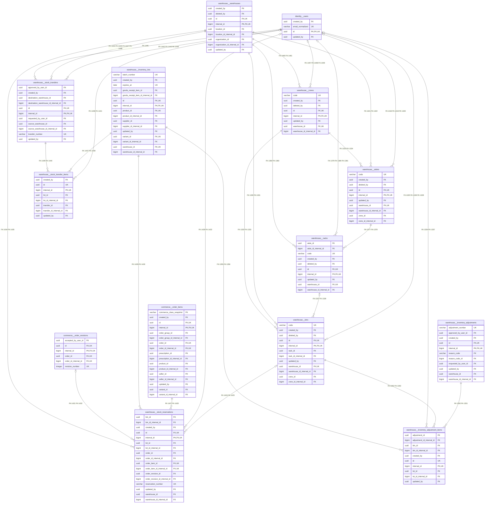
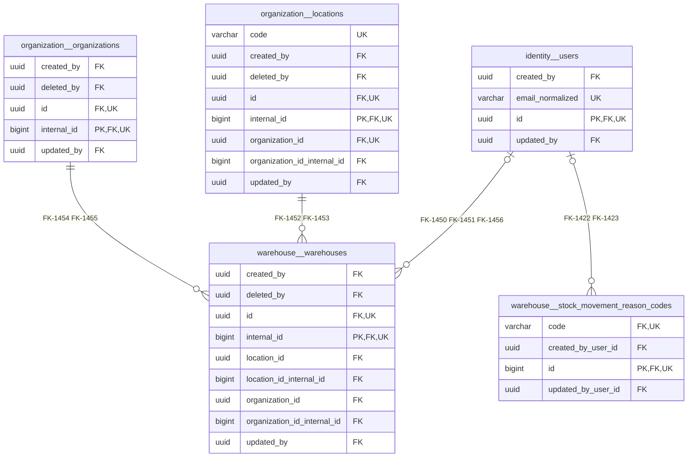

```mermaid
erDiagram
    catalog__product_variants {
        uuid created_by FK
        uuid deleted_by FK
        uuid id FK, UK
        bigint internal_id PK, FK, UK
        uuid pack_uom_id FK
        bigint pack_uom_id_internal_id FK
        uuid product_id FK
        bigint product_id_internal_id FK
        uuid updated_by FK
    }
    catalog__products {
        uuid brand_id FK
        bigint brand_id_internal_id FK
        uuid category_id FK
        bigint category_id_internal_id FK
        varchar commerce_class FK
        uuid commerce_class_approved_by_user_id FK
        uuid created_by FK
        uuid deleted_by FK
        uuid dosage_form_id FK
        bigint dosage_form_id_internal_id FK
        uuid id FK, UK
        bigint internal_id PK, FK, UK
        uuid manufacturer_id FK
        bigint manufacturer_id_internal_id FK
        uuid updated_by FK
    }
    identity__users {
        uuid created_by FK
        varchar email_normalized UK
        uuid id PK, FK, UK
        uuid updated_by FK
    }
    procurement__goods_receipt_items {
        uuid created_by FK
        uuid goods_receipt_id FK
        bigint goods_receipt_id_internal_id FK
        uuid id FK, UK
        bigint internal_id PK, FK, UK
        uuid purchase_order_item_id FK
        bigint purchase_order_item_id_internal_id FK
        uuid updated_by FK
    }
    procurement__suppliers {
        uuid created_by FK
        uuid deleted_by FK
        uuid id FK, UK
        bigint internal_id PK, FK, UK
        uuid organization_id FK
        bigint organization_id_internal_id FK
        uuid updated_by FK
    }
    warehouse__bins {
        varchar code UK
        uuid created_by FK
        uuid deleted_by FK
        uuid id FK, UK
        bigint internal_id PK, FK, UK
        uuid rack_id FK
        bigint rack_id_internal_id FK
        uuid updated_by FK
        uuid warehouse_id FK, UK
        bigint warehouse_id_internal_id FK
        uuid zone_id FK
        bigint zone_id_internal_id FK
    }
    warehouse__cycle_count_items {
        uuid bin_id FK
        bigint bin_id_internal_id FK
        uuid created_by FK
        uuid cycle_count_id FK
        bigint cycle_count_id_internal_id FK
        uuid id UK
        bigint internal_id PK, UK
        uuid lot_id FK
        bigint lot_id_internal_id FK
        varchar reason_code FK
        bigint reason_code_id FK
        uuid updated_by FK
    }
    warehouse__cycle_counts {
        uuid assigned_to_user_id FK
        uuid bin_id FK
        bigint bin_id_internal_id FK
        uuid created_by FK
        uuid id FK, UK
        bigint internal_id PK, FK, UK
        uuid updated_by FK
        uuid warehouse_id FK
        bigint warehouse_id_internal_id FK
    }
    warehouse__inventory_adjustments {
        varchar adjustment_number UK
        uuid approved_by_user_id FK
        uuid created_by FK
        uuid id FK, UK
        bigint internal_id PK, FK, UK
        varchar reason_code FK
        bigint reason_code_id FK
        uuid requested_by_user_id FK
        uuid updated_by FK
        uuid warehouse_id FK
        bigint warehouse_id_internal_id FK
    }
    warehouse__inventory_lots {
        varchar batch_number UK
        uuid created_by FK
        date expires_at UK
        uuid goods_receipt_item_id FK
        bigint goods_receipt_item_id_internal_id FK
        uuid id FK, UK
        bigint internal_id PK, FK, UK
        uuid product_id FK, UK
        bigint product_id_internal_id FK
        uuid supplier_id FK
        bigint supplier_id_internal_id FK
        uuid updated_by FK
        uuid variant_id FK, UK
        bigint variant_id_internal_id FK
        uuid warehouse_id FK, UK
        bigint warehouse_id_internal_id FK
    }
    warehouse__replenishment_rules {
        uuid created_by FK
        uuid deleted_by FK
        uuid id UK
        bigint internal_id PK, UK
        uuid preferred_supplier_id FK
        bigint preferred_supplier_id_internal_id FK
        uuid product_id FK, UK
        bigint product_id_internal_id FK
        uuid updated_by FK
        uuid variant_id FK, UK
        bigint variant_id_internal_id FK
        uuid warehouse_id FK, UK
        bigint warehouse_id_internal_id FK
    }
    warehouse__stock_balances {
        uuid bin_id FK, UK
        bigint bin_id_internal_id FK
        uuid created_by FK
        uuid id UK
        bigint internal_id PK, UK
        uuid inventory_observed_by_user_id FK
        uuid lot_id FK, UK
        bigint lot_id_internal_id FK
        uuid updated_by FK
        uuid warehouse_id FK, UK
        bigint warehouse_id_internal_id FK
    }
    warehouse__stock_holds {
        uuid bin_id FK
        bigint bin_id_internal_id FK
        uuid created_by FK
        uuid id UK
        bigint internal_id PK, UK
        uuid lot_id FK
        bigint lot_id_internal_id FK
        varchar reason_code FK
        bigint reason_code_id FK
        uuid released_by_user_id FK
        uuid updated_by FK
        uuid warehouse_id FK
        bigint warehouse_id_internal_id FK
    }
    warehouse__stock_ledger {
        uuid actor_user_id FK
        uuid bin_id FK
        bigint bin_id_internal_id FK
        uuid id UK
        varchar idempotency_key UK
        bigint internal_id PK, UK
        uuid lot_id FK
        bigint lot_id_internal_id FK
        varchar reason_code FK
        bigint reason_code_id FK
        uuid warehouse_id FK
        bigint warehouse_id_internal_id FK
    }
    warehouse__stock_movement_reason_codes {
        varchar code FK, UK
        uuid created_by_user_id FK
        bigint id PK, FK, UK
        uuid updated_by_user_id FK
    }
    warehouse__warehouses {
        uuid created_by FK
        uuid deleted_by FK
        uuid id FK, UK
        bigint internal_id PK, FK, UK
        uuid location_id FK
        bigint location_id_internal_id FK
        uuid organization_id FK
        bigint organization_id_internal_id FK
        uuid updated_by FK
    }
    identity__users o|--o{ warehouse__inventory_lots : "FK-1365 FK-1372"
    procurement__goods_receipt_items o|--o{ warehouse__inventory_lots : "FK-1366 FK-1367"
    catalog__products ||--o{ warehouse__inventory_lots : "FK-1368 FK-1369"
    procurement__suppliers o|--o{ warehouse__inventory_lots : "FK-1370 FK-1371"
    catalog__product_variants o|--o{ warehouse__inventory_lots : "FK-1373 FK-1374"
    warehouse__warehouses ||--o{ warehouse__inventory_lots : "FK-1375 FK-1376"
    identity__users o|--o{ warehouse__replenishment_rules : "FK-1384 FK-1385 FK-1390"
    procurement__suppliers o|--o{ warehouse__replenishment_rules : "FK-1386 FK-1387"
    catalog__products ||--o{ warehouse__replenishment_rules : "FK-1388 FK-1389"
    catalog__product_variants o|--o{ warehouse__replenishment_rules : "FK-1391 FK-1392"
    warehouse__warehouses ||--o{ warehouse__replenishment_rules : "FK-1393 FK-1394"
    warehouse__bins ||--o{ warehouse__stock_balances : "FK-1395 FK-1396"
    identity__users o|--o{ warehouse__stock_balances : "FK-1397 FK-1398 FK-1401"
    warehouse__inventory_lots ||--o{ warehouse__stock_balances : "FK-1399 FK-1400"
    warehouse__warehouses ||--o{ warehouse__stock_balances : "FK-1402 FK-1403"
    warehouse__bins o|--o{ warehouse__stock_holds : "FK-1404 FK-1405"
    warehouse__stock_movement_reason_codes o|--o{ warehouse__stock_holds : "FK-1406"
    identity__users o|--o{ warehouse__stock_holds : "FK-1407 FK-1410 FK-1411"
    warehouse__inventory_lots ||--o{ warehouse__stock_holds : "FK-1408 FK-1409"
    warehouse__warehouses ||--o{ warehouse__stock_holds : "FK-1412 FK-1413"
    identity__users o|--o{ warehouse__stock_ledger : "FK-1414"
    warehouse__bins o|--o{ warehouse__stock_ledger : "FK-1415 FK-1416"
    warehouse__stock_movement_reason_codes o|--o{ warehouse__stock_ledger : "FK-1417"
    warehouse__inventory_lots ||--o{ warehouse__stock_ledger : "FK-1418 FK-1419"
    warehouse__warehouses ||--o{ warehouse__stock_ledger : "FK-1420 FK-1421"
    warehouse__bins ||--o{ warehouse__cycle_count_items : "FK-1334 FK-1335"
    warehouse__stock_movement_reason_codes o|--o{ warehouse__cycle_count_items : "FK-1336"
    identity__users o|--o{ warehouse__cycle_count_items : "FK-1337 FK-1342"
    warehouse__cycle_counts ||--o{ warehouse__cycle_count_items : "FK-1338 FK-1339"
    warehouse__inventory_lots ||--o{ warehouse__cycle_count_items : "FK-1340 FK-1341"
    identity__users o|--o{ warehouse__cycle_counts : "FK-1343 FK-1346 FK-1347"
    warehouse__bins o|--o{ warehouse__cycle_counts : "FK-1344 FK-1345"
    warehouse__warehouses ||--o{ warehouse__cycle_counts : "FK-1348 FK-1349"
    identity__users o|--o{ warehouse__inventory_adjustments : "FK-1358 FK-1360 FK-1362"
    warehouse__stock_movement_reason_codes o|--o{ warehouse__inventory_adjustments : "FK-1359"
    identity__users ||--o{ warehouse__inventory_adjustments : "FK-1361"
    warehouse__warehouses ||--o{ warehouse__inventory_adjustments : "FK-1363 FK-1364"
```

# Warehouse ER diagrams

## What this part of the database stores

The `warehouse` schema stores stock balances, lots, and transfers. The names and structural relationships below come from the checked-out database catalog snapshot; business-purpose summaries marked inferred are not product-owner approval.

## Main tables

| Table | Recorded purpose | Table definition |
|---|---|---|
| [`aisles`](../Tables/warehouse/aisles.md) | Holds aisles records within the warehouse domain (stock balances, lots and transfers). Its precise write owner and lifecycle must be accepted during module implementation. (inferred meaning) | [Table contract](../Tables/warehouse/aisles.md) |
| [`bins`](../Tables/warehouse/bins.md) | Holds bins records within the warehouse domain (stock balances, lots and transfers). Its precise write owner and lifecycle must be accepted during module implementation. (inferred meaning) | [Table contract](../Tables/warehouse/bins.md) |
| [`cycle_count_items`](../Tables/warehouse/cycle_count_items.md) | Holds cycle count items records within the warehouse domain (stock balances, lots and transfers). Its precise write owner and lifecycle must be accepted during module implementation. (inferred meaning) | [Table contract](../Tables/warehouse/cycle_count_items.md) |
| [`cycle_counts`](../Tables/warehouse/cycle_counts.md) | Holds cycle counts records within the warehouse domain (stock balances, lots and transfers). Its precise write owner and lifecycle must be accepted during module implementation. (inferred meaning) | [Table contract](../Tables/warehouse/cycle_counts.md) |
| [`inventory_adjustment_items`](../Tables/warehouse/inventory_adjustment_items.md) | Holds inventory adjustment items records within the warehouse domain (stock balances, lots and transfers). Its precise write owner and lifecycle must be accepted during module implementation. (inferred meaning) | [Table contract](../Tables/warehouse/inventory_adjustment_items.md) |
| [`inventory_adjustments`](../Tables/warehouse/inventory_adjustments.md) | Holds inventory adjustments records within the warehouse domain (stock balances, lots and transfers). Its precise write owner and lifecycle must be accepted during module implementation. (inferred meaning) | [Table contract](../Tables/warehouse/inventory_adjustments.md) |
| [`inventory_lots`](../Tables/warehouse/inventory_lots.md) | Holds inventory lots records within the warehouse domain (stock balances, lots and transfers). Its precise write owner and lifecycle must be accepted during module implementation. (inferred meaning) | [Table contract](../Tables/warehouse/inventory_lots.md) |
| [`racks`](../Tables/warehouse/racks.md) | Holds racks records within the warehouse domain (stock balances, lots and transfers). Its precise write owner and lifecycle must be accepted during module implementation. (inferred meaning) | [Table contract](../Tables/warehouse/racks.md) |
| [`replenishment_rules`](../Tables/warehouse/replenishment_rules.md) | Holds replenishment rules records within the warehouse domain (stock balances, lots and transfers). Its precise write owner and lifecycle must be accepted during module implementation. (inferred meaning) | [Table contract](../Tables/warehouse/replenishment_rules.md) |
| [`stock_balances`](../Tables/warehouse/stock_balances.md) | Holds stock balances records within the warehouse domain (stock balances, lots and transfers). Its precise write owner and lifecycle must be accepted during module implementation. (inferred meaning) | [Table contract](../Tables/warehouse/stock_balances.md) |
| [`stock_holds`](../Tables/warehouse/stock_holds.md) | Holds stock holds records within the warehouse domain (stock balances, lots and transfers). Its precise write owner and lifecycle must be accepted during module implementation. (inferred meaning) | [Table contract](../Tables/warehouse/stock_holds.md) |
| [`stock_ledger`](../Tables/warehouse/stock_ledger.md) | Holds stock ledger records within the warehouse domain (stock balances, lots and transfers). Its precise write owner and lifecycle must be accepted during module implementation. (inferred meaning) | [Table contract](../Tables/warehouse/stock_ledger.md) |
| [`stock_movement_reason_codes`](../Tables/warehouse/stock_movement_reason_codes.md) | Holds stock movement reason codes records within the warehouse domain (stock balances, lots and transfers). Its precise write owner and lifecycle must be accepted during module implementation. (inferred meaning) | [Table contract](../Tables/warehouse/stock_movement_reason_codes.md) |
| [`stock_reservations`](../Tables/warehouse/stock_reservations.md) | Holds stock reservations records within the warehouse domain (stock balances, lots and transfers). Its precise write owner and lifecycle must be accepted during module implementation. (inferred meaning) | [Table contract](../Tables/warehouse/stock_reservations.md) |
| [`stock_transfer_items`](../Tables/warehouse/stock_transfer_items.md) | Holds stock transfer items records within the warehouse domain (stock balances, lots and transfers). Its precise write owner and lifecycle must be accepted during module implementation. (inferred meaning) | [Table contract](../Tables/warehouse/stock_transfer_items.md) |
| [`stock_transfers`](../Tables/warehouse/stock_transfers.md) | Holds stock transfers records within the warehouse domain (stock balances, lots and transfers). Its precise write owner and lifecycle must be accepted during module implementation. (inferred meaning) | [Table contract](../Tables/warehouse/stock_transfers.md) |
| [`warehouses`](../Tables/warehouse/warehouses.md) | Holds warehouses records within the warehouse domain (stock balances, lots and transfers). Its precise write owner and lifecycle must be accepted during module implementation. (inferred meaning) | [Table contract](../Tables/warehouse/warehouses.md) |
| [`zones`](../Tables/warehouse/zones.md) | Holds zones records within the warehouse domain (stock balances, lots and transfers). Its precise write owner and lifecycle must be accepted during module implementation. (inferred meaning) | [Table contract](../Tables/warehouse/zones.md) |

## ER diagrams

These diagrams show declared PostgreSQL foreign keys from focused source tables. Entity fields include primary keys, unique keys, and FK columns; exact data types remain in the linked table contracts. `PK`, `FK`, and `UK` mark key roles. Relationship cardinality comes from FK nullability and unique constraints/indexes in the recorded catalog.

### Diagram 01 — inventory_lots, replenishment_rules, stock_balances, stock_holds, stock_ledger, cycle_count_items, cycle_counts, inventory_adjustments

This focused view contains every declared FK owned by the listed focus tables. Referenced tables outside that set appear as context. Parallel FK constraints are distinguished by their stable IDs; search those IDs in the [relationship catalog](Relationship-Catalog/warehouse.md) for exact columns and actions.

**Entity name mapping**

| Mermaid name | PostgreSQL table |
|---|---|
| `catalog__product_variants` | [`catalog.product_variants`](../Tables/catalog/product_variants.md) |
| `catalog__products` | [`catalog.products`](../Tables/catalog/products.md) |
| `identity__users` | [`identity.users`](../Tables/identity/users.md) |
| `procurement__goods_receipt_items` | [`procurement.goods_receipt_items`](../Tables/procurement/goods_receipt_items.md) |
| `procurement__suppliers` | [`procurement.suppliers`](../Tables/procurement/suppliers.md) |
| `warehouse__bins` | [`warehouse.bins`](../Tables/warehouse/bins.md) |
| `warehouse__cycle_count_items` | [`warehouse.cycle_count_items`](../Tables/warehouse/cycle_count_items.md) |
| `warehouse__cycle_counts` | [`warehouse.cycle_counts`](../Tables/warehouse/cycle_counts.md) |
| `warehouse__inventory_adjustments` | [`warehouse.inventory_adjustments`](../Tables/warehouse/inventory_adjustments.md) |
| `warehouse__inventory_lots` | [`warehouse.inventory_lots`](../Tables/warehouse/inventory_lots.md) |
| `warehouse__replenishment_rules` | [`warehouse.replenishment_rules`](../Tables/warehouse/replenishment_rules.md) |
| `warehouse__stock_balances` | [`warehouse.stock_balances`](../Tables/warehouse/stock_balances.md) |
| `warehouse__stock_holds` | [`warehouse.stock_holds`](../Tables/warehouse/stock_holds.md) |
| `warehouse__stock_ledger` | [`warehouse.stock_ledger`](../Tables/warehouse/stock_ledger.md) |
| `warehouse__stock_movement_reason_codes` | [`warehouse.stock_movement_reason_codes`](../Tables/warehouse/stock_movement_reason_codes.md) |
| `warehouse__warehouses` | [`warehouse.warehouses`](../Tables/warehouse/warehouses.md) |

Coverage: 8 focus tables, 16 entities, 73 FK constraints (73 unique IDs).

### Diagram 02 — stock_reservations, bins, zones, aisles, racks, inventory_adjustment_items, stock_transfers, stock_transfer_items

This focused view contains every declared FK owned by the listed focus tables. Referenced tables outside that set appear as context. Parallel FK constraints are distinguished by their stable IDs; search those IDs in the [relationship catalog](Relationship-Catalog/warehouse.md) for exact columns and actions.

**Entity name mapping**

| Mermaid name | PostgreSQL table |
|---|---|
| `commerce__order_items` | [`commerce.order_items`](../Tables/commerce/order_items.md) |
| `commerce__order_revisions` | [`commerce.order_revisions`](../Tables/commerce/order_revisions.md) |
| `identity__users` | [`identity.users`](../Tables/identity/users.md) |
| `warehouse__aisles` | [`warehouse.aisles`](../Tables/warehouse/aisles.md) |
| `warehouse__bins` | [`warehouse.bins`](../Tables/warehouse/bins.md) |
| `warehouse__inventory_adjustment_items` | [`warehouse.inventory_adjustment_items`](../Tables/warehouse/inventory_adjustment_items.md) |
| `warehouse__inventory_adjustments` | [`warehouse.inventory_adjustments`](../Tables/warehouse/inventory_adjustments.md) |
| `warehouse__inventory_lots` | [`warehouse.inventory_lots`](../Tables/warehouse/inventory_lots.md) |
| `warehouse__racks` | [`warehouse.racks`](../Tables/warehouse/racks.md) |
| `warehouse__stock_reservations` | [`warehouse.stock_reservations`](../Tables/warehouse/stock_reservations.md) |
| `warehouse__stock_transfer_items` | [`warehouse.stock_transfer_items`](../Tables/warehouse/stock_transfer_items.md) |
| `warehouse__stock_transfers` | [`warehouse.stock_transfers`](../Tables/warehouse/stock_transfers.md) |
| `warehouse__warehouses` | [`warehouse.warehouses`](../Tables/warehouse/warehouses.md) |
| `warehouse__zones` | [`warehouse.zones`](../Tables/warehouse/zones.md) |

Coverage: 8 focus tables, 14 entities, 62 FK constraints (62 unique IDs).

### Diagram 03 — warehouses, stock_movement_reason_codes

This focused view contains every declared FK owned by the listed focus tables. Referenced tables outside that set appear as context. Parallel FK constraints are distinguished by their stable IDs; search those IDs in the [relationship catalog](Relationship-Catalog/warehouse.md) for exact columns and actions.

**Entity name mapping**

| Mermaid name | PostgreSQL table |
|---|---|
| `identity__users` | [`identity.users`](../Tables/identity/users.md) |
| `organization__locations` | [`organization.locations`](../Tables/organization/locations.md) |
| `organization__organizations` | [`organization.organizations`](../Tables/organization/organizations.md) |
| `warehouse__stock_movement_reason_codes` | [`warehouse.stock_movement_reason_codes`](../Tables/warehouse/stock_movement_reason_codes.md) |
| `warehouse__warehouses` | [`warehouse.warehouses`](../Tables/warehouse/warehouses.md) |

Coverage: 2 focus tables, 5 entities, 9 FK constraints (9 unique IDs).

## How the tables connect

- **warehouse.aisles → identity.users:** `created_by` references `id`; Each child may reference zero or one parent; each parent may have zero or more child row(s). The database applies `ON DELETE RESTRICT`. This keeps the child record tied to an existing parent key.
- **warehouse.aisles → identity.users:** `deleted_by` references `id`; Each child may reference zero or one parent; each parent may have zero or more child row(s). The database applies `ON DELETE RESTRICT`. This keeps the child record tied to an existing parent key.
- **warehouse.aisles → identity.users:** `updated_by` references `id`; Each child may reference zero or one parent; each parent may have zero or more child row(s). The database applies `ON DELETE RESTRICT`. This keeps the child record tied to an existing parent key.
- **warehouse.aisles → warehouse.warehouses:** `warehouse_id` references `id`; Each child must reference exactly one parent; each parent may have zero or more child row(s). The database applies `ON DELETE CASCADE`. This keeps the child record tied to an existing parent key.
- **warehouse.aisles → warehouse.warehouses:** `warehouse_id_internal_id` references `internal_id`; Each child must reference exactly one parent; each parent may have zero or more child row(s). The database applies `ON DELETE CASCADE`. This keeps the child record tied to an existing parent key.
- **warehouse.aisles → warehouse.zones:** `zone_id` references `id`; Each child must reference exactly one parent; each parent may have zero or more child row(s). The database applies `ON DELETE CASCADE`. This keeps the child record tied to an existing parent key.

Paired public UUID and internal BIGINT foreign keys are real separate constraints. Diagrams use relationship IDs to keep those links readable; each underlying constraint is listed separately in the catalog. The application must keep paired identifiers consistent under the database's numeric-key guards. A relationship does not itself grant read or write permission.

## Important database rules

- The database primary key strategy uses an internal numeric key for most domain rows while retaining public UUID aliases; `identity.users` retains a UUID primary key. The table diagram labels expose the exact keys for each entity.
- A nullable FK permits a child row without that association; it does not make the referenced parent optional when a value is present.
- Composite FKs remain composite in the relationship catalog. Their scope columns must not be dropped when reading the diagram.
- A many-to-many association uses its actual junction table where one exists; no direct association is inferred.
- Authorization, tenant/site scoping, and service write ownership are separate contracts. See the linked database rules and module designs.

## What happens during normal operations

See [WF-002](../../06-Workflows/WF-002-Search-and-Availability.md), [WF-003](../../06-Workflows/WF-003-Cart-Quote-and-Reservation.md), [WF-006](../../06-Workflows/WF-006-Licensed-Site-Allocation.md), [WF-007](../../06-Workflows/WF-007-Picking-Packing-and-Handoff.md), [WF-011](../../06-Workflows/WF-011-Inventory-Reconciliation.md), [WF-014](../../06-Workflows/WF-014-Supplier-Receiving.md) for the reviewed workflows that touch this schema. The workflows describe business sequencing; these ERDs describe enforced database references.

## Related documents

[Schema overview](../Schema-Overview.md) · [Database rules](../Database-Rules.md) · [Model and parity notes](../Models-and-Parity.md) · [Migration evidence](../Migrations.md) · [Full relationship catalog](Relationship-Catalog.md) · [Non-FK reference review](Logical-References.md) · [Table index](../Tables/warehouse/README.md) · [Cart_Checkout HLD](../../03-Modules/Cart-Checkout/HLD.md) · [Cart_Checkout LLD](../../03-Modules/Cart-Checkout/LLD.md) · [Inventory HLD](../../03-Modules/Inventory/HLD.md) · [Inventory LLD](../../03-Modules/Inventory/LLD.md) · [Store_Operations HLD](../../03-Modules/Store-Operations/HLD.md) · [Store_Operations LLD](../../03-Modules/Store-Operations/LLD.md) · [Warehouse HLD](../../03-Modules/Warehouse/HLD.md) · [Warehouse LLD](../../03-Modules/Warehouse/LLD.md) · [WF-002](../../06-Workflows/WF-002-Search-and-Availability.md) · [WF-003](../../06-Workflows/WF-003-Cart-Quote-and-Reservation.md) · [WF-006](../../06-Workflows/WF-006-Licensed-Site-Allocation.md) · [WF-007](../../06-Workflows/WF-007-Picking-Packing-and-Handoff.md) · [WF-011](../../06-Workflows/WF-011-Inventory-Reconciliation.md) · [WF-014](../../06-Workflows/WF-014-Supplier-Receiving.md)
