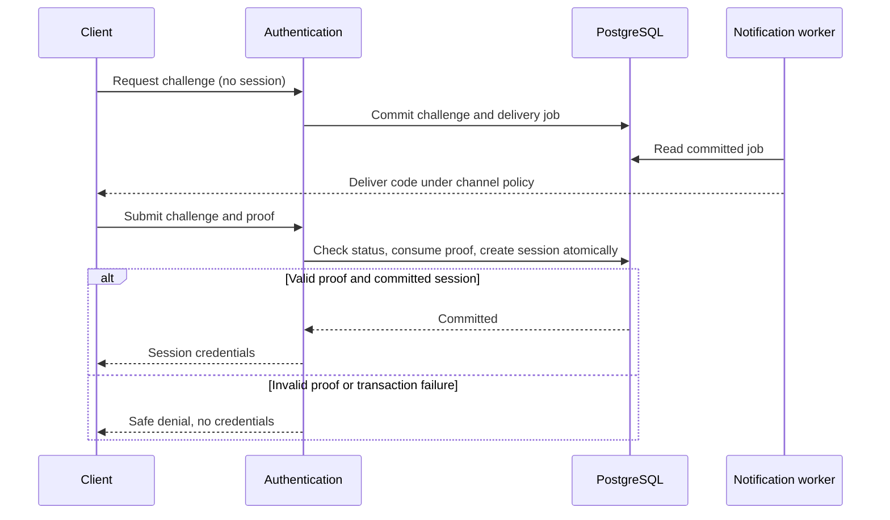

# WF-001 — Identity and Session

Status: proposed orchestration for ACC-01 and AUTH-01–AUTH-04. Customer_Accounts owns the customer entry flow; Authentication_Access owns proof verification, session creation, rotation and revocation. Notifications delivers messages after commit. No application implementation is asserted.

## Preconditions

Initial login has no existing-session requirement. It requires a valid normalized destination or approved staff identifier and the proof required by the current role policy. MFA completion uses a purpose-bound pre-session challenge; refresh uses a refresh credential. Only protected post-login operations require an existing application session. See [authentication contracts](../05-APIs/Authentication_Access.md) and [customer contracts](../05-APIs/Customer_Accounts.md).

## Normal path and transaction boundary

1. Validate phone/identifier and enforce D-003 abuse policy before delivery or credential verification. Do not expose whether an account exists.
2. Create a purpose-bound challenge and its expiry/attempt state. Queue WhatsApp delivery; SMS fallback follows the configured delivery rule. Never log the OTP.
3. Verify the supplied proof; atomically consume the challenge and create the eligible session after rechecking account status and role policy. Staff requiring MFA receive no privileged session before completing it.
4. Resolve/create a customer identity without inventing required profile data. Collect first_name before creating customer.profiles. Required consent and incomplete-onboarding permissions follow D-003/D-013.
5. Commit account/session and audit facts before returning credentials. Profile changes later use the profile and identity versions separately.

## Failure, rollback and recovery

Incorrect/expired/blocked/consumed proof returns a generic denial and no new session. Concurrent verification may consume a challenge once. If the transaction fails, challenge consumption and session creation roll back together; issue no credential. A lost successful response does not permit unrestricted proof replay: the client reauthenticates through the documented challenge flow.

Provider failure leaves delivery pending/failed and follows the approved fallback rule; it never bypasses verification. Refresh replay and role removal cause the security response in AUTH-02/D-003. Revocation must invalidate cached access under the approved expiry/revocation policy. Audit failures must not result in an unaudited privileged session.

## Data and sequence

Tables: identity.users, identity.otp_challenges, identity.sessions, identity.mfa_factors, identity.login_attempts; customer.profiles is created only after mandatory data exists. Identity/session writes are owned by Authentication_Access; customer profile writes by Customer_Accounts through the defined transaction boundary.

## Required tests

Link TC-ACC-01-01 through TC-ACC-01-05 in [Customer LLD](../03-Modules/Customer_Accounts/LLD.md). Also test login without an existing bearer token, MFA bypass, refresh replay, role removal during verification, rollback before credential return, missing profile name, required consent, provider fallback and redacted logs. Proposed tests are not execution evidence.
