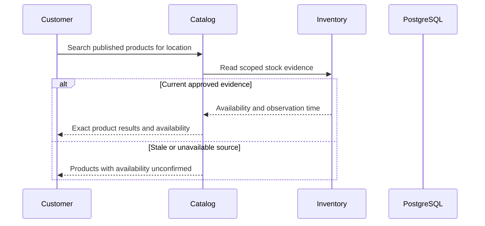

# WF-002 — Search and Availability

> [!NOTE]
> **Status: Proposed orchestration; NOT RUN.** Business rules and thresholds still require the applicable [owner decisions](../09-References/Sources-and-Decisions.md).

## Actors and preconditions

Customer, Catalog and Inventory. Use the operation’s actual trust category: public/pre-login, owned customer session, scoped staff/service or authenticated provider evidence. Enforce current object, patient and location scope, record version and required policy before progression.

## Normal path and committed outcomes

1. Validate bounded search/category inputs against published products; browsing must not inherit a post-login-only requirement.
2. Catalog resolves exact variants and approved P/M/O classification. Search results never authorize clinical substitution.
3. For a delivery location, Inventory returns scoped availability with observation time and eligibility limits; a view is not a reservation.
4. Return permitted product fields and distinguish no matches, unavailable search and unknown stock. Checkout revalidates before a hold.

## Data ownership and API boundary

Catalog owns published discovery; Inventory owns availability evidence. A read grants no stock mutation.

Candidate existing tables: `catalog.products`, `catalog.product_variants`, `search.documents`, `warehouse.stock_balances`. Exact write fields and runtime grants remain per-operation review under D-024.

Related proposed operations: API-013/API-014; Inventory API-050. [Product Catalog](../03-Modules/Product-Catalog/APIs.md) · [Inventory](../03-Modules/Inventory/APIs.md).

## Sequence

## Failure, transaction and recovery boundaries

The alternative outcomes in the steps and diagram retain committed facts and name the next responsible team. Apply the [state and recovery contract](../07-Engineering/State-and-Recovery-Contracts.md): local state/audit/outbox commit together, external IO occurs outside locks, safe replay uses the recorded intent, and unknown money remains pending. Denied scope or stale version cannot create a partial stock, clinical or money effect.

## Feature-specific verification and navigation

Designed cases: `TC-CAT-03-DENY`, `TC-CAT-04-DENY`, `TC-CAT-05-DENY`. Locate their owning LLD/edge pages through the [feature register](../09-References/Coverage-and-Traceability.md). Record fixtures, approved policies and actual execution before claiming success.

[Business journey](../00-Business-Guide/Pharmville-Complete-Business-Flow.md) · [module designs](../03-Modules/README.md) · [operation contracts](../05-APIs/Critical-Operation-Contracts.md) · [data mapping](../04-Database/Module-Mapping.md) · [testing](../07-Engineering/Testing.md) · [workflow index](README.md)
