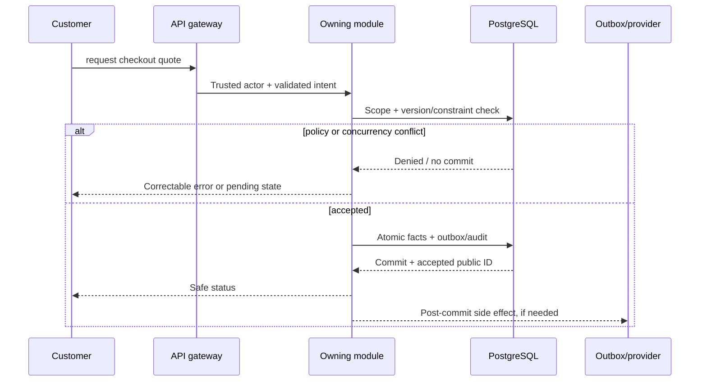

# WF-003 — Cart Quote and Reservation

**Status:** Proposed orchestration based on draft requirements and existing DB contracts. This is not an observed deployed workflow.

**Actor:** Customer. **Trigger:** request checkout quote.
**Preconditions:** Valid session and per-resource scope; approved policy data and current serviceability or eligibility where relevant.
**Expected outcome:** accepted versioned checkout, otherwise correction.

## Normal path

1. Resolve trusted identity and current entity version.
2. Check classifications, licensing, money, consent and location conditions appropriate to this workflow.
3. Validate request payload and expected state.
4. Commit owning module rows and audit/outbox atomically.
5. Publish any external side effect only after commit and record correlation IDs.
6. Return an honest status and allow safe resume.

## Data ownership and API boundary
**Modules:** Cart_Checkout, Inventory, Product_Catalog, Finance_Payments.
**Existing tables involved (candidates):** `commerce.carts`, `commerce.checkouts`, `warehouse.stock_reservations`, `platform.idempotency_keys`.
**Related proposed APIs:** API-018, API-019, API-020, API-021, API-075, API-076, API-077, API-078, API-079, API-080; additional related contracts are in module API indexes.

## Alternative / failure flows
- **Example failure:** double-click, race for last unit, price update. Do not make an optimistic success assertion.
- **Duplicate operation:** accept only the same idempotent result or issue a version conflict; never duplicate stock or money movements.
- **Provider/network timeout:** leave a pending reconciliation state; never infer a paid/delivered/reviewed outcome.
- **Unauthorized or expired identity:** deny, audit outcome as policy allows, and avoid revealing another user’s resource.
- **Compensation:** when separate providers or ledgers are involved, use explicit compensating actions after durable evidence. Never silently reverse historic finance or clinical records.

## Sequence (design)

**Required QA:** approved happy path, denial, replay, race, provider outage, stale state, and actor-scope negative test; testing strategy.
