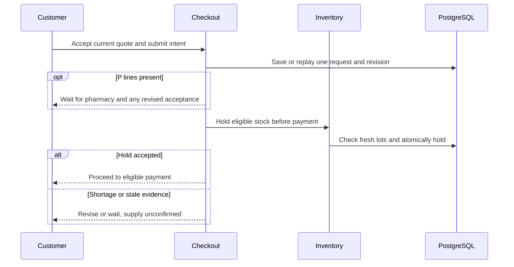

# WF-003 — Cart Quote and Reservation

> [!NOTE]
> **Status: Proposed orchestration; NOT RUN.** Business rules and thresholds still require the applicable [owner decisions](../09-References/Sources-and-Decisions.md).

## Actors and preconditions

Customer, Checkout and Inventory. Use the operation’s actual trust category: public/pre-login, owned customer session, scoped staff/service or authenticated provider evidence. Enforce current object, patient and location scope, record version and required policy before progression.

## Normal path and committed outcomes

1. Load only the caller’s cart; validate quantities, selected address and required patient against current versions.
2. Compute a versioned quote including current class, prices, minimum and fee. A price/stock change requires explicit customer acceptance.
3. Create/replay one order request. P lines go through review and revision acceptance before the detailed journey reaches payment; M/O skip review.
4. Before payment, request Inventory’s eligible licensed-site/lot hold for the exact accepted revision. Allocation and hold must agree on one site.
5. Return the recorded quote/order/hold status. No hold means no claim that supply is secured; policy-approved expiry releases unused holds once.

## Data ownership and API boundary

Checkout owns the cart/quote/intent and delegates order creation to Operations; Inventory alone commands the hold.

Candidate existing tables: `commerce.carts`, `commerce.cart_items`, `commerce.checkouts`, `commerce.orders`, `commerce.order_revisions`, `warehouse.stock_reservations`. Exact write fields and runtime grants remain per-operation review under D-024.

Related proposed operations: API-018–API-021 and API-052/API-053. [Cart Checkout](../05-APIs/Cart_Checkout.md) · [Inventory](../05-APIs/Inventory.md) · [Order Operations](../05-APIs/Order_Operations.md).

## Sequence

## Failure, transaction and recovery boundaries

The alternative outcomes in the steps and diagram retain committed facts and name the next responsible team. Apply the [state and recovery contract](../07-Engineering/State-and-Recovery-Contracts.md): local state/audit/outbox commit together, external IO occurs outside locks, safe replay uses the recorded intent, and unknown money remains pending. Denied scope or stale version cannot create a partial stock, clinical or money effect.

## Feature-specific verification and navigation

Designed cases: `TC-CHK-06-DENY`, `TC-CHK-07-DENY`, `TC-CHK-08-DENY`. Locate their owning LLD/edge pages through the [feature register](../09-References/Coverage-and-Traceability.md). Record fixtures, approved policies and actual execution before claiming success.

[Business journey](../00-Business-Guide/Pharmville-Complete-Business-Flow.md) · [module designs](../03-Modules/README.md) · [operation contracts](../05-APIs/Critical-Operation-Contracts.md) · [data mapping](../04-Database/Module-Mapping.md) · [testing](../07-Engineering/Testing.md) · [workflow index](README.md)
