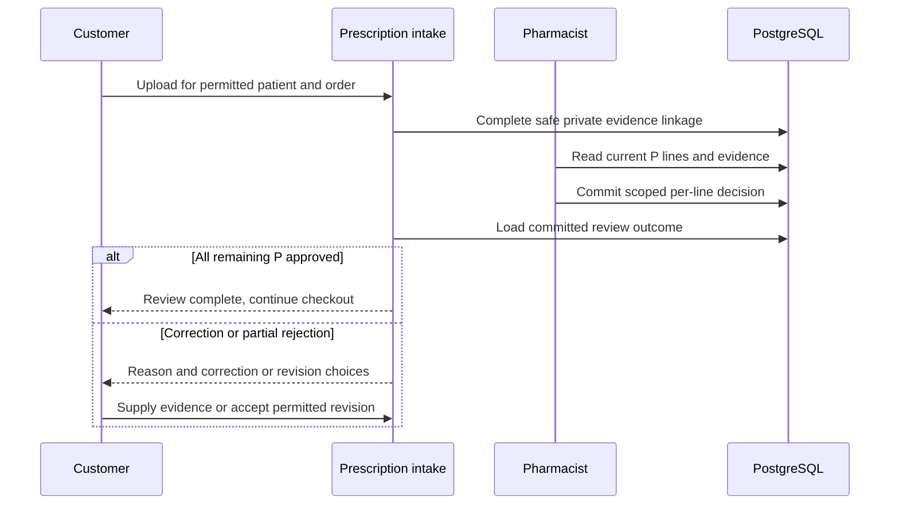

# WF-004 — Prescription Intake and Review

**Status: Proposed orchestration; NOT RUN.** Business rules and thresholds still require the applicable [owner decisions](../09-References/Sources-and-Decisions.md).

## Actors and preconditions

Customer, Prescription intake and Pharmacist. Use the operation’s actual trust category: public/pre-login, owned customer session, scoped staff/service or authenticated provider evidence. Enforce current object, patient and location scope, record version and required policy before progression.

## Normal path and committed outcomes

1. For P only, authorize patient and order linkage and create a private upload session. A file must be complete and pass safety checks before review.
2. Pharmacy loads authorized evidence and the current accepted revision, then compares each P line’s exact SKU, strength, form, quantity and patient.
3. Commit a decision with reviewer identity, registration, reason and evidence/revision binding. Concurrent stale decisions cannot overwrite the accepted result.
4. For rejection/correction, keep affected P lines held and offer re-upload, a permitted revised basket or cancellation. M/O are not automatically rejected.
5. Payment proceeds only when remaining P lines are approved and any changed basket is accepted under the current detailed journey. Deferred upload RX-02 remains blocked pending D-004/D-006.

## Data ownership and API boundary

Intake owns safe patient/document linkage; Pharmacy owns per-line clinical decisions; Operations/Checkout coordinates an accepted revision.

Candidate existing tables: `clinical.prescriptions`, `clinical.prescription_documents`, `clinical.order_reviews`, `clinical.order_review_items`, `platform.file_objects`. Exact write fields and runtime grants remain per-operation review under D-024.

Related proposed operations: API-022–API-024 and API-060–API-063; exact revision-command ownership needs D-024 review. [Prescription Upload](../05-APIs/Prescription_Upload.md) · [Pharmacist Review](../05-APIs/Pharmacist_Review.md).

## Sequence

## Failure, transaction and recovery boundaries

The alternative outcomes in the steps and diagram retain committed facts and name the next responsible team. Apply the [state and recovery contract](../07-Engineering/State-and-Recovery-Contracts.md): local state/audit/outbox commit together, external IO occurs outside locks, safe replay uses the recorded intent, and unknown money remains pending. Denied scope or stale version cannot create a partial stock, clinical or money effect.

## Feature-specific verification and navigation

Designed cases: `TC-RX-01-DENY`, `TC-RX-04-DENY`, `TC-PHM-03-DENY`, `TC-PHM-05-DENY`. Locate their owning LLD/edge pages through the [feature register](../09-References/Coverage-and-Traceability.md). Record fixtures, approved policies and actual execution before claiming success.

[Business journey](../00-Business-Guide/Pharmville-Complete-Business-Flow.md) · [module designs](../03-Modules/README.md) · [operation contracts](../05-APIs/Critical-Operation-Contracts.md) · [data mapping](../04-Database/Module-Mapping.md) · [testing](../07-Engineering/Testing.md) · [workflow index](README.md)
