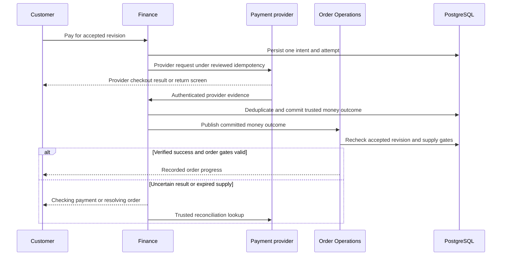

# WF-005 — Payment and Confirmation

> [!NOTE]
> **Status: Proposed orchestration; NOT RUN.** Business rules and thresholds still require the applicable [owner decisions](../09-References/Sources-and-Decisions.md).

## Actors and preconditions

Customer, Finance and Payment provider. Use the operation’s actual trust category: public/pre-login, owned customer session, scoped staff/service or authenticated provider evidence. Enforce current object, patient and location scope, record version and required policy before progression.

## Normal path and committed outcomes

1. Customer initiation requires an owned accepted revision, current required review and eligible hold. The provider callback instead uses the signed raw-body trust path, with no customer-session requirement.
2. Persist one payment attempt/reference before provider IO; invoke the exact provider contract outside database locks. An initiation timeout is not permission to repeat a charge.
3. Authenticate/deduplicate callback evidence, compare amount/currency/order and commit its trusted outcome with audit/outbox before the reviewed acknowledgment.
4. Order Operations consumes committed money facts and rechecks stock/clinical gates. Do not infer paid or confirmed from the browser redirect.
5. If success arrives after hold release, record money and route to Operations/Finance for approved stock recovery or compensation. Keep the customer pending until resolved; message delivery does not decide order success.

## Data ownership and API boundary

Finance owns trusted money evidence; Order Operations consumes it and updates only its order projection/coordination state.

Candidate existing tables: `payment.payment_intents`, `payment.payment_attempts`, `payment.payment_webhooks`, `commerce.orders`. Exact write fields and runtime grants remain per-operation review under D-024.

Related proposed operations: API-075/API-076/API-077; API-026 reads customer order outcome. [Finance Payments](../03-Modules/Finance_Payments/APIs.md) · [Customer Orders](../03-Modules/Customer_Orders/APIs.md).

## Sequence

## Failure, transaction and recovery boundaries

The alternative outcomes in the steps and diagram retain committed facts and name the next responsible team. Apply the [state and recovery contract](../07-Engineering/State-and-Recovery-Contracts.md): local state/audit/outbox commit together, external IO occurs outside locks, safe replay uses the recorded intent, and unknown money remains pending. Denied scope or stale version cannot create a partial stock, clinical or money effect.

## Feature-specific verification and navigation

Designed cases: `TC-CHK-03-DENY`, `TC-CHK-07-DENY`, `TC-FIN-01-DENY`, `TC-ORD-01-DENY`. Locate their owning LLD/edge pages through the [feature register](../09-References/Coverage-and-Traceability.md). Record fixtures, approved policies and actual execution before claiming success.

[Business journey](../00-Business-Guide/Pharmville-Complete-Business-Flow.md) · [module designs](../03-Modules/README.md) · [operation contracts](../05-APIs/Critical-Operation-Contracts.md) · [data mapping](../04-Database/Module-Mapping.md) · [testing](../07-Engineering/Testing.md) · [workflow index](README.md)
