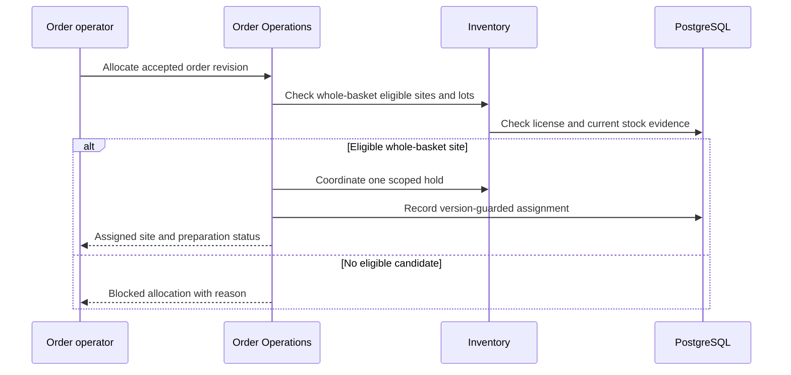

# WF-006 — Licensed Site Allocation

**Status: Proposed orchestration; NOT RUN.** Business rules and thresholds still require the applicable [owner decisions](../09-References/Sources-and-Decisions.md).

## Actors and preconditions

Order operator, Order Operations and Inventory. Use the operation’s actual trust category: public/pre-login, owned customer session, scoped staff/service or authenticated provider evidence. Enforce current object, patient and location scope, record version and required policy before progression.

## Normal path and committed outcomes

1. Read accepted order revision, address and required clinical eligibility. Scope the allocating staff/service identity independently of caller-supplied site IDs.
2. Enumerate approved open serviceable sites. Recheck location-specific license and fresh authoritative stock for every eligible lot/item; nearest distance alone cannot select a site.
3. Coordinate one site decision and exact holds through Inventory. Competing allocators resolve one winner; no unsupported split order or silent substitute.
4. For reassignment, check current version and work state, record a reason and coordinate old work closure/release with new eligible hold. Existing fulfillment identity is immutable in the available V0030 guard.
5. If no whole-basket candidate exists, retain an exception for approved wait/revision/cancellation. Warehouse fallback requires D-002/D-010 approval and the same gates.

## Data ownership and API boundary

Order Operations commands allocation; Inventory commands stock; eligibility consumes approved organization/license evidence.

Candidate existing tables: `commerce.orders`, `commerce.order_allocations`, `commerce.order_revisions`, `warehouse.stock_reservations`, `organization.licenses`. Exact write fields and runtime grants remain per-operation review under D-024.

Related proposed operations: API-041/API-042 and API-052/API-053. [Order Operations](../05-APIs/Order_Operations.md) · [Inventory](../05-APIs/Inventory.md).

## Sequence

## Failure, transaction and recovery boundaries

The alternative outcomes in the steps and diagram retain committed facts and name the next responsible team. Apply the [state and recovery contract](../07-Engineering/State-and-Recovery-Contracts.md): local state/audit/outbox commit together, external IO occurs outside locks, safe replay uses the recorded intent, and unknown money remains pending. Denied scope or stale version cannot create a partial stock, clinical or money effect.

## Feature-specific verification and navigation

Designed cases: `TC-OMS-03-DENY`, `TC-OMS-04-DENY`, `TC-WH-04-DENY`. Locate their owning LLD/edge pages through the [feature register](../09-References/Coverage-and-Traceability.md). Record fixtures, approved policies and actual execution before claiming success.

[Business journey](../00-Business-Guide/Pharmville-Complete-Business-Flow.md) · [module designs](../03-Modules/README.md) · [operation contracts](../05-APIs/Critical-Operation-Contracts.md) · [data mapping](../04-Database/Module-Mapping.md) · [testing](../07-Engineering/Testing.md) · [workflow index](README.md)
