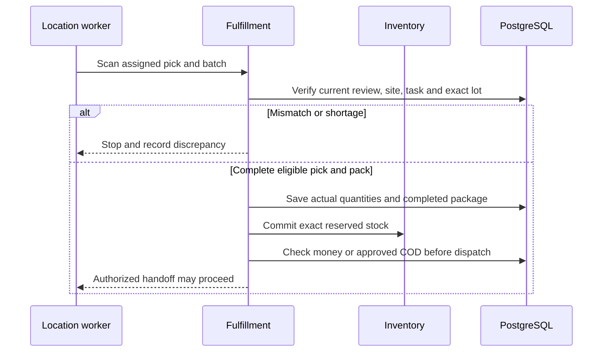

# WF-007 — Picking Packing and Handoff

> [!NOTE]
> **Status: Proposed orchestration; NOT RUN.** Business rules and thresholds still require the applicable [owner decisions](../09-References/Sources-and-Decisions.md).

## Actors and preconditions

Location worker, Fulfillment and Inventory. Use the operation’s actual trust category: public/pre-login, owned customer session, scoped staff/service or authenticated provider evidence. Enforce current object, patient and location scope, record version and required policy before progression.

## Normal path and committed outcomes

1. Authorize worker/location and current task version. Load the assigned accepted revision and current P decisions, licensed site and exact reserved lots.
2. Pick exact eligible products/batches and record actual quantities; a shortage blocks completion and goes to Operations, not an automatic substitution.
3. Complete picking only with required quantities; complete packing only with nonempty authorized package evidence. Preserve actor/time and immutable work identity.
4. Coordinate committed stock through Inventory and dispatch only with completed package, current clinical/license evidence and authoritative full money or approved shipment-scoped COD.
5. Record custody handoff to the current assigned rider and publish progress after commit. Cancellation/packing races resolve against authoritative state.

## Data ownership and API boundary

Scoped Fulfillment/Store commands tasks and packages; Inventory owns reservation/ledger effects; Delivery owns custody.

Candidate existing tables: `fulfillment.pick_tasks`, `fulfillment.pick_task_items`, `fulfillment.pack_tasks`, `fulfillment.packages`, `fulfillment.package_items`, `warehouse.stock_reservations`. Exact write fields and runtime grants remain per-operation review under D-024.

Related proposed operations: API-045/API-046/API-047; API-071 records permitted rider pickup. [Store Operations](../03-Modules/Store-Operations/APIs.md) · [Inventory](../03-Modules/Inventory/APIs.md) · [Rider App](../03-Modules/Rider-Operations/APIs.md).

## Sequence

## Failure, transaction and recovery boundaries

The alternative outcomes in the steps and diagram retain committed facts and name the next responsible team. Apply the [state and recovery contract](../07-Engineering/State-and-Recovery-Contracts.md): local state/audit/outbox commit together, external IO occurs outside locks, safe replay uses the recorded intent, and unknown money remains pending. Denied scope or stale version cannot create a partial stock, clinical or money effect.

## Feature-specific verification and navigation

Designed cases: `TC-STO-02-DENY`, `TC-ORD-04-DENY`, `TC-INV-03-DENY`. Locate their owning LLD/edge pages through the [feature register](../09-References/Coverage-and-Traceability.md). Record fixtures, approved policies and actual execution before claiming success.

[Business journey](../00-Business-Guide/Pharmville-Complete-Business-Flow.md) · [module designs](../03-Modules/README.md) · [operation contracts](../05-APIs/Critical-Operation-Contracts.md) · [data mapping](../04-Database/Module-Mapping.md) · [testing](../07-Engineering/Testing.md) · [workflow index](README.md)
