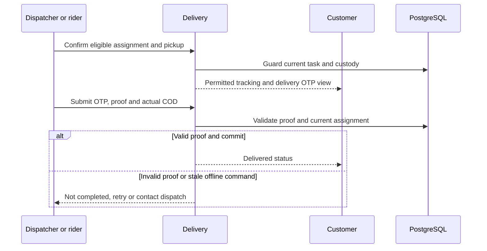

# WF-008 — Rider Assignment and POD

> [!NOTE]
> **Status: Proposed orchestration; NOT RUN.** Business rules and thresholds still require the applicable [owner decisions](../09-References/Sources-and-Decisions.md).

## Actors and preconditions

Dispatcher or rider, Delivery and Customer. Use the operation’s actual trust category: public/pre-login, owned customer session, scoped staff/service or authenticated provider evidence. Enforce current object, patient and location scope, record version and required policy before progression.

## Normal path and committed outcomes

1. A scoped dispatcher confirms an eligible rider for a ready parcel; competing assignments cannot both become current.
2. Assigned rider accepts and records pickup only after current fulfillment/payment/clinical/stock gates pass.
3. Location updates identify capture time and active assignment. Enforce approved privacy/cadence/retention; GPS never proves delivery.
4. Completion checks current rider/assignment, server-side customer OTP and approved photo proof. Record actual COD through Finance rather than inferring cash settlement.
5. Offline actions are unconfirmed until replay is validated; incorrect proof, reassignment or a failed attempt leaves a visible dispatch exception.

## Data ownership and API boundary

Delivery owns assignment, proof, custody and attempts. Rider is a scoped client; Finance separately owns collected COD.

Candidate existing tables: `logistics.shipments`, `logistics.delivery_assignments`, `logistics.delivery_otp_challenges`, `logistics.delivery_attempts`, `logistics.delivery_location_updates`, `payment.cod_collections`. Exact write fields and runtime grants remain per-operation review under D-024.

Related proposed operations: API-064/API-065 and API-070–API-074. [Delivery Operations](../05-APIs/Delivery_Operations.md) · [Rider App](../05-APIs/Rider_App.md).

## Sequence

## Failure, transaction and recovery boundaries

The alternative outcomes in the steps and diagram retain committed facts and name the next responsible team. Apply the [state and recovery contract](../07-Engineering/State-and-Recovery-Contracts.md): local state/audit/outbox commit together, external IO occurs outside locks, safe replay uses the recorded intent, and unknown money remains pending. Denied scope or stale version cannot create a partial stock, clinical or money effect.

## Feature-specific verification and navigation

Designed cases: `TC-DLV-02-DENY`, `TC-RID-02-DENY`, `TC-RID-04-DENY`, `TC-RID-03-DENY`. Locate their owning LLD/edge pages through the [feature register](../09-References/Coverage-and-Traceability.md). Record fixtures, approved policies and actual execution before claiming success.

[Business journey](../00-Business-Guide/Pharmville-Complete-Business-Flow.md) · [module designs](../03-Modules/README.md) · [operation contracts](../05-APIs/Critical-Operation-Contracts.md) · [data mapping](../04-Database/Module-Mapping.md) · [testing](../07-Engineering/Testing.md) · [workflow index](README.md)
