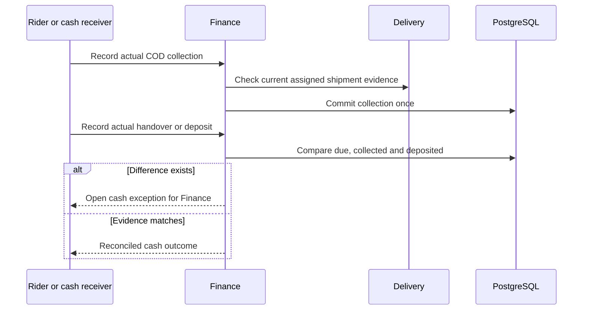

# WF-009 — COD Collection

**Status: Proposed orchestration; NOT RUN.** Business rules and thresholds still require the applicable [owner decisions](../09-References/Sources-and-Decisions.md).

## Actors and preconditions

Rider or cash receiver, Finance and Delivery. Use the operation’s actual trust category: public/pre-login, owned customer session, scoped staff/service or authenticated provider evidence. Enforce current object, patient and location scope, record version and required policy before progression.

## Normal path and committed outcomes

1. Use only approved COD eligibility and amount due for the exact order/revision/shipment. COD authorization is not already collected cash.
2. Current assigned rider records actual collection with delivery evidence; Finance persists one collection effect per permitted intent.
3. A cash receiver records actual handover/deposit separately under their permission. Compare collected and handed-over totals by rider/period.
4. Keep a shortage/overage as an explicit unresolved difference. Finance/Operations investigate; delivery is not rewritten and missing cash is not force-cleared.

## Data ownership and API boundary

Finance owns amount due, actual collection and reconciliation. Delivery supplies current shipment/assignment evidence, not accounting settlement.

Candidate existing tables: `payment.cod_collections`, `payment.reconciliation_runs`, `payment.reconciliation_items`, `logistics.shipments`. Exact write fields and runtime grants remain per-operation review under D-024.

Related proposed operations: API-067 views handover, API-073 supplies collection evidence, API-080 reconciles. Complete deposit/approval command fields remain D-007/D-024. [Finance Payments](../05-APIs/Finance_Payments.md) · [Delivery Operations](../05-APIs/Delivery_Operations.md) · [Rider App](../05-APIs/Rider_App.md).

## Sequence

## Failure, transaction and recovery boundaries

The alternative outcomes in the steps and diagram retain committed facts and name the next responsible team. Apply the [state and recovery contract](../07-Engineering/State-and-Recovery-Contracts.md): local state/audit/outbox commit together, external IO occurs outside locks, safe replay uses the recorded intent, and unknown money remains pending. Denied scope or stale version cannot create a partial stock, clinical or money effect.

## Feature-specific verification and navigation

Designed cases: `TC-RID-04-DENY`, `TC-DLV-04-DENY`, `TC-FIN-06-DENY`. Locate their owning LLD/edge pages through the [feature register](../09-References/Coverage-and-Traceability.md). Record fixtures, approved policies and actual execution before claiming success.

[Business journey](../00-Business-Guide/Pharmville-Complete-Business-Flow.md) · [module designs](../03-Modules/README.md) · [operation contracts](../05-APIs/Critical-Operation-Contracts.md) · [data mapping](../04-Database/Module-Mapping.md) · [testing](../07-Engineering/Testing.md) · [workflow index](README.md)
