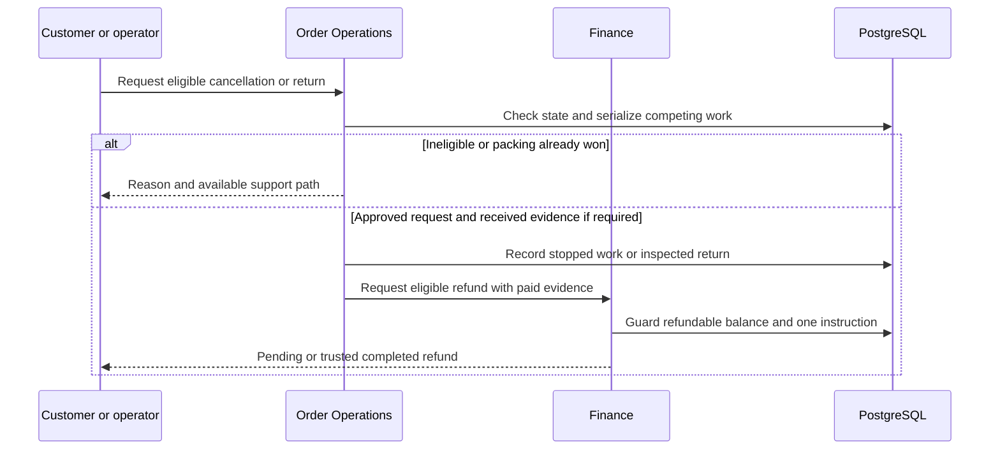

# WF-010 — Cancellation Return and Refund

> [!NOTE]
> **Status: Proposed orchestration; NOT RUN.** Business rules and thresholds still require the applicable [owner decisions](../09-References/Sources-and-Decisions.md).

## Actors and preconditions

Customer or operator, Order Operations and Finance. Use the operation’s actual trust category: public/pre-login, owned customer session, scoped staff/service or authenticated provider evidence. Enforce current object, patient and location scope, record version and required policy before progression.

## Normal path and committed outcomes

1. Authorize requested items and read current order/task state. Customer cancellation is draft before-packed; returns need approved eligibility/window/item policy.
2. Serialize cancellation against packing and retain a reason. Accepted cancellation stops eligible work and requests safe release/compensation through Inventory.
3. For physical return, track custody and inspect received quantities/condition. Pharmacy/Inventory decide disposition independently of refund; unsafe medicine never automatically becomes saleable.
4. Finance checks trusted paid value, earlier refunds and approvals, then creates one refund instruction. COD needs the approved verified destination contract.
5. Submit through the reviewed provider adapter outside locks and reconcile trusted result. Pending/refused/completed are distinct customer outcomes; immutable invoice/credit/history evidence remains.

## Data ownership and API boundary

Order Operations owns cancellation/return orchestration; Inventory owns stock disposition and Finance owns refund/credit effects.

Candidate existing tables: `commerce.cancellations`, `commerce.cancellation_items`, `commerce.returns`, `commerce.return_items`, `payment.refunds`, `payment.refund_allocations`, `finance.credit_notes`. Exact write fields and runtime grants remain per-operation review under D-024.

Related proposed operations: API-027/API-028/API-030/API-043/API-078. Credit-note issuance remains a missing FIN-07 operation. [Customer Orders](../05-APIs/Customer_Orders.md) · [Order Operations](../05-APIs/Order_Operations.md) · [Finance Payments](../05-APIs/Finance_Payments.md).

## Sequence

## Failure, transaction and recovery boundaries

The alternative outcomes in the steps and diagram retain committed facts and name the next responsible team. Apply the [state and recovery contract](../07-Engineering/State-and-Recovery-Contracts.md): local state/audit/outbox commit together, external IO occurs outside locks, safe replay uses the recorded intent, and unknown money remains pending. Denied scope or stale version cannot create a partial stock, clinical or money effect.

## Feature-specific verification and navigation

Designed cases: `TC-ORD-04-DENY`, `TC-ORD-05-DENY`, `TC-FIN-03-DENY`, `TC-FIN-04-DENY`. Locate their owning LLD/edge pages through the [feature register](../09-References/Coverage-and-Traceability.md). Record fixtures, approved policies and actual execution before claiming success.

[Business journey](../00-Business-Guide/Pharmville-Complete-Business-Flow.md) · [module designs](../03-Modules/README.md) · [operation contracts](../05-APIs/Critical-Operation-Contracts.md) · [data mapping](../04-Database/Module-Mapping.md) · [testing](../07-Engineering/Testing.md) · [workflow index](README.md)
