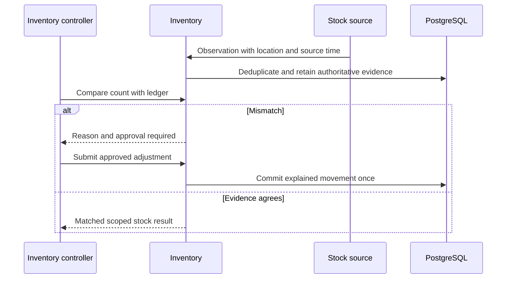

# WF-011 — Inventory Reconciliation

> [!NOTE]
> **Status: Proposed orchestration; NOT RUN.** Business rules and thresholds still require the applicable [owner decisions](../09-References/Sources-and-Decisions.md).

## Actors and preconditions

Inventory controller, Inventory and Stock source. Use the operation’s actual trust category: public/pre-login, owned customer session, scoped staff/service or authenticated provider evidence. Enforce current object, patient and location scope, record version and required policy before progression.

## Normal path and committed outcomes

1. Read approved source/location/time identity and deduplicate incoming observations. Old observations cannot overwrite newer authoritative evidence.
2. Compare usable physical count, ledger/balance and external observations by batch/location, preserving each source value and discrepancy.
3. For discrepancy, require reason, permitted controller and threshold-based manager approval under approved policy; never silently replace the movement history.
4. Commit approved adjustment and linked evidence atomically, then update alerts. Missing/stale source blocks new reservations until valid evidence is restored.

## Data ownership and API boundary

Inventory owns observations, movement/adjustment evidence and reconciliation outcomes. External POS is an approved input source, never a privileged table writer.

Candidate existing tables: `warehouse.stock_ledger`, `warehouse.stock_balances`, `warehouse.inventory_lots`, `warehouse.inventory_adjustments`, `warehouse.inventory_adjustment_items`. Exact write fields and runtime grants remain per-operation review under D-024.

Related proposed operations: API-050/API-051/API-054/API-055; count/import commands still need feature-specific review. [Inventory](../05-APIs/Inventory.md).

## Sequence

## Failure, transaction and recovery boundaries

The alternative outcomes in the steps and diagram retain committed facts and name the next responsible team. Apply the [state and recovery contract](../07-Engineering/State-and-Recovery-Contracts.md): local state/audit/outbox commit together, external IO occurs outside locks, safe replay uses the recorded intent, and unknown money remains pending. Denied scope or stale version cannot create a partial stock, clinical or money effect.

## Feature-specific verification and navigation

Designed cases: `TC-INV-02-DENY`, `TC-INV-04-DENY`, `TC-INV-06-DENY`, `TC-INV-07-DENY`. Locate their owning LLD/edge pages through the [feature register](../09-References/Coverage-and-Traceability.md). Record fixtures, approved policies and actual execution before claiming success.

[Business journey](../00-Business-Guide/Pharmville-Complete-Business-Flow.md) · [module designs](../03-Modules/README.md) · [operation contracts](../05-APIs/Critical-Operation-Contracts.md) · [data mapping](../04-Database/Module-Mapping.md) · [testing](../07-Engineering/Testing.md) · [workflow index](README.md)
