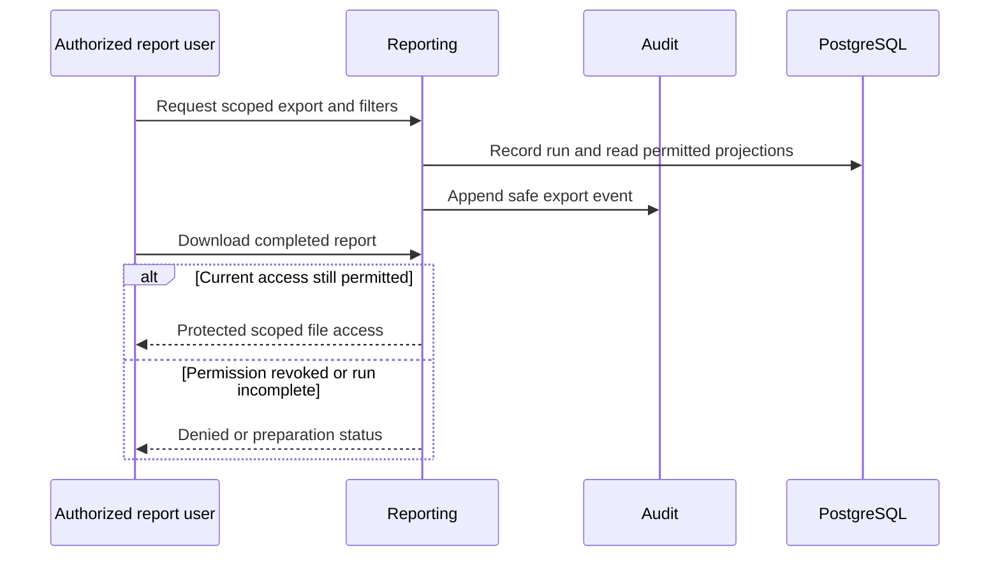

# WF-012 — Report Export and Audit

> [!NOTE]
> **Status: Proposed orchestration; NOT RUN.** Business rules and thresholds still require the applicable [owner decisions](../09-References/Sources-and-Decisions.md).

## Actors and preconditions

Authorized report user, Reporting and Audit. Use the operation’s actual trust category: public/pre-login, owned customer session, scoped staff/service or authenticated provider evidence. Enforce current object, patient and location scope, record version and required policy before progression.

## Normal path and committed outcomes

1. Authorize report purpose, permitted fields and location/date filters. Definitions distinguish pending from completed financial/operational facts.
2. Create a scoped report run/job and read allowed owner projections; report generation has no permission to correct source transactions.
3. Retain filters, data time and explicit incomplete/failure state. Repeated export requests must not duplicate business effects.
4. Before download, recheck current user/role/scope and private-file grant. Audit sensitive report access with safe references; historical evidence is read-only to user roles.

## Data ownership and API boundary

Reporting owns runs/private outputs; Audit owns append-only evidence. Domain source data is read under its approved scope.

Candidate existing tables: `platform.report_definitions`, `platform.report_runs`, `platform.file_access_grants`, `platform.audit_logs`. Exact write fields and runtime grants remain per-operation review under D-024.

Related proposed operations: API-082–API-088; report datasets still require exact approved field/filter schemas. [Reporting](../05-APIs/Reporting.md) · [Audit](../05-APIs/Audit.md).

## Sequence

## Failure, transaction and recovery boundaries

The alternative outcomes in the steps and diagram retain committed facts and name the next responsible team. Apply the [state and recovery contract](../07-Engineering/State-and-Recovery-Contracts.md): local state/audit/outbox commit together, external IO occurs outside locks, safe replay uses the recorded intent, and unknown money remains pending. Denied scope or stale version cannot create a partial stock, clinical or money effect.

## Feature-specific verification and navigation

Designed cases: `TC-REP-07-DENY`, `TC-REP-05-DENY`, `TC-AUD-02-DENY`. Locate their owning LLD/edge pages through the [feature register](../09-References/Coverage-and-Traceability.md). Record fixtures, approved policies and actual execution before claiming success.

[Business journey](../00-Business-Guide/Pharmville-Complete-Business-Flow.md) · [module designs](../03-Modules/README.md) · [operation contracts](../05-APIs/Critical-Operation-Contracts.md) · [data mapping](../04-Database/Module-Mapping.md) · [testing](../07-Engineering/Testing.md) · [workflow index](README.md)
