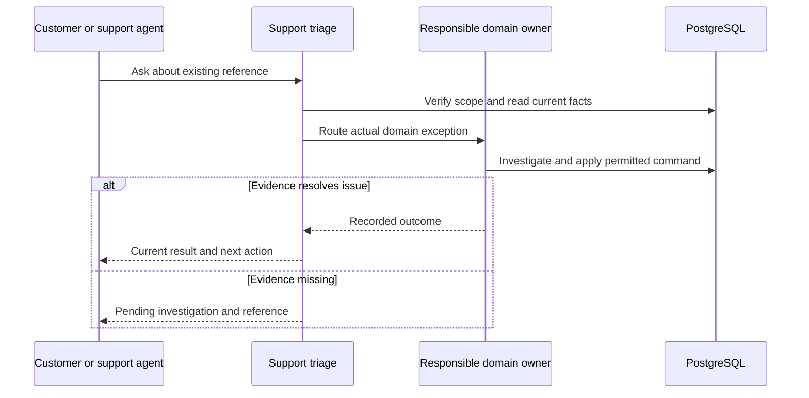

# WF-013 — Customer Support Triage

> [!NOTE]
> **Status: Proposed orchestration; NOT RUN.** Business rules and thresholds still require the applicable [owner decisions](../09-References/Sources-and-Decisions.md).

## Actors and preconditions

Customer or support agent, Support triage and Responsible domain owner. Use the operation’s actual trust category: public/pre-login, owned customer session, scoped staff/service or authenticated provider evidence. Enforce current object, patient and location scope, record version and required policy before progression.

## Normal path and committed outcomes

1. Verify caller identity and support-agent scope before reading the existing reference. A screenshot or supplied phone number is not authorization.
2. Read the current order, review, payment and delivery projections and identify the actual waiting step. Full support-ticket integration and response commitments remain D-020.
3. Route money to Finance, clinical evidence to Pharmacy, supply to Operations and delivery attempts to dispatch. Support cannot directly mark paid, approve prescriptions or force refunds.
4. The responsible owner performs its authorized command with evidence. Record communication and current pending/resolved outcome; a support reply alone does not close a financial exception.

## Data ownership and API boundary

Support routes work to the responsible owner and cannot mutate clinical or money truth. Ticket tables are available schema candidates, not approval of a launch integration.

Candidate existing tables: `support.tickets`, `support.ticket_messages`, `support.ticket_actions`. Exact write fields and runtime grants remain per-operation review under D-024.

Related proposed operations: No confirmed support command endpoint. API-026/API-040/API-077 are role-permitted context reads only; D-020 must approve integration and scope. [Customer Orders](../03-Modules/Customer_Orders/APIs.md) · [Order Operations](../03-Modules/Order_Operations/APIs.md) · [Finance Payments](../03-Modules/Finance_Payments/APIs.md).

## Sequence

## Failure, transaction and recovery boundaries

The alternative outcomes in the steps and diagram retain committed facts and name the next responsible team. Apply the [state and recovery contract](../07-Engineering/State-and-Recovery-Contracts.md): local state/audit/outbox commit together, external IO occurs outside locks, safe replay uses the recorded intent, and unknown money remains pending. Denied scope or stale version cannot create a partial stock, clinical or money effect.

## Feature-specific verification and navigation

Designed cases: `TC-CHK-03-DENY`, `TC-RX-04-DENY`, `TC-ORD-06-DENY`. Locate their owning LLD/edge pages through the [feature register](../09-References/Coverage-and-Traceability.md). Record fixtures, approved policies and actual execution before claiming success.

[Business journey](../00-Business-Guide/Pharmville-Complete-Business-Flow.md) · [module designs](../03-Modules/README.md) · [operation contracts](../05-APIs/Critical-Operation-Contracts.md) · [data mapping](../04-Database/Module-Mapping.md) · [testing](../07-Engineering/Testing.md) · [workflow index](README.md)
