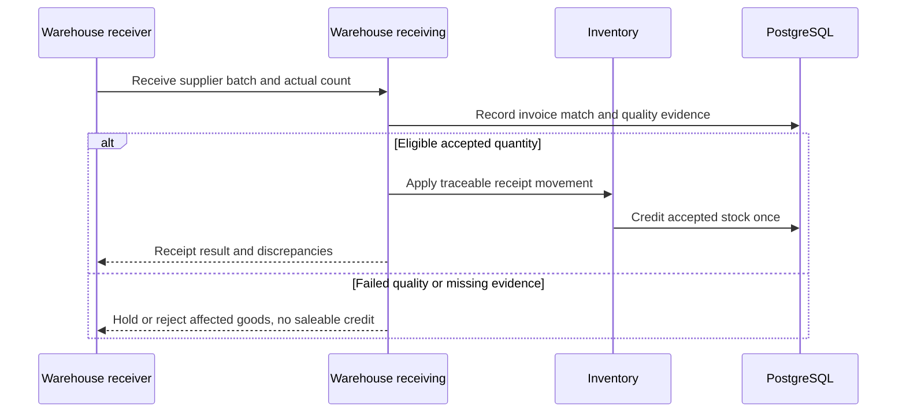

# WF-014 — Supplier Receiving

> [!NOTE]
> **Status: Proposed orchestration; NOT RUN.** Business rules and thresholds still require the applicable [owner decisions](../09-References/Sources-and-Decisions.md).

## Actors and preconditions

Warehouse receiver, Warehouse receiving and Inventory. Use the operation’s actual trust category: public/pre-login, owned customer session, scoped staff/service or authenticated provider evidence. Enforce current object, patient and location scope, record version and required policy before progression.

## Normal path and committed outcomes

1. Authorize receiver/site and match supplier/invoice/receipt references; validate batch, manufacturing/expiry dates and actual quantities.
2. Record quality-check outcome and usable accepted quantity. Damaged, missing or expired goods are not silently credited to orderable stock.
3. Ask Inventory to apply one traceable receipt movement for accepted stock. Duplicated scans/import retries must reuse evidence rather than double receipt.
4. Retain supplier/quantity/invoice discrepancies for Operations/procurement and Finance. Publication of availability waits for approved eligible stock evidence.

## Data ownership and API boundary

Warehouse receiving owns receipt evidence; Inventory applies accepted stock movement; procurement/Finance retain invoice discrepancies.

Candidate existing tables: `procurement.goods_receipts`, `procurement.goods_receipt_items`, `procurement.goods_receipt_quality_checks`, `procurement.supplier_invoices`, `warehouse.inventory_lots`, `warehouse.stock_ledger`. Exact write fields and runtime grants remain per-operation review under D-024.

Related proposed operations: API-056 for receiving; exact receipt-to-stock atomic interface and supplier discrepancy handling remain D-024. [Warehouse](../05-APIs/Warehouse.md) · [Inventory](../05-APIs/Inventory.md).

## Sequence

## Failure, transaction and recovery boundaries

The alternative outcomes in the steps and diagram retain committed facts and name the next responsible team. Apply the [state and recovery contract](../07-Engineering/State-and-Recovery-Contracts.md): local state/audit/outbox commit together, external IO occurs outside locks, safe replay uses the recorded intent, and unknown money remains pending. Denied scope or stale version cannot create a partial stock, clinical or money effect.

## Feature-specific verification and navigation

Designed cases: `TC-WH-01-DENY`, `TC-STO-04-DENY`, `TC-INV-02-DENY`. Locate their owning LLD/edge pages through the [feature register](../09-References/Coverage-and-Traceability.md). Record fixtures, approved policies and actual execution before claiming success.

[Business journey](../00-Business-Guide/Pharmville-Complete-Business-Flow.md) · [module designs](../03-Modules/README.md) · [operation contracts](../05-APIs/Critical-Operation-Contracts.md) · [data mapping](../04-Database/Module-Mapping.md) · [testing](../07-Engineering/Testing.md) · [workflow index](README.md)
