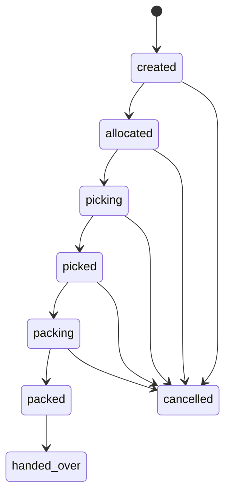

# State, ownership and recovery contracts

**Status:** Proposed application contracts derived from the existing journey and database catalog. Only the explicitly identified SQL transitions below are confirmed local-source behavior. No application test has run. [D-015](../09-References/Sources-and-Decisions.md#decisions-that-block-implementation) must settle the intended database release, and D-024 requires review of each command’s exact fields and runtime grants.

## Command ownership and transaction boundary

A feature owner is accountable for the user outcome. The command owner validates and performs an action. The data owner controls writes and invariants. A consumer reads a filtered result or requests an owner command; sharing a schema or rendering a screen grants no direct write authority.

| Feature/surface owner | Command and proposed data owner | Consumers and limits |
| --- | --- | --- |
| Customer Accounts | Authentication Access owns OTP/session mechanics; Customer Accounts owns profiles, addresses, dependent associations, consent choices and wishlist | Checkout consumes owned address/patient results; staff invitations do not bypass identity policy |
| Product Catalog | Catalog owns approved product/classification/publication; Finance approves tax meaning; pricing write responsibility needs D-024 review | Admin edits through Catalog, not unrestricted table access; search is a derived read model |
| Cart Checkout | Checkout owns cart, quote/checkout intent; Order Operations owns the resulting order/revision aggregate | Inventory owns holds; Finance owns money; neither browser nor Checkout invents those facts |
| Prescription Upload | Intake owns patient/order/file linkage; platform file service owns private object upload/scan/grants | Pharmacy consumes safe scoped evidence; support cannot expose raw files or approve them |
| Pharmacist Review | Authorized review command owns clinical line decisions and immutable reviewer evidence | Order/fulfillment consume decisions tied to exact patient, SKU, quantity, evidence and revision |
| Customer Orders / Order Operations | Operations owns order revisions, routing, cancellation/return orchestration and customer projections | Customer APIs request owner commands; projection writes never overwrite money, clinical or delivery facts |
| Inventory | Inventory owns lots, balances, holds, reservations, movement ledger and approved adjustments | Store/Warehouse submit evidenced movements; POS observations are validated inputs, not arbitrary balance replacement |
| Store Operations / Warehouse | Scoped fulfillment owns pick/pack/package tasks; Warehouse owns receiving/transfer workflow | Inventory applies stock effects; procurement invoice and finance postings remain separate owner commands |
| Delivery Operations / Rider App | Delivery owns assignment, custody, attempts, OTP validation and location stream; rider app is a client | Finance owns COD money; a rider cannot approve dispensing or settle a bank balance |
| Finance Payments | Finance owns payment/refund/reconciliation records, invoices, credits and approved accounting postings | Order progression consumes trusted outcomes; administrator/support cannot directly set paid/refunded |
| Admin CMS | Admin owns CMS/settings/location-management commands within approved scope | Identity, Catalog, clinical and Finance owners retain their rules and approval authority |
| Notifications | Notifications owns message/attempt/endpoints; domain owners write their committed event | Sending/retrying a message never repeats the source order, stock or money command |
| Reporting | Reporting owns report definitions/runs and scoped export jobs | Domain data is read through approved views/interfaces; no correction through report queries |
| Audit | Trusted event writer owns append-only audit evidence; authorized auditors read/export | No business UI role gets update/delete rights to historical events |

These are implementation assignments for review, not evidence that SQL runtime grants already permit all writes. The [database module map](../04-Database/Module-Mapping.md) supplies candidate tables; each operation review must name its insert/update fields, read dependencies, actual restricted role, guards and history/outbox rows.

## Atomic command and external effect

1. Resolve trusted identity, permission, object/patient/location scope and required policy version. Pre-login and signed provider callbacks use their own trust paths, not an invented existing session.
2. Validate operation-specific fields and the current accepted revision. Lock the relevant aggregate/stock rows or perform an equivalent checked version update; apply a deterministic lock order for multi-row holds.
3. Persist the owner’s state change, idempotency result and required audit/outbox facts in the same local transaction. A rejected command or pre-commit crash leaves no partial business mutation. A denial can have a separate safe security event.
4. Commit before returning a successful effect or delivering an event. Never hold a database transaction open across provider, object-store or messaging network calls.
5. A worker invokes external effects using the reviewed provider idempotency contract. An uncertain financial result becomes reconciliation work; blind charge/refund retries are forbidden.
6. Record the trusted external result in a new transaction and publish its committed outcome. Deduplicate incoming messages using source plus durable event identity. Out-of-order evidence cannot roll a trusted success backward.

`Idempotency-Key` binds actor/service, action, target and a canonical request fingerprint. Same key/body replays the stored result; a different body is a conflict with no new effect. Pending commands return the existing reference/status. D-024 must specify persistence and retention for each key; this page does not invent a retention duration.

Reassignment is a coordination problem: do not mutate the site identity on an existing fulfillment record that SQL makes immutable. Operations must define how old work is safely closed, holds are released/replaced and new work is created. Cross-owner recovery uses explicit steps and compensating records; no distributed atomic transaction is claimed.

## Order and clinical progression

The states in this table are business milestones, not a proposed single database enum. `commerce.orders.status` and subsystem status values remain distinct; see the [order catalog](../04-Database/Tables/commerce/orders.md).

| Current milestone | Permitted next action and evidence | Invalid action and recovery | Test evidence design |
| --- | --- | --- | --- |
| Request received with P lines | Wait for safe prescription/patient match and authorized current per-line decisions | Missing/wrong-patient evidence cannot become approved; request correction | TC-RX-04-DENY, TC-PHM-02-DENY |
| P review pending | Approve current lines, reject/request correction, or prepare permitted revision | Another patient/revision/unauthorized reviewer cannot approve; preserve history and refresh | TC-PHM-03-DENY, TC-PHM-05-DENY |
| Revised basket offered | Customer accepts exact contents/amount or chooses correction/cancellation | Old acceptance cannot pay a changed total; show comparison and wait | TC-CHK-06-DENY, TC-OMS-05-DENY |
| M/O-only or current P approval | Obtain licensed fresh-stock hold and choose eligible payment | No universal Rx gate for M/O; unknown classification still blocks | TC-CAT-02-DENY, TC-CHK-02-OK |
| Money uncertain | Reconcile trusted provider result against current order/hold | Browser return, screenshot or repeated Pay is not proof; keep pending | TC-CHK-03-DENY, TC-FIN-01-DENY |
| Ready for preparation | Valid accepted revision, current clinical/site/stock gates | Changed evidence invalidates progression; stop and resolve | TC-STO-02-DENY, TC-WH-04-DENY |
| Before packed | Customer cancellation can compete with packing under draft policy | At most one valid current transition; after packed use approved exception path | TC-ORD-04-DENY |
| Delivered | Permit eligible return request; retain delivery history | A return/refund is not deletion or reversal of delivery evidence | TC-ORD-05-DENY, TC-FIN-07-DENY |

Deferred prescription upload RX-02 conflicts with the detailed review-before-payment journey. It stays blocked under D-004/D-006 until Product, Finance and Pharmacy decide the deadline, money treatment, hold behavior and automatic-cancellation consequences.

## Reservation, payment and refund progression

| Record | Allowed application progression | Invalid transition / interrupted-work recovery |
| --- | --- | --- |
| Reservation | Eligible current stock → active hold → committed fulfillment stock, or unused hold → released/expired under approved policy | Expired/released hold cannot become committed without a new validated hold. Duplicate release must not add stock twice. A payment/expiry race checks current version and durable result. TC-CHK-08-DENY, TC-INV-02-DENY |
| Payment attempt/intent | Accepted amount → pending provider interaction → trusted successful, failed or unresolved evidence | Timeout cannot become failure/success by assumption. Late trusted success is recorded even if fulfillment cannot resume; reconcile and apply D-004 compensation. TC-CHK-03-DENY, TC-FIN-01-DENY |
| Refund | Eligible request → required approval → provider submission → trusted completion/failure or pending reconciliation | No duplicate instruction or payout beyond remaining refundable paid value. Unknown result stays pending; failed retry requires provider evidence/idempotency. TC-FIN-03-DENY, TC-ORD-06-DENY |
| Reconciliation item/run | Evidence imported → matched or exception → investigated → approved resolution | Missing provider report or cash difference cannot be force-closed. Replayed evidence cannot duplicate posting. TC-FIN-05-DENY, TC-FIN-06-DENY |

The [reservation](../04-Database/Tables/warehouse/stock_reservations.md), [payment](../04-Database/Tables/payment/payment_intents.md), [refund](../04-Database/Tables/payment/refunds.md) and [reconciliation](../04-Database/Tables/payment/reconciliation_items.md) catalogs contain the available field/status constraints. Vocabulary above describes intent; exact enum mapping, refund approvals and transition implementations remain D-024. No unsupported payment status names are prescribed as database values.

## Confirmed local fulfillment transitions

Inspection of the available V0030 SQL confirms `fulfillment.guard_authorized_fulfillment`: a record starts `created` and retains its order, site, seller and revision identity. Its legal transitions are:

There is no `packed → cancelled` or `created → packed` edge in that local guard. Business cancellation eligibility and fulfillment enum names are different concepts; Operations must coordinate related records through the approved command. This source behavior must be rechecked if the intended baseline excludes V0030.

V0028/V0030 task guards permit `created → assigned/in_progress/cancelled`, `assigned → in_progress/cancelled`, and `in_progress → completed/cancelled`. V0030 additionally rejects empty/incomplete pick completion and pack completion without completed package evidence. Packages may start `created` or `packed`; an existing `created` package can become `packed` or `cancelled`. Packed evidence is immutable in the inspected guard.

The V0030 dispatch guard checks the order-scoped completed package, authoritative captured payment for the full accepted revision or approved shipment-scoped COD, exact committed package lots and eligible licensed location. This is local-source evidence, not a fresh SQL execution or production approval. See [baseline/checksums](../04-Database/Migrations.md).

## Delivery and offline recovery

Assignment → accepted pickup → in transit/out for delivery → evidenced delivery or recorded failed attempt is an application design. The [shipment catalog](../04-Database/Tables/logistics/shipments.md) lists valid stored values; listing an enum is not proof every pairwise transition is legal. Failed delivery follows approved reattempt/reschedule/return-to-origin policy and keeps parcel custody and COD facts separately accountable.

An offline device must label queued work unconfirmed. On reconnect, the delivery command rechecks actor, current assignment, record version, server-side OTP validity and required evidence before accepting an effect. Same command replay returns the saved result; stale reassigned work is denied and routed to dispatch. Queue encryption, persistence, ordering, credential expiry and exact offline UX remain D-011/D-024 design tasks, not an asserted implemented capability. See TC-RID-04-DENY, TC-DLV-03-DENY and TC-RID-03-DENY.

## Outage and recovery checks

| Interruption | Authoritative result | Resume owner and assertion |
| --- | --- | --- |
| Before database commit | No partial domain effect; no published success event | Domain owner retries validated intent; check rollback including hold/money/history |
| After commit, before response | Existing result persists | Client/worker looks up/replays same key; check one order, movement or refund |
| Worker stops after external request | External result may be unknown | Finance/provider adapter reconciles before another money instruction |
| Notification or search fails | Source transaction remains valid | Notifications/Search repair their derived output, never replay the source mutation |
| Restore or projection rebuild | Restored ledger and committed evidence decide status | DevOps/DBA and domain owners reconcile provider side effects and replay safe events before reopening writes |

[Testing](Testing.md) · [API contracts requiring review](../05-APIs/Critical-Operation-Contracts.md) · [technical workflows](../06-Workflows/README.md) · [Business Guide](../00-Business-Guide/README.md)
