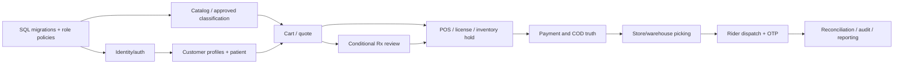

# Implementation plan

## Definition of Done (DoD)

A feature is done only when its source ID and phase priority are recorded, business decision dependencies are approved, module owner and stage map exist, typed API contract is reviewed, matching existing SQL tables and transactional invariants are verified, and the implementation includes server-side permissions, validation, idempotency/concurrency and useful error/status states.

Tests must cover happy/denied/concurrent/timeout/provider-retry paths, protect P/M/O and financial correctness, verify audit trace and demonstrate no protected data leakage. Frontend acceptance covers loading, empty, blocked, retry and accessible mobile states, not just screenshots.

Provider integrations require actual sandbox signature/reconciliation proof before any production authorization.

Review includes code quality, runbooks, deployment compatibility, rollback/forward-fix, monitoring, DB checksum integrity and approved pharmacy/finance/ops handoff. The source reports local database readiness only; the new application has no tested completion proof in this documentation checkout.

See Acceptance Gates, First Sprint and Open Decisions.

## Development roadmap without invented deadlines

**Step 0 — resolve kickoff blockers:** sign off Phase 1 platform/module boundary, staff login policy, warehouse/rider scope, real catalog and stock import plan, POS authority and NestJS ↔ SQLAlchemy parity approach. Maintain one product decision register rather than handling important changes only in chat.

**Foundation:** repository contracts, isolated the checked-in SQL migrations, restricted runtime roles, NestJS modular infrastructure, OTP/MFA, public DTO conventions, private files, outbox and instrumentation.

- **Core commerce:** customer/location accounts, catalog and controlled P/M/O classification, search, pricing, cart/checkout and durable one-order intent.
- **Medical gate:** private document upload, pharmacist P-line review, revised basket acceptance.
- **Ops:** site/license/POS stock, reservation, store/warehouse picking and packing, rider tasks.
- **Finance:** Cashfree signed reconciliation, COD, invoice/refunds.
- **Cross-cutting:** notifications, reporting, audit, security, load, restore and UAT.

Phase 2/3/4 candidates are tracked separately, not treated as Phase 1 acceptance. Each handoff has module LLD, actual DB table contract, proposed API and test evidence. See Implementation Order and Open Decisions.

## First-sprint implementation proposal

**No deadlines, team members or points assigned.** Build only safe, testable foundations until critical business policies are signed.

| Task | Suggested owner role | Activity | Acceptance |
| --- | --- | --- | --- |
| `OPS-001` | DevOps | Provision safe isolated PG15/18 DB and migration owner | Check the checked-in migration file ledger and restore |
| `OPS-002` | Database | Validate ORM/catalog parity on target engine | 0 unexplained catalog/ORM differences |
| `OPS-003` | Security | Threat model and role-matrix signoff | Cross-scope negative tests accepted |
| `OPS-004` | Product | Approve Phase 1 and warehouse/rider scope | Signed scope/phase decision |
| `OPS-005` | Finance/Pharmacy | Approve payment, COD and licensed P-review rules | Approved documented workflows and reasons |
| `OPS-006` | QA | Prepare DB-backed concurrency and provider replay harness | Reproducible test results |

**Parallelizable:** platform conventions, API contract mocks, SQL verification, role matrix reviews and QA fixtures.

**Sequential gates:** verified migrations → trusted authorization → eligible catalog/lot → checkout/clinical/payments → dispatch/reconciliation.

**Entry criteria**

## Suggested implementation order and parallel work

1. **Approval and architecture:** settle D-001/D-002/D-003/D-015, choose rider technology, define interface/permission conventions and pull immutable SQL repository.
2. **Database setup:** authorize isolated PG URL; status/migrate/verify; inspect runtime roles, modeling parity, dry-run recoveries and seed only synthetic approved values.
3. **Parallel foundations:** identity/OTP, catalog/classification masters, customer/address/patient domain, S3 protected file pipeline, basic provider adapters and shared audit/outbox.
4. **Order core:** accepted quote/cart/checkouts/orders, one-order idempotency, conditional clinical P-line decisions/revised acceptance, payment state reconciliation and stock holds.
5. **Operations:** license/lot/POS freshness checks, one-site routing, pick/pack, basic replenishment/fallback warehouse, delivery rider assignment/OTP and COD handover.
6. **Completion:** invoicing, cancellations/returns/refunds, notification templates, reporting/exports, all negative/security scenarios and real provider sandbox UAT.
7. **Release readiness:** staging load/restore/HA security, signed professional SOP/policies, finance/operations training and verified approvals.

No deadlines or person assignments are invented. Maintain stable task IDs in Work Breakdown and feature-level checks in Requirements Coverage.

## Integration sequencing and contract handoff

Contract-first development should publish per-module OpenAPI DTOs, clearly versioned public UUID resources, role/location/patient authorization and error codes before frontend wiring. Mock adapters may support UI progress, but tag them as mocks and never claim live settlement/dispensing in demos.

First integrate catalog → cart/quote → order creation with safe idempotency, followed by P-only Rx review/revision acceptance, stock reservation and payment. Add store/warehouse pick/pack after license, freshness and line guards are proven with real SQL; then rider/GPS/OTP and COD. Finally attach refunds, notifications, reporting and audit exports.

Providers require independent adapters, signed webhook validation, reconnect/backfill/reconciliation and company-owned sandbox credentials. Cross-module events carry public references, versions and safe metadata; no raw prescription or bank details. Complete each integration only after timeout, duplicate and out-of-order tests pass.

Use API contracts, Provider Dependencies and Deployment.

## Planning dependency graph

The graph represents prerequisite domain evidence, not a mandatory serial sprint schedule. Catalog and identity tasks can run in parallel after SQL conventions. Private Rx storage and payment adapter setup can proceed in parallel while business rules are being signed off, but cannot be enabled before the corresponding safety/owner gates are approved.

Basic warehouse transfers are needed in the current operational flow but Phase 1 vs Phase 2 ownership remains D-002. Hosted PG15, integration credentials and production content are external dependencies and can block release despite completed coding. See Roadmap.

## Module delivery tasks

Existing TASK-001 through TASK-110 IDs are preserved. The [master register](../09-References/Coverage-and-Traceability.md) owns requirement descriptions. Each task delivers that feature’s approved command/read model, typed API, scoped database access, visible outcomes and named tests; common D-024 review applies before implementation.

Tasks are proposed and unassigned. Original generic TEST-<feature>-01/02/03 prompts are superseded by specific LLD/edge cases, not extra execution evidence.

### Admin CMS

Resolve [module API readiness](../05-APIs/Admin_CMS.md), [write ownership](../07-Engineering/State-and-Recovery-Contracts.md) and applicable [business approvals](../09-References/Sources-and-Decisions.md). Review the exact persistence, transaction and recovery contract; attach actual results for these task gates.

| Task | Feature source | Verification gate |
| --- | --- | --- |
| `TASK-036` | [`ADM-01`](../09-References/Coverage-and-Traceability.md) | `TC-ADM-01-OK` and `TC-ADM-01-DENY` in [LLD](../03-Modules/Admin_CMS/LLD.md) and [edge cases](../03-Modules/Admin_CMS/Edge-Cases.md), reviewed and executed against approved fixtures |
| `TASK-037` | [`ADM-02`](../09-References/Coverage-and-Traceability.md) | `TC-ADM-02-OK` and `TC-ADM-02-DENY` in [LLD](../03-Modules/Admin_CMS/LLD.md) and [edge cases](../03-Modules/Admin_CMS/Edge-Cases.md), reviewed and executed against approved fixtures |
| `TASK-038` | [`ADM-03`](../09-References/Coverage-and-Traceability.md) | `TC-ADM-03-OK` and `TC-ADM-03-DENY` in [LLD](../03-Modules/Admin_CMS/LLD.md) and [edge cases](../03-Modules/Admin_CMS/Edge-Cases.md), reviewed and executed against approved fixtures |
| `TASK-039` | [`ADM-04`](../09-References/Coverage-and-Traceability.md) | `TC-ADM-04-OK` and `TC-ADM-04-DENY` in [LLD](../03-Modules/Admin_CMS/LLD.md) and [edge cases](../03-Modules/Admin_CMS/Edge-Cases.md), reviewed and executed against approved fixtures |
| `TASK-040` | [`ADM-05`](../09-References/Coverage-and-Traceability.md) | `TC-ADM-05-OK` and `TC-ADM-05-DENY` in [LLD](../03-Modules/Admin_CMS/LLD.md) and [edge cases](../03-Modules/Admin_CMS/Edge-Cases.md), reviewed and executed against approved fixtures |
| `TASK-041` | [`ADM-06`](../09-References/Coverage-and-Traceability.md) | `TC-ADM-06-OK` and `TC-ADM-06-DENY` in [LLD](../03-Modules/Admin_CMS/LLD.md) and [edge cases](../03-Modules/Admin_CMS/Edge-Cases.md), reviewed and executed against approved fixtures |
| `TASK-042` | [`ADM-07`](../09-References/Coverage-and-Traceability.md) | `TC-ADM-07-OK` and `TC-ADM-07-DENY` in [LLD](../03-Modules/Admin_CMS/LLD.md) and [edge cases](../03-Modules/Admin_CMS/Edge-Cases.md), reviewed and executed against approved fixtures |
| `TASK-043` | [`ADM-08`](../09-References/Coverage-and-Traceability.md) | `TC-ADM-08-OK` and `TC-ADM-08-DENY` in [LLD](../03-Modules/Admin_CMS/LLD.md) and [edge cases](../03-Modules/Admin_CMS/Edge-Cases.md), reviewed and executed against approved fixtures |
| `TASK-044` | [`ADM-09`](../09-References/Coverage-and-Traceability.md) | `TC-ADM-09-OK` and `TC-ADM-09-DENY` in [LLD](../03-Modules/Admin_CMS/LLD.md) and [edge cases](../03-Modules/Admin_CMS/Edge-Cases.md), reviewed and executed against approved fixtures |

### Audit

Resolve [module API readiness](../05-APIs/Audit.md), [write ownership](../07-Engineering/State-and-Recovery-Contracts.md) and applicable [business approvals](../09-References/Sources-and-Decisions.md). Review the exact persistence, transaction and recovery contract; attach actual results for these task gates.

| Task | Feature source | Verification gate |
| --- | --- | --- |
| `TASK-100` | [`AUD-01`](../09-References/Coverage-and-Traceability.md) | `TC-AUD-01-OK` and `TC-AUD-01-DENY` in [LLD](../03-Modules/Audit/LLD.md) and [edge cases](../03-Modules/Audit/Edge-Cases.md), reviewed and executed against approved fixtures |
| `TASK-101` | [`AUD-02`](../09-References/Coverage-and-Traceability.md) | `TC-AUD-02-OK` and `TC-AUD-02-DENY` in [LLD](../03-Modules/Audit/LLD.md) and [edge cases](../03-Modules/Audit/Edge-Cases.md), reviewed and executed against approved fixtures |

### Authentication Access

Resolve [module API readiness](../05-APIs/Authentication_Access.md), [write ownership](../07-Engineering/State-and-Recovery-Contracts.md) and applicable [business approvals](../09-References/Sources-and-Decisions.md). Review the exact persistence, transaction and recovery contract; attach actual results for these task gates.

| Task | Feature source | Verification gate |
| --- | --- | --- |
| `TASK-102` | [`AUTH-01`](../09-References/Coverage-and-Traceability.md) | `TC-AUTH-01-OK` and `TC-AUTH-01-DENY` in [LLD](../03-Modules/Authentication_Access/LLD.md) and [edge cases](../03-Modules/Authentication_Access/Edge-Cases.md), reviewed and executed against approved fixtures |
| `TASK-103` | [`AUTH-02`](../09-References/Coverage-and-Traceability.md) | `TC-AUTH-02-OK` and `TC-AUTH-02-DENY` in [LLD](../03-Modules/Authentication_Access/LLD.md) and [edge cases](../03-Modules/Authentication_Access/Edge-Cases.md), reviewed and executed against approved fixtures |
| `TASK-104` | [`AUTH-03`](../09-References/Coverage-and-Traceability.md) | `TC-AUTH-03-OK` and `TC-AUTH-03-DENY` in [LLD](../03-Modules/Authentication_Access/LLD.md) and [edge cases](../03-Modules/Authentication_Access/Edge-Cases.md), reviewed and executed against approved fixtures |
| `TASK-105` | [`AUTH-04`](../09-References/Coverage-and-Traceability.md) | `TC-AUTH-04-OK` and `TC-AUTH-04-DENY` in [LLD](../03-Modules/Authentication_Access/LLD.md) and [edge cases](../03-Modules/Authentication_Access/Edge-Cases.md), reviewed and executed against approved fixtures |

### Cart Checkout

Resolve [module API readiness](../05-APIs/Cart_Checkout.md), [write ownership](../07-Engineering/State-and-Recovery-Contracts.md) and applicable [business approvals](../09-References/Sources-and-Decisions.md). Review the exact persistence, transaction and recovery contract; attach actual results for these task gates.

| Task | Feature source | Verification gate |
| --- | --- | --- |
| `TASK-014` | [`CHK-01`](../09-References/Coverage-and-Traceability.md) | `TC-CHK-01-OK` and `TC-CHK-01-DENY` in [LLD](../03-Modules/Cart_Checkout/LLD.md) and [edge cases](../03-Modules/Cart_Checkout/Edge-Cases.md), reviewed and executed against approved fixtures |
| `TASK-015` | [`CHK-02`](../09-References/Coverage-and-Traceability.md) | `TC-CHK-02-OK` and `TC-CHK-02-DENY` in [LLD](../03-Modules/Cart_Checkout/LLD.md) and [edge cases](../03-Modules/Cart_Checkout/Edge-Cases.md), reviewed and executed against approved fixtures |
| `TASK-016` | [`CHK-03`](../09-References/Coverage-and-Traceability.md) | `TC-CHK-03-OK` and `TC-CHK-03-DENY` in [LLD](../03-Modules/Cart_Checkout/LLD.md) and [edge cases](../03-Modules/Cart_Checkout/Edge-Cases.md), reviewed and executed against approved fixtures |
| `TASK-017` | [`CHK-04`](../09-References/Coverage-and-Traceability.md) | `TC-CHK-04-OK` and `TC-CHK-04-DENY` in [LLD](../03-Modules/Cart_Checkout/LLD.md) and [edge cases](../03-Modules/Cart_Checkout/Edge-Cases.md), reviewed and executed against approved fixtures |
| `TASK-018` | [`CHK-05`](../09-References/Coverage-and-Traceability.md) | `TC-CHK-05-OK` and `TC-CHK-05-DENY` in [LLD](../03-Modules/Cart_Checkout/LLD.md) and [edge cases](../03-Modules/Cart_Checkout/Edge-Cases.md), reviewed and executed against approved fixtures |
| `TASK-019` | [`CHK-06`](../09-References/Coverage-and-Traceability.md) | `TC-CHK-06-OK` and `TC-CHK-06-DENY` in [LLD](../03-Modules/Cart_Checkout/LLD.md) and [edge cases](../03-Modules/Cart_Checkout/Edge-Cases.md), reviewed and executed against approved fixtures |
| `TASK-020` | [`CHK-07`](../09-References/Coverage-and-Traceability.md) | `TC-CHK-07-OK` and `TC-CHK-07-DENY` in [LLD](../03-Modules/Cart_Checkout/LLD.md) and [edge cases](../03-Modules/Cart_Checkout/Edge-Cases.md), reviewed and executed against approved fixtures |
| `TASK-021` | [`CHK-08`](../09-References/Coverage-and-Traceability.md) | `TC-CHK-08-OK` and `TC-CHK-08-DENY` in [LLD](../03-Modules/Cart_Checkout/LLD.md) and [edge cases](../03-Modules/Cart_Checkout/Edge-Cases.md), reviewed and executed against approved fixtures |

### Customer Accounts

Resolve [module API readiness](../05-APIs/Customer_Accounts.md), [write ownership](../07-Engineering/State-and-Recovery-Contracts.md) and applicable [business approvals](../09-References/Sources-and-Decisions.md). Review the exact persistence, transaction and recovery contract; attach actual results for these task gates.

| Task | Feature source | Verification gate |
| --- | --- | --- |
| `TASK-001` | [`ACC-01`](../09-References/Coverage-and-Traceability.md) | existing numbered cases in [LLD](../03-Modules/Customer_Accounts/LLD.md) and [edge cases](../03-Modules/Customer_Accounts/Edge-Cases.md), reviewed and executed against approved fixtures |
| `TASK-002` | [`ACC-02`](../09-References/Coverage-and-Traceability.md) | existing numbered cases in [LLD](../03-Modules/Customer_Accounts/LLD.md) and [edge cases](../03-Modules/Customer_Accounts/Edge-Cases.md), reviewed and executed against approved fixtures |
| `TASK-003` | [`ACC-03`](../09-References/Coverage-and-Traceability.md) | `TC-ACC-03-OK` and `TC-ACC-03-DENY` in [LLD](../03-Modules/Customer_Accounts/LLD.md) and [edge cases](../03-Modules/Customer_Accounts/Edge-Cases.md), reviewed and executed against approved fixtures |
| `TASK-004` | [`ACC-04`](../09-References/Coverage-and-Traceability.md) | `TC-ACC-04-OK` and `TC-ACC-04-DENY` in [LLD](../03-Modules/Customer_Accounts/LLD.md) and [edge cases](../03-Modules/Customer_Accounts/Edge-Cases.md), reviewed and executed against approved fixtures |
| `TASK-005` | [`ACC-05`](../09-References/Coverage-and-Traceability.md) | `TC-ACC-05-OK` and `TC-ACC-05-DENY` in [LLD](../03-Modules/Customer_Accounts/LLD.md) and [edge cases](../03-Modules/Customer_Accounts/Edge-Cases.md), reviewed and executed against approved fixtures |
| `TASK-006` | [`ACC-06`](../09-References/Coverage-and-Traceability.md) | `TC-ACC-06-OK` and `TC-ACC-06-DENY` in [LLD](../03-Modules/Customer_Accounts/LLD.md) and [edge cases](../03-Modules/Customer_Accounts/Edge-Cases.md), reviewed and executed against approved fixtures |
| `TASK-007` | [`ACC-07`](../09-References/Coverage-and-Traceability.md) | `TC-ACC-07-OK` and `TC-ACC-07-DENY` in [LLD](../03-Modules/Customer_Accounts/LLD.md) and [edge cases](../03-Modules/Customer_Accounts/Edge-Cases.md), reviewed and executed against approved fixtures |

### Customer Orders

Resolve [module API readiness](../05-APIs/Customer_Orders.md), [write ownership](../07-Engineering/State-and-Recovery-Contracts.md) and applicable [business approvals](../09-References/Sources-and-Decisions.md). Review the exact persistence, transaction and recovery contract; attach actual results for these task gates.

| Task | Feature source | Verification gate |
| --- | --- | --- |
| `TASK-027` | [`ORD-01`](../09-References/Coverage-and-Traceability.md) | `TC-ORD-01-OK` and `TC-ORD-01-DENY` in [LLD](../03-Modules/Customer_Orders/LLD.md) and [edge cases](../03-Modules/Customer_Orders/Edge-Cases.md), reviewed and executed against approved fixtures |
| `TASK-028` | [`ORD-02`](../09-References/Coverage-and-Traceability.md) | `TC-ORD-02-OK` and `TC-ORD-02-DENY` in [LLD](../03-Modules/Customer_Orders/LLD.md) and [edge cases](../03-Modules/Customer_Orders/Edge-Cases.md), reviewed and executed against approved fixtures |
| `TASK-029` | [`ORD-03`](../09-References/Coverage-and-Traceability.md) | `TC-ORD-03-OK` and `TC-ORD-03-DENY` in [LLD](../03-Modules/Customer_Orders/LLD.md) and [edge cases](../03-Modules/Customer_Orders/Edge-Cases.md), reviewed and executed against approved fixtures |
| `TASK-030` | [`ORD-04`](../09-References/Coverage-and-Traceability.md) | `TC-ORD-04-OK` and `TC-ORD-04-DENY` in [LLD](../03-Modules/Customer_Orders/LLD.md) and [edge cases](../03-Modules/Customer_Orders/Edge-Cases.md), reviewed and executed against approved fixtures |
| `TASK-031` | [`ORD-05`](../09-References/Coverage-and-Traceability.md) | `TC-ORD-05-OK` and `TC-ORD-05-DENY` in [LLD](../03-Modules/Customer_Orders/LLD.md) and [edge cases](../03-Modules/Customer_Orders/Edge-Cases.md), reviewed and executed against approved fixtures |
| `TASK-032` | [`ORD-06`](../09-References/Coverage-and-Traceability.md) | `TC-ORD-06-OK` and `TC-ORD-06-DENY` in [LLD](../03-Modules/Customer_Orders/LLD.md) and [edge cases](../03-Modules/Customer_Orders/Edge-Cases.md), reviewed and executed against approved fixtures |
| `TASK-033` | [`ORD-07`](../09-References/Coverage-and-Traceability.md) | `TC-ORD-07-OK` and `TC-ORD-07-DENY` in [LLD](../03-Modules/Customer_Orders/LLD.md) and [edge cases](../03-Modules/Customer_Orders/Edge-Cases.md), reviewed and executed against approved fixtures |
| `TASK-034` | [`ORD-08`](../09-References/Coverage-and-Traceability.md) | `TC-ORD-08-OK` and `TC-ORD-08-DENY` in [LLD](../03-Modules/Customer_Orders/LLD.md) and [edge cases](../03-Modules/Customer_Orders/Edge-Cases.md), reviewed and executed against approved fixtures |
| `TASK-035` | [`ORD-09`](../09-References/Coverage-and-Traceability.md) | `TC-ORD-09-OK` and `TC-ORD-09-DENY` in [LLD](../03-Modules/Customer_Orders/LLD.md) and [edge cases](../03-Modules/Customer_Orders/Edge-Cases.md), reviewed and executed against approved fixtures |

### Delivery Operations

Resolve [module API readiness](../05-APIs/Delivery_Operations.md), [write ownership](../07-Engineering/State-and-Recovery-Contracts.md) and applicable [business approvals](../09-References/Sources-and-Decisions.md). Review the exact persistence, transaction and recovery contract; attach actual results for these task gates.

| Task | Feature source | Verification gate |
| --- | --- | --- |
| `TASK-074` | [`DLV-01`](../09-References/Coverage-and-Traceability.md) | `TC-DLV-01-OK` and `TC-DLV-01-DENY` in [LLD](../03-Modules/Delivery_Operations/LLD.md) and [edge cases](../03-Modules/Delivery_Operations/Edge-Cases.md), reviewed and executed against approved fixtures |
| `TASK-075` | [`DLV-02`](../09-References/Coverage-and-Traceability.md) | `TC-DLV-02-OK` and `TC-DLV-02-DENY` in [LLD](../03-Modules/Delivery_Operations/LLD.md) and [edge cases](../03-Modules/Delivery_Operations/Edge-Cases.md), reviewed and executed against approved fixtures |
| `TASK-076` | [`DLV-03`](../09-References/Coverage-and-Traceability.md) | `TC-DLV-03-OK` and `TC-DLV-03-DENY` in [LLD](../03-Modules/Delivery_Operations/LLD.md) and [edge cases](../03-Modules/Delivery_Operations/Edge-Cases.md), reviewed and executed against approved fixtures |
| `TASK-077` | [`DLV-04`](../09-References/Coverage-and-Traceability.md) | `TC-DLV-04-OK` and `TC-DLV-04-DENY` in [LLD](../03-Modules/Delivery_Operations/LLD.md) and [edge cases](../03-Modules/Delivery_Operations/Edge-Cases.md), reviewed and executed against approved fixtures |
| `TASK-078` | [`DLV-05`](../09-References/Coverage-and-Traceability.md) | `TC-DLV-05-OK` and `TC-DLV-05-DENY` in [LLD](../03-Modules/Delivery_Operations/LLD.md) and [edge cases](../03-Modules/Delivery_Operations/Edge-Cases.md), reviewed and executed against approved fixtures |

### Finance Payments

Resolve [module API readiness](../05-APIs/Finance_Payments.md), [write ownership](../07-Engineering/State-and-Recovery-Contracts.md) and applicable [business approvals](../09-References/Sources-and-Decisions.md). Review the exact persistence, transaction and recovery contract; attach actual results for these task gates.

| Task | Feature source | Verification gate |
| --- | --- | --- |
| `TASK-086` | [`FIN-01`](../09-References/Coverage-and-Traceability.md) | `TC-FIN-01-OK` and `TC-FIN-01-DENY` in [LLD](../03-Modules/Finance_Payments/LLD.md) and [edge cases](../03-Modules/Finance_Payments/Edge-Cases.md), reviewed and executed against approved fixtures |
| `TASK-087` | [`FIN-02`](../09-References/Coverage-and-Traceability.md) | `TC-FIN-02-OK` and `TC-FIN-02-DENY` in [LLD](../03-Modules/Finance_Payments/LLD.md) and [edge cases](../03-Modules/Finance_Payments/Edge-Cases.md), reviewed and executed against approved fixtures |
| `TASK-088` | [`FIN-03`](../09-References/Coverage-and-Traceability.md) | `TC-FIN-03-OK` and `TC-FIN-03-DENY` in [LLD](../03-Modules/Finance_Payments/LLD.md) and [edge cases](../03-Modules/Finance_Payments/Edge-Cases.md), reviewed and executed against approved fixtures |
| `TASK-089` | [`FIN-04`](../09-References/Coverage-and-Traceability.md) | `TC-FIN-04-OK` and `TC-FIN-04-DENY` in [LLD](../03-Modules/Finance_Payments/LLD.md) and [edge cases](../03-Modules/Finance_Payments/Edge-Cases.md), reviewed and executed against approved fixtures |
| `TASK-090` | [`FIN-05`](../09-References/Coverage-and-Traceability.md) | `TC-FIN-05-OK` and `TC-FIN-05-DENY` in [LLD](../03-Modules/Finance_Payments/LLD.md) and [edge cases](../03-Modules/Finance_Payments/Edge-Cases.md), reviewed and executed against approved fixtures |
| `TASK-091` | [`FIN-06`](../09-References/Coverage-and-Traceability.md) | `TC-FIN-06-OK` and `TC-FIN-06-DENY` in [LLD](../03-Modules/Finance_Payments/LLD.md) and [edge cases](../03-Modules/Finance_Payments/Edge-Cases.md), reviewed and executed against approved fixtures |
| `TASK-092` | [`FIN-07`](../09-References/Coverage-and-Traceability.md) | `TC-FIN-07-OK` and `TC-FIN-07-DENY` in [LLD](../03-Modules/Finance_Payments/LLD.md) and [edge cases](../03-Modules/Finance_Payments/Edge-Cases.md), reviewed and executed against approved fixtures |

### Inventory

Resolve [module API readiness](../05-APIs/Inventory.md), [write ownership](../07-Engineering/State-and-Recovery-Contracts.md) and applicable [business approvals](../09-References/Sources-and-Decisions.md). Review the exact persistence, transaction and recovery contract; attach actual results for these task gates.

| Task | Feature source | Verification gate |
| --- | --- | --- |
| `TASK-057` | [`INV-01`](../09-References/Coverage-and-Traceability.md) | `TC-INV-01-OK` and `TC-INV-01-DENY` in [LLD](../03-Modules/Inventory/LLD.md) and [edge cases](../03-Modules/Inventory/Edge-Cases.md), reviewed and executed against approved fixtures |
| `TASK-058` | [`INV-02`](../09-References/Coverage-and-Traceability.md) | `TC-INV-02-OK` and `TC-INV-02-DENY` in [LLD](../03-Modules/Inventory/LLD.md) and [edge cases](../03-Modules/Inventory/Edge-Cases.md), reviewed and executed against approved fixtures |
| `TASK-059` | [`INV-03`](../09-References/Coverage-and-Traceability.md) | `TC-INV-03-OK` and `TC-INV-03-DENY` in [LLD](../03-Modules/Inventory/LLD.md) and [edge cases](../03-Modules/Inventory/Edge-Cases.md), reviewed and executed against approved fixtures |
| `TASK-060` | [`INV-04`](../09-References/Coverage-and-Traceability.md) | `TC-INV-04-OK` and `TC-INV-04-DENY` in [LLD](../03-Modules/Inventory/LLD.md) and [edge cases](../03-Modules/Inventory/Edge-Cases.md), reviewed and executed against approved fixtures |
| `TASK-061` | [`INV-05`](../09-References/Coverage-and-Traceability.md) | `TC-INV-05-OK` and `TC-INV-05-DENY` in [LLD](../03-Modules/Inventory/LLD.md) and [edge cases](../03-Modules/Inventory/Edge-Cases.md), reviewed and executed against approved fixtures |
| `TASK-062` | [`INV-06`](../09-References/Coverage-and-Traceability.md) | `TC-INV-06-OK` and `TC-INV-06-DENY` in [LLD](../03-Modules/Inventory/LLD.md) and [edge cases](../03-Modules/Inventory/Edge-Cases.md), reviewed and executed against approved fixtures |
| `TASK-063` | [`INV-07`](../09-References/Coverage-and-Traceability.md) | `TC-INV-07-OK` and `TC-INV-07-DENY` in [LLD](../03-Modules/Inventory/LLD.md) and [edge cases](../03-Modules/Inventory/Edge-Cases.md), reviewed and executed against approved fixtures |

### Notifications

Resolve [module API readiness](../05-APIs/Notifications.md), [write ownership](../07-Engineering/State-and-Recovery-Contracts.md) and applicable [business approvals](../09-References/Sources-and-Decisions.md). Review the exact persistence, transaction and recovery contract; attach actual results for these task gates.

| Task | Feature source | Verification gate |
| --- | --- | --- |
| `TASK-106` | [`NOT-01`](../09-References/Coverage-and-Traceability.md) | `TC-NOT-01-OK` and `TC-NOT-01-DENY` in [LLD](../03-Modules/Notifications/LLD.md) and [edge cases](../03-Modules/Notifications/Edge-Cases.md), reviewed and executed against approved fixtures |
| `TASK-107` | [`NOT-02`](../09-References/Coverage-and-Traceability.md) | `TC-NOT-02-OK` and `TC-NOT-02-DENY` in [LLD](../03-Modules/Notifications/LLD.md) and [edge cases](../03-Modules/Notifications/Edge-Cases.md), reviewed and executed against approved fixtures |
| `TASK-108` | [`NOT-03`](../09-References/Coverage-and-Traceability.md) | `TC-NOT-03-OK` and `TC-NOT-03-DENY` in [LLD](../03-Modules/Notifications/LLD.md) and [edge cases](../03-Modules/Notifications/Edge-Cases.md), reviewed and executed against approved fixtures |
| `TASK-109` | [`NOT-04`](../09-References/Coverage-and-Traceability.md) | `TC-NOT-04-OK` and `TC-NOT-04-DENY` in [LLD](../03-Modules/Notifications/LLD.md) and [edge cases](../03-Modules/Notifications/Edge-Cases.md), reviewed and executed against approved fixtures |
| `TASK-110` | [`NOT-05`](../09-References/Coverage-and-Traceability.md) | `TC-NOT-05-OK` and `TC-NOT-05-DENY` in [LLD](../03-Modules/Notifications/LLD.md) and [edge cases](../03-Modules/Notifications/Edge-Cases.md), reviewed and executed against approved fixtures |

### Order Operations

Resolve [module API readiness](../05-APIs/Order_Operations.md), [write ownership](../07-Engineering/State-and-Recovery-Contracts.md) and applicable [business approvals](../09-References/Sources-and-Decisions.md). Review the exact persistence, transaction and recovery contract; attach actual results for these task gates.

| Task | Feature source | Verification gate |
| --- | --- | --- |
| `TASK-045` | [`OMS-01`](../09-References/Coverage-and-Traceability.md) | `TC-OMS-01-OK` and `TC-OMS-01-DENY` in [LLD](../03-Modules/Order_Operations/LLD.md) and [edge cases](../03-Modules/Order_Operations/Edge-Cases.md), reviewed and executed against approved fixtures |
| `TASK-046` | [`OMS-02`](../09-References/Coverage-and-Traceability.md) | `TC-OMS-02-OK` and `TC-OMS-02-DENY` in [LLD](../03-Modules/Order_Operations/LLD.md) and [edge cases](../03-Modules/Order_Operations/Edge-Cases.md), reviewed and executed against approved fixtures |
| `TASK-047` | [`OMS-03`](../09-References/Coverage-and-Traceability.md) | `TC-OMS-03-OK` and `TC-OMS-03-DENY` in [LLD](../03-Modules/Order_Operations/LLD.md) and [edge cases](../03-Modules/Order_Operations/Edge-Cases.md), reviewed and executed against approved fixtures |
| `TASK-048` | [`OMS-04`](../09-References/Coverage-and-Traceability.md) | `TC-OMS-04-OK` and `TC-OMS-04-DENY` in [LLD](../03-Modules/Order_Operations/LLD.md) and [edge cases](../03-Modules/Order_Operations/Edge-Cases.md), reviewed and executed against approved fixtures |
| `TASK-049` | [`OMS-05`](../09-References/Coverage-and-Traceability.md) | `TC-OMS-05-OK` and `TC-OMS-05-DENY` in [LLD](../03-Modules/Order_Operations/LLD.md) and [edge cases](../03-Modules/Order_Operations/Edge-Cases.md), reviewed and executed against approved fixtures |
| `TASK-050` | [`OMS-06`](../09-References/Coverage-and-Traceability.md) | `TC-OMS-06-OK` and `TC-OMS-06-DENY` in [LLD](../03-Modules/Order_Operations/LLD.md) and [edge cases](../03-Modules/Order_Operations/Edge-Cases.md), reviewed and executed against approved fixtures |
| `TASK-051` | [`OMS-07`](../09-References/Coverage-and-Traceability.md) | `TC-OMS-07-OK` and `TC-OMS-07-DENY` in [LLD](../03-Modules/Order_Operations/LLD.md) and [edge cases](../03-Modules/Order_Operations/Edge-Cases.md), reviewed and executed against approved fixtures |

### Pharmacist Review

Resolve [module API readiness](../05-APIs/Pharmacist_Review.md), [write ownership](../07-Engineering/State-and-Recovery-Contracts.md) and applicable [business approvals](../09-References/Sources-and-Decisions.md). Review the exact persistence, transaction and recovery contract; attach actual results for these task gates.

| Task | Feature source | Verification gate |
| --- | --- | --- |
| `TASK-069` | [`PHM-01`](../09-References/Coverage-and-Traceability.md) | `TC-PHM-01-OK` and `TC-PHM-01-DENY` in [LLD](../03-Modules/Pharmacist_Review/LLD.md) and [edge cases](../03-Modules/Pharmacist_Review/Edge-Cases.md), reviewed and executed against approved fixtures |
| `TASK-070` | [`PHM-02`](../09-References/Coverage-and-Traceability.md) | `TC-PHM-02-OK` and `TC-PHM-02-DENY` in [LLD](../03-Modules/Pharmacist_Review/LLD.md) and [edge cases](../03-Modules/Pharmacist_Review/Edge-Cases.md), reviewed and executed against approved fixtures |
| `TASK-071` | [`PHM-03`](../09-References/Coverage-and-Traceability.md) | `TC-PHM-03-OK` and `TC-PHM-03-DENY` in [LLD](../03-Modules/Pharmacist_Review/LLD.md) and [edge cases](../03-Modules/Pharmacist_Review/Edge-Cases.md), reviewed and executed against approved fixtures |
| `TASK-072` | [`PHM-04`](../09-References/Coverage-and-Traceability.md) | `TC-PHM-04-OK` and `TC-PHM-04-DENY` in [LLD](../03-Modules/Pharmacist_Review/LLD.md) and [edge cases](../03-Modules/Pharmacist_Review/Edge-Cases.md), reviewed and executed against approved fixtures |
| `TASK-073` | [`PHM-05`](../09-References/Coverage-and-Traceability.md) | `TC-PHM-05-OK` and `TC-PHM-05-DENY` in [LLD](../03-Modules/Pharmacist_Review/LLD.md) and [edge cases](../03-Modules/Pharmacist_Review/Edge-Cases.md), reviewed and executed against approved fixtures |

### Prescription Upload

Resolve [module API readiness](../05-APIs/Prescription_Upload.md), [write ownership](../07-Engineering/State-and-Recovery-Contracts.md) and applicable [business approvals](../09-References/Sources-and-Decisions.md). Review the exact persistence, transaction and recovery contract; attach actual results for these task gates.

| Task | Feature source | Verification gate |
| --- | --- | --- |
| `TASK-022` | [`RX-01`](../09-References/Coverage-and-Traceability.md) | `TC-RX-01-OK` and `TC-RX-01-DENY` in [LLD](../03-Modules/Prescription_Upload/LLD.md) and [edge cases](../03-Modules/Prescription_Upload/Edge-Cases.md), reviewed and executed against approved fixtures |
| `TASK-023` | [`RX-02`](../09-References/Coverage-and-Traceability.md) | `TC-RX-02-OK` and `TC-RX-02-DENY` in [LLD](../03-Modules/Prescription_Upload/LLD.md) and [edge cases](../03-Modules/Prescription_Upload/Edge-Cases.md), reviewed and executed against approved fixtures |
| `TASK-024` | [`RX-03`](../09-References/Coverage-and-Traceability.md) | `TC-RX-03-OK` and `TC-RX-03-DENY` in [LLD](../03-Modules/Prescription_Upload/LLD.md) and [edge cases](../03-Modules/Prescription_Upload/Edge-Cases.md), reviewed and executed against approved fixtures |
| `TASK-025` | [`RX-04`](../09-References/Coverage-and-Traceability.md) | `TC-RX-04-OK` and `TC-RX-04-DENY` in [LLD](../03-Modules/Prescription_Upload/LLD.md) and [edge cases](../03-Modules/Prescription_Upload/Edge-Cases.md), reviewed and executed against approved fixtures |
| `TASK-026` | [`RX-05`](../09-References/Coverage-and-Traceability.md) | `TC-RX-05-OK` and `TC-RX-05-DENY` in [LLD](../03-Modules/Prescription_Upload/LLD.md) and [edge cases](../03-Modules/Prescription_Upload/Edge-Cases.md), reviewed and executed against approved fixtures |

### Product Catalog

Resolve [module API readiness](../05-APIs/Product_Catalog.md), [write ownership](../07-Engineering/State-and-Recovery-Contracts.md) and applicable [business approvals](../09-References/Sources-and-Decisions.md). Review the exact persistence, transaction and recovery contract; attach actual results for these task gates.

| Task | Feature source | Verification gate |
| --- | --- | --- |
| `TASK-008` | [`CAT-01`](../09-References/Coverage-and-Traceability.md) | `TC-CAT-01-OK` and `TC-CAT-01-DENY` in [LLD](../03-Modules/Product_Catalog/LLD.md) and [edge cases](../03-Modules/Product_Catalog/Edge-Cases.md), reviewed and executed against approved fixtures |
| `TASK-009` | [`CAT-02`](../09-References/Coverage-and-Traceability.md) | `TC-CAT-02-OK` and `TC-CAT-02-DENY` in [LLD](../03-Modules/Product_Catalog/LLD.md) and [edge cases](../03-Modules/Product_Catalog/Edge-Cases.md), reviewed and executed against approved fixtures |
| `TASK-010` | [`CAT-03`](../09-References/Coverage-and-Traceability.md) | `TC-CAT-03-OK` and `TC-CAT-03-DENY` in [LLD](../03-Modules/Product_Catalog/LLD.md) and [edge cases](../03-Modules/Product_Catalog/Edge-Cases.md), reviewed and executed against approved fixtures |
| `TASK-011` | [`CAT-04`](../09-References/Coverage-and-Traceability.md) | `TC-CAT-04-OK` and `TC-CAT-04-DENY` in [LLD](../03-Modules/Product_Catalog/LLD.md) and [edge cases](../03-Modules/Product_Catalog/Edge-Cases.md), reviewed and executed against approved fixtures |
| `TASK-012` | [`CAT-05`](../09-References/Coverage-and-Traceability.md) | `TC-CAT-05-OK` and `TC-CAT-05-DENY` in [LLD](../03-Modules/Product_Catalog/LLD.md) and [edge cases](../03-Modules/Product_Catalog/Edge-Cases.md), reviewed and executed against approved fixtures |
| `TASK-013` | [`CAT-06`](../09-References/Coverage-and-Traceability.md) | `TC-CAT-06-OK` and `TC-CAT-06-DENY` in [LLD](../03-Modules/Product_Catalog/LLD.md) and [edge cases](../03-Modules/Product_Catalog/Edge-Cases.md), reviewed and executed against approved fixtures |

### Reporting

Resolve [module API readiness](../05-APIs/Reporting.md), [write ownership](../07-Engineering/State-and-Recovery-Contracts.md) and applicable [business approvals](../09-References/Sources-and-Decisions.md). Review the exact persistence, transaction and recovery contract; attach actual results for these task gates.

| Task | Feature source | Verification gate |
| --- | --- | --- |
| `TASK-093` | [`REP-01`](../09-References/Coverage-and-Traceability.md) | `TC-REP-01-OK` and `TC-REP-01-DENY` in [LLD](../03-Modules/Reporting/LLD.md) and [edge cases](../03-Modules/Reporting/Edge-Cases.md), reviewed and executed against approved fixtures |
| `TASK-094` | [`REP-02`](../09-References/Coverage-and-Traceability.md) | `TC-REP-02-OK` and `TC-REP-02-DENY` in [LLD](../03-Modules/Reporting/LLD.md) and [edge cases](../03-Modules/Reporting/Edge-Cases.md), reviewed and executed against approved fixtures |
| `TASK-095` | [`REP-03`](../09-References/Coverage-and-Traceability.md) | `TC-REP-03-OK` and `TC-REP-03-DENY` in [LLD](../03-Modules/Reporting/LLD.md) and [edge cases](../03-Modules/Reporting/Edge-Cases.md), reviewed and executed against approved fixtures |
| `TASK-096` | [`REP-04`](../09-References/Coverage-and-Traceability.md) | `TC-REP-04-OK` and `TC-REP-04-DENY` in [LLD](../03-Modules/Reporting/LLD.md) and [edge cases](../03-Modules/Reporting/Edge-Cases.md), reviewed and executed against approved fixtures |
| `TASK-097` | [`REP-05`](../09-References/Coverage-and-Traceability.md) | `TC-REP-05-OK` and `TC-REP-05-DENY` in [LLD](../03-Modules/Reporting/LLD.md) and [edge cases](../03-Modules/Reporting/Edge-Cases.md), reviewed and executed against approved fixtures |
| `TASK-098` | [`REP-06`](../09-References/Coverage-and-Traceability.md) | `TC-REP-06-OK` and `TC-REP-06-DENY` in [LLD](../03-Modules/Reporting/LLD.md) and [edge cases](../03-Modules/Reporting/Edge-Cases.md), reviewed and executed against approved fixtures |
| `TASK-099` | [`REP-07`](../09-References/Coverage-and-Traceability.md) | `TC-REP-07-OK` and `TC-REP-07-DENY` in [LLD](../03-Modules/Reporting/LLD.md) and [edge cases](../03-Modules/Reporting/Edge-Cases.md), reviewed and executed against approved fixtures |

### Rider App

Resolve [module API readiness](../05-APIs/Rider_App.md), [write ownership](../07-Engineering/State-and-Recovery-Contracts.md) and applicable [business approvals](../09-References/Sources-and-Decisions.md). Review the exact persistence, transaction and recovery contract; attach actual results for these task gates.

| Task | Feature source | Verification gate |
| --- | --- | --- |
| `TASK-079` | [`RID-01`](../09-References/Coverage-and-Traceability.md) | `TC-RID-01-OK` and `TC-RID-01-DENY` in [LLD](../03-Modules/Rider_App/LLD.md) and [edge cases](../03-Modules/Rider_App/Edge-Cases.md), reviewed and executed against approved fixtures |
| `TASK-080` | [`RID-02`](../09-References/Coverage-and-Traceability.md) | `TC-RID-02-OK` and `TC-RID-02-DENY` in [LLD](../03-Modules/Rider_App/LLD.md) and [edge cases](../03-Modules/Rider_App/Edge-Cases.md), reviewed and executed against approved fixtures |
| `TASK-081` | [`RID-03`](../09-References/Coverage-and-Traceability.md) | `TC-RID-03-OK` and `TC-RID-03-DENY` in [LLD](../03-Modules/Rider_App/LLD.md) and [edge cases](../03-Modules/Rider_App/Edge-Cases.md), reviewed and executed against approved fixtures |
| `TASK-082` | [`RID-04`](../09-References/Coverage-and-Traceability.md) | `TC-RID-04-OK` and `TC-RID-04-DENY` in [LLD](../03-Modules/Rider_App/LLD.md) and [edge cases](../03-Modules/Rider_App/Edge-Cases.md), reviewed and executed against approved fixtures |
| `TASK-083` | [`RID-05`](../09-References/Coverage-and-Traceability.md) | `TC-RID-05-OK` and `TC-RID-05-DENY` in [LLD](../03-Modules/Rider_App/LLD.md) and [edge cases](../03-Modules/Rider_App/Edge-Cases.md), reviewed and executed against approved fixtures |
| `TASK-084` | [`RID-06`](../09-References/Coverage-and-Traceability.md) | `TC-RID-06-OK` and `TC-RID-06-DENY` in [LLD](../03-Modules/Rider_App/LLD.md) and [edge cases](../03-Modules/Rider_App/Edge-Cases.md), reviewed and executed against approved fixtures |
| `TASK-085` | [`RID-07`](../09-References/Coverage-and-Traceability.md) | `TC-RID-07-OK` and `TC-RID-07-DENY` in [LLD](../03-Modules/Rider_App/LLD.md) and [edge cases](../03-Modules/Rider_App/Edge-Cases.md), reviewed and executed against approved fixtures |

### Store Operations

Resolve [module API readiness](../05-APIs/Store_Operations.md), [write ownership](../07-Engineering/State-and-Recovery-Contracts.md) and applicable [business approvals](../09-References/Sources-and-Decisions.md). Review the exact persistence, transaction and recovery contract; attach actual results for these task gates.

| Task | Feature source | Verification gate |
| --- | --- | --- |
| `TASK-052` | [`STO-01`](../09-References/Coverage-and-Traceability.md) | `TC-STO-01-OK` and `TC-STO-01-DENY` in [LLD](../03-Modules/Store_Operations/LLD.md) and [edge cases](../03-Modules/Store_Operations/Edge-Cases.md), reviewed and executed against approved fixtures |
| `TASK-053` | [`STO-02`](../09-References/Coverage-and-Traceability.md) | `TC-STO-02-OK` and `TC-STO-02-DENY` in [LLD](../03-Modules/Store_Operations/LLD.md) and [edge cases](../03-Modules/Store_Operations/Edge-Cases.md), reviewed and executed against approved fixtures |
| `TASK-054` | [`STO-03`](../09-References/Coverage-and-Traceability.md) | `TC-STO-03-OK` and `TC-STO-03-DENY` in [LLD](../03-Modules/Store_Operations/LLD.md) and [edge cases](../03-Modules/Store_Operations/Edge-Cases.md), reviewed and executed against approved fixtures |
| `TASK-055` | [`STO-04`](../09-References/Coverage-and-Traceability.md) | `TC-STO-04-OK` and `TC-STO-04-DENY` in [LLD](../03-Modules/Store_Operations/LLD.md) and [edge cases](../03-Modules/Store_Operations/Edge-Cases.md), reviewed and executed against approved fixtures |
| `TASK-056` | [`STO-05`](../09-References/Coverage-and-Traceability.md) | `TC-STO-05-OK` and `TC-STO-05-DENY` in [LLD](../03-Modules/Store_Operations/LLD.md) and [edge cases](../03-Modules/Store_Operations/Edge-Cases.md), reviewed and executed against approved fixtures |

### Warehouse

Resolve [module API readiness](../05-APIs/Warehouse.md), [write ownership](../07-Engineering/State-and-Recovery-Contracts.md) and applicable [business approvals](../09-References/Sources-and-Decisions.md). Review the exact persistence, transaction and recovery contract; attach actual results for these task gates.

| Task | Feature source | Verification gate |
| --- | --- | --- |
| `TASK-064` | [`WH-01`](../09-References/Coverage-and-Traceability.md) | `TC-WH-01-OK` and `TC-WH-01-DENY` in [LLD](../03-Modules/Warehouse/LLD.md) and [edge cases](../03-Modules/Warehouse/Edge-Cases.md), reviewed and executed against approved fixtures |
| `TASK-065` | [`WH-02`](../09-References/Coverage-and-Traceability.md) | `TC-WH-02-OK` and `TC-WH-02-DENY` in [LLD](../03-Modules/Warehouse/LLD.md) and [edge cases](../03-Modules/Warehouse/Edge-Cases.md), reviewed and executed against approved fixtures |
| `TASK-066` | [`WH-03`](../09-References/Coverage-and-Traceability.md) | `TC-WH-03-OK` and `TC-WH-03-DENY` in [LLD](../03-Modules/Warehouse/LLD.md) and [edge cases](../03-Modules/Warehouse/Edge-Cases.md), reviewed and executed against approved fixtures |
| `TASK-067` | [`WH-04`](../09-References/Coverage-and-Traceability.md) | `TC-WH-04-OK` and `TC-WH-04-DENY` in [LLD](../03-Modules/Warehouse/LLD.md) and [edge cases](../03-Modules/Warehouse/Edge-Cases.md), reviewed and executed against approved fixtures |
| `TASK-068` | [`WH-05`](../09-References/Coverage-and-Traceability.md) | `TC-WH-05-OK` and `TC-WH-05-DENY` in [LLD](../03-Modules/Warehouse/LLD.md) and [edge cases](../03-Modules/Warehouse/Edge-Cases.md), reviewed and executed against approved fixtures |
