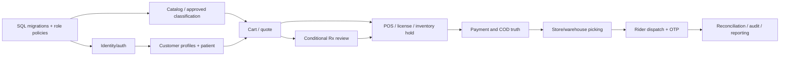

# Implementation plan

## Definition Of Done

## Definition of Done (DoD)

A feature is done only when its source ID and phase priority are recorded, business decision dependencies are approved, module owner and stage map exist, typed API contract is reviewed, matching existing SQL tables and transactional invariants are verified, and the implementation includes server-side permissions, validation, idempotency/concurrency and useful error/status states.

Tests must cover happy/denied/concurrent/timeout/provider-retry paths, protect P/M/O and financial correctness, verify audit trace and demonstrate no protected data leakage. Frontend acceptance covers loading, empty, blocked, retry and accessible mobile states, not just screenshots. Provider integrations require actual sandbox signature/reconciliation proof before any production authorization.

Review includes code quality, runbooks, deployment compatibility, rollback/forward-fix, monitoring, DB checksum integrity and approved pharmacy/finance/ops handoff. The source reports local database readiness only; the new application has no tested completion proof in these uploads.

See Acceptance Gates, First Sprint and Open Decisions.

## Development Roadmap

## Development roadmap without invented deadlines

**Step 0 — resolve kickoff blockers:** sign off Phase 1 platform/module boundary, staff login policy, warehouse/rider scope, real catalog and stock import plan, POS authority and NestJS ↔ SQLAlchemy parity approach. Maintain one product decision register rather than handling important changes only in chat.

**Foundation:** repository contracts, isolated SQL the checked-in SQL migration history migrations, restricted runtime roles, NestJS modular infrastructure, OTP/MFA, public DTO conventions, private files, outbox and instrumentation.

**Core commerce:** customer/location accounts, catalog and controlled P/M/O classification, search, pricing, cart/checkout and durable one-order intent. **Medical gate:** private document upload, pharmacist P-line review, revised basket acceptance. **Ops:** site/license/POS stock, reservation, store/warehouse picking and packing, rider tasks. **Finance:** Cashfree signed reconciliation, COD, invoice/refunds. **Cross-cutting:** notifications, reporting, audit, security, load, restore and UAT.

Phase 2/3/4 candidates are tracked separately, not treated as Phase 1 acceptance. Each handoff has module LLD, actual DB table contract, proposed API and test evidence. See Implementation Order and Open Decisions.

## First Sprint

## First-sprint implementation proposal

**No deadlines, team members or points assigned.** Build only safe, testable foundations until critical business policies are signed.

| Task | Suggested owner role | Activity | Acceptance |
| --- | --- | --- | --- |
| `OPS-001` | DevOps | Provision safe isolated PG15/18 DB and migration owner | Check the checked-in migration file ledger and restore |
| `OPS-002` | Database | Validate ORM/catalog parity on target engine | 0 unexplained catalog/ORM differences |
| `OPS-003` | Security | Threat model and role-matrix signoff | Cross-scope negative tests accepted |
| `OPS-004` | Product | Approve Phase 1 and warehouse/rider scope | Signed scope/phase decision |
| `OPS-005` | Finance/Pharmacy | Approve payment, COD and licensed P-review rules | Approved documented workflows and reasons |
| `OPS-006` | QA | Prepare DB-backed concurrency and provider replay harness | Reproducible test results |

**Parallelizable:** platform conventions, API contract mocks, SQL verification, role matrix reviews and QA fixtures. **Sequential gates:** verified migrations → trusted authorization → eligible catalog/lot → checkout/clinical/payments → dispatch/reconciliation.

Entry criteria

## Implementation Order

## Suggested implementation order and parallel work

1. **Approval and architecture:** settle D-001/D-002/D-003/D-015, choose rider technology, define interface/permission conventions and pull immutable SQL repository.
2. **Database setup:** authorize isolated PG URL; status/migrate/verify; inspect runtime roles, modeling parity, dry-run recoveries and seed only synthetic approved values.
3. **Parallel foundations:** identity/OTP, catalog/classification masters, customer/address/patient domain, S3 protected file pipeline, basic provider adapters and shared audit/outbox.
4. **Order core:** accepted quote/cart/checkouts/orders, one-order idempotency, conditional clinical P-line decisions/revised acceptance, payment state reconciliation and stock holds.
5. **Operations:** license/lot/POS freshness checks, one-site routing, pick/pack, basic replenishment/fallback warehouse, delivery rider assignment/OTP and COD handover.
6. **Completion:** invoicing, cancellations/returns/refunds, notification templates, reporting/exports, all negative/security scenarios and real provider sandbox UAT.
7. **Release readiness:** staging load/restore/HA security, signed professional SOP/policies, finance/operations training and verified approvals.

No deadlines or person assignments are invented. Maintain stable task IDs in Work Breakdown and feature-level checks in Requirements Coverage.

## Integration Plan

## Integration sequencing and contract handoff

Contract-first development should publish per-module OpenAPI DTOs, clearly versioned public UUID resources, role/location/patient authorization and error codes before frontend wiring. Mock adapters may support UI progress, but tag them as mocks and never claim live settlement/dispensing in demos.

First integrate catalog → cart/quote → order creation with safe idempotency, followed by P-only Rx review/revision acceptance, stock reservation and payment. Add store/warehouse pick/pack after license, freshness and line guards are proven with real SQL; then rider/GPS/OTP and COD. Finally attach refunds, notifications, reporting and audit exports.

Providers require independent adapters, signed webhook validation, reconnect/backfill/reconciliation and company-owned sandbox credentials. Cross-module events carry public references, versions and safe metadata; no raw prescription or bank details. Complete each integration only after timeout, duplicate and out-of-order tests pass.

Use API contracts, Provider Dependencies and Deployment.

## Module Dependencies

## Planning dependency graph

The graph represents prerequisite domain evidence, not a mandatory serial sprint schedule. Catalog and identity tasks can run in parallel after SQL conventions. Private Rx storage and payment adapter setup can proceed in parallel while business rules are being signed off, but cannot be enabled before the corresponding safety/owner gates are approved.

Basic warehouse transfers are needed in the current operational flow but Phase 1 vs Phase 2 ownership remains D-002. Hosted PG15, integration credentials and production content are external dependencies and can block release despite completed coding. See Roadmap.

## Admin CMS

## Admin masters and editorial pages — work breakdown

**Status: Proposed backlog, not assigned or implemented.** Recommended owner roles: backend engineer, frontend engineer, database engineer, QA engineer, security reviewer.

| Task ID | Feature | Deliverable | Dependencies | Done when |
| --- | --- | --- | --- | --- |
| `TASK-036` | `ADM-01` — Dashboard per role: orders by status, pending prescriptions, alerts, deliveries in progress | Backend use case + DTO, frontend states, database access policy, API integration, audit + test | Auth/session, shared schema parity, module prerequisites | Tests `TEST-ADM-01-01/02/03` reviewed and passed against test environment |
| `TASK-037` | `ADM-02` — Staff users: invite, assign role and location, deactivate, log out sessions | Backend use case + DTO, frontend states, database access policy, API integration, audit + test | Auth/session, shared schema parity, module prerequisites | Tests `TEST-ADM-02-01/02/03` reviewed and passed against test environment |
| `TASK-038` | `ADM-03` — Roles and permissions for 16 roles, limited to own store or warehouse | Backend use case + DTO, frontend states, database access policy, API integration, audit + test | Auth/session, shared schema parity, module prerequisites | Tests `TEST-ADM-03-01/02/03` reviewed and passed against test environment |
| `TASK-039` | `ADM-04` — CMS: home banners, FAQs, policy pages, with draft and publish | Backend use case + DTO, frontend states, database access policy, API integration, audit + test | Auth/session, shared schema parity, module prerequisites | Tests `TEST-ADM-04-01/02/03` reviewed and passed against test environment |
| `TASK-040` | `ADM-05` — System settings (PRD section 8) | Backend use case + DTO, frontend states, database access policy, API integration, audit + test | Auth/session, shared schema parity, module prerequisites | Tests `TEST-ADM-05-01/02/03` reviewed and passed against test environment |
| `TASK-041` | `ADM-06` — Catalogue admin: products, categories, brands, salt master, prices, GST and HSN | Backend use case + DTO, frontend states, database access policy, API integration, audit + test | Auth/session, shared schema parity, module prerequisites | Tests `TEST-ADM-06-01/02/03` reviewed and passed against test environment |
| `TASK-042` | `ADM-07` — Bulk product import from Excel, with error report | Backend use case + DTO, frontend states, database access policy, API integration, audit + test | Auth/session, shared schema parity, module prerequisites | Tests `TEST-ADM-07-01/02/03` reviewed and passed against test environment |
| `TASK-043` | `ADM-08` — Store and warehouse master: address, hours, GSTIN, service areas | Backend use case + DTO, frontend states, database access policy, API integration, audit + test | Auth/session, shared schema parity, module prerequisites | Tests `TEST-ADM-08-01/02/03` reviewed and passed against test environment |
| `TASK-044` | `ADM-09` — Offer settings: start and end dates, maximum discount, first-order offer | Backend use case + DTO, frontend states, database access policy, API integration, audit + test | Auth/session, shared schema parity, module prerequisites | Tests `TEST-ADM-09-01/02/03` reviewed and passed against test environment |

## Parallel work
- Frontend can build text-specified loading/error states against contract mocks after DTO review.
- Backend and database engineers should agree on transaction ownership before implementing writes.
- QA can construct fixtures in parallel but provider/clinical edge cases require approved policies.

Module design · Test cases · System-level order

## Audit

## Immutable change evidence — work breakdown

**Status: Proposed backlog, not assigned or implemented.** Recommended owner roles: backend engineer, frontend engineer, database engineer, QA engineer, security reviewer.

| Task ID | Feature | Deliverable | Dependencies | Done when |
| --- | --- | --- | --- | --- |
| `TASK-100` | `AUD-01` — Log logins, changes, stock movements and prescription views | Backend use case + DTO, frontend states, database access policy, API integration, audit + test | Auth/session, shared schema parity, module prerequisites | Tests `TEST-AUD-01-01/02/03` reviewed and passed against test environment |
| `TASK-101` | `AUD-02` — Search and export the audit log; read-only for everyone | Backend use case + DTO, frontend states, database access policy, API integration, audit + test | Auth/session, shared schema parity, module prerequisites | Tests `TEST-AUD-02-01/02/03` reviewed and passed against test environment |

## Parallel work
- Frontend can build text-specified loading/error states against contract mocks after DTO review.
- Backend and database engineers should agree on transaction ownership before implementing writes.
- QA can construct fixtures in parallel but provider/clinical edge cases require approved policies.

Module design · Test cases · System-level order

## Authentication Access

## Login, sessions, roles and access control — work breakdown

**Status: Proposed backlog, not assigned or implemented.** Recommended owner roles: backend engineer, frontend engineer, database engineer, QA engineer, security reviewer.

| Task ID | Feature | Deliverable | Dependencies | Done when |
| --- | --- | --- | --- | --- |
| `TASK-102` | `AUTH-01` — Password + authenticator 2FA for Super Admin, Central Admin, Finance Manager | Backend use case + DTO, frontend states, database access policy, API integration, audit + test | Auth/session, shared schema parity, module prerequisites | Tests `TEST-AUTH-01-01/02/03` reviewed and passed against test environment |
| `TASK-103` | `AUTH-02` — Lockout rules, session limits, one session per staff account | Backend use case + DTO, frontend states, database access policy, API integration, audit + test | Auth/session, shared schema parity, module prerequisites | Tests `TEST-AUTH-02-01/02/03` reviewed and passed against test environment |
| `TASK-104` | `AUTH-03` — OTP rate limits per number and IP | Backend use case + DTO, frontend states, database access policy, API integration, audit + test | Auth/session, shared schema parity, module prerequisites | Tests `TEST-AUTH-03-01/02/03` reviewed and passed against test environment |
| `TASK-105` | `AUTH-04` — Permissions checked on the server for every request | Backend use case + DTO, frontend states, database access policy, API integration, audit + test | Auth/session, shared schema parity, module prerequisites | Tests `TEST-AUTH-04-01/02/03` reviewed and passed against test environment |

## Parallel work
- Frontend can build text-specified loading/error states against contract mocks after DTO review.
- Backend and database engineers should agree on transaction ownership before implementing writes.
- QA can construct fixtures in parallel but provider/clinical edge cases require approved policies.

Module design · Test cases · System-level order

## Cart Checkout

## Cart, quote and placement intent — work breakdown

**Status: Proposed backlog, not assigned or implemented.** Recommended owner roles: backend engineer, frontend engineer, database engineer, QA engineer, security reviewer.

| Task ID | Feature | Deliverable | Dependencies | Done when |
| --- | --- | --- | --- | --- |
| `TASK-014` | `CHK-01` — Cart saved across devices for logged-in customers | Backend use case + DTO, frontend states, database access policy, API integration, audit + test | Auth/session, shared schema parity, module prerequisites | Tests `TEST-CHK-01-01/02/03` reviewed and passed against test environment |
| `TASK-015` | `CHK-02` — Checkout: address, patient (self or family), payment method, delivery fee and estimated time shown before paying | Backend use case + DTO, frontend states, database access policy, API integration, audit + test | Auth/session, shared schema parity, module prerequisites | Tests `TEST-CHK-02-01/02/03` reviewed and passed against test environment |
| `TASK-016` | `CHK-03` — Online payment via Cashfree: UPI, cards, net banking | Backend use case + DTO, frontend states, database access policy, API integration, audit + test | Auth/session, shared schema parity, module prerequisites | Tests `TEST-CHK-03-01/02/03` reviewed and passed against test environment |
| `TASK-017` | `CHK-04` — Cash on delivery, with a maximum order value and a block after repeated refusals | Backend use case + DTO, frontend states, database access policy, API integration, audit + test | Auth/session, shared schema parity, module prerequisites | Tests `TEST-CHK-04-01/02/03` reviewed and passed against test environment |
| `TASK-018` | `CHK-05` — Minimum order value and delivery fee applied from settings | Backend use case + DTO, frontend states, database access policy, API integration, audit + test | Auth/session, shared schema parity, module prerequisites | Tests `TEST-CHK-05-01/02/03` reviewed and passed against test environment |
| `TASK-019` | `CHK-06` — Price or stock change detected before payment; customer confirms | Backend use case + DTO, frontend states, database access policy, API integration, audit + test | Auth/session, shared schema parity, module prerequisites | Tests `TEST-CHK-06-01/02/03` reviewed and passed against test environment |
| `TASK-020` | `CHK-07` — No duplicate orders or charges (double tap, refresh, closed browser after payment) | Backend use case + DTO, frontend states, database access policy, API integration, audit + test | Auth/session, shared schema parity, module prerequisites | Tests `TEST-CHK-07-01/02/03` reviewed and passed against test environment |
| `TASK-021` | `CHK-08` — Stock reserved during checkout, released automatically if payment does not finish | Backend use case + DTO, frontend states, database access policy, API integration, audit + test | Auth/session, shared schema parity, module prerequisites | Tests `TEST-CHK-08-01/02/03` reviewed and passed against test environment |

## Parallel work
- Frontend can build text-specified loading/error states against contract mocks after DTO review.
- Backend and database engineers should agree on transaction ownership before implementing writes.
- QA can construct fixtures in parallel but provider/clinical edge cases require approved policies.

Module design · Test cases · System-level order

## Customer Accounts

## Customer profiles and family access — work breakdown

**Status: Proposed backlog, not assigned or implemented.** Recommended owner roles: backend engineer, frontend engineer, database engineer, QA engineer, security reviewer.

| Task ID | Feature | Deliverable | Dependencies | Done when |
| --- | --- | --- | --- | --- |
| `TASK-001` | `ACC-01` — Sign up and log in with mobile OTP (WhatsApp first, SMS fallback) | Backend use case + DTO, frontend states, database access policy, API integration, audit + test | Auth/session, shared schema parity, module prerequisites | Tests `TEST-ACC-01-01/02/03` reviewed and passed against test environment |
| `TASK-002` | `ACC-02` — Profile: name, email, phone | Backend use case + DTO, frontend states, database access policy, API integration, audit + test | Auth/session, shared schema parity, module prerequisites | Tests `TEST-ACC-02-01/02/03` reviewed and passed against test environment |
| `TASK-003` | `ACC-03` — Saved addresses with map pin; serviceability checked when the address is entered | Backend use case + DTO, frontend states, database access policy, API integration, audit + test | Auth/session, shared schema parity, module prerequisites | Tests `TEST-ACC-03-01/02/03` reviewed and passed against test environment |
| `TASK-004` | `ACC-04` — Family profiles for dependents (name, age, relation) | Backend use case + DTO, frontend states, database access policy, API integration, audit + test | Auth/session, shared schema parity, module prerequisites | Tests `TEST-ACC-04-01/02/03` reviewed and passed against test environment |
| `TASK-005` | `ACC-05` — Privacy notice and consent at signup | Backend use case + DTO, frontend states, database access policy, API integration, audit + test | Auth/session, shared schema parity, module prerequisites | Tests `TEST-ACC-05-01/02/03` reviewed and passed against test environment |
| `TASK-006` | `ACC-06` — Account deletion request | Backend use case + DTO, frontend states, database access policy, API integration, audit + test | Auth/session, shared schema parity, module prerequisites | Tests `TEST-ACC-06-01/02/03` reviewed and passed against test environment |
| `TASK-007` | `ACC-07` — Wishlist | Backend use case + DTO, frontend states, database access policy, API integration, audit + test | Auth/session, shared schema parity, module prerequisites | Tests `TEST-ACC-07-01/02/03` reviewed and passed against test environment |

## Parallel work
- Frontend can build text-specified loading/error states against contract mocks after DTO review.
- Backend and database engineers should agree on transaction ownership before implementing writes.
- QA can construct fixtures in parallel but provider/clinical edge cases require approved policies.

Module design · Test cases · System-level order

## Customer Orders

## Order tracking and aftercare — work breakdown

**Status: Proposed backlog, not assigned or implemented.** Recommended owner roles: backend engineer, frontend engineer, database engineer, QA engineer, security reviewer.

| Task ID | Feature | Deliverable | Dependencies | Done when |
| --- | --- | --- | --- | --- |
| `TASK-027` | `ORD-01` — Order confirmation on screen, WhatsApp and email | Backend use case + DTO, frontend states, database access policy, API integration, audit + test | Auth/session, shared schema parity, module prerequisites | Tests `TEST-ORD-01-01/02/03` reviewed and passed against test environment |
| `TASK-028` | `ORD-02` — Status timeline (placed → packed → out for delivery → delivered) | Backend use case + DTO, frontend states, database access policy, API integration, audit + test | Auth/session, shared schema parity, module prerequisites | Tests `TEST-ORD-02-01/02/03` reviewed and passed against test environment |
| `TASK-029` | `ORD-03` — Order history with GST invoice download | Backend use case + DTO, frontend states, database access policy, API integration, audit + test | Auth/session, shared schema parity, module prerequisites | Tests `TEST-ORD-03-01/02/03` reviewed and passed against test environment |
| `TASK-030` | `ORD-04` — Cancel before the order is packed | Backend use case + DTO, frontend states, database access policy, API integration, audit + test | Auth/session, shared schema parity, module prerequisites | Tests `TEST-ORD-04-01/02/03` reviewed and passed against test environment |
| `TASK-031` | `ORD-05` — Return request within the return window | Backend use case + DTO, frontend states, database access policy, API integration, audit + test | Auth/session, shared schema parity, module prerequisites | Tests `TEST-ORD-05-01/02/03` reviewed and passed against test environment |
| `TASK-032` | `ORD-06` — Refund status for cancelled and returned orders | Backend use case + DTO, frontend states, database access policy, API integration, audit + test | Auth/session, shared schema parity, module prerequisites | Tests `TEST-ORD-06-01/02/03` reviewed and passed against test environment |
| `TASK-033` | `ORD-07` — Live rider location on a map, estimated arrival, masked call button | Backend use case + DTO, frontend states, database access policy, API integration, audit + test | Auth/session, shared schema parity, module prerequisites | Tests `TEST-ORD-07-01/02/03` reviewed and passed against test environment |
| `TASK-034` | `ORD-08` — Delivery OTP shown to the customer | Backend use case + DTO, frontend states, database access policy, API integration, audit + test | Auth/session, shared schema parity, module prerequisites | Tests `TEST-ORD-08-01/02/03` reviewed and passed against test environment |
| `TASK-035` | `ORD-09` — Change items or address after placing an order | Backend use case + DTO, frontend states, database access policy, API integration, audit + test | Auth/session, shared schema parity, module prerequisites | Tests `TEST-ORD-09-01/02/03` reviewed and passed against test environment |

## Parallel work
- Frontend can build text-specified loading/error states against contract mocks after DTO review.
- Backend and database engineers should agree on transaction ownership before implementing writes.
- QA can construct fixtures in parallel but provider/clinical edge cases require approved policies.

Module design · Test cases · System-level order

## Delivery Operations

## Delivery planning, route and proof — work breakdown

**Status: Proposed backlog, not assigned or implemented.** Recommended owner roles: backend engineer, frontend engineer, database engineer, QA engineer, security reviewer.

| Task ID | Feature | Deliverable | Dependencies | Done when |
| --- | --- | --- | --- | --- |
| `TASK-074` | `DLV-01` — Live map of riders (available, on delivery, offline) and orders ready for pickup | Backend use case + DTO, frontend states, database access policy, API integration, audit + test | Auth/session, shared schema parity, module prerequisites | Tests `TEST-DLV-01-01/02/03` reviewed and passed against test environment |
| `TASK-075` | `DLV-02` — Suggest the nearest available rider; staff confirm or choose another | Backend use case + DTO, frontend states, database access policy, API integration, audit + test | Auth/session, shared schema parity, module prerequisites | Tests `TEST-DLV-02-01/02/03` reviewed and passed against test environment |
| `TASK-076` | `DLV-03` — Failed-delivery queue: reattempt, reschedule or return to store | Backend use case + DTO, frontend states, database access policy, API integration, audit + test | Auth/session, shared schema parity, module prerequisites | Tests `TEST-DLV-03-01/02/03` reviewed and passed against test environment |
| `TASK-077` | `DLV-04` — COD handover: cash collected vs deposited per rider per day | Backend use case + DTO, frontend states, database access policy, API integration, audit + test | Auth/session, shared schema parity, module prerequisites | Tests `TEST-DLV-04-01/02/03` reviewed and passed against test environment |
| `TASK-078` | `DLV-05` — Rider management: onboard, assign location, shifts | Backend use case + DTO, frontend states, database access policy, API integration, audit + test | Auth/session, shared schema parity, module prerequisites | Tests `TEST-DLV-05-01/02/03` reviewed and passed against test environment |

## Parallel work
- Frontend can build text-specified loading/error states against contract mocks after DTO review.
- Backend and database engineers should agree on transaction ownership before implementing writes.
- QA can construct fixtures in parallel but provider/clinical edge cases require approved policies.

Module design · Test cases · System-level order

## Finance Payments

## Payment truth, refunds and invoice evidence — work breakdown

**Status: Proposed backlog, not assigned or implemented.** Recommended owner roles: backend engineer, frontend engineer, database engineer, QA engineer, security reviewer.

| Task ID | Feature | Deliverable | Dependencies | Done when |
| --- | --- | --- | --- | --- |
| `TASK-086` | `FIN-01` — Payment records from Cashfree webhooks and COD collections | Backend use case + DTO, frontend states, database access policy, API integration, audit + test | Auth/session, shared schema parity, module prerequisites | Tests `TEST-FIN-01-01/02/03` reviewed and passed against test environment |
| `TASK-087` | `FIN-02` — GST invoice per order, from the right GSTIN | Backend use case + DTO, frontend states, database access policy, API integration, audit + test | Auth/session, shared schema parity, module prerequisites | Tests `TEST-FIN-02-01/02/03` reviewed and passed against test environment |
| `TASK-088` | `FIN-03` — Automatic refunds; manual refunds need approval above a set amount | Backend use case + DTO, frontend states, database access policy, API integration, audit + test | Auth/session, shared schema parity, module prerequisites | Tests `TEST-FIN-03-01/02/03` reviewed and passed against test environment |
| `TASK-089` | `FIN-04` — COD refunds by bank transfer or UPI | Backend use case + DTO, frontend states, database access policy, API integration, audit + test | Auth/session, shared schema parity, module prerequisites | Tests `TEST-FIN-04-01/02/03` reviewed and passed against test environment |
| `TASK-090` | `FIN-05` — Daily reconciliation: Cashfree settlements vs orders | Backend use case + DTO, frontend states, database access policy, API integration, audit + test | Auth/session, shared schema parity, module prerequisites | Tests `TEST-FIN-05-01/02/03` reviewed and passed against test environment |
| `TASK-091` | `FIN-06` — COD reconciliation: collected vs deposited | Backend use case + DTO, frontend states, database access policy, API integration, audit + test | Auth/session, shared schema parity, module prerequisites | Tests `TEST-FIN-06-01/02/03` reviewed and passed against test environment |
| `TASK-092` | `FIN-07` — Credit notes for refunds and returns | Backend use case + DTO, frontend states, database access policy, API integration, audit + test | Auth/session, shared schema parity, module prerequisites | Tests `TEST-FIN-07-01/02/03` reviewed and passed against test environment |

## Parallel work
- Frontend can build text-specified loading/error states against contract mocks after DTO review.
- Backend and database engineers should agree on transaction ownership before implementing writes.
- QA can construct fixtures in parallel but provider/clinical edge cases require approved policies.

Module design · Test cases · System-level order

## Inventory

## Lot-aware inventory and reservation — work breakdown

**Status: Proposed backlog, not assigned or implemented.** Recommended owner roles: backend engineer, frontend engineer, database engineer, QA engineer, security reviewer.

| Task ID | Feature | Deliverable | Dependencies | Done when |
| --- | --- | --- | --- | --- |
| `TASK-057` | `INV-01` — Stock per location and batch, with manufacturing and expiry dates | Backend use case + DTO, frontend states, database access policy, API integration, audit + test | Auth/session, shared schema parity, module prerequisites | Tests `TEST-INV-01-01/02/03` reviewed and passed against test environment |
| `TASK-058` | `INV-02` — Stock ledger: every movement recorded; stock is the sum of the ledger | Backend use case + DTO, frontend states, database access policy, API integration, audit + test | Auth/session, shared schema parity, module prerequisites | Tests `TEST-INV-02-01/02/03` reviewed and passed against test environment |
| `TASK-059` | `INV-03` — Allocate nearest-expiry batch first; block batches below minimum shelf life | Backend use case + DTO, frontend states, database access policy, API integration, audit + test | Auth/session, shared schema parity, module prerequisites | Tests `TEST-INV-03-01/02/03` reviewed and passed against test environment |
| `TASK-060` | `INV-04` — Stock adjustments with reason; manager approval above a threshold | Backend use case + DTO, frontend states, database access policy, API integration, audit + test | Auth/session, shared schema parity, module prerequisites | Tests `TEST-INV-04-01/02/03` reviewed and passed against test environment |
| `TASK-061` | `INV-05` — Low-stock and near-expiry alerts | Backend use case + DTO, frontend states, database access policy, API integration, audit + test | Auth/session, shared schema parity, module prerequisites | Tests `TEST-INV-05-01/02/03` reviewed and passed against test environment |
| `TASK-062` | `INV-06` — Opening stock import per location | Backend use case + DTO, frontend states, database access policy, API integration, audit + test | Auth/session, shared schema parity, module prerequisites | Tests `TEST-INV-06-01/02/03` reviewed and passed against test environment |
| `TASK-063` | `INV-07` — Stock sync with Techsmith | Backend use case + DTO, frontend states, database access policy, API integration, audit + test | Auth/session, shared schema parity, module prerequisites | Tests `TEST-INV-07-01/02/03` reviewed and passed against test environment |

## Parallel work
- Frontend can build text-specified loading/error states against contract mocks after DTO review.
- Backend and database engineers should agree on transaction ownership before implementing writes.
- QA can construct fixtures in parallel but provider/clinical edge cases require approved policies.

Module design · Test cases · System-level order

## Notifications

## Transactional customer/staff messaging — work breakdown

**Status: Proposed backlog, not assigned or implemented.** Recommended owner roles: backend engineer, frontend engineer, database engineer, QA engineer, security reviewer.

| Task ID | Feature | Deliverable | Dependencies | Done when |
| --- | --- | --- | --- | --- |
| `TASK-106` | `NOT-01` — One notification service: templates, WhatsApp first, SMS fallback, email | Backend use case + DTO, frontend states, database access policy, API integration, audit + test | Auth/session, shared schema parity, module prerequisites | Tests `TEST-NOT-01-01/02/03` reviewed and passed against test environment |
| `TASK-107` | `NOT-02` — Delivery log with retries | Backend use case + DTO, frontend states, database access policy, API integration, audit + test | Auth/session, shared schema parity, module prerequisites | Tests `TEST-NOT-02-01/02/03` reviewed and passed against test environment |
| `TASK-108` | `NOT-03` — Rider push notifications (FCM) | Backend use case + DTO, frontend states, database access policy, API integration, audit + test | Auth/session, shared schema parity, module prerequisites | Tests `TEST-NOT-03-01/02/03` reviewed and passed against test environment |
| `TASK-109` | `NOT-04` — Staff alerts in the admin panel | Backend use case + DTO, frontend states, database access policy, API integration, audit + test | Auth/session, shared schema parity, module prerequisites | Tests `TEST-NOT-04-01/02/03` reviewed and passed against test environment |
| `TASK-110` | `NOT-05` — Customer browser push notifications | Backend use case + DTO, frontend states, database access policy, API integration, audit + test | Auth/session, shared schema parity, module prerequisites | Tests `TEST-NOT-05-01/02/03` reviewed and passed against test environment |

## Parallel work
- Frontend can build text-specified loading/error states against contract mocks after DTO review.
- Backend and database engineers should agree on transaction ownership before implementing writes.
- QA can construct fixtures in parallel but provider/clinical edge cases require approved policies.

Module design · Test cases · System-level order

## Order Operations

## Order orchestration and routing — work breakdown

**Status: Proposed backlog, not assigned or implemented.** Recommended owner roles: backend engineer, frontend engineer, database engineer, QA engineer, security reviewer.

| Task ID | Feature | Deliverable | Dependencies | Done when |
| --- | --- | --- | --- | --- |
| `TASK-045` | `OMS-01` — Order list with filters (status, location, date, payment, Rx) and search by order number or phone | Backend use case + DTO, frontend states, database access policy, API integration, audit + test | Auth/session, shared schema parity, module prerequisites | Tests `TEST-OMS-01-01/02/03` reviewed and passed against test environment |
| `TASK-046` | `OMS-02` — Order detail: items, batches, prescription, payment, delivery, full history | Backend use case + DTO, frontend states, database access policy, API integration, audit + test | Auth/session, shared schema parity, module prerequisites | Tests `TEST-OMS-02-01/02/03` reviewed and passed against test environment |
| `TASK-047` | `OMS-03` — Automatic routing to the nearest open store with every item; warehouse as fallback | Backend use case + DTO, frontend states, database access policy, API integration, audit + test | Auth/session, shared schema parity, module prerequisites | Tests `TEST-OMS-03-01/02/03` reviewed and passed against test environment |
| `TASK-048` | `OMS-04` — Reassign an order to another location, with a reason | Backend use case + DTO, frontend states, database access policy, API integration, audit + test | Auth/session, shared schema parity, module prerequisites | Tests `TEST-OMS-04-01/02/03` reviewed and passed against test environment |
| `TASK-049` | `OMS-05` — Cancel, partly fulfil, raise return, add internal note | Backend use case + DTO, frontend states, database access policy, API integration, audit + test | Auth/session, shared schema parity, module prerequisites | Tests `TEST-OMS-05-01/02/03` reviewed and passed against test environment |
| `TASK-050` | `OMS-06` — Attention queue: payment pending, stuck orders, failed deliveries | Backend use case + DTO, frontend states, database access policy, API integration, audit + test | Auth/session, shared schema parity, module prerequisites | Tests `TEST-OMS-06-01/02/03` reviewed and passed against test environment |
| `TASK-051` | `OMS-07` — Assisted order entry for phone orders | Backend use case + DTO, frontend states, database access policy, API integration, audit + test | Auth/session, shared schema parity, module prerequisites | Tests `TEST-OMS-07-01/02/03` reviewed and passed against test environment |

## Parallel work
- Frontend can build text-specified loading/error states against contract mocks after DTO review.
- Backend and database engineers should agree on transaction ownership before implementing writes.
- QA can construct fixtures in parallel but provider/clinical edge cases require approved policies.

Module design · Test cases · System-level order

## Pharmacist Review

## Clinical review for prescription items — work breakdown

**Status: Proposed backlog, not assigned or implemented.** Recommended owner roles: backend engineer, frontend engineer, database engineer, QA engineer, security reviewer.

| Task ID | Feature | Deliverable | Dependencies | Done when |
| --- | --- | --- | --- | --- |
| `TASK-069` | `PHM-01` — Review queue, oldest first, with waiting time | Backend use case + DTO, frontend states, database access policy, API integration, audit + test | Auth/session, shared schema parity, module prerequisites | Tests `TEST-PHM-01-01/02/03` reviewed and passed against test environment |
| `TASK-070` | `PHM-02` — Side-by-side view: zoomable prescription and order items | Backend use case + DTO, frontend states, database access policy, API integration, audit + test | Auth/session, shared schema parity, module prerequisites | Tests `TEST-PHM-02-01/02/03` reviewed and passed against test environment |
| `TASK-071` | `PHM-03` — Approve all, approve some, or reject with a reason | Backend use case + DTO, frontend states, database access policy, API integration, audit + test | Auth/session, shared schema parity, module prerequisites | Tests `TEST-PHM-03-01/02/03` reviewed and passed against test environment |
| `TASK-072` | `PHM-04` — Confirm a chosen alternative matches the prescription | Backend use case + DTO, frontend states, database access policy, API integration, audit + test | Auth/session, shared schema parity, module prerequisites | Tests `TEST-PHM-04-01/02/03` reviewed and passed against test environment |
| `TASK-073` | `PHM-05` — Pharmacist name, registration number and time on every decision | Backend use case + DTO, frontend states, database access policy, API integration, audit + test | Auth/session, shared schema parity, module prerequisites | Tests `TEST-PHM-05-01/02/03` reviewed and passed against test environment |

## Parallel work
- Frontend can build text-specified loading/error states against contract mocks after DTO review.
- Backend and database engineers should agree on transaction ownership before implementing writes.
- QA can construct fixtures in parallel but provider/clinical edge cases require approved policies.

Module design · Test cases · System-level order

## Prescription Upload

## Private prescription intake — work breakdown

**Status: Proposed backlog, not assigned or implemented.** Recommended owner roles: backend engineer, frontend engineer, database engineer, QA engineer, security reviewer.

| Task ID | Feature | Deliverable | Dependencies | Done when |
| --- | --- | --- | --- | --- |
| `TASK-022` | `RX-01` — Upload one or more prescriptions (JPG, PNG, PDF) at checkout | Backend use case + DTO, frontend states, database access policy, API integration, audit + test | Auth/session, shared schema parity, module prerequisites | Tests `TEST-RX-01-01/02/03` reviewed and passed against test environment |
| `TASK-023` | `RX-02` — Upload within 24 hours after ordering; auto-cancel after that | Backend use case + DTO, frontend states, database access policy, API integration, audit + test | Auth/session, shared schema parity, module prerequisites | Tests `TEST-RX-02-01/02/03` reviewed and passed against test environment |
| `TASK-024` | `RX-03` — Reuse a saved, still-valid prescription | Backend use case + DTO, frontend states, database access policy, API integration, audit + test | Auth/session, shared schema parity, module prerequisites | Tests `TEST-RX-03-01/02/03` reviewed and passed against test environment |
| `TASK-025` | `RX-04` — Link each prescription to the patient (self or family member) | Backend use case + DTO, frontend states, database access policy, API integration, audit + test | Auth/session, shared schema parity, module prerequisites | Tests `TEST-RX-04-01/02/03` reviewed and passed against test environment |
| `TASK-026` | `RX-05` — See the pharmacist's decision and reason; re-upload after rejection | Backend use case + DTO, frontend states, database access policy, API integration, audit + test | Auth/session, shared schema parity, module prerequisites | Tests `TEST-RX-05-01/02/03` reviewed and passed against test environment |

## Parallel work
- Frontend can build text-specified loading/error states against contract mocks after DTO review.
- Backend and database engineers should agree on transaction ownership before implementing writes.
- QA can construct fixtures in parallel but provider/clinical edge cases require approved policies.

Module design · Test cases · System-level order

## Product Catalog

## Product discovery and classification — work breakdown

**Status: Proposed backlog, not assigned or implemented.** Recommended owner roles: backend engineer, frontend engineer, database engineer, QA engineer, security reviewer.

| Task ID | Feature | Deliverable | Dependencies | Done when |
| --- | --- | --- | --- | --- |
| `TASK-008` | `CAT-01` — Browse by category and sub-category | Backend use case + DTO, frontend states, database access policy, API integration, audit + test | Auth/session, shared schema parity, module prerequisites | Tests `TEST-CAT-01-01/02/03` reviewed and passed against test environment |
| `TASK-009` | `CAT-02` — Product page: brand, manufacturer, composition, pack size, MRP, price, images, "Prescription required" label | Backend use case + DTO, frontend states, database access policy, API integration, audit + test | Auth/session, shared schema parity, module prerequisites | Tests `TEST-CAT-02-01/02/03` reviewed and passed against test environment |
| `TASK-010` | `CAT-03` — Search by name, brand and composition, with typo tolerance and autosuggest | Backend use case + DTO, frontend states, database access policy, API integration, audit + test | Auth/session, shared schema parity, module prerequisites | Tests `TEST-CAT-03-01/02/03` reviewed and passed against test environment |
| `TASK-011` | `CAT-04` — Availability for the customer's pin code (in stock / out of stock) | Backend use case + DTO, frontend states, database access policy, API integration, audit + test | Auth/session, shared schema parity, module prerequisites | Tests `TEST-CAT-04-01/02/03` reviewed and passed against test environment |
| `TASK-012` | `CAT-05` — Alternative medicines: same composition, strength and dosage form, ranked by a configurable rule | Backend use case + DTO, frontend states, database access policy, API integration, audit + test | Auth/session, shared schema parity, module prerequisites | Tests `TEST-CAT-05-01/02/03` reviewed and passed against test environment |
| `TASK-013` | `CAT-06` — Placeholder image when a product has none | Backend use case + DTO, frontend states, database access policy, API integration, audit + test | Auth/session, shared schema parity, module prerequisites | Tests `TEST-CAT-06-01/02/03` reviewed and passed against test environment |

## Parallel work
- Frontend can build text-specified loading/error states against contract mocks after DTO review.
- Backend and database engineers should agree on transaction ownership before implementing writes.
- QA can construct fixtures in parallel but provider/clinical edge cases require approved policies.

Module design · Test cases · System-level order

## Reporting

## Scoped operations and financial reports — work breakdown

**Status: Proposed backlog, not assigned or implemented.** Recommended owner roles: backend engineer, frontend engineer, database engineer, QA engineer, security reviewer.

| Task ID | Feature | Deliverable | Dependencies | Done when |
| --- | --- | --- | --- | --- |
| `TASK-093` | `REP-01` — Sales and orders, by date, store and product | Backend use case + DTO, frontend states, database access policy, API integration, audit + test | Auth/session, shared schema parity, module prerequisites | Tests `TEST-REP-01-01/02/03` reviewed and passed against test environment |
| `TASK-094` | `REP-02` — GST report for filing | Backend use case + DTO, frontend states, database access policy, API integration, audit + test | Auth/session, shared schema parity, module prerequisites | Tests `TEST-REP-02-01/02/03` reviewed and passed against test environment |
| `TASK-095` | `REP-03` — Stock, low stock and near-expiry | Backend use case + DTO, frontend states, database access policy, API integration, audit + test | Auth/session, shared schema parity, module prerequisites | Tests `TEST-REP-03-01/02/03` reviewed and passed against test environment |
| `TASK-096` | `REP-04` — COD, rider collections and deliveries per rider | Backend use case + DTO, frontend states, database access policy, API integration, audit + test | Auth/session, shared schema parity, module prerequisites | Tests `TEST-REP-04-01/02/03` reviewed and passed against test environment |
| `TASK-097` | `REP-05` — Refunds, cancellations and failed deliveries | Backend use case + DTO, frontend states, database access policy, API integration, audit + test | Auth/session, shared schema parity, module prerequisites | Tests `TEST-REP-05-01/02/03` reviewed and passed against test environment |
| `TASK-098` | `REP-06` — Replenishment transfers | Backend use case + DTO, frontend states, database access policy, API integration, audit + test | Auth/session, shared schema parity, module prerequisites | Tests `TEST-REP-06-01/02/03` reviewed and passed against test environment |
| `TASK-099` | `REP-07` — Excel export for every report | Backend use case + DTO, frontend states, database access policy, API integration, audit + test | Auth/session, shared schema parity, module prerequisites | Tests `TEST-REP-07-01/02/03` reviewed and passed against test environment |

## Parallel work
- Frontend can build text-specified loading/error states against contract mocks after DTO review.
- Backend and database engineers should agree on transaction ownership before implementing writes.
- QA can construct fixtures in parallel but provider/clinical edge cases require approved policies.

Module design · Test cases · System-level order

## Rider App

## Rider shifts and delivery actions — work breakdown

**Status: Proposed backlog, not assigned or implemented.** Recommended owner roles: backend engineer, frontend engineer, database engineer, QA engineer, security reviewer.

| Task ID | Feature | Deliverable | Dependencies | Done when |
| --- | --- | --- | --- | --- |
| `TASK-079` | `RID-01` — OTP login; on duty, off duty and break | Backend use case + DTO, frontend states, database access policy, API integration, audit + test | Auth/session, shared schema parity, module prerequisites | Tests `TEST-RID-01-01/02/03` reviewed and passed against test environment |
| `TASK-080` | `RID-02` — Task list; accept; open Google Maps to navigate; mark picked up | Backend use case + DTO, frontend states, database access policy, API integration, audit + test | Auth/session, shared schema parity, module prerequisites | Tests `TEST-RID-02-01/02/03` reviewed and passed against test environment |
| `TASK-081` | `RID-03` — Background location: every 5–10 s on delivery, 15–30 s idle | Backend use case + DTO, frontend states, database access policy, API integration, audit + test | Auth/session, shared schema parity, module prerequisites | Tests `TEST-RID-03-01/02/03` reviewed and passed against test environment |
| `TASK-082` | `RID-04` — Complete delivery with customer OTP and photo; record COD collected | Backend use case + DTO, frontend states, database access policy, API integration, audit + test | Auth/session, shared schema parity, module prerequisites | Tests `TEST-RID-04-01/02/03` reviewed and passed against test environment |
| `TASK-083` | `RID-05` — Door checks for prescription medicines | Backend use case + DTO, frontend states, database access policy, API integration, audit + test | Auth/session, shared schema parity, module prerequisites | Tests `TEST-RID-05-01/02/03` reviewed and passed against test environment |
| `TASK-084` | `RID-06` — Failed attempt with a reason from a fixed list | Backend use case + DTO, frontend states, database access policy, API integration, audit + test | Auth/session, shared schema parity, module prerequisites | Tests `TEST-RID-06-01/02/03` reviewed and passed against test environment |
| `TASK-085` | `RID-07` — Daily deliveries and incentive earned | Backend use case + DTO, frontend states, database access policy, API integration, audit + test | Auth/session, shared schema parity, module prerequisites | Tests `TEST-RID-07-01/02/03` reviewed and passed against test environment |

## Parallel work
- Frontend can build text-specified loading/error states against contract mocks after DTO review.
- Backend and database engineers should agree on transaction ownership before implementing writes.
- QA can construct fixtures in parallel but provider/clinical edge cases require approved policies.

Module design · Test cases · System-level order

## Store Operations

## Picking, packing and store replenishment — work breakdown

**Status: Proposed backlog, not assigned or implemented.** Recommended owner roles: backend engineer, frontend engineer, database engineer, QA engineer, security reviewer.

| Task ID | Feature | Deliverable | Dependencies | Done when |
| --- | --- | --- | --- | --- |
| `TASK-052` | `STO-01` — Incoming order queue for my store, with sound alert | Backend use case + DTO, frontend states, database access policy, API integration, audit + test | Auth/session, shared schema parity, module prerequisites | Tests `TEST-STO-01-01/02/03` reviewed and passed against test environment |
| `TASK-053` | `STO-02` — Accept order, pick list, mark packed, hand over to rider | Backend use case + DTO, frontend states, database access policy, API integration, audit + test | Auth/session, shared schema parity, module prerequisites | Tests `TEST-STO-02-01/02/03` reviewed and passed against test environment |
| `TASK-054` | `STO-03` — Raise replenishment request (normal or urgent) | Backend use case + DTO, frontend states, database access policy, API integration, audit + test | Auth/session, shared schema parity, module prerequisites | Tests `TEST-STO-03-01/02/03` reviewed and passed against test environment |
| `TASK-055` | `STO-04` — Confirm receipt of a transfer; record shortages | Backend use case + DTO, frontend states, database access policy, API integration, audit + test | Auth/session, shared schema parity, module prerequisites | Tests `TEST-STO-04-01/02/03` reviewed and passed against test environment |
| `TASK-056` | `STO-05` — My store's stock, with low-stock and near-expiry alerts | Backend use case + DTO, frontend states, database access policy, API integration, audit + test | Auth/session, shared schema parity, module prerequisites | Tests `TEST-STO-05-01/02/03` reviewed and passed against test environment |

## Parallel work
- Frontend can build text-specified loading/error states against contract mocks after DTO review.
- Backend and database engineers should agree on transaction ownership before implementing writes.
- QA can construct fixtures in parallel but provider/clinical edge cases require approved policies.

Module design · Test cases · System-level order

## Warehouse

## Warehouse replenishment and transfers — work breakdown

**Status: Proposed backlog, not assigned or implemented.** Recommended owner roles: backend engineer, frontend engineer, database engineer, QA engineer, security reviewer.

| Task ID | Feature | Deliverable | Dependencies | Done when |
| --- | --- | --- | --- | --- |
| `TASK-064` | `WH-01` — Receive stock: batch, manufacturing and expiry dates, quantity, supplier invoice | Backend use case + DTO, frontend states, database access policy, API integration, audit + test | Auth/session, shared schema parity, module prerequisites | Tests `TEST-WH-01-01/02/03` reviewed and passed against test environment |
| `TASK-065` | `WH-02` — Replenishment queue: approve, dispatch with note, stock "in transit" | Backend use case + DTO, frontend states, database access policy, API integration, audit + test | Auth/session, shared schema parity, module prerequisites | Tests `TEST-WH-02-01/02/03` reviewed and passed against test environment |
| `TASK-066` | `WH-03` — Urgent runs, up to two extra a day | Backend use case + DTO, frontend states, database access policy, API integration, audit + test | Auth/session, shared schema parity, module prerequisites | Tests `TEST-WH-03-01/02/03` reviewed and passed against test environment |
| `TASK-067` | `WH-04` — Pick, pack and dispatch fallback online orders | Backend use case + DTO, frontend states, database access policy, API integration, audit + test | Auth/session, shared schema parity, module prerequisites | Tests `TEST-WH-04-01/02/03` reviewed and passed against test environment |
| `TASK-068` | `WH-05` — Basic stock audit | Backend use case + DTO, frontend states, database access policy, API integration, audit + test | Auth/session, shared schema parity, module prerequisites | Tests `TEST-WH-05-01/02/03` reviewed and passed against test environment |

## Parallel work
- Frontend can build text-specified loading/error states against contract mocks after DTO review.
- Backend and database engineers should agree on transaction ownership before implementing writes.
- QA can construct fixtures in parallel but provider/clinical edge cases require approved policies.

Module design · Test cases · System-level order

## Release Plan

## Release planning and production approval

Promote a tagged release only when a signed Phase 1 scope and all product-critical decision policies exist. Require pharmacist/legal validation for class/licensing/Rx handling, finance/CA validation of payment/COD/refund/GST, ops validation of opening stock, real POS sync and store/rider procedures, security review of private files/access, and DBA/DevOps review of real backup/PITR, PG15/18 CI and runtime privileges.

Sequence: isolated dev migrations and app contract tests → staging with approved synthetic catalog/stock/provider sandbox → cross-module UAT, concurrency, failure and recovery drills → release candidate with migration/backfill/compatibility review → go/no-go signoff → monitored deployment with forward-fix/incident plan. Stop unsafe capabilities through explicit feature gates, not by faking success.

The source final DB acceptance explicitly states production **NOT APPROVED**. This documentation package does not change that verdict; no new live service is deployed. See Acceptance Gates and Recovery.

## Admin CMS

## Admin Portal, CMS & Masters — implementation work breakdown

**Scope:** Phase 1 draft feature group; all dependent policies still require owner approval. Business functionality: Role-limited operations console, content publishing, settings and staff masters.

| Stable task ID | Workstream | Task | Dependency |
| --- | --- | --- | --- |
| `TASK-06-BE` | BE | Implement service/controller/DTO and domain policy | Auth, owned APIs and approved provider rules |
| `TASK-06-DB` | DB | Map existing SQL tables, roles and transaction contracts; propose forward migration only if proven missing | Source approval + schema review |
| `TASK-06-FE` | FE | Build typed client integration, loading/error/status states | Auth, owned APIs and approved provider rules |
| `TASK-06-INT` | INT | Implement/mock approved external and cross-module adapters | Auth, owned APIs and approved provider rules |
| `TASK-06-QA` | QA | Write execution tests for each mapped feature and edge case | Auth, owned APIs and approved provider rules |
| `TASK-06-SEC` | SEC | Add object/location authorization, audit and safe error behavior | Auth, owned APIs and approved provider rules |

**Linked feature IDs:** `ADM-01`, `ADM-02`, `ADM-03`, `ADM-04`, `ADM-05`, `ADM-06`, `ADM-07`, `ADM-08`, `ADM-09`. **Done criteria:** reviewed API schema, real migrated table mapping, correct role scope, concurrency/idempotency path, failure behavior, audit, dedicated unit/DB/API/UAT tests, security/privacy review where required. Cross-module integration must show evidence of one accepted business outcome, not merely a 200 response.

Read LLD and module tests.

## Audit

## Audit & Evidence — implementation work breakdown

**Scope:** Phase 1 draft feature group; all dependent policies still require owner approval. Business functionality: Immutable actor-action evidence and reviewable sensitive data access.

| Stable task ID | Workstream | Task | Dependency |
| --- | --- | --- | --- |
| `TASK-16-BE` | BE | Implement service/controller/DTO and domain policy | Auth, owned APIs and approved provider rules |
| `TASK-16-DB` | DB | Map existing SQL tables, roles and transaction contracts; propose forward migration only if proven missing | Source approval + schema review |
| `TASK-16-FE` | FE | Build typed client integration, loading/error/status states | Auth, owned APIs and approved provider rules |
| `TASK-16-INT` | INT | Implement/mock approved external and cross-module adapters | Auth, owned APIs and approved provider rules |
| `TASK-16-QA` | QA | Write execution tests for each mapped feature and edge case | Auth, owned APIs and approved provider rules |
| `TASK-16-SEC` | SEC | Add object/location authorization, audit and safe error behavior | Auth, owned APIs and approved provider rules |

**Linked feature IDs:** `AUD-01`, `AUD-02`. **Done criteria:** reviewed API schema, real migrated table mapping, correct role scope, concurrency/idempotency path, failure behavior, audit, dedicated unit/DB/API/UAT tests, security/privacy review where required. Cross-module integration must show evidence of one accepted business outcome, not merely a 200 response.

Read LLD and module tests.

## Authentication Access

## Authentication & Authorization — implementation work breakdown

**Scope:** Phase 1 draft feature group; all dependent policies still require owner approval. Business functionality: OTP, privileged MFA, sessions, server permissions and trusted DB contexts.

| Stable task ID | Workstream | Task | Dependency |
| --- | --- | --- | --- |
| `TASK-17-BE` | BE | Implement service/controller/DTO and domain policy | Auth, owned APIs and approved provider rules |
| `TASK-17-DB` | DB | Map existing SQL tables, roles and transaction contracts; propose forward migration only if proven missing | Source approval + schema review |
| `TASK-17-FE` | FE | Build typed client integration, loading/error/status states | Auth, owned APIs and approved provider rules |
| `TASK-17-INT` | INT | Implement/mock approved external and cross-module adapters | Auth, owned APIs and approved provider rules |
| `TASK-17-QA` | QA | Write execution tests for each mapped feature and edge case | Auth, owned APIs and approved provider rules |
| `TASK-17-SEC` | SEC | Add object/location authorization, audit and safe error behavior | Auth, owned APIs and approved provider rules |

**Linked feature IDs:** `AUTH-01`, `AUTH-02`, `AUTH-03`, `AUTH-04`. **Done criteria:** reviewed API schema, real migrated table mapping, correct role scope, concurrency/idempotency path, failure behavior, audit, dedicated unit/DB/API/UAT tests, security/privacy review where required. Cross-module integration must show evidence of one accepted business outcome, not merely a 200 response.

Read LLD and module tests.

## Cart Checkout

## Cart & Checkout — implementation work breakdown

**Scope:** Phase 1 draft feature group; all dependent policies still require owner approval. Business functionality: Cart creation, quote validation, patient and address selection, checkout idempotency.

| Stable task ID | Workstream | Task | Dependency |
| --- | --- | --- | --- |
| `TASK-03-BE` | BE | Implement service/controller/DTO and domain policy | Auth, owned APIs and approved provider rules |
| `TASK-03-DB` | DB | Map existing SQL tables, roles and transaction contracts; propose forward migration only if proven missing | Source approval + schema review |
| `TASK-03-FE` | FE | Build typed client integration, loading/error/status states | Auth, owned APIs and approved provider rules |
| `TASK-03-INT` | INT | Implement/mock approved external and cross-module adapters | Auth, owned APIs and approved provider rules |
| `TASK-03-QA` | QA | Write execution tests for each mapped feature and edge case | Auth, owned APIs and approved provider rules |
| `TASK-03-SEC` | SEC | Add object/location authorization, audit and safe error behavior | Auth, owned APIs and approved provider rules |

**Linked feature IDs:** `CHK-01`, `CHK-02`, `CHK-03`, `CHK-04`, `CHK-05`, `CHK-06`, `CHK-07`, `CHK-08`. **Done criteria:** reviewed API schema, real migrated table mapping, correct role scope, concurrency/idempotency path, failure behavior, audit, dedicated unit/DB/API/UAT tests, security/privacy review where required. Cross-module integration must show evidence of one accepted business outcome, not merely a 200 response.

Read LLD and module tests.

## Customer Accounts

## Customer Accounts & Family — implementation work breakdown

**Scope:** Phase 1 draft feature group; all dependent policies still require owner approval. Business functionality: Accounts, addresses, dependent profiles, wishlist and privacy choices.

| Stable task ID | Workstream | Task | Dependency |
| --- | --- | --- | --- |
| `TASK-01-BE` | BE | Implement service/controller/DTO and domain policy | Auth, owned APIs and approved provider rules |
| `TASK-01-DB` | DB | Map existing SQL tables, roles and transaction contracts; propose forward migration only if proven missing | Source approval + schema review |
| `TASK-01-FE` | FE | Build typed client integration, loading/error/status states | Auth, owned APIs and approved provider rules |
| `TASK-01-INT` | INT | Implement/mock approved external and cross-module adapters | Auth, owned APIs and approved provider rules |
| `TASK-01-QA` | QA | Write execution tests for each mapped feature and edge case | Auth, owned APIs and approved provider rules |
| `TASK-01-SEC` | SEC | Add object/location authorization, audit and safe error behavior | Auth, owned APIs and approved provider rules |

**Linked feature IDs:** `ACC-01`, `ACC-02`, `ACC-03`, `ACC-04`, `ACC-05`, `ACC-06`, `ACC-07`. **Done criteria:** reviewed API schema, real migrated table mapping, correct role scope, concurrency/idempotency path, failure behavior, audit, dedicated unit/DB/API/UAT tests, security/privacy review where required. Cross-module integration must show evidence of one accepted business outcome, not merely a 200 response.

Read LLD and module tests.

## Customer Orders

## Customer Orders & Aftercare — implementation work breakdown

**Scope:** Phase 1 draft feature group; all dependent policies still require owner approval. Business functionality: Order status, history, cancellations, return requests and invoices.

| Stable task ID | Workstream | Task | Dependency |
| --- | --- | --- | --- |
| `TASK-05-BE` | BE | Implement service/controller/DTO and domain policy | Auth, owned APIs and approved provider rules |
| `TASK-05-DB` | DB | Map existing SQL tables, roles and transaction contracts; propose forward migration only if proven missing | Source approval + schema review |
| `TASK-05-FE` | FE | Build typed client integration, loading/error/status states | Auth, owned APIs and approved provider rules |
| `TASK-05-INT` | INT | Implement/mock approved external and cross-module adapters | Auth, owned APIs and approved provider rules |
| `TASK-05-QA` | QA | Write execution tests for each mapped feature and edge case | Auth, owned APIs and approved provider rules |
| `TASK-05-SEC` | SEC | Add object/location authorization, audit and safe error behavior | Auth, owned APIs and approved provider rules |

**Linked feature IDs:** `ORD-01`, `ORD-02`, `ORD-03`, `ORD-04`, `ORD-05`, `ORD-06`, `ORD-07`, `ORD-08`, `ORD-09`. **Done criteria:** reviewed API schema, real migrated table mapping, correct role scope, concurrency/idempotency path, failure behavior, audit, dedicated unit/DB/API/UAT tests, security/privacy review where required. Cross-module integration must show evidence of one accepted business outcome, not merely a 200 response.

Read LLD and module tests.

## Delivery Operations

## Delivery Management — implementation work breakdown

**Scope:** Phase 1 draft feature group; all dependent policies still require owner approval. Business functionality: Rider assignment, live fleet, delivery exceptions and COD handover.

| Stable task ID | Workstream | Task | Dependency |
| --- | --- | --- | --- |
| `TASK-12-BE` | BE | Implement service/controller/DTO and domain policy | Auth, owned APIs and approved provider rules |
| `TASK-12-DB` | DB | Map existing SQL tables, roles and transaction contracts; propose forward migration only if proven missing | Source approval + schema review |
| `TASK-12-FE` | FE | Build typed client integration, loading/error/status states | Auth, owned APIs and approved provider rules |
| `TASK-12-INT` | INT | Implement/mock approved external and cross-module adapters | Auth, owned APIs and approved provider rules |
| `TASK-12-QA` | QA | Write execution tests for each mapped feature and edge case | Auth, owned APIs and approved provider rules |
| `TASK-12-SEC` | SEC | Add object/location authorization, audit and safe error behavior | Auth, owned APIs and approved provider rules |

**Linked feature IDs:** `DLV-01`, `DLV-02`, `DLV-03`, `DLV-04`, `DLV-05`. **Done criteria:** reviewed API schema, real migrated table mapping, correct role scope, concurrency/idempotency path, failure behavior, audit, dedicated unit/DB/API/UAT tests, security/privacy review where required. Cross-module integration must show evidence of one accepted business outcome, not merely a 200 response.

Read LLD and module tests.

## Finance Payments

## Payments, Invoices & Refunds — implementation work breakdown

**Scope:** Phase 1 draft feature group; all dependent policies still require owner approval. Business functionality: Cashfree, payment truth, invoice, refund, settlement and COD accounting.

| Stable task ID | Workstream | Task | Dependency |
| --- | --- | --- | --- |
| `TASK-14-BE` | BE | Implement service/controller/DTO and domain policy | Auth, owned APIs and approved provider rules |
| `TASK-14-DB` | DB | Map existing SQL tables, roles and transaction contracts; propose forward migration only if proven missing | Source approval + schema review |
| `TASK-14-FE` | FE | Build typed client integration, loading/error/status states | Auth, owned APIs and approved provider rules |
| `TASK-14-INT` | INT | Implement/mock approved external and cross-module adapters | Auth, owned APIs and approved provider rules |
| `TASK-14-QA` | QA | Write execution tests for each mapped feature and edge case | Auth, owned APIs and approved provider rules |
| `TASK-14-SEC` | SEC | Add object/location authorization, audit and safe error behavior | Auth, owned APIs and approved provider rules |

**Linked feature IDs:** `FIN-01`, `FIN-02`, `FIN-03`, `FIN-04`, `FIN-05`, `FIN-06`, `FIN-07`. **Done criteria:** reviewed API schema, real migrated table mapping, correct role scope, concurrency/idempotency path, failure behavior, audit, dedicated unit/DB/API/UAT tests, security/privacy review where required. Cross-module integration must show evidence of one accepted business outcome, not merely a 200 response.

Read LLD and module tests.

## Inventory

## Inventory & Stock Reservations — implementation work breakdown

**Scope:** Phase 1 draft feature group; all dependent policies still require owner approval. Business functionality: Stock by site/batch/expiry, ledger, holds, adjustments and alerts.

| Stable task ID | Workstream | Task | Dependency |
| --- | --- | --- | --- |
| `TASK-09-BE` | BE | Implement service/controller/DTO and domain policy | Auth, owned APIs and approved provider rules |
| `TASK-09-DB` | DB | Map existing SQL tables, roles and transaction contracts; propose forward migration only if proven missing | Source approval + schema review |
| `TASK-09-FE` | FE | Build typed client integration, loading/error/status states | Auth, owned APIs and approved provider rules |
| `TASK-09-INT` | INT | Implement/mock approved external and cross-module adapters | Auth, owned APIs and approved provider rules |
| `TASK-09-QA` | QA | Write execution tests for each mapped feature and edge case | Auth, owned APIs and approved provider rules |
| `TASK-09-SEC` | SEC | Add object/location authorization, audit and safe error behavior | Auth, owned APIs and approved provider rules |

**Linked feature IDs:** `INV-01`, `INV-02`, `INV-03`, `INV-04`, `INV-05`, `INV-06`, `INV-07`. **Done criteria:** reviewed API schema, real migrated table mapping, correct role scope, concurrency/idempotency path, failure behavior, audit, dedicated unit/DB/API/UAT tests, security/privacy review where required. Cross-module integration must show evidence of one accepted business outcome, not merely a 200 response.

Read LLD and module tests.

## Notifications

## Notifications & Communications — implementation work breakdown

**Scope:** Phase 1 draft feature group; all dependent policies still require owner approval. Business functionality: Transactional WhatsApp/SMS/email/push with delivery attempts.

| Stable task ID | Workstream | Task | Dependency |
| --- | --- | --- | --- |
| `TASK-18-BE` | BE | Implement service/controller/DTO and domain policy | Auth, owned APIs and approved provider rules |
| `TASK-18-DB` | DB | Map existing SQL tables, roles and transaction contracts; propose forward migration only if proven missing | Source approval + schema review |
| `TASK-18-FE` | FE | Build typed client integration, loading/error/status states | Auth, owned APIs and approved provider rules |
| `TASK-18-INT` | INT | Implement/mock approved external and cross-module adapters | Auth, owned APIs and approved provider rules |
| `TASK-18-QA` | QA | Write execution tests for each mapped feature and edge case | Auth, owned APIs and approved provider rules |
| `TASK-18-SEC` | SEC | Add object/location authorization, audit and safe error behavior | Auth, owned APIs and approved provider rules |

**Linked feature IDs:** `NOT-01`, `NOT-02`, `NOT-03`, `NOT-04`, `NOT-05`. **Done criteria:** reviewed API schema, real migrated table mapping, correct role scope, concurrency/idempotency path, failure behavior, audit, dedicated unit/DB/API/UAT tests, security/privacy review where required. Cross-module integration must show evidence of one accepted business outcome, not merely a 200 response.

Read LLD and module tests.

## Order Operations

## Order Management & Routing — implementation work breakdown

**Scope:** Phase 1 draft feature group; all dependent policies still require owner approval. Business functionality: Review queues, assign one eligible site, handle stuck and amended orders.

| Stable task ID | Workstream | Task | Dependency |
| --- | --- | --- | --- |
| `TASK-07-BE` | BE | Implement service/controller/DTO and domain policy | Auth, owned APIs and approved provider rules |
| `TASK-07-DB` | DB | Map existing SQL tables, roles and transaction contracts; propose forward migration only if proven missing | Source approval + schema review |
| `TASK-07-FE` | FE | Build typed client integration, loading/error/status states | Auth, owned APIs and approved provider rules |
| `TASK-07-INT` | INT | Implement/mock approved external and cross-module adapters | Auth, owned APIs and approved provider rules |
| `TASK-07-QA` | QA | Write execution tests for each mapped feature and edge case | Auth, owned APIs and approved provider rules |
| `TASK-07-SEC` | SEC | Add object/location authorization, audit and safe error behavior | Auth, owned APIs and approved provider rules |

**Linked feature IDs:** `OMS-01`, `OMS-02`, `OMS-03`, `OMS-04`, `OMS-05`, `OMS-06`, `OMS-07`. **Done criteria:** reviewed API schema, real migrated table mapping, correct role scope, concurrency/idempotency path, failure behavior, audit, dedicated unit/DB/API/UAT tests, security/privacy review where required. Cross-module integration must show evidence of one accepted business outcome, not merely a 200 response.

Read LLD and module tests.

## Pharmacist Review

## Pharmacist Verification — implementation work breakdown

**Scope:** Phase 1 draft feature group; all dependent policies still require owner approval. Business functionality: Line-level P reviews, outcome reasons and revised basket workflow.

| Stable task ID | Workstream | Task | Dependency |
| --- | --- | --- | --- |
| `TASK-11-BE` | BE | Implement service/controller/DTO and domain policy | Auth, owned APIs and approved provider rules |
| `TASK-11-DB` | DB | Map existing SQL tables, roles and transaction contracts; propose forward migration only if proven missing | Source approval + schema review |
| `TASK-11-FE` | FE | Build typed client integration, loading/error/status states | Auth, owned APIs and approved provider rules |
| `TASK-11-INT` | INT | Implement/mock approved external and cross-module adapters | Auth, owned APIs and approved provider rules |
| `TASK-11-QA` | QA | Write execution tests for each mapped feature and edge case | Auth, owned APIs and approved provider rules |
| `TASK-11-SEC` | SEC | Add object/location authorization, audit and safe error behavior | Auth, owned APIs and approved provider rules |

**Linked feature IDs:** `PHM-01`, `PHM-02`, `PHM-03`, `PHM-04`, `PHM-05`. **Done criteria:** reviewed API schema, real migrated table mapping, correct role scope, concurrency/idempotency path, failure behavior, audit, dedicated unit/DB/API/UAT tests, security/privacy review where required. Cross-module integration must show evidence of one accepted business outcome, not merely a 200 response.

Read LLD and module tests.

## Prescription Upload

## Prescription Upload & Private Files — implementation work breakdown

**Scope:** Phase 1 draft feature group; all dependent policies still require owner approval. Business functionality: Private upload, document association and correction requests.

| Stable task ID | Workstream | Task | Dependency |
| --- | --- | --- | --- |
| `TASK-04-BE` | BE | Implement service/controller/DTO and domain policy | Auth, owned APIs and approved provider rules |
| `TASK-04-DB` | DB | Map existing SQL tables, roles and transaction contracts; propose forward migration only if proven missing | Source approval + schema review |
| `TASK-04-FE` | FE | Build typed client integration, loading/error/status states | Auth, owned APIs and approved provider rules |
| `TASK-04-INT` | INT | Implement/mock approved external and cross-module adapters | Auth, owned APIs and approved provider rules |
| `TASK-04-QA` | QA | Write execution tests for each mapped feature and edge case | Auth, owned APIs and approved provider rules |
| `TASK-04-SEC` | SEC | Add object/location authorization, audit and safe error behavior | Auth, owned APIs and approved provider rules |

**Linked feature IDs:** `RX-01`, `RX-02`, `RX-03`, `RX-04`, `RX-05`. **Done criteria:** reviewed API schema, real migrated table mapping, correct role scope, concurrency/idempotency path, failure behavior, audit, dedicated unit/DB/API/UAT tests, security/privacy review where required. Cross-module integration must show evidence of one accepted business outcome, not merely a 200 response.

Read LLD and module tests.

## Product Catalog

## Product Catalog & Search — implementation work breakdown

**Scope:** Phase 1 draft feature group; all dependent policies still require owner approval. Business functionality: Product identity, P/M/O approval, browsing, search and public product details.

| Stable task ID | Workstream | Task | Dependency |
| --- | --- | --- | --- |
| `TASK-02-BE` | BE | Implement service/controller/DTO and domain policy | Auth, owned APIs and approved provider rules |
| `TASK-02-DB` | DB | Map existing SQL tables, roles and transaction contracts; propose forward migration only if proven missing | Source approval + schema review |
| `TASK-02-FE` | FE | Build typed client integration, loading/error/status states | Auth, owned APIs and approved provider rules |
| `TASK-02-INT` | INT | Implement/mock approved external and cross-module adapters | Auth, owned APIs and approved provider rules |
| `TASK-02-QA` | QA | Write execution tests for each mapped feature and edge case | Auth, owned APIs and approved provider rules |
| `TASK-02-SEC` | SEC | Add object/location authorization, audit and safe error behavior | Auth, owned APIs and approved provider rules |

**Linked feature IDs:** `CAT-01`, `CAT-02`, `CAT-03`, `CAT-04`, `CAT-05`, `CAT-06`. **Done criteria:** reviewed API schema, real migrated table mapping, correct role scope, concurrency/idempotency path, failure behavior, audit, dedicated unit/DB/API/UAT tests, security/privacy review where required. Cross-module integration must show evidence of one accepted business outcome, not merely a 200 response.

Read LLD and module tests.

## Reporting

## Operational & Finance Reporting — implementation work breakdown

**Scope:** Phase 1 draft feature group; all dependent policies still require owner approval. Business functionality: Scoped reports, exports, reconciliation and operational metrics.

| Stable task ID | Workstream | Task | Dependency |
| --- | --- | --- | --- |
| `TASK-15-BE` | BE | Implement service/controller/DTO and domain policy | Auth, owned APIs and approved provider rules |
| `TASK-15-DB` | DB | Map existing SQL tables, roles and transaction contracts; propose forward migration only if proven missing | Source approval + schema review |
| `TASK-15-FE` | FE | Build typed client integration, loading/error/status states | Auth, owned APIs and approved provider rules |
| `TASK-15-INT` | INT | Implement/mock approved external and cross-module adapters | Auth, owned APIs and approved provider rules |
| `TASK-15-QA` | QA | Write execution tests for each mapped feature and edge case | Auth, owned APIs and approved provider rules |
| `TASK-15-SEC` | SEC | Add object/location authorization, audit and safe error behavior | Auth, owned APIs and approved provider rules |

**Linked feature IDs:** `REP-01`, `REP-02`, `REP-03`, `REP-04`, `REP-05`, `REP-06`, `REP-07`. **Done criteria:** reviewed API schema, real migrated table mapping, correct role scope, concurrency/idempotency path, failure behavior, audit, dedicated unit/DB/API/UAT tests, security/privacy review where required. Cross-module integration must show evidence of one accepted business outcome, not merely a 200 response.

Read LLD and module tests.

## Rider App

## Rider Android App — implementation work breakdown

**Scope:** Phase 1 draft feature group; all dependent policies still require owner approval. Business functionality: Shift, pickup, location, OTP, proof of delivery and COD capture.

| Stable task ID | Workstream | Task | Dependency |
| --- | --- | --- | --- |
| `TASK-13-BE` | BE | Implement service/controller/DTO and domain policy | Auth, owned APIs and approved provider rules |
| `TASK-13-DB` | DB | Map existing SQL tables, roles and transaction contracts; propose forward migration only if proven missing | Source approval + schema review |
| `TASK-13-FE` | FE | Build typed client integration, loading/error/status states | Auth, owned APIs and approved provider rules |
| `TASK-13-INT` | INT | Implement/mock approved external and cross-module adapters | Auth, owned APIs and approved provider rules |
| `TASK-13-QA` | QA | Write execution tests for each mapped feature and edge case | Auth, owned APIs and approved provider rules |
| `TASK-13-SEC` | SEC | Add object/location authorization, audit and safe error behavior | Auth, owned APIs and approved provider rules |

**Linked feature IDs:** `RID-01`, `RID-02`, `RID-03`, `RID-04`, `RID-05`, `RID-06`, `RID-07`. **Done criteria:** reviewed API schema, real migrated table mapping, correct role scope, concurrency/idempotency path, failure behavior, audit, dedicated unit/DB/API/UAT tests, security/privacy review where required. Cross-module integration must show evidence of one accepted business outcome, not merely a 200 response.

Read LLD and module tests.

## Store Operations

## Store Picking & Replenishment — implementation work breakdown

**Scope:** Phase 1 draft feature group; all dependent policies still require owner approval. Business functionality: Accept store queue, pick/pack, request replenishment and acknowledge transfers.

| Stable task ID | Workstream | Task | Dependency |
| --- | --- | --- | --- |
| `TASK-08-BE` | BE | Implement service/controller/DTO and domain policy | Auth, owned APIs and approved provider rules |
| `TASK-08-DB` | DB | Map existing SQL tables, roles and transaction contracts; propose forward migration only if proven missing | Source approval + schema review |
| `TASK-08-FE` | FE | Build typed client integration, loading/error/status states | Auth, owned APIs and approved provider rules |
| `TASK-08-INT` | INT | Implement/mock approved external and cross-module adapters | Auth, owned APIs and approved provider rules |
| `TASK-08-QA` | QA | Write execution tests for each mapped feature and edge case | Auth, owned APIs and approved provider rules |
| `TASK-08-SEC` | SEC | Add object/location authorization, audit and safe error behavior | Auth, owned APIs and approved provider rules |

**Linked feature IDs:** `STO-01`, `STO-02`, `STO-03`, `STO-04`, `STO-05`. **Done criteria:** reviewed API schema, real migrated table mapping, correct role scope, concurrency/idempotency path, failure behavior, audit, dedicated unit/DB/API/UAT tests, security/privacy review where required. Cross-module integration must show evidence of one accepted business outcome, not merely a 200 response.

Read LLD and module tests.

## Warehouse

## Warehouse & Store Replenishment — implementation work breakdown

**Scope:** Phase 1 draft feature group; all dependent policies still require owner approval. Business functionality: Basic receiving, stock transfers, urgent restocks and fallback online dispatch.

| Stable task ID | Workstream | Task | Dependency |
| --- | --- | --- | --- |
| `TASK-10-BE` | BE | Implement service/controller/DTO and domain policy | Auth, owned APIs and approved provider rules |
| `TASK-10-DB` | DB | Map existing SQL tables, roles and transaction contracts; propose forward migration only if proven missing | Source approval + schema review |
| `TASK-10-FE` | FE | Build typed client integration, loading/error/status states | Auth, owned APIs and approved provider rules |
| `TASK-10-INT` | INT | Implement/mock approved external and cross-module adapters | Auth, owned APIs and approved provider rules |
| `TASK-10-QA` | QA | Write execution tests for each mapped feature and edge case | Auth, owned APIs and approved provider rules |
| `TASK-10-SEC` | SEC | Add object/location authorization, audit and safe error behavior | Auth, owned APIs and approved provider rules |

**Linked feature IDs:** `WH-01`, `WH-02`, `WH-03`, `WH-04`, `WH-05`. **Done criteria:** reviewed API schema, real migrated table mapping, correct role scope, concurrency/idempotency path, failure behavior, audit, dedicated unit/DB/API/UAT tests, security/privacy review where required. Cross-module integration must show evidence of one accepted business outcome, not merely a 200 response.

Read LLD and module tests.

## Backend Development Guide

## Backend engineering guide

The source technology decision is a NestJS modular monolith with REST v1; Python SQLAlchemy is database contract/validation tooling, not a second live business service. Organize backend modules by owned business capability (identity, catalog, commerce, pharmacy, inventory, fulfillment, logistics, finance, notifications/audit) and keep controllers thin.

Define typed DTOs and use cases from proposed API contracts; authorize scoped actor, patient/order/location on every request and link a transaction to current accepted revision. One mutation changes its owning aggregate and writes outbox/audit. Use reliable adapter interfaces for Cashfree, POS/Techsmith, private S3, MSG91, SES and rider messages. Validate webhooks/signatures, idempotency, wrong-state prevention and reconciliation before production credentials.

Do not use migration-owner DB rights for runtime or use an ORM automatic schema sync. Preserve source SQL the checked-in SQL migration history, numeric key/public UUID dual fields and model parity. Run negative concurrency and permission tests with an isolated migrated DB. See Patterns.

## Database Development Guide

## Database engineer handoff

The authoritative source is `healthcare_db/postgresql/migrations/` through the checked-in migration file; historical Alembic is frozen. Read source `postgresql/docs/MIGRATION_POLICY.md` and `FINAL_DATABASE_ACCEPTANCE_REPORT.md`, then Generated Inventory. The final catalog has 24 schemas, 266 tables, 4,438 columns, and one UUID PK (`identity.users.id`); other entity tables use internal BIGINT identifiers with most preserving public UUID aliases.

Use explicit approved DATABASE_URL with repo runner `status/migrate/verify` in isolated environment. Never reset shared DB, stamp history or edit immutable V files. Review real column/FK/index/trigger/RLS contracts per table and test actor scopes, license/P/stock/payment guards under least-privilege runtime roles. Add a forward migration only after confirmed feature-level schema gap and owner signoff.

Model/server parity is checked by source Python tooling; NestJS implementation must not assume old UUID PKs or use internal IDs as authentication. See Database Gap Analysis.

## Final Readiness Report

## Pharmville development readiness and limits

**Verdict: design repository suitable for team review and conditional sprint planning; not an approved, fully implementation-ready or production-ready baseline.** No code, cloud environments or new DB tests were deployed in this task.

| Category | Verified scope and limitation | Owner / next action |
| --- | --- | --- |
| Ready for technical implementation planning | checked-in database snapshot database catalog and schema inventory, DB relationships, initial modular boundaries, text workflows and proposed test cases | DBA and senior API architect to run new environment verification and accept contracts |
| Documented but requiring approval | 110 inherited draft features, 18 module groupings, proposed Next.js/NestJS stack, 97 proposed HTTP APIs and warehouse/rider phases | Product owner + architect to obtain original PRD and approve source-of-truth |
| Partially documented | 22 unmapped feature-to-API links, exact DTOs, per-table service write ownership and provider-specific contracts | API/backend leads |
| Blocked by missing requirements | COD cap, pricing/replacement policy, license classification and pharmacist decisions, site/stock freshness, support SLAs | Product, pharmacy, finance and ops |
| Blocked by DB gaps | No confirmed missing schema objects from final catalog, but target-runtime type mapping and feature-level data access still require testing | DBA + runtime backend team |
| Requires technical review | Payment webhook signatures, private file storage/scans, POS ingestion, courier GPS/OTP, CI, restore/HA and real performance | Security, integration and DevOps leads |
| Requires legal/compliance review | Medical sale/prescription rules, lawful data processing/consent, retention/deletion, tax invoices and site licenses | Qualified legal, compliance and pharmacy specialist |
| Deferred until UI/UX completion | Visual design, prototypes, content copy, accessibility signoff and usability tests | Design/product |

**Evidence boundary:** The database repository reports 108 local PG18 acceptance tests passing; independent tests here were documentation structure, references and link audits only. No signed client approval source is present in this workspace.

**Start condition:** Obtain signed Phase 1 scope, verify migration history on a new isolated target database, accept role/permission and pharmacy/payment/stock invariants, close critical API/DTO gaps, then start a vertical slice using test data and disabled real money/clinical fulfillment until provider and legal approval.

Open questions · Contract gaps · first sprint · database source

## First Sprint Entry Gates

## First implementation sprint — entry criteria

**Blockers requiring owner decisions:** Phase 1 platform/module boundary, basic warehouse scope, rider Android technology/ownership, stock feed authority and freshness, payment capture/hold sequence, licensed clinical workflow, and user/session permissions. Do not begin irreversible checkout integration on guesses.

**Work that can start in parallel without blocked business policy:** create repo lint/test conventions, typed API error envelope, documented module boundaries, review SQL migration runner on an isolated DB, implement a provider-agnostic fake adapter, build contract mocks, write failing authorization and concurrency tests, and document security threat assumptions.

**First vertical slice proposal:** login scope → published catalog read → cart/quote with P/M/O class determination → test-only checkout idempotency and stock reservation. Keep real payment and Rx approval disabled until policies and sandbox evidence exist.

**Exit:** developer can reproduce the checked-in migration file on a fresh test DB; first contract has accepted DTO, role matrix, test fixture and owner; release blockers remain tracked.

## First Sprint Plan

## First sprint handoff

Target a **repeatable and safe architecture foundation**: resolve D-001/D-002/D-003/D-015 and source/data ownership; run authoritative SQL against isolated developer PostgreSQL; establish NestJS module/REST contracts and restricted DB permissions; validate catalogue/P/M/O import and basic customer account/cart read/write with synthetic fixtures.

Delegate work by discipline rather than inventing people: backend API/authorization, database migration/parity, frontend read-only screens and error states, QA migration/negative tests and product/ops vendor inputs. Provider adapters stay mocked with obvious status until the company supplies signed sandbox credentials. Do not implement full charging or medical fulfillment in first sprint without clinical/payment policy.

Exit with reviewed PR, API schema, database verify output, one scoped vertical slice, negative IDOR/duplicate tests, relevant Jira IDs and updated decision register. See Development Tasks and First Sprint.

## Frontend Development Guide

## Frontend integration and screen behavior

Customer web and staff/admin web use decided Next.js/React/TypeScript; rider Android is Phase 1 in later decisions but framework/distribution choice needs approval. Build typed clients against signed OpenAPI, not arbitrary mock URLs. Show loading, empty, invalid, permission-denied, stale revision, upload scanning, pharmacist pending/correction, provider payment unknown and stock changed states explicitly.

Patient selector and Rx upload appear only when current order has P products; non-P baskets bypass clinical UI. Mixed rejected P shows exact before/after items and requires visible customer acceptance of new price/revision before charging. Never treat “file uploaded”, “payment redirect returned”, “stock displayed” or “rider location received” as authoritative acceptance.

Staff screens use role/location scopes and backend checks; a hidden UI control is not permission. Rider app must handle offline/invalid OTP and minimize GPS retention. See Screen/State Inventory and API contracts.

## Pre Development Checklist

## Before writing production application code

- [ ] Product owner approves Phase 1 platform/surface/module boundary, warehouse/rider scope and item priorities.
- [ ] Pharmacy/legal team approves P/M/O class owners, location licenses, Rx review/retention, accepted reasons and Schedule policy.
- [ ] Ops supplies clean 33-store/one-warehouse masters, opening lot stock, POS vendor rights, freshness/expiry/routing rules.
- [ ] Finance approves Cashfree merchant/sandbox, COD/refunds/settlement/GSTIN and invoice controls.
- [ ] Security resolves staff OTP vs MFA, cloud IAM, private Rx storage, export permission and retention/legal holds.
- [ ] DevOps verifies local SQL runner, hosted PG15/18 migration parity, backup/restore, runtime grants/RLS and secret ownership.
- [ ] Engineering approves NestJS/Next.js contracts, rider technology, cross-module data ownership and code review strategy.
- [ ] QA approves feature → workflow → API → DB → test traceability and UAT owner signoff.

Do not substitute a database PASS report for clinical/legal or real provider release authorization. Record outcomes under Decisions and Readiness.

## Start Development Here

## Developer onboarding: safe start

Read root README → Development Readiness → Master HLD → your Module LLD → Database → Requirements Traceability. Do not begin from old Alembic migrations or an outdated pre-V0022 schema diagram.

First reproduce isolated SQL `status/migrate/verify` with a fully approved nonproduction connection; do not destroy unknown databases. Agree public UUID vs internal BIGINT contract and NestJS schema access strategy before coding. Pull confirmed API routes only after proposed DTOs/permissions are reviewed. Prioritize a safe catalogue/customer/cart vertical slice; do not use real patients or provider secrets in mock fixtures.

Full application implementation has not been validated in the provided files. Block work needing unsigned pharmacy/payment/stock policy and record the decision ID in Jira. See First Sprint.

## Testing Guide

## QA engineer handoff

Start with Test Strategy, then use `TC-{feature ID}-OK` and `TC-{feature ID}-DENY` cases in each module Testing document. Execute the 34 source-defined journey stages and full seven P/M/O basket compositions, including mixed accepted/rejected P with explicit revised consent.

Record actual outcomes against a disposable database migrated from the checked-in SQL migration history. Special tests: last-unit competition, wrong patient/stale Rx version, expired license, stale POS data, fake Cashfree callback, refund replay, wrong-location picking, privileged role escalation, unauthorized Rx download, rider OTP failure and COD settlement mismatch. Verify exact DB state/audit evidence, not only HTTP 200 or UI text.

The checked-in database source reports 108 passing PG18 local tests, but no running application/API/provider integration is furnished. Do not mark HTTP, E2E or production UAT as passed. Link evidence and owners to Acceptance Criteria.
